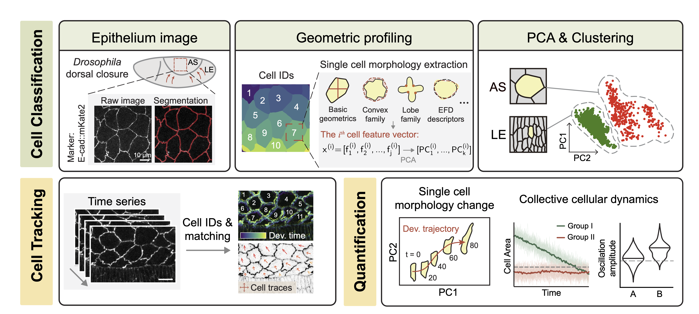
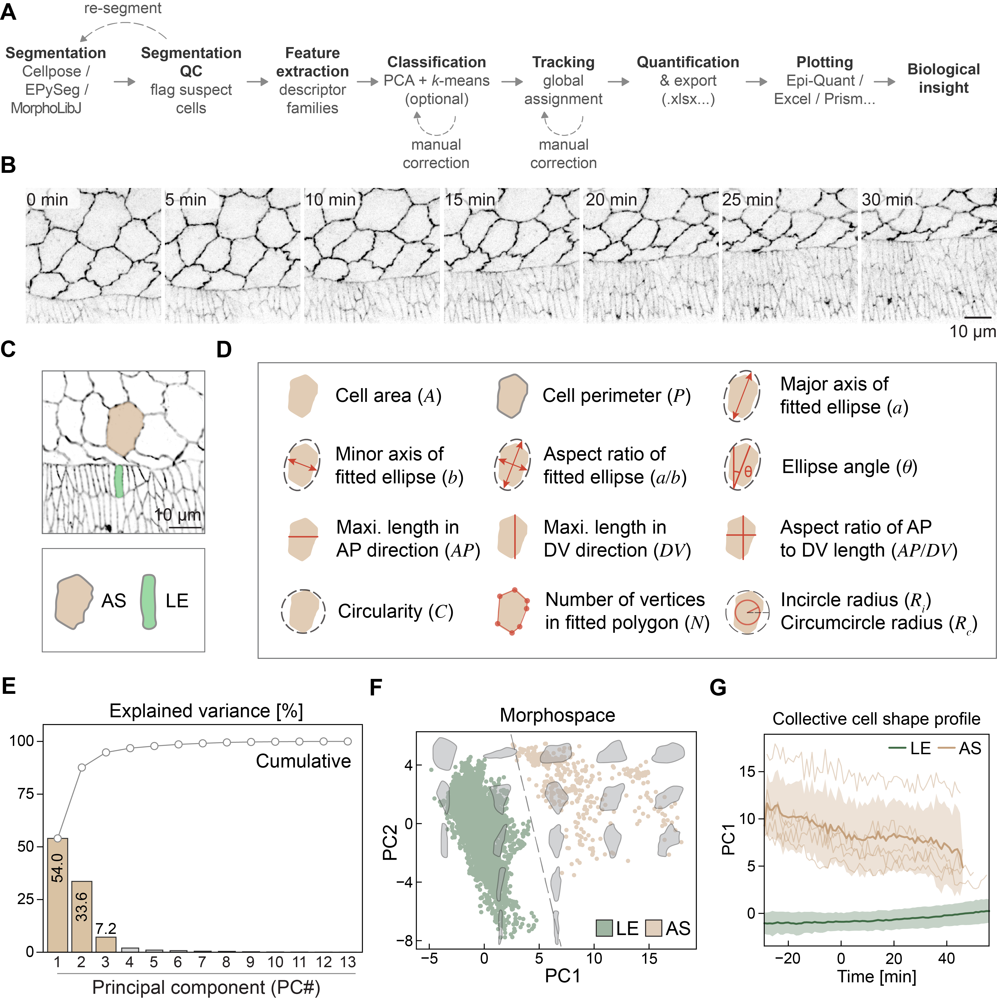
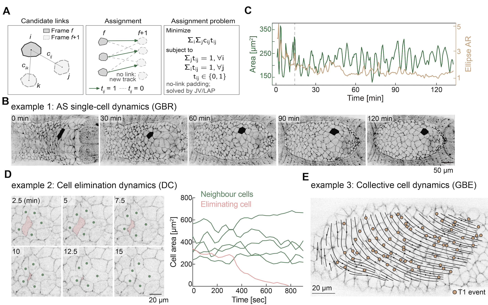
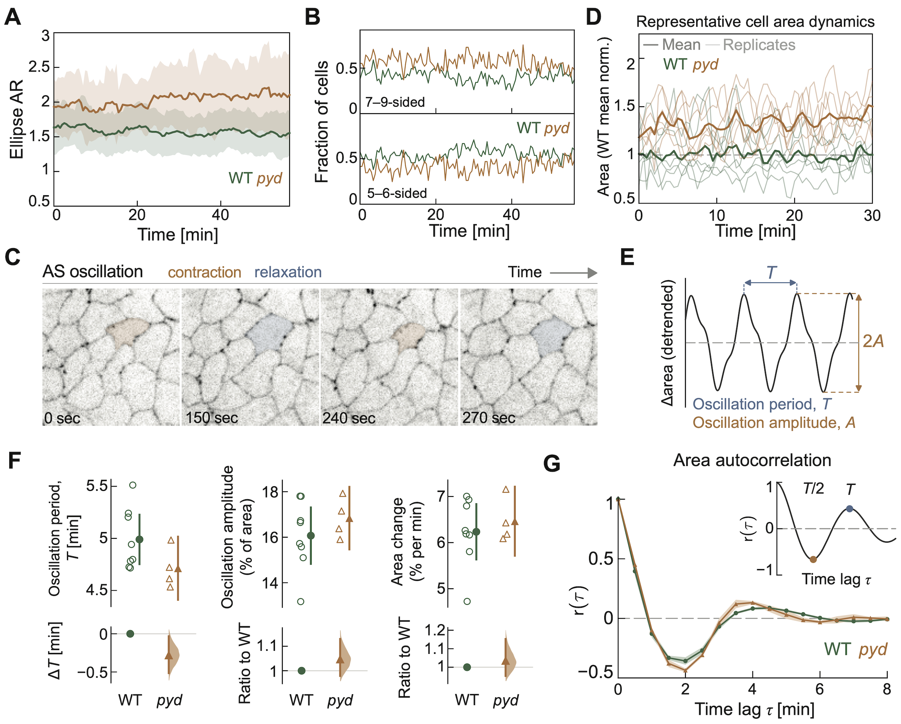
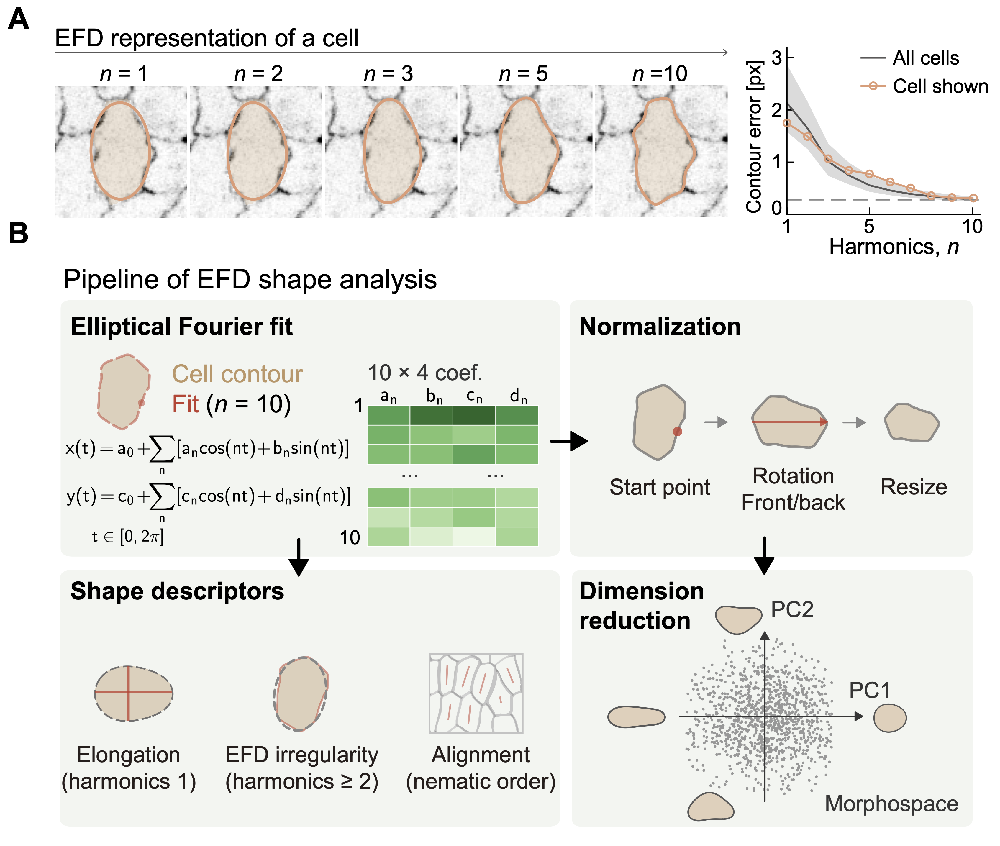

# Epi-Quant

Welcome to Epi-Quant repository🥳


Epi-Quant is a desktop application for measuring cell shape, tracking cells, and exploring cell dynamics in segmented **two-dimensional epithelial images**. It is intended for biologists who have a time series of microscopy images and cell segmentation masks. Classification uses selected geometric features with PCA and k-means; tracking uses frame-to-frame assignment and can be corrected by visual inspection. You can skip classification and go directly from feature extraction to tracking.



## Start here

1. [Install and launch Epi-Quant](#installation).
2. Prepare an `images/` folder and a `masks/` folder as shown under [Input data](#input-data).
3. In **Setup**, select those two folders and a separate output folder, then click **Set Project**.
4. In **Extract Cell Features**, inspect the masks and run **Extract Features**. Continue to **Classify Cells**, or choose **Skip classification, track directly**.
5. Run **Track Cells**, inspect and correct questionable links, then explore trajectories, cell events, and plots.

The [illustrated GUI tutorial](Tutos/Tutos.md) follows each screen and includes practical advice for segmentation and tracking correction. A [PDF version](<Tutos/Epi-Quant%20GUI%20Tutos.pdf>) is also available.

## Installation

Epi-Quant currently runs from the Python source in this repository. The current desktop interface uses [pywebview](https://github.com/r0x0r/pywebview), rather than the older PyQt5 interface in `src/`. Use **Python 3.11** for the steps below; pywebview requires Python 3.10 or newer. A terminal (command line) is needed to install the dependencies and each time you start the app. Linux users should read the desktop-backend note below before launching.

**Open a terminal:** on macOS, open **Terminal** from Applications → Utilities; on Windows, open **PowerShell** from the Start menu; on Linux, open your distribution's **Terminal** application. Download the repository with **Code → Download ZIP** on [GitHub](https://github.com/isintron/Epi-Quant), extract it, and change into the extracted folder in the terminal. If you use Git, the alternative is:

```sh
git clone https://github.com/isintron/Epi-Quant.git
cd Epi-Quant
```

Run the following commands **from the folder containing this README**. Paths containing spaces must be enclosed in quotes when you use `cd`. For example, `cd "/path/to/Epi-Quant"` on macOS/Linux or `cd "C:\path\to\Epi-Quant"` in PowerShell.

### Option A: Conda

Install [Miniconda](https://docs.conda.io/projects/conda/en/latest/user-guide/install/index.html) if needed. On Windows, use **Anaconda Prompt** or a PowerShell session where Conda is initialized. The same commands work on macOS and Linux:

```sh
conda create -n epi-quant python=3.11 -y
conda activate epi-quant
python -m pip install -r v2/webview/requirements.txt
python v2/webview/app.py
```

The packages are installed inside the new environment. When returning later, open a terminal in the repository folder, run `conda activate epi-quant`, then `python v2/webview/app.py`. See the [Conda environment guide](https://docs.conda.io/projects/conda/en/stable/user-guide/tasks/manage-environments.html) if activation is unfamiliar.

### Option B: pip and venv

Install [Python 3.11](https://www.python.org/downloads/) first. On **macOS or Linux**:

```sh
python3.11 -m venv .venv
source .venv/bin/activate
python -m pip install -r v2/webview/requirements.txt
python v2/webview/app.py
```

On **Windows PowerShell**:

```powershell
py -3.11 -m venv .venv
.\.venv\Scripts\Activate.ps1
python -m pip install -r v2/webview/requirements.txt
python v2/webview/app.py
```

If PowerShell blocks activation, use `.\.venv\Scripts\python.exe -m pip install -r v2/webview/requirements.txt` and `.\.venv\Scripts\python.exe v2/webview/app.py` instead. The [Python Packaging User Guide](https://packaging.python.org/en/latest/guides/installing-using-pip-and-virtual-environments/) explains virtual environments in more detail.

On **Linux**, pywebview also needs a desktop backend. After installing the requirements, install either `python -m pip install 'pywebview[gtk]'` or `python -m pip install 'pywebview[qt]'`; consult the [pywebview installation guide](https://github.com/r0x0r/pywebview/blob/master/docs/guide/installation.md) for any system packages your distribution needs. On Windows, pywebview may require the [WebView2 Runtime](https://developer.microsoft.com/en-us/microsoft-edge/webview2/). The app opens as a desktop window; it does not start a web server for your browser.

### Python dependencies

The authoritative Python package list is [`v2/webview/requirements.txt`](v2/webview/requirements.txt): pywebview, NumPy, pandas, OpenCV, Pillow, scikit-learn, SciPy, openpyxl, Matplotlib, and pyefd. The installation command above installs them together. Cellpose, EpySeg, and Tissue Analyzer can supply segmentations, but are **not required** to run Epi-Quant or included in this requirements file. This repository is not currently packaged for `pip install .`.

## Input data

Put one segmentation mask and one microscopy image per frame in separate folders. Keep the frame numbers consistent between them. For example:

```text
my_experiment/
├── images/
│   ├── sample_0000.tif
│   └── sample_0001.tif
└── masks/
    ├── sample_0000_mask.tif
    └── sample_0001_mask.tif
```

- **Masks:** a folder of Cellpose-style `.npy` files, or a folder of `.tif`/`.tiff` instance masks or cell-boundary images (such as EpySeg or Tissue Analyzer exports). Do not mix `.npy` and TIFF masks in the same folder. TIFF masks are converted to `.npy` in `masks/npy_converted/` when needed; that directory is a generated cache, not the original data. In **Extract → Advanced options**, choose **Mask type** if automatic detection mistakes a binary cell-body mask for boundary lines.
- **Images:** `.tif`, `.tiff`, `.jpg`, `.jpeg`, or `.png`. These are used for viewing and intensity-based quality checks. Epi-Quant first tries to match image and mask names, then falls back to frame numbers. Check the pairing in the preview before trusting intensity-based results.
- **Frame naming:** for a time series, number **every** file consistently (`0000`, `0001`, …). If any mask filename has no digits, the importer numbers all frames by sorted position. The last number in a filename is treated as its frame number; avoid unrelated numbers after the frame counter.
- **Scale:** set **Frame interval** (seconds) and **Pixel size** (µm/pixel) in Extract when you know them. Features that need physical units depend on these settings.

Epi-Quant measures two-dimensional cell outlines. For a 3D dataset, first make a biologically justified 2D projection or surface representation and validate the resulting segmentation; the app does not analyze full 3D cell shapes.

### Test dataset

The test dataset is available from the [Dataset release](https://github.com/isintron/Epi-Quant/releases/tag/Dataset). It is distributed separately from the Git repository to avoid making clones unnecessarily large. To try the interface, use the dataset's small, segmented image series in the layout above. Keep the input folders unchanged and choose a separate output folder. The screenshots in the [GUI tutorial](Tutos/Tutos.md) show an example project, but are not themselves analysis inputs.

## What the analysis produces

**Set Project** creates these three folders inside the output folder you select. The original `images/` and `masks/` folders remain where you put them; the output folder does not contain automatic copies of them.

| Folder                            | Typical contents                                                                                                                                                     | Format and purpose                                                                                                                                                                                                                                                       |
| --------------------------------- | -------------------------------------------------------------------------------------------------------------------------------------------------------------------- | ------------------------------------------------------------------------------------------------------------------------------------------------------------------------------------------------------------------------------------------------------------------------ |
| `cell_classification_output/`   | `Cells_info.xlsx`; optional `Cells_shape.xlsx`, `Cells_tissue.xlsx`; `Cells_info_PCA.xlsx`, `cells_clustering_results.xlsx`; settings and provenance files | One row per detected cell for measured features; optional shape/texture descriptors and PCA/clustering results. The PCA/clustering files appear only after classification. Tables are Excel workbooks (`.xlsx`); settings/provenance use JSON.                         |
| `cell_track_output/`            | `all_cell_tracking/all_cell_merged_tracking_results.xlsx`; optional `cell_lineage.xlsx`, `ground_truth_links.csv` and review records                           | The main workbook contains persistent track IDs and frame columns. Lineage and manually reviewed ground truth appear only after their respective operations. Tracking workbooks use `.xlsx`; reviewed links use `.csv`.                                              |
| `quantitative_analysis_output/` | Exported plots, source tables and movies; optional Tissue Analyzer-style track maps                                                                                  | Plot exports use `.png` or `.svg`, with `.xlsx` tables where offered. Movie frames are `.png` files with a `settings.json`; optional track-map export writes TIFF images in per-frame folders. Files appear only when you use the corresponding export action. |

Some operations write additional intermediate files. Keep the three folders together when reopening a project; **Load Existing Results** reads previously generated tables from them. Exported plots and movies are separate from the underlying measurements.

## What Epi-Quant can analyze



From segmented images, Epi-Quant measures cell geometry and classifies cells using selected features, PCA, and k-means. PCA describes shape variation; it is not the method that detects divisions, cell loss, or neighbour exchanges.



Track cells across a time series, inspect suspicious links, and correct identities. The figure illustrates single-cell dynamics, cell elimination, and collective movement.



Plot cell and tissue measurements over time and compare groups using the underlying exported tables.



Optional elliptic Fourier descriptors (EFDs) capture the contour of lobed or puzzle-like cells. See the [20-page illustrated tutorial](Tutos/Tutos.md) for the GUI steps, exports, and keyboard shortcuts.

## License and attribution

Epi-Quant is released under the [MIT License](LICENSE). Parts of the T1/neighbour-exchange logic and lineage conventions were adapted from [TissueMiner](https://github.com/mpicbg-scicomp/tissue_miner), which is distributed under the BSD 3-Clause License. Its copyright notice and full license are retained in [`third_party/tissue_miner_LICENSE`](third_party/tissue_miner_LICENSE); see the attribution in [`v2/topology.py`](v2/topology.py) and [`v2/lineage.py`](v2/lineage.py). Please also cite [Etournay et al., *eLife* (2016)](https://doi.org/10.7554/eLife.14334) when using the TissueMiner-derived approach.

For questions or bug reports, open a [GitHub issue](https://github.com/isintron/Epi-Quant/issues) with the operating system, Python version, mask format, and the step at which the problem occurred. Do not upload unpublished microscopy data unless you intend to share it publicly.
