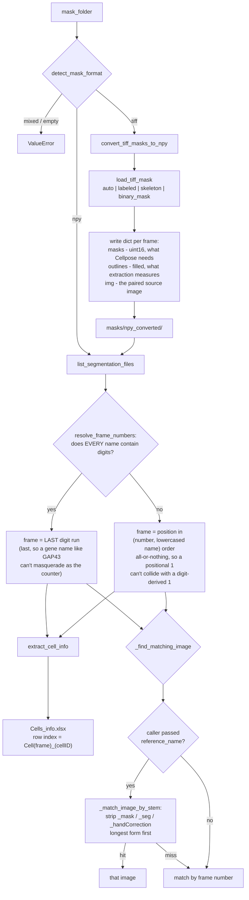

# Epi-Quant v2 — backend logic extraction

This is a prep step for rebuilding Epi-Quant's frontend on pywebview. The
modules here pull the pure quantitative-analysis logic out of `src/`'s
PyQt5 windows into plain, independently-debuggable Python functions with
explicit inputs/outputs — no `self.*` state, no `config.py` globals. `src/`
is untouched and keeps working exactly as before; nothing here is wired up
to a UI yet.

Run modules directly with `v2/` as the working directory (or on
`PYTHONPATH`), the same way `src/`'s `gui_*.py` files already expect sibling
imports to resolve — e.g.:

```bash
cd v2
python data_input.py --mask-folder /path/to/masks --output /path/to/out
```

## How `data_input.py` resolves a folder into frames

Two questions decide everything downstream: *which files are frames*, and
*which image belongs to each frame*. Both are answered here, once, so nothing
later can disagree.



Two rules are worth keeping in mind when adding a dataset:

- **Frame numbering is all-or-nothing.** Digits win only if *every* filename
  in the folder has them. Add one digit-less file to a numbered folder and the
  whole folder renumbers positionally — deliberate (it prevents silent
  collisions) but surprising if unexpected.
- **Name beats position for image pairing.** Sorted order can disagree between
  the mask and image folders, so the stem match runs first and position is
  only the fallback. `Demo_Seg_QC` is the case that proves it: its masks sort
  `Demo_OE_mask`, `Demo_WT_handCorrection_mask`, `Demo_WT_mask` while its
  images sort `Demo_OE`, `Demo_WT`, `Demo_WT_handCorrection`, so pure position
  hands frames 2 and 3 each other's image.

## Extraction performance: 12x, byte-identical (2026-08-18)

Groundwork for the convoluted-shape descriptors (below), but useful on its own
and independently verified. `extract_cell_info` got 12x faster overall with
**identical output**, via three changes. It also answers reviewer 2's point 5
about whether the pipeline scales to datasets of a few thousand cells: the two
worst offenders were both O(n_cells x frame_area), so cost grew with frame size
even when cell count did not.

Profiled on `AS_dorsal view_E-cad` before any change:

| per-cell work | share of extraction time |
| --- | --- |
| `np.where(outlines == cell_id)` over the **whole frame** | 55.8% |
| `cv2.distanceTransform` over the **whole frame** | 35.4% |
| everything else | 8.8% |

1. **Bounding boxes.** `ndimage.find_objects` gives each cell's bbox once per
   frame; the per-cell `np.where`, `fillPoly`, `findContours` and
   `distanceTransform` now run on that window instead of the full array. Area,
   arc length, vertex count and both radii are translation-invariant, so
   cropping cannot change them; the columns that *are* absolute (centroid,
   left/right boundary, the edge-cell test) get the window offset added back.
2. **`_BBOX_MARGIN = 8`.** `cv2.distanceTransform` measures distance to the
   nearest zero pixel, so a crop tight to the cell leaves its edge pixels with
   no zero to measure from. Measured: margin 0 corrupts the Inscribed Circle
   Radius of **260/2822** cells (saturated distance overflows the `int()` cast,
   max error 65532); margin 1 already reproduces the full-frame result exactly.
   8 is cheap headroom -- the cost scales with the bbox, not the frame. The
   margin is *not* about the 5x5 chamfer mask width, which was the initial
   (wrong) guess.
3. **Row accumulation.** The old loop built a one-row DataFrame per cell and
   `pd.concat`-ed it onto an accumulator -- quadratic, and after (1) it was
   ~60% of what remained (cProfile). Rows are now collected as lists and the
   DataFrame is built once.

| dataset | cells | before | after | speedup |
| --- | --- | --- | --- | --- |
| `AS_dorsal view_E-cad` | 2822 | 12.57s | 0.65s | **19.4x** |
| `AS_LE_lateral view_E-cad` | 9920 | 7.61s | 1.01s | 7.5x |
| `pupae_E-cad` | 1213 | 4.72s | 0.08s | **60.7x** |
| `embryos_GBE_GAP43` | 7474 | 5.29s | 0.81s | 6.5x |
| `Demo_Seg_QC` | 211 | 0.11s | 0.04s | 3.1x |
| `cp_dataset_puzzle-like_cells` | 2354 | 2.53s | 0.16s | 16.1x |
| **total** | 24k | **32.8s** | **2.74s** | **12.0x** |

**Verification.** Every value in all six tables is unchanged, and each written
`Cells_info.xlsx` round-trips identically. Full `track_cells` output on
`AS_dorsal view_E-cad` is identical including dtypes (captured via `git stash`
so the comparison is against genuinely unmodified code).

**One intentional difference:** `cells_info` now has `float64` columns where it
previously had `object`. The old dtype was an artifact of concatenating onto an
empty `pd.DataFrame(columns=...)`, and it forced Python-level arithmetic
everywhere downstream. Values are equal and the Excel file is unchanged --
confirmed by round-tripping both through `to_excel`/`read_excel` and comparing
*with* dtype checking, since Excel stores numbers either way.

### `tracking_only` extraction mode

`extract_cell_info(..., tracking_only=True)` computes only the four columns
`cell_tracking.build_cost_matrix` actually reads -- `Maximum Horizontal/Vertical
Length` (its displacement gate) and `Center X/Y Coordinate` (the only nonzero
entries in `DEFAULT_TRACKING_WEIGHTS`) -- leaving the other 14 `NaN`. The column
set and order are unchanged, because several modules map columns positionally.
A further 2.1-2.7x on top of the above, and the four columns are identical to a
full extract.

**This surfaced a real bug in `build_cost_matrix`.** It summed
`weights[k] * (info2[k] - info1[k]) ** 2` over every column, and `0 * np.nan`
is `np.nan` -- so a zero weight did **not** mean "ignore", and a single
unpopulated column turned every cost into `NaN`, after which
`linear_sum_assignment` rejected the whole matrix. Zero-weight columns are now
skipped up front. Results for a fully-populated table are unchanged (the
skipped terms contributed exactly 0, verified end-to-end above), and it also
removes 14 of 18 multiplications from an O(n^2) Python loop.

## Coordinate-outline input + the Vofely puzzle-cell benchmark (2026-08-18)

Reviewer 2 asked for descriptors suited to "more convolve and complex cell
shape (e.g. puzzle like cells)". `test_data/cp_dataset_puzzle-like_cells`
turned out to contain **no puzzle-like cells at all** -- rendering all 12 masks
and measuring gives a median solidity of 0.93-0.98 per image (real Arabidopsis
pavement cells sit at 0.55-0.85); it is the Cellpose generalist grab-bag
(spheroid nuclei, bacteria, PlantSeg ovules/root, CoNIC histology nuclei).

The benchmark is now **Vofely et al. 2019, *New Phytologist***, Dryad
`10.5061/dryad.g4q6pv3`, in `test_data/Vofeley_Dryad_dataset`: 11,346
hand-traced cell outlines across 278 taxa, **solidity 0.512-0.968**. Only
`CellCoordinates.zip` (19.6 MB) is needed; the 5.9 GB `CellImages.zip` is not,
so there are no images -- visual checks render the outlines themselves.

`load_outline_coordinates` + `convert_outline_coords_to_npy` import it. Four
things about that deposit are load-bearing and were established by surveying it
rather than by reading its README alone:

- **Two file formats.** 6,235 files have no header and space-separated floats;
  5,111 carry an `x\ty` header and tab-separated integers; one is a README.
- **Two layouts.** The numeric-named files are each centred on their own
  centroid and carry no spatial relationship; the `gp`/`JH` files are in shared
  image-pixel coordinates. `_coords_share_a_frame` distinguishes them by
  comparing centroid spread against typical cell size. Only the second kind
  could support neighbour/tissue analyses -- but see the overlap caveat below.
- **Leaf side must come from `SampleTable.csv`, never the filename.** The
  deposit's own README warns its numeric side field is inconsistent. Parsing it
  from filenames gave r = 0.9346 against the published table; the correct join
  gives 0.9999.
- **Traced outlines are not a segmentation and can overlap.** Nothing forced
  the tracer to keep them disjoint, and a label image cannot put one pixel in
  two cells, so painting them in sequence lets each cell silently erase parts
  of its predecessors. Measured overlap as a fraction of total cell area:
  `gp15-043` 0.0%, `gp15-046` 14.9%, the puzzle-like fern `gp17-003` **25.2%,
  stacking up to 5 deep**. The converter therefore measures overlap and falls
  back to grid tiling (with a logged warning) above
  `max_overlap_fraction=0.01`, so no cell is ever truncated.

**Rasterization scale.** `px_per_unit` must not go below 1.0: against solidity
computed directly from the float coordinates, 1.0 and 2.0 px/unit reproduce it
exactly (bias 0.0000, max error 0.0000, r = 1.00000 over 441 cells) while 0.5
px/unit biases by -0.0056 with errors to 0.031. No cell fragments at any tested
scale; rasterized area converges as expected (2.73% -> 0.34% over 1 -> 8
px/unit, the usual O(perimeter/area) boundary term).

**End-to-end external validation.** Raw `.txt` -> `.npy` -> `masks` ->
solidity, against the authors' published `Table S1` per-species means, over 12
samples spanning the full range: **r = 1.0000, bias +0.0001, max error
0.0004**. Over all 336 matched species x side using the float coordinates
directly: r = 0.9999, 99.7% within 0.02. This is external published ground
truth, which matters because neither reference implementation's code may be
copied (below).

### Why the existing geometry cannot be reused for these cells

`extract_cell_info` never reads `dat['masks']`. It takes
`np.where(outlines == id)` -- **scanline order** -- and passes it straight to
`cv2.fillPoly`, which bridges across every concavity. On near-convex cells this
is invisible; on lobed cells it is catastrophic. Measured on the converted
Vofely data:

| group | solidity | median area error | median perimeter error |
| --- | --- | --- | --- |
| `gp15-043` Tabernaemontana | 0.97 | **+0.04%** | -0.31% |
| `gp17-003` Adiantum fern | 0.53 | **+67%** (max +617%) | -9% |

Rendered side by side, the fern's interdigitating lobes collapse into a solid
slab. **So all new shape descriptors must derive their contour from
`dat['masks']`, not from the fillPoly reconstruction.**

This does **not** affect the manuscript: on `AS_dorsal view_E-cad` the median
area error is +0.05% (p95 +2.31%) and perimeter -0.38%, with
`AS_LE_lateral view_E-cad` and `pupae_E-cad` similar -- those cells sit at
solidity 0.91-0.93, where the bias vanishes. Nothing needs re-running.

### Licensing of the reference implementations

Neither may be copied, so the descriptors are implemented from the **published
method descriptions** (algorithms are citable; only their expression is
copyrighted) and no code from either project is used:

| tool | licence | consequence |
| --- | --- | --- |
| **PaCeQuant** (in MiToBo) | GPL-3.0 | copying would force Epi-Quant to GPL-3 |
| **LobeFinder** (`George-wu509/LobeFinder`) | **no licence file** (verified via the GitHub API; the repo is one `.m` file) | all rights reserved by default -- copying not permitted at all |

Correctness is therefore established by (i) synthetic shapes with analytically
known lobe counts, (ii) two independent estimators asserted to agree, and
(iii) the published-ground-truth comparison above, which is the one that
actually settles it and needs no third-party code.

## `shape_features.py` -- descriptors for convoluted cells (2026-08-18)

Reviewer 2's main request. Per-cell descriptors in three families, all
dimensionless or explicitly scale-normalized: convex hull (solidity, convexity,
shape index), hull deviation (lobe count, max concavity depth, mean neck
width), and elliptic Fourier (elongation, sin/cos 2psi, irregularity, plus
optional raw coefficients). Cost is 0.29-0.50 ms/cell -- roughly 10% of what
extraction itself costs even after the 12x speedup above.

Everything reads its contour from `dat['masks']`; nothing reuses
`extract_cell_info`'s fillPoly reconstruction, for the reason measured earlier
(median +67% area error on genuinely lobed cells).

**Validation** is against external published ground truth, not self-consistency
-- which matters, because neither reference implementation's code may be
copied (PaCeQuant is GPL-3.0, LobeFinder has no licence at all). Our per-species
mean solidity vs the Vofely `Table S1` values, 16 samples spanning 0.51-0.97:
**r = 1.00000, bias +0.0001, max error 0.00035**. Three further descriptors
track published solidity from completely independent mathematics: max concavity
depth r = -0.974, EFD irregularity r = -0.941, lobe count r = -0.888. Synthetic
k-lobed shapes recover k exactly for k in 4/5/6/8 at amplitudes 0.20 and 0.45,
and two independent estimators (hull deviation vs curvature sign runs) are
asserted to agree on every one.

### Three findings that changed the design

**1. Curvature-derived scalars are not shippable.** The first version also
emitted a curvature-based lobe count, concave fraction, bending energy and
curvature standard deviation. They are exact on synthetics, but recomputing on
`AS_dorsal view_E-cad` at smoothing sigma = 0.01/0.02/0.04/0.08 of the contour
moved them by **70-100%** -- the median cell reported 10, then 5, then 2, then 0
lobes -- while every hull- and Fourier-derived descriptor moved by **0.0%**.
Curvature is a second derivative, so it amplifies the pixel-scale waviness of a
segmented boundary; sweeping a curvature-magnitude cutoff from 0.0 to 0.5 left
the instability untouched while the synthetics stayed exact, so no threshold
rescues it. Feeding features like that into PCA is precisely the failure this
work exists to fix, so they are not emitted. `Lobe Count` is the hull-deviation
count instead -- which is also what LobeFinder's published method actually uses.
The curvature code is kept, used by the self-test as an independent cross-check.

**2. Perimeter needs a better estimator than `cv2.arcLength`, and the obvious
correction is wrong.** Summing a pixel chain overestimates arc length. Measured
against exact perimeters on rasterized circles (r=30..200), axis-aligned
squares, those squares rotated 30 degrees, and 6/8-lobed cells:

| estimator | mean \|err\| | max \|err\| |
| --- | --- | --- |
| raw `cv2.arcLength` | 4.42% | 7.29% |
| Kulpa x0.9481 | 1.64% | 5.19% |
| Vossepoel-Smeulders | 0.74% | 2.15% |
| resample @2px | 0.80% | 1.63% |
| **resample @3px (chosen)** | **0.31%** | **0.70%** |

Kulpa's constant is tempting because `arcLength` is a near-uniform +5.5% on
curved boundaries -- but an axis-aligned square has no staircase and is already
exact, so the correction makes it 5.2% *too short*. Resampling at a fixed
arc-length spacing has no such blind spot. This is not cosmetic: the shape index
is compared against the rigidity threshold p* ~ 3.81 of Bi et al., and the raw
estimator reports a perfect circle as 3.743 instead of 3.545 -- enough to move
solid-like tissue across that threshold. Note this makes `Shape Index` here
*more accurate than*, and so not directly comparable with, the existing
`Circularity` column in `Cells_info.xlsx`, which still uses raw `arcLength`.

**3. `cv2.convexityDefects` fails on real cells.** It requires the hull's vertex
indices to be monotonic along the contour and raises otherwise. A cell with a
one-pixel neck is traced out-and-back, so the same coordinate appears twice at
non-adjacent positions and the ordering becomes ambiguous -- it happened on 4 of
2822 cells in `AS_dorsal view_E-cad`, and deduplicating points does not fix it
because the repeats are not adjacent. Replaced with `hull_deviation`, a
vectorized point-to-segment distance from each contour point to the hull, which
needs no ordering and so cannot fail that way. It also yields depth and count
from one computation, and is closer to LobeFinder's stated convex-hull concept.
Zero NaNs remain in the hull-derived columns on all test datasets.

**Output goes to a separate `Cells_shape.xlsx`** (sheet `Shape`), joined to
`Cells_info.xlsx` on `Cell Index` -- verified to join 1:1 on every dataset --
rather than as extra columns, because `common.save_modified_rows` maps DataFrame
column position to Excel column position and would write into the wrong columns
of an existing file if the schema grew. EFD coefficient columns are named
`efd_{h}_{c}`, the exact convention
`figures/Epiquant_ShapeAnalysis_allMutants.ipynb` uses, so that notebook can
read our output unmodified as a second implementation to check against.

Failures are `NaN`, never `-1`: `segmentation_qc.measurement_failures` scans
named columns for `-1` and `extract_cell_info`'s own check is column-blind, so
reusing `-1` would make an unmeasurable cell indistinguishable from a real
measurement failure. The only NaNs observed are cells whose contour is shorter
than `2*order+1` points, which genuinely cannot support an order-10 transform.

## `tissue_features.py` -- local tissue texture (2026-08-18)

The second half of reviewer 2's point 4 ("Could they also implement local
tissue texture parameters?"). Per cell, over its 1-ring: neighbour count, local
hexagonal fraction, local nematic order `S = |<exp(2i psi)>|`, local mean shape
index and solidity, local density, plus a per-frame neighbour-count entropy.
Joins to `Cells_info.xlsx` and `Cells_shape.xlsx` on `Cell Index` -- verified
1:1 on all four datasets. Cost 0.06-0.77 ms/cell. Fills the
the packing/neighbour-count analyses the manuscript's Fig. 5G / 6B need.

Three decisions that measurement forced:

**1. Adjacency is edge-based, not dilation-based.**
`adjacency.build_neighbor_graph` dilates each cell and sees what it reaches,
which cannot distinguish "shares a wall" from "meets at a corner". On a
synthetic square lattice it reports **8** neighbours per cell instead of 4,
because the four diagonal cells touch at the vertex. That is not academic here:
square packing is exactly what Tamada & Zallen (2015) describe in the Drosophila
presumptive pharynx, and detecting such arrangements is the point of these
descriptors. `build_interface_graph` counts shared border pixels via
`segmentation_qc._interface_pixels` and gets both lattices right -- hex 6,
square 4.

Gaps must be closed first: `pupae_E-cad` has **0** raw interfaces (no two of its
826 cells touch), and `_bridge_gaps` recovers 2341. Bridging was checked not to
create corner adjacencies -- both lattices stay correct with it applied at every
threshold from 1 to 8 px. The minimum interface is **2 px**, deliberately *not*
`segmentation_qc.suggest_min_interface_px`: that returns 14-40 px here because
it is tuned for scoring individual junctions in the QC overlay, and applying it
to topology discards real walls, driving the median neighbour count from 6 to 4
on all three datasets tested.

**2. "Border cell" has to mean the tissue's edge, not just the image's.**
`segmentation_qc.neighbor_count_deviation` excludes only frame-edge cells, which
is right for its purpose and useless here: `AS_dorsal view_E-cad` is 70.7%
background and `pupae_E-cad` 67.6%, and **not one cell in either touches the
frame**, so that rule excluded nothing while 119 of 145 AS cells sat on the
tissue rim. The symptom was a mean neighbour count of 5.24 where Euler's theorem
puts a 2D packing at ~6. Background adjacency must also be measured *after*
gap-closing, or it catches everything -- before bridging, all 826 `pupae` cells
are within a few pixels of "background" because the inter-cell gaps are
background too.

With both rules, interior mean neighbour count is 5.98 / 5.92 / 5.69 / 5.94 on
`AS_dorsal` / `pupae` / `embryos_GBE_GAP43` / `Demo_Seg_QC`, **median exactly 6
on all four** -- which is the check that the topology is right.

**3. Neighbour-count entropy is per frame, not per cell.** A 1-ring holds 6-7
cells and the entropy of a 6-sample categorical distribution is mostly sampling
noise; as a per-cell column it would enter PCA looking like a tissue-order
readout while carrying almost none. It is computed over all non-border cells of
a frame and broadcast, named `Frame Neighbor Entropy` so it cannot be mistaken
for a per-cell quantity.

Orientation `psi` comes from `shape_features`' `Sin2Theta`/`Cos2Theta`, never
from `Cells_info.xlsx`'s `Fitted Ellipse Angle` -- that column is stored folded,
so cells drawn 40 degrees apart can share a value (70 and 110 degrees both store
20.0), and averaging directions from it would be meaningless. `S` itself is
invariant to any global rotation or sign convention, so it does not depend on
how the imaging frame was oriented; the per-cell sin/cos pair does, which is why
the convention is fixed and tested.

Self-test covers: hex lattice -> 6 neighbours, square -> 4, perfect lattice more
ordered than a jittered one, aligned field `S`=1 vs isotropic `S`<0.15, the
director convention (`psi` and `psi+pi` identical), rotation invariance, and an
inset tissue that never touches the frame (the case that exposed finding 2).

## `pca_kmeans.py` -- feature presets and feature-space repair (2026-08-18)

`compute_pca` gains `standardize_mode`, `prune_correlation` and
`sign_convention`; the module gains `FEATURE_PRESETS`, `efd_preset`,
`standardize`, `prune_correlated` and `plot_shape_modes`. **Every new argument
defaults to v1's behaviour**, verified: `Cells_info_PCA.xlsx` and the K-means
labels are identical on `AS_dorsal view_E-cad`, `embryos_GBE_GAP43` and
`cp_dataset_puzzle-like_cells`.

Feature selection lives in the additive `FEATURE_FAMILIES` (see "New features"
above). Two named lists sit outside that scheme and are not families:
`legacy_13` (**since retired** -- see the column-deletion section below), which reproduced v1's exact PCA input and was asserted identical to
`data_input.ML_FEATURE_COLUMNS`, and `tracking_only`, the four columns
`cell_tracking.build_cost_matrix` reads. No family or list contains `P-Value` -- it is
`4*pi/circularity**2`, a monotone function of `Circularity`, which is itself a
monotone function of `Shape Index`: the same quantity three times. (The column
stays in the schema for now; removing it shifts every later column's position
and `common.save_modified_rows` writes Excel by position.)

### What worked, and what did not

The plan proposed correlation pruning **and** per-frame standardization as fixes
for the size-dominated PC1. Measured on `cp_dataset_puzzle-like_cells`, they fix
**different problems**, and only one of them addresses size at all.

**Correlation pruning barely dents size dominance.** The 8 size proxies
correlate at r = 0.88-0.94, so a 0.95 threshold mostly keeps them:

| threshold | features kept | PC1 size share |
| --- | --- | --- |
| (none) | 13 | 85.5% |
| r > 0.99 | 12 | 83.6% |
| r > 0.95 | 10 | 77.9% |
| r > 0.90 | 8 | 66.7% |
| r > 0.85 | 6 | 36.7% |

It only bites at 0.85, by which point it has discarded 7 of 13 features. Pruning
is still worth having for genuine duplicates, but it is the wrong instrument
here.

**Per-frame standardization does not touch size dominance either** -- but it
does exactly what it was actually for, which is the *between-image* confound.
Measured as the share of PC1's variance explained by image identity:

| feature set | global | per-frame |
| --- | --- | --- |
| v1's 13 features | 0.601 | **0.000** |
| a ratio-only set | 0.180 | **0.000** |

**The direct fix for size dominance is dimensionless features.** PC1's size
share: v1's 13 features 85.5%, the same 13 with pruning at 0.95 77.9%, a
ratio-only set **0.0%** (top loadings Shape Index 16%, Solidity 13%,
Elongation 13%), a lobing-only set **0.0%** (Solidity 21%, Max Concavity
Depth 19%, EFD Irregularity 15%). Every column in today's `hull` and `lobe`
families is dimensionless by construction, so both land in that regime.

So the three controls are not substitutes: **dimensionless features** for size
dominance, **per-frame standardization** for the image confound, **pruning** for
literal duplicates.

### `plot_shape_modes`

Writes `PCA_Shape_Modes.png`: the reconstructed cell outline at the 10th/30th/
50th/70th/90th percentile along each of the first components of EFD shape
space, against the mean shape. A port of `plot_modes`/`contour_of` from
`figures/Epiquant_ShapeAnalysis_allMutants.ipynb`, and the reason the EFD route
is worth having -- a component becomes a visible shape change rather than a
percentage. On `AS_dorsal view_E-cad`: PC1 63.7% is elongation, PC2 10.0% a
dorsoventral taper, PC3 8.9% a pear-shaped asymmetry.

It fits PCA **without standardizing**, per `standardize`'s `"none"` mode and the
collaborator's documented reason. `sign_convention` is on there because PCA
signs are otherwise arbitrary and the panels would flip between runs.

### The manuscript's shape parameter `p`

`shape_features`' `Shape Index` **is** the manuscript's Fig. 5D/E/F shape
parameter `p = P/sqrt(A)`. There is no separate module for it any more --
`gap_analysis/shape_parameter.py` was deleted, since a second implementation of
one division is a liability rather than an asset. Note `p` is read against Bi et
al.'s rigidity threshold p* ~ 3.81, so the perimeter estimator matters: the old
raw-`arcLength` route reported a perfect circle as 3.743 instead of 3.545.

## API wiring for the new descriptors (2026-08-18)

`webview/api.py` gains `start_shape_extraction` / `_run_shape_extraction`
(threaded, `onShapeExtractDone` / `onShapeExtractError`, progress stage
`"shape"`), `get_shape_feature_summary`, `load_existing_shape_features`,
`get_feature_options`, `has_efd_coefficients`, and `feature_families` /
`selected_features` / `prune_correlation` / `dataset_mode` on
`run_classification`. `get_existing_results` reports `shape` and `tissue`.
Shape extraction is **opt-in**: a user who only tracks never needs it.

**Families are additive, and the selection dictates the scaler in Python.**
`pca_kmeans.FEATURE_FAMILIES` holds each family and `family_columns()` unions
them on top of the always-on `basic` base; `_feature_frame` returns the matrix
and its standardize mode together, so the `efd` family cannot be run through
`StandardScaler` no matter what the frontend sends, and it refuses to combine
with any other family. The JS mock mirrors both rules, but the backend is the
authority -- a UI that *can* get this wrong eventually will.

**`ready` must mean "every column present", not "any".** A first version marked
a family ready when its filtered column list was non-empty. That reported a
mixed family as ready on a project with no shape table, because some of its
columns come from `Cells_info.xlsx` -- so the UI would enable it and the run
would then fail. Now verified both ways: every family reported ready runs
successfully, and every family reported not-ready names exactly what it is
missing.

Missing columns raise a readable `ValueError` naming them and pointing at the
shape step, rather than surfacing as a bare pandas `KeyError`; `load_cells_info`
reads whatever Excel exists, so a legacy project hitting a shape-dependent
preset was the realistic path to that.

**`dataset_mode`** answers the pooling question. `"time_series"` (default, v1's
behaviour) pools every frame -- correct for a movie of one specimen and required
if the result will be tracked. `"independent_samples"` runs PCA and K-means per
frame, for folders of unrelated images where pooling makes the leading component
partly "which image is this" (measured: image identity explains 0.601 of PC1's
variance on `cp_dataset_puzzle-like_cells`). Cluster labels are then per-frame,
so `cluster_1` in one image is unrelated to `cluster_1` in another -- documented
on the method, because the colour legend cannot express that.

**Verified** via the headless harness, which now takes `--shape`:

```
python3 v2/webview/api.py --mask-folder "test_data/AS_dorsal view_E-cad/masks" \
  --image-folder "test_data/AS_dorsal view_E-cad/images" \
  --output-dir /tmp/epiq_smoke --classify --shape --n-clusters 2
```

On `AS_dorsal view_E-cad` every family combination runs — `basic` 8 features /
global, `basic+hull` 11, `basic+lobe` 12, `basic+tissue` 13 (1780 of 2824 cells;
border cells have no neighbour count by construction), `basic+hull+lobe` 15,
`basic+hull+lobe+tissue` 20, and `efd` 40 / **none** — EFD refuses to combine
with another family, `independent_samples` runs, an unknown family is rejected
by name, and leading edge, tracking and every overlay still run afterwards.

`NaN`/`inf` are converted to `null` before crossing the bridge: `json.dumps`
emits bare `NaN`, which `JSON.parse` rejects, and the tissue table legitimately
contains NaN for border cells.

## ⚠️ FIXED: degenerate ellipse fits made extraction non-deterministic (2026-08-18)

**This changes numbers on manuscript datasets** -- see the impact table below.
Fixed with the user's explicit approval.

Surfaced while regression-testing the work above, and **pre-existing** --
confirmed by `git stash`-ing every change and reproducing it on the original
code.

**Symptom.** `extract_cell_info` was not reproducible. Four consecutive runs
over `cp_dataset_puzzle-like_cells` in one process gave different tables,
always differing on `Cell1564_255`, a **6-pixel** cell whose major axis came
back 7.48 on one run and 15.11 on the next. `cv2.fitEllipse` on a point set
that small is numerically degenerate.

**The real damage was to the feature, not the reproducibility.** When the minor
axis was *exactly* 0 the old `!= 0` guard caught it and wrote the `-1`
sentinel; a tiny nonzero axis slipped straight through and made
`Ellipse Major/Minor Axis Ratio` enormous -- 5443 on `AS_LE_lateral view_E-cad`
against a median of 3.15, 13421 on the puzzle set. One such value inflated that
column's standard deviation to 54.65, so after `StandardScaler` **99% of cells
were compressed into z = [-0.055, 0.134]** while the artifact sat at z = 99.5.
Real elongation variation (median 3.15, p99 10.14) was squeezed into a fifth of
a standard deviation, leaving PCA almost nothing from an axis that carries 93%
of PC3's loading -- all because of a handful of 1-6 pixel objects.

**Fix.** `_MIN_ELLIPSE_AXIS_PX = 2.0`: a fit whose smaller semi-axis is below
that falls through to the same `-1` sentinel a failed fit already used. The
threshold was chosen by sweeping it against determinism over all six datasets,
five interleaved runs each -- 1.0 px left `AS_LE_lateral` still flaky (its
`Cell71_124`, a 5-px 2-vertex line of pixels, measured 1.00 on one run and 1.01
on the next, straddling the cut), 1.5 px was already enough, 2.0 px buys margin
for four more cells out of 23,994. The 1st percentile of genuine minor axes is
7-12 px, so nothing real is near it.

**Impact** (all six datasets now identical across 8 interleaved runs):

| dataset | cells changed | ratio max | ratio SD | elongation z-range (99%) | cluster changes |
| --- | --- | --- | --- | --- | --- |
| `AS_dorsal view_E-cad` | 2 / 2822 (0.07%) | 9.95 → 9.95 | 1.08 → 1.08 | 7.60 → 7.58 | 7 (0.25%) |
| `AS_LE_lateral view_E-cad` | 4 / 9920 (0.04%) | **5443 → 19.79** | **54.65 → 1.85** | **0.19 → 5.54** | 10 (0.10%) |
| `pupae_E-cad` | 1 / 1213 (0.08%) | 6.27 → 6.27 | 0.64 → 0.64 | — | — |
| `embryos_GBE_GAP43` | 0 | 5.29 → 5.29 | unchanged | — | — |
| `Demo_Seg_QC` | 0 | 8.63 → 8.63 | unchanged | — | — |
| `cp_dataset_puzzle-like_cells` | 3 / 2354 (0.13%) | **13421 → 9.73** | **276.59 → 0.85** | **0.02 → 6.53** | 14 (0.59%) |

Every changed cell has an area of 5-26 px. The elongation feature's usable
z-range recovers 29x on `AS_LE_lateral` and 326x on the puzzle set; PC3 rises
from 7.8% to 11.1% on the latter as that axis stops being an artifact.
`AS_dorsal` barely moves because it had no tiny-nonzero fits -- which is the
check that the fix is targeted rather than broad.

**For the manuscript:** classification changes by 0.10-0.25% of cells on the two
dorsal-closure datasets. That is unlikely to disturb the reported ~100%
AS/LE accuracy, but anything quoting exact per-cluster counts should be re-run.
This is independent of, and additional to, the `_merge_tracking_pairs`
cell-loss re-benchmark already outstanding in `CLAUDE.local.md`.

## Frontend for the new descriptors (2026-08-18)

Two additions, no new pipeline step -- shape extraction belongs to Extract and
feature selection to Classify.

**Extract** gains a `#shape-descriptors` sub-panel, hidden until extraction
finishes: checkboxes for local tissue texture and raw EFD coefficients, an
`<details>` for EFD order / contour points / smoothing, a Compute button, and a
median summary table per descriptor. It is opt-in and says so -- a user going
straight to tracking never needs it.

**Classify** gains a feature-mode `<select>`, a checkbox group for the chosen
preset, a dataset-mode radio pair, an "Advanced" `<details>` for correlation
pruning, and a line under the status reporting what actually went in
(`"7 features (convolution, global), 2822 cells, all frames pooled."`).

Three behaviours worth knowing:

- **Modes the project cannot run are disabled in the dropdown**, labelled
  "— run shape descriptors first", and the select falls back to `geometric`.
  This is the same all-columns-present rule the backend uses, so anything
  selectable will actually run.
- **Selecting EFD replaces the checkbox group** with an explanation rather than
  offering coefficients individually, and the note reads "no standardization".
  The backend enforces both regardless of what the frontend sends.
- **`populateFeatureOptions()` runs on every entry to Classify**, from
  `goToStep`, not once. A user can run shape extraction *after* first visiting
  Classify, and a cached list would leave the new modes greyed out;
  `onShapeExtractDone` also refreshes it.

**Verified by driving the dev-mode mock in a real browser** (`python3 -m
http.server` in `frontend/`, then scripted clicks):

| checked | result |
| --- | --- |
| before shape extraction | `geometric` enabled, the other four **disabled**, auto-selected `geometric`, checkboxes populated |
| after shape extraction | all five enabled; summary tables rendered (2 tables, 5 rows) |
| switch to EFD | checkbox group replaced by the explanation, note = "no standardization" |
| switch back to convolution | checkboxes repopulate |
| dataset-mode radio | note switches to the per-image warning |
| run classification | status + `"2 features (convolution, global), 500 cells, each image clustered on its own — cluster_1 in one image is unrelated to cluster_1 in another."` |

The mock in `frontend/api.js` mirrors the backend contract, including the
mode-dictates-the-scaler rule, so this path exercises the real wiring rather
than a stub that always succeeds.

**Not yet click-tested in the real pywebview window** -- the dev browser cannot
run the actual pipeline. That is the one remaining gap for this work.

## New features: method, dependency, improvement, flaw (2026-08-18)

One row per shipped descriptor. "Flaw" is what it genuinely cannot do -- read it
before choosing a feature set.

| feature | how it is computed | needs | improved over v1 | known flaw |
| --- | --- | --- | --- | --- |
| `Cell Area` | pixel count of `dat['masks']` | cv2 | no longer re-fills the outline; **+46% error on lobed cells removed** | none material |
| `Cell Perimeter` | boundary resampled at 3 px, then summed | cv2/numpy | staircase bias removed (raw `arcLength` is +5.5%); **−32% error on lobed cells removed** | ~0.3% residual; `int()`-rounded for schema compatibility |
| `Approximate Polygon Vertex Count` | `approxPolyDP(contour, epsilon=2px)` on the mask contour | cv2 | measured on the real outline, not the bridged one (**was 0.41x on lobed cells**) | **fixed 2 px epsilon is resolution-dependent** — the same cell imaged at 2x gives a different count |
| `Circumscribed Circle Radius` | `minEnclosingCircle` on the mask contour | cv2 | now from the mask (it was already the one fillPoly barely affected, -0.2%) | `int()`-truncated |
| `Inscribed Circle Radius` | `distanceTransform` on the true mask raster | cv2 | **+104% error on lobed cells removed** | `int()`-truncated |
| `Solidity` | `A / A_hull`, both via `contourArea` | cv2 | new | none — the cleanest lobing measure |
| `Convexity` | `P_hull / P` | cv2 | new | hull perimeter is exact, cell perimeter estimated → slight upward bias |
| `Shape Index` | `P / sqrt(A)` (Bi et al.) | cv2 | new; replaces the deleted `gap_analysis` stub | **compactness, not anisotropy** — rises with both elongation and lobing |
| `Lobe Count` | runs of contour ≥5% of R_eq inside the hull | cv2/numpy | new | counts concavities; a lobe merged with its neighbour reads as one |
| `Max Concavity Depth` | max hull deviation / R_eq | cv2/numpy | new | one deep notch dominates |
| `Mean Neck Width` | chord across each concavity / R_eq | cv2/numpy | new | undefined for a convex cell (reported 0) |
| `EFD Irregularity` | ‖harmonics ≥2‖ after size normalization | **pyefd** | new | **not purely lobing** — 0.119 for a smooth 8:1 ellipse vs 0.268 for a 6-lobed round cell |
| `Elongation`, `Sin2Theta`, `Cos2Theta` | SVD of EFD harmonic 1 | **pyefd** | replaces the folded `Fitted Ellipse Angle` | elongation compressed (true 4.0 reads 3.08) and Spearman 0.9913 with the ellipse ratio; sin/cos are absolute orientation. **In no PCA family** |
| `Neighbor Count`, `Local Hexagonal Fraction` | shared-border pixels after gap-bridging | scipy/numpy | new; separates edge-sharing from corner-touching (hex 6, square 4) | border cells are NaN by construction, so they drop out of a run |
| `Local Nematic Order` | `|<exp(2i psi)>|` over the 1-ring | numpy | new | a 1-ring is ~7 cells, so it cannot reach 0 even for random orientations |
| `Local Mean Shape Index / Solidity` | 1-ring means | numpy | new | inherits each underlying flaw |
| `efd_{h}_{c}` (40) | Kuhl & Giardina elliptic Fourier | **pyefd** | start-point invariant to 6e-16 (pyefd's own `normalize=True` is not) | order 10 truncates fine detail; **must not be standardized** |

**Dependencies:** only **`pyefd`** was added (MIT, numpy-only) — everything else
uses cv2 / numpy / scipy / sklearn, already present. scikit-image is *not*
required.

**Dropped from every feature family, with the measured reason:**
`Fitted Ellipse Angle` (stored folded — 70° and 110° both become 20.0),
`Circularity` and `P-Value` (monotone functions of `Shape Index`),
`Frame Neighbor Entropy` (within-frame variance exactly 0 — pooled it encodes
only "which frame"), `Local Density` (px⁻², not comparable across
magnifications), `Elongation` / `Sin2Theta` / `Cos2Theta` (see the table). All
are still written to the xlsx files; they are simply not offered as PCA inputs.

**The Extract summary panel lists only what Classify can select.** It is built
from `pca_kmeans.FEATURE_FAMILIES`, the same source the family checkboxes use,
so it cannot drift from them. An earlier version listed the `SCALE_INVARIANT_*`
columns instead, which conflated "is dimensionless" (a property of the maths)
with "is offered as a feature" (a design decision) -- so it kept advertising
`Elongation`, `Sin2Theta`, `Cos2Theta` and `Frame Neighbor Entropy` after they
had been retired from every family. Those columns are still computed and still
written to the xlsx (`Sin2Theta`/`Cos2Theta` feed `Local Nematic Order`, and
`Frame Neighbor Entropy` is a real per-frame statistic), so the panel names them
under "Also written to the xlsx, not offered as features" rather than hiding
them.

**Feature families are additive.** `Basic geometrics` is the always-on base and
`Convex hull`, `Convolution/lobe` and `Local tissue texture` stack on top of it.
`Elliptic Fourier` is exclusive and unstandardized. Within `Basic geometrics`,
`Maximum Horizontal/Vertical Length` and their ratio are offered but **unchecked
by default**: they measure the cell's orientation relative to the image axes, so
rotating one real fern cell from 0° to 90° swings the ratio from 2.458 to 0.407
while solidity and shape index do not move. Tick them only for a deliberately
aligned specimen, as in the manuscript's AP/DV convention.

## ⚠️ Geometry now measured on `dat['masks']` (2026-08-18)

**Changes manuscript numbers — approved by the user.** `extract_cell_info` used
to re-fill the scanline-ordered outline with `cv2.fillPoly`, which bridges every
concavity. All five affected columns now read `dat['masks']` directly.

**Only `Cell Perimeter` additionally uses the 3 px resampling**, and that is not
an oversight: resampling exists to stop a *sum along the boundary* accumulating
staircase error, and perimeter is the only one of the five that sums along the
boundary. `Cell Area` is a pixel count (exact, and resampling would make it
worse -- a polygon through pixel centres under-counts by roughly P/2);
`Inscribed Circle Radius` comes from a raster distance transform; and both
`Circumscribed Circle Radius` and `Approximate Polygon Vertex Count` come from
extremal/simplified points on the contour, where no error accumulates. Their
remaining flaws are different ones -- `int()` truncation on the two radii, and a
resolution-dependent fixed epsilon on the vertex count.

On real puzzle cells (Adiantum fern, solidity 0.51) the errors this removes:

| column | before | after |
| --- | --- | --- |
| `Cell Area` | +46.4% | **0.00%** |
| `Cell Perimeter` | −31.8% | **−0.01%** |
| `Circularity` | +236% | **+1.01%** |
| `Inscribed Circle Radius` | +104% | **−1.55%** |
| `Approximate Polygon Vertex Count` | 0.41× | exact |

On the near-convex project datasets, with the data held constant and only the
code varying: `Cell Area` ±0.06%, `Cell Perimeter` **−4.0 to −5.0%** (the
staircase correction), `Circularity` **+8.0 to +11.3%** (which follows exactly:
`C = 4πA/P²`, so a ×0.9504 perimeter predicts ×1.1072 and ×1.1045 was observed),
and `Inscribed R` / `Vertex Count` / `Circumscribed R` unchanged. Classification
moves 0.00% (`embryos_GBE_GAP43`) to 1.59% (`AS_dorsal view_E-cad`) of cells.

**The safety gate held: the four columns `cell_tracking.build_cost_matrix` reads
— `Maximum Horizontal/Vertical Length` and `Center X/Y Coordinate` — are
byte-identical on all six datasets, and so is full `track_cells` output.** They
are not derived from the reconstruction, which is why the fix could be made
without touching tracking at all.

**Deliberately not changed:** `Center X/Y` is the mean of the *boundary* pixels,
not the area centroid — 6.6% of R_eq off on lobed cells (max 18.4%). It is a
tracking input, so moving it would change tracking; that is a separate decision.
The four `Fitted Ellipse *` columns also still fit the outline ring, so they keep
their exact values.

> **Note on baselines:** `test_data/AS_dorsal view_E-cad` and
> `AS_LE_lateral view_E-cad` masks were hand-corrected on 2026-08-20 (four and
> several frames respectively). Any regression baseline captured before that date
> will show spurious differences. Re-capture before comparing.

## Shortened feature labels in Classify (2026-08-18)

Display only. `pca_kmeans.FEATURE_DISPLAY_NAMES` maps a real column name to a
shorter label; the checkbox `value`, the DataFrame, the xlsx and every lookup
keep the full name, and the UI carries it as a tooltip. The principle is to drop
words that carry no information in a per-cell table: **"Cell"** (everything here
is a cell), **"Fitted"/"Approximate"** (how it was measured, not what it is) and
**"Circle"** (implied by "Radius").

| shown | real column |
| --- | --- |
| Area | `Cell Area` |
| Perimeter | `Cell Perimeter` |
| Ellipse Major Axis | `Fitted Ellipse Major Axis` |
| Ellipse Minor Axis | `Fitted Ellipse Minor Axis` |
| Ellipse Axis Ratio | `Ellipse Major/Minor Axis Ratio` |
| Vertex Count | `Approximate Polygon Vertex Count` |
| Circumscribed Radius | `Circumscribed Circle Radius` |
| Inscribed Radius | `Inscribed Circle Radius` |
| Max Horizontal Length | `Maximum Horizontal Length` |
| Max Vertical Length | `Maximum Vertical Length` |
| H/V Length Ratio | `Horizontal/Vertical Length Ratio` |

The `base` tag was dropped from the family picker at the same time -- Basic
geometrics being locked-on already says it.

**Guarded by the self-test:** every key must be a real column, and **no short
label may collide with a real column name** -- if one did, a lookup could
silently resolve the label instead of the column it stands for. Unmapped columns
(the hull/lobe/tissue families, whose names are already short) fall through
unchanged.

## Three columns deleted from `Cells_info.xlsx` (2026-08-18)

**Changes the output schema, 18 columns -> 15 -- approved by the user.** They
appeared in every exported table while being offered in no feature family, which
was actively confusing.

| removed | why it was safe |
| --- | --- |
| `Fitted Ellipse Angle` | stored **folded** (`180 - a if a > 90`), a mirror reflection rather than a modulo, so orientations 40 degrees apart shared a value (70 and 110 both stored 20.0). Not invertible, therefore unusable as a direction. Orientation now comes from `shape_features`' `Sin2Theta`/`Cos2Theta`, recomputed from the elliptic-Fourier harmonic-1 SVD. |
| `Circularity` | exactly recoverable as `4*pi*A/P^2` from two columns that remain. Verified against the stored column to within its own 2-decimal rounding (max diff 0.005), with all 2824 sentinel rows reproduced. |
| `P-Value` | `4*pi/circularity**2` -- a monotone function of a monotone function of `Shape Index`. The same quantity a third time. |

**Two consumers had to be rewired, both verified:**

- `segmentation_qc.morphology_outlier` read the `Circularity` column; it now
  derives it from `Cell Area` and `Cell Perimeter`. Per-cell scores move by a
  median of **0.0000** (p95 0.024, max 0.094) and 0.89% of cells shift by more
  than 0.05 -- that difference is the *old* column's 2-decimal rounding being
  removed, so the new value is the more accurate one. The set of worst-scoring
  cells the overlay highlights overlaps 93.4% on average, and no frame falls
  below 50%.
- `segmentation_qc.measurement_failures` scanned all three for `-1`. Removing
  them loses **no** detection: the same 12 failures across all 24 frames of
  `AS_dorsal view_E-cad`, because each was `-1` exactly when a surviving column
  already was.

**`legacy_13` is retired.** It named two of the deleted columns, so it can no
longer be assembled -- and it would not have reproduced v1's numbers anyway
once geometry moved to the mask (perimeter ~-5%, circularity ~+10%). `src/`
stays frozen and is the reference for exact v1 reproduction.
`data_input.ML_FEATURE_COLUMNS` is now the 11-column `basic` family, and the
self-test asserts the two stay the same set.

### The positional coupling this exposed

`cell_tracking` indexed `CELLS_INFO_COLUMNS` **positionally** in two places:
`DEFAULT_TRACKING_WEIGHTS` was the literal `[0]*12 + [1, 1] + [0]*4`, and the
displacement gate read `info1[1]`, `info1[2]`, `info2[12]`, `info2[13]`.
Deleting `Fitted Ellipse Angle` (index 9) moved `Center X/Y` from 12/13 to
**11/12**, so both would have silently started reading
`Inscribed Circle Radius` and `Center X` -- no error, just wrong tracks.

Both now resolve **by name** (`DEFAULT_TRACKING_WEIGHTS` is built from a
membership test; the gate uses `_gate_indices`, which raises if a needed column
is absent), so the schema can change again without this trap.

**Gate result: full `track_cells` output on `AS_dorsal view_E-cad` is
byte-identical across the change.**

**Backward compatible.** A legacy 18-column `Cells_info.xlsx` still loads,
classifies (the extra columns are simply not selected) and passes QC --
verified end to end.

## Input format flexibility (reviewer-requested extension)

A peer reviewer asked for the pipeline to accept segmentation input beyond
Cellpose's `.npy` format, since other commonly-used epithelial segmentation
tools (e.g. EpySeg) export masks or boundary *skeletons* as `.tif`/`.tiff`
images instead. `data_input.py` now supports this via a small composable
pre-processing layer that sits in front of the (unchanged) `extract_cell_info`:

- `detect_mask_format(folder)` — `'npy'` / `'tiff'` / `'mixed'` / `'empty'`.
- `load_tiff_mask(path, mask_type='auto')` — converts one TIFF into a
  Cellpose-`'outlines'`-compatible labeled array. `mask_type` is `'auto'`
  (default), `'labeled'` (already an instance mask), `'skeleton'` (boundary
  lines to discard, splitting the rest into cells), or `'binary_mask'`
  (foreground pixels already *are* the cell bodies, no boundary to remove).
  `'auto'` treats any 2-valued TIFF as `'skeleton'`, since that's the more
  common convention for non-Cellpose tools and what motivated this request —
  pass an explicit `mask_type` if a given tool's binary output means the
  opposite.
- `convert_tiff_masks_to_npy(...)` / `prepare_segmentation_folder(...)` —
  batch conversion; the latter is the one-call "just get me an npy folder"
  entry point (no-ops if the folder is already `.npy`).

**Distinguishing a skeleton from a filled mask isn't just a pixel-value
question.** For a 2-valued TIFF, `_resolve_skeleton_classes` labels each of
the two classes under both 4- and 8-connectivity and picks the class that
fragments heavily going from 8- to 4-connectivity as the boundary/skeleton
(a thin 1px-wide line network falls apart at diagonal-only junctions under
4-connectivity; solid cell-body blobs don't) — this is more robust than
assuming "the minority-pixel-count class is the boundary," since that isn't
true for every tool/dataset.

**Unsegmented background can look like one giant "cell."** Labeling the
complement of a skeleton only works if the skeleton fully encloses the
imaged tissue; any region outside the segmented area (or between the tissue
edge and the image border) merges into one connected blob that can dwarf
every real cell by 1-2 orders of magnitude. `background_area_ratio` (default
10× the median component area, `None` to disable) discards such oversized
components after labeling — real epithelial cells packed into one field of
view have comparable cross-sectional areas, so this cleanly separates
genuine cells from background artifacts without needing to know the image's
layout. This only applies to labels this module derives itself
(`'skeleton'`/`'binary_mask'`/2-valued-`'auto'`); an already-labeled mask
(`mask_type='labeled'`) is trusted as-is.

**Tested against `test_data/embryos_GBE_GAP43`** (a real hand-corrected EpySeg-
style dataset: `masks/****_handCorrection.tif`, an 8-bit RGB
boundary-skeleton TIFF, black interior / white boundary lines): auto-detected
as `'tiff'`, converted via the skeleton path to 267 raw connected components,
one of which (28,698px, ~85× the 336px median) was correctly identified and
dropped as unsegmented background by the default `background_area_ratio=10`,
leaving 266 real cells with a sane area distribution (167–610px, mean ~343)
carried all the way through `extract_cell_info` → `compute_pca` →
`cluster_cells_kmeans`. The pre-existing `.npy`-based `test_data/pupae_E-cad`
dataset was re-verified unaffected (still 1213 cells / 2 frames, identical to
before this change).

## N-cluster classification (generalized from binary AS/LE)

v1's biology (Drosophila dorsal closure) only ever had two cell populations,
so `pca_kmeans.cluster_cells_kmeans` hardcoded `n_clusters=2` and baked a
binary majority/minority relabeling directly into the classification step,
and `manual_correction_classification.compute_leading_edge` hardcoded
`cluster_label==1`/`==0` as fixed "large"/"small" sides of the AS/LE
boundary. Many other tissues naturally split into more than two
morphologically distinct cell populations (confirmed by viewing
`test_data/cp_dataset_puzzle-like_cells`'s sample image: a thin elongated cell-file
region alongside several rounded rosette-shaped cell clusters in the same
frame) — this generalizes classification to arbitrary N while leaving the
actual K-means computation and `src/`'s frozen v1 methodology untouched.

**What changed:**

- `cluster_cells_kmeans(cells_info_pca, output_dir=None, n_clusters=2, k_range=(2, 9), random_state=None)`:
  `n_clusters` accepts any int, or the literal string `"auto"` to pick k via
  a new `_select_k_by_silhouette` helper (tries each k in `k_range`, clamped
  to `min(k_range[1], n_samples - 1)`, scores with
  `sklearn.metrics.silhouette_score`, picks the max — returns the full
  per-k score dict, not just the winner). Clusters are ranked by population
  size descending and labeled generically: `Cluster_Label=0`/`Cell_Type='cluster_1'`
  is always the largest cluster, ..., `'cluster_N'` the smallest. **For the
  classic N=2 case this produces the exact same `Cluster_Label` integers v1
  did** (majority still 0, minority still 1) — verified by diffing a
  before/after run on `test_data/pupae_E-cad`, `Cluster_Label` columns were
  byte-for-byte identical; only the `Cell_Type` string changed
  (`'epi cell'`/`'mes cell'` → `'cluster_1'`/`'cluster_2'`). The
  `cells_PCA_2D.png` decision-boundary contour (fit via `LogisticRegression`,
  a binary-classifier concept) is only drawn when the final cluster count is
  exactly 2; for N>2 it's a plain `tab10` multi-color scatter with no
  boundary line.
- `compute_leading_edge(..., cluster_pair: tuple[int, int] | None = None)`:
  **Important correction made while implementing this** — v1's "large cell"
  sentinel (`cluster_label==1` → -1) was NOT tied to population majority.
  Running real data confirmed the opposite: for the classic AS/LE case,
  `Cluster_Label=1` ("mes cell") is the population MINORITY (29 cells vs.
  1184 for `Cluster_Label=0`/"epi cell") — "large cell" referred to
  physically large individual cells (amnioserosa), which happen to be few
  in number, not "the more populous cluster". Those are two different
  things that only correlated in that one dataset. So `cluster_pair` is a
  purely positional convention (`cluster_pair[0]` → -1, `cluster_pair[1]` →
  +1), decided by the caller, NOT a runtime "whichever cluster has more
  cells" computation. `cluster_pair=None` auto-resolves only when exactly 2
  `Cluster_Label` values are present: if they're exactly `{0, 1}` (the
  normal 2-cluster `cluster_cells_kmeans` output), resolves to `(1, 0)`
  specifically to reproduce v1's exact numeric behavior; any other 2-value
  pair (e.g. after manual relabeling) resolves to ascending order, since no
  legacy convention applies there. More than 2 `Cluster_Label` values present
  with `cluster_pair=None` raises `ValueError`. An explicit `cluster_pair`
  referencing an absent label also raises `ValueError`. Cells in any
  third/non-compared cluster are skipped entirely (generalizes v1's
  `not in [0, 1]` guard to `not in cluster_pair`).
- `update_clustering_data(clustering_data, cell_index, classification_result)`:
  drops the old 0/1-only restriction (which silently did nothing — not even
  raising — for any other value, while still marking the row `modified=True`,
  a latent no-op bug). Now accepts any int and sets
  `Cell_Type=f"cluster_{classification_result + 1}"` — no more
  `'mes Cell'`/`'epi Cell'` strings anywhere in `v2/`.

**What was verified unaffected:** `cell_tracking.py` needed zero changes —
confirmed via exhaustive grep that `split_by_leading_edge`/`track_cells`
only ever read the numeric `leading_edge` column and its sign (`<= 0` /
`> 0`), never `Cluster_Label` or any `mes`/`epi` string. `common.py`,
`data_input.py`, `trajectory_visualization.py`, and all of `gap_analysis/*.py`
have zero references to any of this terminology. `src/` (v1, including
`src/gui_comparison.py`'s hardcoded 2-item mes/epi manual-correction
dropdown) is completely untouched.

**Test results:**

- `test_data/pupae_E-cad` (N=2 regression): `Cluster_Label` integers
  identical before/after (diffed directly); `Cell_Type` correctly renamed to
  `cluster_1`(1184 cells)/`cluster_2`(29 cells); `cells_PCA_2D.png` still
  renders the `LogisticRegression` boundary; `compute_leading_edge` with no
  `cluster_pair` (auto-resolves to `(1, 0)`) reproduced the exact
  pre-refactor summary (n=826, min=0.0, max=282.85155117128136, count(+1)=1,
  count(-1)=0, computed-distance count=825).
- `test_data/cp_dataset_puzzle-like_cells` (N-cluster / auto-k, 3 independent images
  clustered separately, not pooled, since they're unrelated samples): the
  `Root_YX_019` image (65 cells) selected k=8 (silhouette 0.4440, vs. 0.4199
  at k=2 — the two smallest resulting clusters were 4 and 1 cells, so treat
  this particular winner with some caution on such a small sample; silhouette
  scores across k=6..9 were all within ~0.006 of each other, not a sharp
  separation). The other two images (`N_294_final_crop_ds2_YX_001`, 300
  cells; `N_435_final_crop_ds2_YX_009`, 183 cells) both cleanly selected
  k=2 with scores decreasing monotonically for larger k. `Cluster_Label`
  ordering was verified correctly size-ranked in all three cases (e.g. the
  k=8 run: 16, 13, 8, 8, 8, 5, 4, 1). The k=8 output's plot was confirmed to
  have no boundary line (plain `tab10` scatter, visually inspected).
  `compute_leading_edge(cluster_pair=None)` on the k=8 output correctly
  raised `ValueError` naming all 8 present labels; an explicit
  `cluster_pair=(0, 1)` succeeded and, spot-checked directly, produced a
  real `leading_edge` value for exactly the 29 cells in clusters 0/1 (16+13)
  while leaving all 34 cells in clusters 2-7 untouched (`None`); a
  `cluster_pair=(0, 99)` (99 absent) correctly raised `ValueError`.
- `update_clustering_data` unit check: `classification_result=3` produced
  `Cluster_Label=3`, `Cell_Type="cluster_4"`, `modified=True`, as expected.

## Module map

| File                                    | Covers (v1 source)                                                                                                                                                                   |
| --------------------------------------- | ------------------------------------------------------------------------------------------------------------------------------------------------------------------------------------ |
| `common.py`                           | Path setup, shared`save_modified_rows` helper                                                                                                                                      |
| `data_input.py`                       | Module 1 — Cellpose`.npy` loading + 18-feature extraction (`gui_main.bio_extract_cell_info`)                                                                                    |
| `pca_kmeans.py`                       | Module 2 — PCA + K-means classification (`gui_main.bio_compute_cell_pca` / `bio_clustering_k_mean`)                                                                             |
| `manual_correction_classification.py` | Module 4a — classification correction +`leading_edge` computation (`gui_comparison.py`)                                                                                         |
| `cell_tracking.py`                    | Module 3 — Hungarian-algorithm tracking (`gui_main.run_cell_tracking` + tracking orchestration)                                                                                   |
| `manual_correction_tracking.py`       | Module 4b — tracking correction (`gui_cell_track.py`), plus swap-safe correction / suggest-match / smart-stop propagate (new, see below)                                          |
| `trajectory_visualization.py`         | Module 5 — trajectory replay + displacement field (`gui_plot_track.py`, `gui_cell_direction.py`) + lifetime-map scaffold                                                        |
| `rendering.py`                        | Overlay compositing for the webview UI (see below) — cluster/tracking/trajectory tinting, click-to-cell pixel lookup, PNG encoding                                                  |
| `adjacency.py`                        | Same-frame cell-adjacency graph via mask-dilation overlap — gap-tolerant, used by the tracking-correction termination check. Cannot separate edge-sharing from corner-touching; `tissue_features.build_interface_graph` does that |
| `webview/`                            | The pywebview desktop UI itself (see "pywebview UI" section below)                                                                                                                   |
| `gap_analysis/`                       | Stub modules for manuscript analyses with no v1 implementation (see below)                                                                                                           |

Build/dependency order: `common` → `data_input` → `pca_kmeans` →
`manual_correction_classification` (parity-check gate here, see below) →
`cell_tracking` → `manual_correction_tracking` → `trajectory_visualization`.
`gap_analysis/` has no real dependencies on the above,
which imports `adjacency.py`. `rendering.py` depends on `data_input.py` only;
`webview/` depends on everything.

## Track-correction improvements: swap safety, match suggestions, smart-stop propagate

Follow-up to the "Propagate to later frames" feature above: cells mismatched
from the very start of a run can churn through a chain of different wrong
track IDs frame after frame (e.g. 69 → 63 → 64 …), and a single
propagate-forward fix only reunites one hand-off point. Four additions to
`manual_correction_tracking.py` (plus `adjacency.py`, new) address this,
compared against EPySeg/Tissue Analyzer's tracking-correction code
(`/Users/a72670/EPySeg`) for design precedent.

**`swap_tracks_at_frame(tracking_data, frame_number, id_a, id_b)`** — fixes a
real data-loss bug in `update_tracking_data`: for a genuine two-cell ID swap,
calling it twice silently destroys one side (it overwrites `new_id`'s current
frame-value with `old_id`'s value, with no read/preservation of what
`new_id` held before). `swap_tracks_at_frame` reads both tracks' LIVE values
(not the frozen `original_tracking_data`) and atomically exchanges them;
raises `ValueError` if either side is unmatched at that frame (a one-sided
case is a relabel, not a swap — kept as an explicit, separate operation
rather than folded into `update_tracking_data`, mirroring EPySeg's
`track_correction.py` presence-based swap/relabel dispatch). Wired to a new
"Swap two tracks" panel in the webview UI, separate from the existing
reassign dialog.

**`suggest_match_candidates(cells_info, tracking_data, frame_number, selected_cell_index, top_k=3)`** — ranks frame `frame_number + 1`'s currently
unmatched cells by centroid distance from the selected cell, as a suggestion
only (a human still clicks "Use this" to apply via `add_tracking_id`). Note:
**not** a revival of the "local re-track" feature removed earlier (see the
changelog above) — that re-ran Hungarian matching on spatial proximity,
which just reproduces whatever wrong answer Hungarian already gave; this
function never decides anything on its own, it only narrows the candidate
pool a human picks from.

**`adjacency.build_neighbor_graph(fill_labels, dilation_px=2)`** (new
module) — the first same-population cell-adjacency graph in this codebase
(`manual_correction_classification.get_adjacent_cells` is cross-cluster-only).
Dilates each cell's own bounding-box-restricted mask and checks which other
labels fall inside; `tissue_features.build_interface_graph`
delegates to it, incidentally filling that manuscript-analysis stub
(Fig.5G/6B) as a byproduct — `compute_neighbor_count_distribution`/
`compute_area_vs_neighbor_count` remain unimplemented.

**`find_propagation_stop_frame(...)`** + `merge_tracks_from_frame`'s new
optional `end_frame` parameter — a "smart-stop propagate" advanced workflow,
kept separate from the existing "Propagate to later frames" checkbox (which
keeps its unconditional to-the-end behavior). Given a correction at
`frame_number`, walks forward using `adjacency`'s neighbor graph to find how
far the corrected cell's local neighborhood stays unsettled (some neighbor
unmatched), stopping when it settles (neighbor becomes matched) or
disappears (heuristic: no plausible nearby continuation within a
displacement gate, or an ambiguous large jump onto territory that's already
one of the corrected cell's own neighbors — flagged in code as a judgment
call with no labeled extrusion ground truth; the computed stop frame and its
diagnostic trail are always shown to the user before `merge_tracks_from_frame`
is actually called with that bound). Verified against real data
(`test_data/pupae_E-cad`, `test_data/AS_dorsal view_E-cad`): the neighbor
graph builds in well under a second even on ~2800-cell/24-frame real
segmentation, and the walk correctly resolves both a genuine "matched" and a
forced "unsettled" scenario.

### Round 2: correction-workflow UX + collision-safety redesign (2026-08-09)

Follow-up after using round 1's features in practice surfaced three UX
frictions and two real defects.

**Collision guard (new default, no opt-in flag)**: `update_tracking_data`,
`add_tracking_id`, and `merge_tracks_from_frame` now return
`(tracking_data, displaced)` instead of a bare `DataFrame` — before any of
them would overwrite a target track's slot that already holds a *different*,
live claim, a new `_evict_future_if_colliding` helper first relocates that
claim's entire future (from the collision point onward) onto a
freshly-minted track ID (`max(existing Index) + 1`), rather than silently
destroying it. This is the fix for a real cascading-mismatch bug: fixing one
track's identity could previously corrupt a third, unrelated track when
their target IDs collided (confirmed via a real 3-cell trace — `Cell_i`,
`Cell_j`, `Cell_k` — and reproduced as a smoke test). Checked external prior
art (napari's MMV_H4Tracks "Separate" function, CVAT's ID-correction guide,
EPySeg's own presence-based refuse-or-swap dispatch) — auto-bump-to-a-fresh-ID
is the standard pattern; EPySeg's alternative (refuse and demand manual
resolution) is strictly more restrictive. `merge_tracks_from_frame` also
gained a same-track guard (`old_id == new_id` now raises `ValueError`) after
this work surfaced that merging a track into itself would silently null out
its own data — relevant to the new "Check how far this holds" diagnostic
below, which deliberately calls it with `old_id == new_id` for a read-only
neighbor-settlement check.

**`swap_tracks_from_frame`** — swap with propagate, mirroring
`merge_tracks_from_frame`'s "Propagate to later frames" checkbox but for a
mutual swap: loops `swap_tracks_at_frame` per frame across a range, skipping
(and reporting) any frame where only one side has a claim rather than
aborting the whole range. Since a swap only ever exchanges values between
the same two rows, it needs none of the eviction logic above.

**`suggest_match_candidates` reversed direction** — now searches *backward*:
given a selected cell at frame `f` (typically unmatched, but works for a
wrongly-matched one too), it ranks "orphaned" tracks — ones with a claim at
`f-1` but none at `f` — by centroid distance, matching how a user actually
notices a problem (they see the broken cell at the *later* frame). Also
gained a mask-fallback (`_centroid_and_radius_from_mask`) for cells missing
from `Cells_info.xlsx` — root-caused to the Extract step's `exclude_edge_cells`
option, which drops edge-touching cells from `Cells_info.xlsx` while leaving
them fully intact in the segmentation mask, so they were clickable and
addable via `add_tracking_id` (which never needed `cells_info`) but crashed
`suggest_match_candidates` with a `KeyError`. `find_propagation_stop_frame`
got the same fallback for its neighbor lookups. After a suggestion is
applied, a new manual "Check how far this holds →" button reuses
`compute_propagation_stop_frame` purely diagnostically (see the `old_id == new_id` guard above).

**Correct Classification UX** — reversed to target-cluster-first: pick a
cluster from the (existing) picker buttons, which now toggle an "active"
highlight and persist across clicks/frame navigation, then click cells to
reassign them immediately (mirrors the Correct Tracking swap-mode
convention: pick a mode, then clicks act immediately, no separate apply
step).

**Correct Tracking panel consolidation** — the Smart-stop trigger moved into
the same row as the reassign panel's Apply button (shortened label:
"Smart-stop propagate"), and the track-# input got a dedicated
`.track-id-input` CSS class instead of the shared `.small-input`. Note:
`!important` was required on its properties — `.small-input` and
`.track-id-input` both lose to the generic `input[type="number"]` rule's
`min-width: 120px` on plain specificity, a pre-existing bug affecting every
`.small-input` field (FPS/zoom/swap inputs all silently render at 120px
instead of 70px) that was flagged separately rather than fixed here (fixed
in a follow-up session, same `!important` treatment).

### Round 3: UI polish + position-based identity propagation (2026-08-09)

Testing round 2 in the real (dev-mode) app surfaced three small UI issues,
fixed directly: `.track-id-input` widened 45px → 60px (45 proved too
narrow in practice); both "Propagate to later frames" checkboxes shortened
to "Propagate to later" (the reassign row was getting crowded after round
2's Smart-stop consolidation); and a real bug where Suggest-match's "Use
this" never refreshed the on-image cell-ID labels (traced to its click
handler being the one place that didn't call an equivalent of
`showCorrectTrackFrame`'s image re-fetch — fixed by extracting a
`refreshCorrectTrackImage()` helper shared by both). Also added an
adjustable label-size control (`ImageFont.load_default(size=N)`, supported
since Pillow 10.1 — no bundled font file needed; verified in this
environment's Pillow 12.3.0).

**The more substantial finding**: "Check how far this holds" (round 2's
Suggest-match follow-up) turned out to be diagnostic-only — it called
`compute_propagation_stop_frame(frame, trackId, trackId, 20)`, which checks
*neighbor*-topology settlement, not whether the corrected cell's own track
number stays correct going forward. It couldn't handle the actual reported
scenario: a physical cell manually attached to a track at frame f, whose
identity then churns through **several different wrong tracks** across
subsequent frames (e.g. attached to track 18 at f, then found under track
12 at f+1, track 14 at f+2, track 16 at f+3) — `find_propagation_stop_frame`
trusts the track's own row as ground truth for future frames, which is
right for the existing single-`old_id` Smart-stop-propagate use case but
wrong here, since there's no single consistently-wrong `old_id`.

New functions in `manual_correction_tracking.py`:

- **`find_confirmed_identity_moves`** — walks forward from a human-confirmed
  anchor cell by centroid position (nearest cell within
  `drift_gate_multiplier * radius`, reusing the same displacement-gate
  convention as `find_propagation_stop_frame`'s neighbor walk and
  `build_cost_matrix`), and at each frame checks which track (if any)
  currently claims the position-matched cell — recording a move whenever
  it's unclaimed or claimed by a *different* track. Explicitly not a
  revival of the removed "local re-track" feature: it never re-runs
  Hungarian or proposes an initial match on its own, it only extends an
  already-confirmed anchor one small gated step at a time. Returns a plan,
  applies nothing.
- **`apply_confirmed_identity_moves`** — applies that plan in one batch
  (confirmed with the user: all-at-once, not per-move confirmation),
  reusing the same `_evict_future_if_colliding` collision guard as every
  other write path.

Verified against real data (`test_data/AS_dorsal view_E-cad`): simulated a
3-track churn by nulling a real track's claims across three frames and
reassigning those same physical cells to three unrelated tracks — the walk
correctly identified and named all three, and applying the plan correctly
reunited them onto the original track with the churned tracks' claims
cleared. Kept entirely separate from the existing neighbor-based
"Smart-stop propagate" (per the user's confirmed scope decision) — that
feature and its backing functions are untouched.

**Restricted pairing (follow-up fix).** Real-data testing on
`test_data/AS_dorsal view_E-cad` exposed a drift bug in the walk above: a
plain nearest-centroid pick can land on a neighbouring cell that another
track legitimately owns just because it happens to be a few pixels closer,
and since the anchor position then updates to that wrong cell, every later
frame follows the wrong track too. Measured instance — reconstructing the
reported case (track 18 anchored at frame 2, its frames 3-8 claims
cleared), at frame 4 three cells sat inside the 49.5px gate: 25.0px (owned
by track 5), 28.4px (owned by track 11), and 30.7px — the genuine
continuation and the only unclaimed one. The walk took the 25.0px cell and
then followed track 5's cells for frames 5-8: **5 of 6 moves wrong**.

`find_confirmed_identity_moves` now takes `restrict_to_unmatched=True`
(default), limiting candidates to cells no track claims. On that same
reconstruction it produces **6 of 6 moves correct**. The restriction is
principled rather than a tie-break: a cell some track already claims is
*accounted for* — that track asserts continuity through it — whereas an
unclaimed cell is by definition one Hungarian failed to account for, which
is exactly what an anchor needing repair is looking for. When no unclaimed
cell is in the gate the walk stops with `reason="no_unmatched_continuation"`
rather than stealing, and the UI says so and points at the checkbox.

Passing `restrict_to_unmatched=False` restores the old behaviour, which is
what the multiple-different-wrong-tracks churn case needs (there the
genuine continuation IS claimed, by a different wrong track each frame) —
exposed as a "Pair with unmatched cells only" checkbox next to "Check how
far this holds". Each move now also carries its centroid `distance`, shown
in the moves list so a reviewer can judge a borderline pick. Both modes are
covered by smoke tests, including a fixture mirroring the measured
2.0px-owned vs 3.0px-unclaimed competition.

### Round 4: TA environment score, track-lifecycle view, trajectory click-to-jump (2026-08-10)

Correct Tracking's first two visualizations (matched/unmatched, cell
identity) only help *inspect* a cell you already suspect. Two new color modes
port Tissue Analyzer's error-*spotting* workflow (Aigouy & Prud'homme,
"Segmentation and Quantitative Analysis of Epithelial Tissues", Ch. 20 —
in the gitignored `bibliography/`; its Fig. 3 is the reference for both).

**Environment score** (`adjacency.environment_scores` + `track_color_mode="environment"`)
— Dice/Sorensen overlap of a cell's neighbor set between the current frame
and the previous *or* next one (TA's Fig. 3g/h; the metric is EPySeg's
`pairwise_score`). Dark = the neighborhood changed a lot, usually worth
inspecting; bright = preserved. Selectable LUT: viridis (TA's own default),
Fire, Gem, PuOr, BrBG.

Three deliberate departures from the reference implementation, each for a
concrete reason:

1. **Neighbor sets are compared in track-ID space.** EPySeg computes
   neighbors directly on identity-colored tracked images, so this is free
   there; here they come from per-frame `fill_labels`, whose raw ids are
   reassigned every frame, so they must be translated through `tracking_data`
   first. Verified on real data: raw-label neighbor sets genuinely differ
   between frames while the translated track-ID sets match.
2. **Fixed [0,1] normalization.** EPySeg calls `apply_lut` with
   `min=None, max=None`, which autoscales each frame to its own min/max — so
   the same color means different things on different frames. Pinned here so
   a movie is readable as a time series.
3. **A real unscoreable state.** EPySeg scores cells absent from the compared
   frame as `0`, conflating "brand-new cell" with "environment completely
   changed" (its own author notes vertex-less cells land there too). Here
   unscoreable cells — untracked, track absent in the compared frame, or no
   comparable neighbors — are omitted from the result and left **untinted**.
   Untracked *neighbors* are likewise dropped from both sets rather than
   guessed at, a case EPySeg never has.

Validated on `test_data/AS_dorsal view_E-cad`: all 171 cells at frame 5 score
1.0 against frame 4 (that region's tracking is topologically clean), and
injecting a swap between two neighboring tracks flags **exactly those two
cells at 0.5** — TA's own "inspect" threshold — with no false positives.
TA's Note 16 caveat (a division or delamination lowers the score
legitimately) is surfaced in the UI hint.

**Track lifecycle** (`manual_correction_tracking.classify_track_lifecycle` +
`track_color_mode="lifecycle"`) — colors cells whose track *ends* at this
frame ("lost"), *starts* at it ("new"), or both, i.e. a single-frame track.
That third state gets its own color because it is TA's Fig. 3 oversegmentation
example ("a newly appeared cell that does not exist in the previous or next
time frame") and the most actionable of the three. Other cells are untinted
unless "Tint other cells" is on. At the first frame nothing can be judged
"new" and at the last nothing "lost", so edge frames only report the side
that exists rather than lighting up entirely.

**Caching design worth preserving.** The neighbor graph is cached per frame
(`api._neighbor_graph_cache`) but — unlike `_border_cell_cache` — needs **no
invalidation on tracking edits**, because it depends only on the frame's
`fill_labels` geometry, which never changes. The tracking-dependent half
(label→track translation and the Dice score) is cheap set math recomputed on
every render, so both new views are automatically correct straight after a
correction. Verified: a `swap_tracks` edit changed the scores immediately
while the cache stayed populated. Measured cost on a 171-cell frame: 35ms to
build, ~0ms cached. Note the graph must always be built from `fill_labels`
even when `render_mode="outline"` — the boundary array yields near-empty
neighbor sets.

**Trajectory click-to-jump** — clicking any cell jumps to its track, reusing
`get_tracking_cell_at_pixel` unchanged (no backend work: it hit-tests
`fill_labels` regardless of render mode, and `imagePixelFromClick` is already
zoom/pan-correct since zoom is an inline pixel width, not a CSS transform).
`loadTrack` gained a `preserveFrame` option so a click keeps the frame you
are looking at, falling back to the track's first frame only if the clicked
track doesn't exist there; the number input and Prev/Next Track buttons keep
their original jump-to-start behavior. Clicking an unmatched cell reports it
instead of jumping. Also fixed a latent bug found here: during a track "gap"
the previous frame's image stayed on screen while `state.trajectoryFrame` had
already advanced, so a click would have hit-tested a frame that wasn't being
displayed — the image is now cleared in that state.

Fire is an ImageJ built-in (it is *not* one of Fiji's ~500 `.lut` files),
defined from its canonical 32 control points, which is exactly how ImageJ
builds it. Gem is embedded verbatim as base64 from Fiji's `Gem.lut` (an
800-byte NIH-Image file: 32-byte `ICOL` header + raw RGB), so there is no
runtime dependency on a Fiji install; control-point subsampling was measured
and still cost ~3/255 error even at 65 anchors, hence the exact copy.

### Round 5: segmentation QC view + local re-track (2026-08-10)

**Segmentation QC (`v2/segmentation_qc.py`, new).** Extract had no quality
signal at all: the `-1`/`0` sentinels `extract_cell_info` writes for failed
ellipse fits, zero perimeters and zero contours went only to `logger.debug`,
then straight into PCA/K-means as if they were measurements. Four
individually-selectable metrics now render as heatmaps in the Extract step,
reusing round 4's `continuous_lut_colors` and LUT set unchanged:

- `boundary_contrast` — does the outline sit on the bright membrane signal?
  `(ring − interior) / (ring + interior)` per cell. **The one that uses the
  image**, and the one worth trusting most on junction-marker data.
- `morphology` — robust (median/MAD) z-score over area, circularity and
  inscribed/circumscribed ratio, from columns already stored.
- `neighbor_count` — |neighbours − 6|, reusing `adjacency.build_neighbor_graph`
  and its cache. Border cells are excluded (their count is truncated by the
  field of view, not by segmentation quality).
- `measurement_failures` — surfaces those wasted sentinels. Note the
  zero-contour branch writes **`0`**, not `-1`, for vertex count and both
  radii, so an `== -1` scan alone misses it.

Metrics are kept separate rather than PCA-combined into one score. The
best-known no-reference work (Chen & Murphy, MBoC 2022) does combine 14
metrics, but assumes multichannel images with several cell types differing in
expression — not single-channel Ecad-GFP — so its weighting would not
transfer, and a combined number would hide *why* a cell was flagged.

**Cellpose's own `cellprob` is deliberately unused** even though it's present
(`flows[4][2]`): the `flows` layout differs between Cellpose versions *within
this project* (`AS_dorsal` stores `flows[0]` as ndarray, `pupae` as a list),
and it records Cellpose's original guess, so it's stale for exactly the
hand-corrected cells that matter — `ismanual` shows 8–43 corrected cells per
frame in `AS_dorsal view_E-cad`. Everything is computed from the raw image
plus the final mask instead.

**Two calibration facts, both measured rather than assumed.** `boundary_contrast`
validates against a weak ground truth: on `AS_dorsal view_E-cad` frame 10,
hand-corrected cells average **0.247 vs 0.461** for automatic ones — it
independently picks out the same hard regions a human chose to fix. And the
metrics do *not* share a scale: contrast medians ~0.44 on real data, so a
shared 0–1 LUT and a shared 0.5 threshold flagged ~85% of cells.
`QC_METRIC_DISPLAY` gives each metric its own LUT window and triage
threshold, bringing flag rates to 0.7–12%. The window is fixed, not a
per-frame autoscale, so round 4's cross-frame comparability still holds.
The raw intensity array is read via `data_input._find_matching_image`, never
`rendering.load_base_image`, which max-normalises per frame to uint8 and
would both break cross-frame comparison and discard 8 bits of the 16-bit
`pupae_E-cad` data. Both bit depths are verified.

**Local re-track (`cell_tracking.retrack_frame_range`).** Re-solves tracking
for `[start, end]` only, after segmentation hand-correction makes those links
stale. Identity survives both seams: `start-1` is untouched, so the re-solved
`(start-1, start)` match says which existing track each cell continues and it
is written into that same row; at `end+1` the re-solved `(end, end+1)` match
says which cell genuinely continues the chain, and where a different track
claims it, that track's future is spliced on via the existing
`merge_tracks_from_frame` and reported. Mid-range arrivals get
`max(Index) + 1`, the same collision-free scheme the correction path uses.

**This is not the "local re-track" removed in an earlier round.** That one
re-ran Hungarian in a *spatial* neighbourhood around a *tracking* correction
— re-running the algorithm that produced the bad link. Here the *segmentation
input changed*, so recomputing is the only correct response.

**How EPySeg/TA solves this: it doesn't** (verified in source). Tracking is
whole-list only; index 0 is unconditionally re-minted with fresh random
colours by `track_first_frame` with no existence guard; there is no seam
handling, no staleness detection, and no ID-collision protection
(`assigned_ids` starts as `[0, 0xFFFFFF]`, is never seeded from existing
files, and isn't even passed into the per-frame matcher). Its de-facto answer
is re-tracking the whole movie, which **destroys every manual track
correction** — the author flagged this and never fixed it. The one
transferable idea is that `match_by_max_overlap` propagates the previous
frame's identities off disk; that is what the leading-seam anchor above does,
minus the re-mint that makes partial re-tracking impossible there.

`api.get_stale_frames()` compares mask `.npy` mtimes against the tracking
output and reports each frame's `ismanual` count, pre-filling the range and
warning that tracking is out of date — the check EPySeg lacks entirely.
(`ismanual` can't date a correction, so mtime decides staleness and
`ismanual` is context.)

Verified on real data: re-tracking `[8,12]` on `AS_dorsal view_E-cad` left
all 18 frame columns outside `[7,13]` byte-identical, preserved every
pre-existing track id, and kept the count at 185; re-tracking unmodified data
is correctly a no-op. Then, breaking 30 `Frame10` claims deliberately (20
nulled, 10 swapped) and re-tracking `[9,11]` **repaired all 30 exactly**,
with zero residual difference from the original table.

### Round 5 follow-up 4: QC help popover, clipboard export, tunable junction length (2026-08-14)

**Minimum junction length is now derived, not hardcoded.** `MIN_INTERFACE_PX
= 20` assumed a fixed pixel scale; junction length actually tracks image
resolution. `segmentation_qc.suggest_min_interface_px` takes the 25th
percentile of the frame's own junction band-lengths, and
`junction_contrast`/`worst_junction_per_cell`/`junction_label_array` accept
`min_interface_px=None` to mean "derive it". Derived values across this
project: **14 px** (`pupae_E-cad`), **17** (`embryos_GBE_GAP43`), **21**
(`Demo_Seg_QC`), **41** (`AS_dorsal view_E-cad`) — a 3x spread no constant
covers. `api.get_junction_min_px()` pools it over the same sampled frames as
the LUT window (`_qc_fit_frames`) so the threshold can't drift frame to frame
(measured per-frame spread is only 17-18 px on embryos, 20-22 on Demo);
`set_junction_min_px()` overrides it and clears the dependent LUT cache.

**The percentile is 25, not the 5th originally proposed** — chosen on
measurement, and the override makes the difference reproducible. At the
derived 21 px, `Demo_Seg_QC` frame 2 (which contains a real false junction)
flags exactly 1 junction and frame 3 (the hand-corrected control) flags 0.
Forcing the threshold to 9 px (the 5th percentile) takes frame 2 to 3 flags
and **frame 3 to 2 flags on a frame with nothing wrong** — the two short
vertex stubs return, one of which visibly traces a real but dim membrane. A
lower percentile buys only false positives here; clean datasets flag nothing
either way.

**QC help moved into a `?` popover.** `#extract-qc-hint` had grown to ten
lines of inline prose pushing the preview down the page. It is replaced by a
`?` button beside the "Boundary only" radio opening a popover with one entry
per metric, plus what `Min junction` does and why short edges are skipped.
Dismisses on outside click and `Escape`. This is the **first layered element
in the app** — the stylesheet previously contained no `z-index` and no
absolute/fixed positioning at all, and there was no modal, dialog, popover or
tooltip pattern to follow. Native `<dialog>` was avoided because the bundled
WKWebView's support for it is unverified; the popover uses the same
`style.display` toggle idiom as everything else.

**Send-to-clipboard button** in the step nav, beside "7. Trajectory". It
carries `nav-action-btn`, deliberately **not** `step-btn` — `init()` binds
`goToStep(btn.dataset.step)` to every `.step-btn`, which would throw on a
button with no `data-step`.

Steps 1 (Setup) and 5 (Track) have no preview image, so all six `.src`
writes now route through one `setPreviewImage()` helper that records
`state.lastViewDataUri`; the button copies the active step's own image when it
has one and that last view otherwise. Copies at **native resolution** — verified
that a 300x200 render displayed at 793x529 under zoom still copies as 300x200,
so zoom stays a viewing aid and pasted figures are reproducible.

The page is served from `http://127.0.0.1:<random-port>/` — pywebview
auto-starts its Bottle server because `create_window` receives a bare
filesystem path (`webview/util.py:75-84`, `webview/__init__.py:274`), even
though `http_server=True` is never passed. That is a potentially-trustworthy
origin, so `navigator.clipboard` is available and is the primary path (the
`.src` data URI needs no Python round-trip). `api.copy_image_to_clipboard`
is a fallback via `AppKit.NSPasteboard`, added because at the time the native
window had never been click-tested and the primary path was therefore
unproven; pyobjc is already a transitive pywebview dependency so this costs no
new requirement, and there is no PyInstaller spec for `v2/webview/` to update
(the `gui_main.spec` in the docs targets the legacy PyQt5 `src/` app). Verified
at the Python level by round-tripping a 40x25 PNG off the pasteboard at the
exact pixel value.

*(Updated 2026-08-17: the click-through since confirmed
`navigator.clipboard` works in the real WKWebView, so the primary path is
proven and the fallback is now belt-and-braces. The fallback itself has still
never executed — it only fires when the primary path throws.)*

### Round 5 follow-up 3: junction contrast — per-edge, not per-cell (2026-08-13)

The user pointed out that `Demo_Seg_QC`'s WT frame contains a real
segmentation error — a junction drawn straight across a cell, splitting it
into two spurious 4-vertex cells — that the QC view did not flag at all.

**Why it was missed.** `boundary_contrast` averages over a cell's *entire
perimeter*. A cell has ~6 edges, so one fabricated edge among five good ones
is diluted away: the two affected cells scored at the **25th and 57th
percentile** of their frame, i.e. entirely unremarkable. Measured per
interface instead, that same edge is the **dimmest of all 203 junctions** in
the frame (median intensity 1073 vs a frame median of 1472).

**`junction_contrast`** scores each cell-cell interface on its own:
`(median on the border − median of the two interiors) / sum`. Three details
that were each necessary, not incidental:

- **Median, not mean, along the border.** The vertices at each end of a
  junction are genuinely bright; a mean lets them mask a dark span between
  them. Switching to the median moved the real error from 3rd-worst to
  2nd-worst on its own.
- **A minimum interface size** (`MIN_INTERFACE_PX = 20` band px, ~10 px of
  junction). The two junctions that had been out-ranking the genuine error
  were 15- and 18-px stubs beside vertices — too few independent samples for
  a stable median. Excluding them made the real error **worst of 159**, with
  the next junction 0.065 away. Visual inspection confirmed one of those
  stubs traces a real (dim) membrane, i.e. it was a false positive.
- **Gap bridging** (`_bridge_gaps`, `MAX_GAP_PX = 3`). "Adjacent" is not a
  given even in Cellpose output: on `pupae_E-cad` **no two of the 826 cells
  touch anywhere** (0 4-adjacent pixel pairs), so a touching-only search
  returned zero junctions. Bounded so cells can't reach across the genuinely
  unsegmented background that is 67-71% of those frames.

**Contrast ≤ 0 is an absolute, physically meaningful threshold**: a real
membrane is brighter than the cytoplasm it separates, so an edge that is not
means there is no membrane there. Result on the three `Demo_Seg_QC` frames:

| frame | junctions | ≤ 0 |
|---|---|---|
| WT (has the error) | 159 | **1 — exactly the false junction** |
| WT hand-corrected | 159 | 0 |
| OE | 104 | 0 |

Across whole projects the flag rate is 0.12% (`AS_dorsal`, 8/6869) to 0.47%
(`Demo_Seg_QC`, 2/422), and 0.00% on `embryos_GBE_GAP43` (0/14567).

**Rendered as edges, not cells.** `junction_label_array` paints each scored
interface with its own id, so the existing `rendering.render_score_overlay`
consumes it unchanged and the bad *edge* is coloured in place rather than
tinting the two cells that share it. The false junction shows up as a black
line against otherwise yellow/orange junctions. Click-to-inspect lists the
clicked cell's own junctions worst-first with the neighbour named, so the
answer is "this edge, with that cell", not just "something here is wrong".

**On a user-adjustable colour range** (asked, and answered with measurement):
not needed, because the auto-fit already spans what a manual control would
be for. Median `junction_contrast` is 0.14 on `Demo_Seg_QC`, 0.45 on
`pupae_E-cad` and 0.52 on `AS_dorsal view_E-cad` — a 3.7x spread that no
single fixed window covers, which is why `fit_display_window` now refits
`vmax` for this metric too. `vmin` stays pinned at 0 and is deliberately
*not* fitted: fitting it would turn "≤ 0 means no membrane" from an absolute
statement into a relative one, and make the worst junction of a perfectly
clean frame look as alarming as a genuine error.

The window is now pooled over up to 3 frames spread across the project
(`api._QC_FIT_FRAMES`) rather than taken from frame 1 alone — `Demo_Seg_QC`
holds *unrelated samples* whose contrast levels differ ~2x, so fitting on
whichever happened to be first clipped the others to the top of the colormap.

### Round 5 follow-up 2: TIFF 1-px erosion + Filled/Outlines toggle (2026-08-13)

Both found by the user QC-ing `embryos_GBE_GAP43` (segmented in TA, read
through the TIFF→npy converter). **Both only affect TIFF input — the native
`.npy` path is untouched, so the manuscript's Cellpose-based AS/LE numbers do
not move** (verified: `AS_dorsal` and `pupae` extraction byte-identical
against the pre-change module; `cp_dataset` differs on one cell, which is the
pre-existing `cv2.fitEllipse` nondeterminism that also differs old-vs-old).

**1. Cells lost a 1-px rim.** `_label_binary_mask` resolved the source TIFF
into a cell class and a boundary class, labeled only the cell class, and
**discarded the boundary** — so every drawn 1-px line became permanent
background between two cells. Measured: background was 8.03% of the image,
*exactly* the 10,449 skeleton pixels, and **not one of the 269 cells was
4-adjacent to another** (native Cellpose has 16,107 adjacent pixel pairs).

New `_close_label_gaps` hands those pixels back to the nearest cell, via
`scipy.ndimage.distance_transform_edt(..., return_indices=True)` —
scikit-image's `expand_labels` would be the obvious tool but scikit-image is
**not installed and is referenced nowhere in this repo**. Restricted to the
resolved boundary class, never a blanket background fill, so a genuinely
unsegmented region can't be absorbed. Applied to `skeleton`/`auto` only;
`binary_mask`'s background may be real empty space.

Result on embryos: background 8.03% → 0.00%, adjacent pairs 0 → 14,128, cell
count unchanged (269 → 269, nothing lost or merged). **`boundary_contrast`
rose from 0.145 to 0.175 (+20%)** — the ring now samples the membrane instead
of sitting one pixel inside it, which is exactly what the QC metric needed.

**2. The Filled/Outlines toggle was a no-op on TIFF data.** The frontend
wiring was correct; the converter wrote the *same filled array* under both
`'masks'` and `'outlines'`, so `_load_frame`'s `boundary_labels` **was**
`fill_labels` (`np.array_equal → True`, both 91.9% nonzero) and "outlines"
painted a flooded cell. This affected all five render steps, not just the two
reported. The converter now writes a genuine ring via `thin_label_outlines`
(91.9% → 13.7% nonzero). Verified the encoded PNGs now differ between
`mask` and `outline` in both Extract and Correct Tracking, on both input paths.

`rendering.cell_boundary_mask` now delegates to `data_input.thin_label_outlines`
so the ring geometry has one implementation.

**Numbers this moves, TIFF datasets only:**

| | from gap fix | extra, from thin outlines |
|---|---|---|
| Cell Area | +9.1% | — |
| Cell Perimeter | +4.0% | — |
| Circularity | +1.2% | — |
| Fitted Ellipse Minor / Major Axis | — | +16.4% / +18.0% |
| Ellipse Major/Minor Ratio | — | +1.5% |

The ellipse shift is the point, not a side effect: `cv2.fitEllipse` is fed the
raw stored array, so a filled point cloud biased the fit small while a ring
fits the actual outline — which is what the Cellpose path always did. The two
input formats are now consistent. The axis *ratio* barely moves, so
aspect-ratio conclusions hold, but ellipse axes are 4 of the 13 PCA features,
so **any TIFF-derived classification should be re-run.**

**3. `binary_mask` picked the wrong class** (pre-existing, fixed here). It
selected whichever class covered *fewer* pixels, which is backwards whenever
cells outnumber the gaps — on skeleton-like input it labeled 4,668 line
fragments as "cells" instead of finding the 269 real ones. It now takes the
foreground (higher) value, matching this `mask_type`'s documented meaning and
the UI's own wording, "binary_mask (foreground = cell body)". Cell/boundary
disambiguation is the skeleton path's job (`_resolve_skeleton_classes`, what
`auto` uses); `binary_mask` is the explicit "trust me" escape hatch.

`python3 data_input.py` now runs a self-test covering all three (9-cell
skeleton grid closes with no background and touching cells; the ring is
smaller than the filled mask and preserves the label set; `binary_mask` labels
3 foreground blobs and keeps its background).

### Round 5 follow-up 1: digit-less filenames, Cellpose round-trip, adaptive QC window (2026-08-12)

Found by the user debugging the new QC view against `test_data/Demo_Seg_QC`
(two *unrelated samples*, `Demo_WT`/`Demo_OE`, as TIFF boundary masks — not a
time series). Three separate defects, all now fixed and verified.

**1. Digit-less filenames made every preview blank.** `_extract_frame_number`
returns `inf` for a name with no digits, and `extract_cell_info` had its own
private `str(idx + 1)` fallback — so extraction emitted `Cell1_*`/`Cell2_*`
rows while `_npy_path_for_frame` and `_find_matching_image` both looked for a
frame numbered `inf`, found nothing, and returned `None`. New
`data_input.resolve_frame_numbers` is now the single place that decision is
made, used by `list_segmentation_files`, `extract_cell_info`,
`_find_matching_image`, `convert_tiff_masks_to_npy` and api.py's three
lookups. Numbering is all-or-nothing (embedded digits if *every* name has
them, otherwise positional for *all*) so a positional 1 can't collide with a
digit-derived 1. Ordering is `(number, lowercased name)` — sorting digit-less
names by `inf` alone left them in `os.listdir` order, which is arbitrary, so
frames 1 and 2 could have swapped identity between runs on the same folder.
Verified byte-identical extraction output on `AS_dorsal view_E-cad` against
the pre-change code (2822 rows, every column equal).

**2. Converted `.npy` files couldn't be opened in Cellpose.**
`convert_tiff_masks_to_npy` wrote `{'outlines': ...}` only; Cellpose's
`io._load_seg` indexes `dat["masks"]` unconditionally (`KeyError: 'masks'`)
and then reports "no image file found and no image in npy" without `'img'`.
Both keys are now written — `'masks'` as uint16, matching what Cellpose
saves. `'outlines'` deliberately keeps holding the same *filled* array rather
than a thin boundary: `extract_cell_info` measures from `'outlines'` on this
path, so narrowing it would silently change every extracted geometry column,
and Cellpose is unaffected because `io._masks_to_gui` discards stored
outlines for 2D masks and recomputes them. Verified by replaying
`_load_seg`'s key path inside the user's own cellpose venv.
To hand-correct one, copy it beside its image as `<image-stem>_seg.npy`.

**3. The QC LUT window was hardcoded to Ecad-GFP's contrast range.**
`boundary_contrast` is a physical intensity ratio; the `vmax=0.6` in
`QC_METRIC_DISPLAY` was measured on dorsal-closure Ecad data. `Demo_Seg_QC`
tops out at 0.07, so every cell rendered in the bottom eighth of the colormap
and **100% tripped the flag threshold** — saying nothing about segmentation
quality. `segmentation_qc.fit_display_window` now refits the window from the
project's own scores (98th percentile, not max, so one bright junction can't
compress everything), cached per project in `api._qc_display_cache` and
applied to every frame, so frames stay mutually comparable — the property the
fixed-range LUT exists to protect. Only `boundary_contrast` is refit; the
other three span 0-1 by construction. Flag rates: `Demo_Seg_QC` 100% → 9.2%,
`AS_dorsal` unchanged at 5.8% (fitted window 0.555 vs the old hardcoded 0.6).

**Extract preview controls.** `api.get_extract_preview` now composites the
whole Extract preview in one call — raw frame, optional QC tint
(`metric=None` for none), optional segmentation outline (colour-pickable),
optional per-cell ID labels (size-adjustable). One method rather than the
frontend layering several, because each layer needs the same `_load_frame`
result and they must be drawn in a fixed order. `rendering.cell_boundary_mask`
derives the outline from the *filled* mask rather than a stored `'outlines'`
array, since that array is only a thin boundary on the native Cellpose path
and would flood every cell on the TIFF path. `rendering._label_centroids`
computes all centroids in one `bincount` pass instead of the per-cell
`np.where` scan `render_tracking_overlay` uses.

## pywebview UI (`v2/webview/`) — handoff notes

**Status (updated 2026-08-16). All work through Round 5 follow-up 4 is
COMMITTED and the working tree is clean** (`c3d231c` is the latest; `a0cd93e`
and `c9850da` precede it). **The user considers the tracking-correction work
feature-complete as of this point** — Rounds 1–5 covered swap safety,
suggest-match, smart-stop propagate, collision guards, restricted pairing,
the TA environment score, the track-lifecycle view, trajectory click-to-jump,
and bounded local re-tracking. Treat further tracking features as a new
request, not as continuing an in-progress arc; the natural remaining work is
the verification debt below, not more functionality.

Read the round sections in this order — note they are **not** in one
consistent direction: "Extended session changelog" (the original round) is
oldest, then "Round 2" → "Round 5" ascend, and then the four **"Round 5
follow-up"** sections are ordered newest-first (follow-up 4 appears before
follow-up 3, and so on). The follow-ups are where the segmentation-QC metrics
actually took their current shape, so a reader who stops at "Round 5" will
have an out-of-date picture of `segmentation_qc.py`.

**The native-window click-through is DONE (2026-08-17) and was clean.** The
user ran `python v2/webview/app.py` against real `test_data/` and exercised
click-to-cell on full-size images, a full Extract/Track run with live
progress, the QC overlay (metric/LUT switching, the `?` popover, the
`Min junction` input) and the Send-to-clipboard button, reporting no
misbehaviour. This retires the gap that stood open across all five previous
rounds, in which everything had been verified only through backend Python
calls plus the dev-mode mock's 1x1 stand-in images in an 800x450 viewport.

Three specific consequences worth keeping:
- **`navigator.clipboard` works in the real WKWebView.** That was the one
  path that could not be tested from the dev browser, and it is the primary
  copy path.
- **The native folder pickers work** (`select_folder` →
  `webview.create_file_dialog`). This was never in doubt after the fact: all
  three path inputs are `readonly` (`index.html:37,42,47`), so `Browse…` is
  the only way to set a project at all.
- **The `?` popover stacks correctly at real window size.** It is the app's
  first layered element — the stylesheet had no `z-index` or absolute/fixed
  positioning before it.

If you're picking this up in a new conversation, read
`~/.claude/skills/epi-quant-webview-ui/SKILL.md` first — it has the file
layout, the `EpiQuantAPI` naming convention, the progress-wiring template,
and an "add a new pipeline step" checklist (still accurate, unchanged by
this round). This section is just the current status/outstanding-work
summary.

**What exists**: `rendering.py` (overlay compositing + click-to-cell lookup)
and `webview/api.py`+`app.py`+`frontend/` (vanilla HTML/CSS/JS, no build
step) implement the full pipeline: Setup (+ "Load Existing Results" to skip
recompute if a prior run's output is found) → Extract → Classify (skippable,
n_clusters manual or `"auto"`, per-cluster HEX colors + preset palettes,
per-cluster show/hide, "cluster borders" interface highlight) → Correct
Classification (click-to-reassign) → Track (single population, or
leading-edge-boundary split for exactly 2 clusters) → Correct Tracking
(click-to-reassign/add, "propagate to later frames" for a mismatch that
cascades forward) → Trajectory view (single-cell highlight per frame). Every
frame-preview panel (Extract/Classify/Correct Classification/Correct
Tracking/Trajectory) has: zoom (buttons/slider/drag-pan), mouse-wheel frame
scrubbing, First/Prev/Play(adjustable FPS)/Next/Last, and a filled-mask vs.
boundary-outline render toggle. Correct Tracking additionally has a
matched/unmatched vs. per-cell-identity (Golden Angle or a reused qualitative
LUT) color mode and a cell-label visibility toggle.

Added since that description was written (Round 5 and its four follow-ups):
**Extract** gained a segmentation-QC overlay (five selectable metrics, LUT
picker, per-project auto-fitted colour window, click-to-inspect with a
per-junction breakdown, a "Worst frames" triage button, a tunable
`Min junction` size, and a `?` metric-help popover) plus colour-pickable
outline and size-adjustable Cell-ID overlays. **Track** gained a bounded
local re-track (`[Start, End]` with automatic seam reconciliation) and
mtime-based stale-frame detection. The step nav gained a global
**Send-to-clipboard** button that copies the current view — or the last view,
on the two steps that have no preview — at native resolution.

**Verified**: the entire backend, via `api.py`'s own `if __name__ == "__main__"` smoke-test harness (`python v2/webview/api.py --mask-folder ... --image-folder ... --output-dir ... [--classify --n-clusters 2]`), re-run
repeatedly against all real datasets across this round's fixes, most
recently `test_data/pupae_E-cad`, `test_data/AS_dorsal view_E-cad`, and
`test_data/AS_LE_lateral view_E-cad` (86 frames, 226 tracks post-fix) —
all pass end to end including manual classification/tracking corrections.
The frontend is exercised at two levels. During development, via the
**dev-mode mock** (`api.js` falls back to fixture data when
`window.pywebview` is absent) served over a local `http.server` and driven
with the Browser tool for every new control — this proves the JS wiring,
layout and call parameters, but only against fake 1×1-pixel images. Keep
using it while building: it is fast and needs no dataset. It is not
sufficient on its own, which the 2026-08-17 click-through finally
complemented — run the real app before calling a UI change done.

**Verified in the real window (2026-08-17)**, closing what were items 1, 2,
3, 4, 6 and 9 of this list: click-to-cell on full-size images, a full
Extract/Track run with live progress, the QC overlay and its `?` popover and
`Min junction` control, the native folder pickers, and the primary
`navigator.clipboard` copy path. Reported clean.

**Still not verified — do this next:**

1. **Re-benchmark the manuscript's tracking cell-loss numbers.** See the
   "Tracking correctness" entry in the changelog below. Not a UI task, which
   is why the click-through did not touch it, and not optional busywork: the
   previously-reported ~10%/~60% comparison was measured against the buggy
   merge algorithm.
2. **The local re-track panel against a genuinely hand-corrected project** —
   masks actually corrected in Cellpose/Fiji, reloaded, then re-tracked. The
   real-data verification used already-clean masks plus a Python-simulated
   "broken links" case (30 links broken, all 30 repaired exactly), and the
   click-through did not cover this specific workflow.
3. **The Python clipboard fallback** (`api.copy_image_to_clipboard`,
   `AppKit.NSPasteboard`) has still never executed. It only runs when
   `navigator.clipboard` throws, and in the real window the primary path
   worked — so its success confirms the primary path, not the fallback. It is
   verified at the Python level (a 40x25 PNG round-tripped off the pasteboard
   at the exact pixel value). If clipboard copy ever misbehaves on another
   machine or OS version, this is the first place to look.

### Extended session changelog (2026-08-08) — found via real usage, not code review

Everything below was found by the user actually running the app against
real `test_data/` (mainly `pupae_E-cad`, `AS_dorsal view_E-cad`,
`AS_LE_lateral view_E-cad`, `cp_dataset_puzzle-like_cells`) and reporting
what broke, not by reading code — treat this list as the "what's actually
been battle-tested" record for the webview UI.

**Rendering/display bugs:**

- App **crashed on Classify**: `pca_kmeans.py` calls `plt.figure()` (to save
  PCA plots) from a background thread (pywebview's `js_api` calls don't run
  on the main thread); macOS requires `NSWindow` creation on the main
  thread, so this raised `NSInternalInconsistencyException` and killed the
  app. Every figure in that module is `savefig`'d and never `.show()`n, so
  forcing `matplotlib.use("Agg")` (a non-interactive backend, no window
  creation at all) is safe. Fixed.
- **Images didn't preview at all** in Classify/Correct Tracking:
  `rendering.encode_png_base64` returned a bare base64 string instead of a
  `data:image/png;base64,...` URI (its own docstring already said it should
  return the latter). Without the `data:` scheme, the browser treated the
  huge base64 blob as a relative URL and tried to GET it from the local
  server, overflowing the request line (`414 Request-URI Too Long` in the
  terminal log — that's what gave this away). The dev-mode mock's fixture
  already had the correct prefix, which is exactly why this only showed up
  against real data. Fixed at the single `encode_png_base64` boundary.
- **Clicking a cell almost always said "No cell at that position"**: native
  Cellpose `.npy` output's `'outlines'` key is the ~2–5%-of-pixels *boundary
  line*, not a filled mask (despite the name and despite `v1`/`data_input.py`
  consistently treating it as "the labeled mask" for feature extraction,
  which works there because that code explicitly re-fills the polygon via
  `cv2.fillPoly` from the boundary points — `rendering.py` does no such
  reconstruction). `'masks'` is the actual filled per-cell array (verified:
  same cell IDs, ~30% pixel coverage vs. `outlines`' ~2–5%, on every real
  dataset checked). `api.py`'s `_load_frame` now prefers `'masks'`, falling
  back to `'outlines'` only for `convert_tiff_masks_to_npy`'s synthetic
  dicts (which have no `'masks'` key because their `'outlines'` is already
  filled — that path was already correct). Both a **filled label array**
  (`fill_labels`, used for hit-testing and the default "mask" render mode)
  and the **boundary-only array** (`boundary_labels`, used for the
  "outline" render mode option and, critically, still passed unchanged into
  `manual_correction_classification.compute_leading_edge`, which was
  ported from v1 against the boundary-only convention — swapping that one
  input would have silently changed the `leading_edge` numbers) are now
  returned separately from `_load_frame`.
- **Frame Prev/Next silently did nothing past the first frame** for
  `cp_dataset_puzzle-like_cells` (three unrelated sample images, not a time
  series — real frame numbers `[1, 9, 19]`, not `1..3`). The frontend
  assumed frame `N`'s "next" is always `N+1`; a new `get_frame_numbers()`
  API method returns the actual (possibly sparse) sorted frame list, and
  all frame-nav (First/Prev/Next/Last/autoplay) now steps by index into
  that list.
- **Editing one cluster's color in the legend silently reset every other
  cluster's color to gray**: `set_cluster_colors` replaced the whole
  `cluster_color_map` instead of merging, but the per-swatch color picker
  only ever sends one `{cluster_label: color}` entry at a time. Fixed to
  `.update()`.
- **"Show cluster borders" didn't visibly do anything**, then (after a first
  fix attempt) highlighted an oddly large, not-boundary-shaped region: the
  `leading_edge` column is a continuous KDTree distance (or a ±1 fallback
  sentinel for frames with no detected interface), never a boolean, so an
  initial `== True` check was comparing floats to Python's `True` (~never
  true) — no highlight at all. A distance-percentile heuristic replaced that
  but wasn't right either (matches manuscript Fig. 2E: the actual physical
  interface is a thin, one-cell-wide line, not a broad region). The final
  fix reuses `get_adjacent_cells` — the exact pairwise-contour-proximity
  check `compute_leading_edge` already runs internally — via a new
  `find_boundary_cells`, which returns only cells that genuinely touch a
  cell of the other cluster. This is a new *visualization-only* helper;
  it doesn't touch the persisted `leading_edge` column or the tracking
  split logic. It's also expensive (~2s on a ~1000-cell frame, all-pairs
  KDTree scan) — cached per-frame, invalidated on any classification change.

**Tracking correctness (the big one — changes reported numbers, see below):**

- **Reassigning one track's ID sometimes silently changed a *different*
  track's displayed ID**, and **cells that first appear mid-movie (not
  present in frame 1) were never tracked at all** — both traced to the same
  root cause in `cell_tracking._merge_tracking_pairs`: its ported "seed a
  table from the first frame-pair, then look up later pairs by matching
  values" stitching algorithm silently dropped any cell whose first valid
  match was at frame *i > 1* (no row existed yet for it to attach to), and
  could leave two rows both claiming the same physical cell — which two
  *different* pieces of correction/display code then resolved inconsistently
  (`api.py`'s click lookup took the first match, `rendering.py`'s on-image
  label took the last, via a dict overwrite), so an edit nulling one
  duplicate could flip which "phantom" claim became visible elsewhere.
  Rewritten as an incremental "open tracks" stitch (walks pair files in
  frame order, extending or starting a track per cell, `Index` assigned
  once over the complete result) — mid-sequence starts are now included,
  and duplicate claims can't arise by construction. **Explicitly confirmed
  by the user to be worth the tradeoff of changing tracking output**: track
  counts increase (verified on `AS_dorsal view_E-cad`: 174 → 185 tracks;
  `AS_LE_lateral view_E-cad`: 226 tracks post-fix, previously untested at
  this scale) since previously-dropped cells now get tracks, and any
  dataset's cell-loss % will shift accordingly. **This means the
  manuscript's reported ~10%-cell-loss-vs.-~60%-nearest-neighbor benchmark
  (measured against the old buggy merge) should be re-run before being
  treated as final** — see `CLAUDE.local.md`'s working agreement.
- A **local re-track feature was built, tested, and then removed** after
  the user found it didn't actually fix mismatched pairs in practice — it
  re-ran Hungarian matching on a spatial+temporal neighborhood around a
  correction, which doesn't address the actual failure mode (a wrong track
  ID that then keeps extending itself frame after frame). Replaced with
  `manual_correction_tracking.merge_tracks_from_frame(tracking_data, frame_number, old_id, new_id)`: from `frame_number` onward, moves every
  cell `old_id` currently claims onto `new_id`, clearing `old_id`'s claim —
  i.e. splices the mis-tracked tail of one track onto the correct one,
  wired in as a "Propagate to later frames" checkbox next to the existing
  reassign-to-track UI. Verified against the user's own example (track 15
  correct through frame 5, track 11 wrongly picks up the same cell frames
  6–8): after propagating, track 15 correctly spans through frame 8, track
  11 is empty from frame 6 on, frame 5 is untouched.

**New features (additive, don't affect existing numbers):**

- "Load Existing Results" on the Setup step — if a prior run's
  `Cells_info.xlsx`/`cells_clustering_results.xlsx`/tracking `.xlsx` already
  exist in the chosen output folder, offers to load them instead of
  recomputing; legacy tracking files get `dedupe_tracking_data`-cleaned on
  load with a status notice if it found anything to clean.
  `EpiQuantAPI.get_existing_results`/`load_existing_extraction`/
  `load_existing_classification`/`load_existing_tracking`.
- Per-panel zoom (buttons + slider + click-drag pan) and mouse-wheel frame
  scrubbing (debounced to one frame per ~120ms so a fast trackpad flick
  doesn't skip several) on all five frame-preview panels.
- First/Last frame buttons and autoplay (Play/Pause, adjustable FPS) on all
  five panels, alongside the existing Prev/Next.
- Filled-mask vs. boundary-outline render-mode toggle for Classify/Correct
  Classification/Correct Tracking/Trajectory (reuses the same `fill_labels`/
  `boundary_labels` split from the click-to-cell fix above — hit-testing
  always uses `fill_labels` regardless of display mode).
- Per-cluster show/hide checkboxes in the Classify legend, and a "cluster
  borders" highlight toggle with an adjustable border color.
- Correct Tracking: matched/unmatched color pickers actually wired up (the
  UI hint text referenced them before they existed), a cell-label
  visibility toggle, and a "Cell identity" color mode (each track/cell its
  own color) with a LUT picker — the qualitative presets already used for
  cluster colors (tab10/Set2/Dark2/Paired/tab20, cycling past their size),
  plus a new Golden Angle generator (MorpholibJ's default label-image LUT:
  HSV hue advances ~137.508° per label, scales to any track count without
  visibly repeating) as the default. A first version used a continuous
  viridis colormap instead of LUTs; replaced per user feedback.

## Deferred (not touched this round)

The data-export module (`gui_main.generate_quantitative_analysis_data`,
which assembles and writes one `track_{n}_quantitative_analysis.xlsx` file
per tracked cell) is explicitly deferred — not extracted or stubbed here.

## `compute_leading_edge` parity check

`manual_correction_classification.compute_leading_edge` is a genuine new
extraction (not a mechanical hoist) assembled from two ~150-line Qt methods
in `gui_comparison.py`. Before relying on it: run v1's classification-
correction flow on a real multi-frame dataset, capture the `leading_edge`
column it writes to `Cells_info.xlsx`, run v2's `compute_leading_edge` on
the same `outlines`/`cells_info`/`clustering_data` inputs, and diff the two
`leading_edge` columns row-for-row — they must match exactly.

## Gap analysis: manuscript analyses with no v1 implementation

Confirmed missing from `src/` entirely (stub files created in
`gap_analysis/`, signatures + docstrings + `NotImplementedError` only):

1. **Cross-genotype (WT vs. `pyd`) statistical comparison** — Fig.5A-C,E,G,
   Fig.6A,B,D,E. `gui_comparison.py` ("Correct Cell Classification Results")
   is single-dataset correction UI only; no two-dataset comparison exists
   anywhere. → **stub deleted 2026-08-18**; a genotype comparison is a
   statistics/plotting job over two finished `Cells_*.xlsx` sets, not a
   pipeline module, so an empty placeholder was only misleading.
2. **Packing / neighbor-count analysis** — Fig.5G, Fig.6B. No cell-adjacency
   graph exists in v1 (vertex count via `cv2.approxPolyDP` describes a
   cell's own contour, not its neighbor count). → **implemented** in
   `tissue_features.py` (`Neighbor Count`, `Local Hexagonal Fraction`); stub
   deleted.
3. **Shape parameter `p = perimeter / sqrt(area)`** — Fig.5D/E/F. Distinct
   from the existing `Cells_info.xlsx` `'P-Value'` column
   (`4*pi/circularity**2`) — do not conflate the two. → **implemented** as
   `shape_features`' `Shape Index`, on a correctly-measured perimeter; stub
   deleted.
4. **Oscillation period/amplitude analysis** — Fig.4B, Fig.6D/E. Only an
   unrelated MSD power-law exponent (gamma) exists (duplicated in
   `gui_cell_shadow_plot.py` / `gui_quantitative_analysis.py`). →
   `gap_analysis/oscillation_analysis.py`
5. **PCA-subtractive + DTW trajectory comparison** — Fig.6F-I. No `dtw` code
   anywhere; would need a new dependency (`fastdtw`/`dtaidistance`). →
   `gap_analysis/pca_dtw_analysis.py`

## Bug Fix Changelog

Four bugs found during exploration were fixed here (v2 is a new location,
not a live-patch of v1, so this is safe). **None of these fixes alter the
headline published methodology** (PCA explained-variance percentages,
K-means classification results, or Hungarian-algorithm cell-tracking loss
rates) for any cell/frame that was already being processed correctly in v1
— they only correct edge-case or latent bugs.

1. **Path-setup duplication** (`common.py`). v1 had two divergent
   implementations: `config.set_paths` (`src/config.py:10-28`, dead code,
   never actually called) and `gui_main.MainWindow.update_paths_and_create_folders`
   (`src/gui_main.py:583-679`), which duplicated the same logic inline and
   additionally set an undeclared `config.output_path` attribute. Fixed:
   one canonical `common.setup_output_dirs()`. Pure bookkeeping — no
   numeric effect.
2. **PCA feature-abbreviation duplicate dict key** (`pca_kmeans.py`).
   `src/gui_main.py:1445-1446` had `'Cell Left Boundary'` as a dict key
   twice (the second was meant to be `'Cell Right Boundary'`); Python's
   duplicate-key overwrite silently gave Right Boundary no abbreviation at
   all (its full column name leaked onto the `PCA_Component_{i}_Contribution_Squared.png`
   chart's x-axis instead of a short code). Fixed: `'Cell Left Boundary': 'Lb'`, `'Cell Right Boundary': 'Rb'`. Cosmetic only — does not change PC
   scores or explained-variance percentages.
3. **`leading_edge == 0` silently dropped from tracking** (`cell_tracking.py`,
   `split_by_leading_edge`). `src/gui_main.py:796,800` split cells with
   strict `< 0` / `> 0`, inconsistent with `run_cell_tracking`'s own
   internal population-detection at `src/gui_main.py:1626,1641` (already
   `<= 0` / `> 0`) — any cell with `leading_edge == 0` fell into neither
   split and was never tracked. Fixed: `<= 0` (mes) / `> 0` (epi)
   consistently. Can only add previously-dropped edge-case cells; doesn't
   change Hungarian matching or cell-loss methodology for anything already
   tracked.
4. **Unconditional debug print** (`data_input.py`, `extract_cell_info`).
   `src/gui_main.py:1085` unconditionally `print()`ed every row containing a
   `-1` sentinel value (failed ellipse fit / zero-perimeter cell) on every
   call. Fixed: guarded `logging.debug()`, only when such rows exist. No
   change to the returned DataFrame or Excel output.

### Additional opportunistic fix (not one of the 4 above, flagged separately)

- **`data_input.extract_cell_info`**: v1's `bio_extract_cell_info`
  (`src/gui_main.py:1043-1046`) leaves `cell_arclength`/`circularity`/
  `p_value` completely unassigned in the (practically unreachable, since
  `cv2.findContours` on a just-rasterized single-cell mask should always
  return at least one contour) branch where `cv2.findContours` finds zero
  contours — referencing them later would raise `UnboundLocalError`. v2
  defensively assigns `-1` sentinels there instead (matching the existing
  `-1` convention already used for the zero-perimeter case), so a
  virtually-unreachable edge case degrades gracefully instead of crashing.
  Flagged here since it wasn't one of the 4 explicitly agreed fixes.
- **`data_input._extract_frame_number` / `extract_cell_info`'s `fig_id`**
  (found while building the webview UI and testing against
  `test_data/embryos_GBE_GAP43`, whose mask filenames look like
  `Ctrl_GAP43-mChCtrl_GAP43-mCh0000_handCorrection.tif`): the ported v1
  logic picked the FIRST digit run (`_extract_frame_number`) or the LARGEST
  digit run (`fig_id`) as the frame number. Both resolve to `43` (from the
  "GAP43" gene name) for every one of that dataset's 31 files, since `43` is
  both first and numerically larger than any of the actual `0000`..`0030`
  frame counters — silently collapsing all 31 frames into one ("frame 43"),
  which broke extraction and tracking entirely for that dataset (produced 1
  frame / 0 tracks instead of 30 frames / hundreds of tracks). Fixed: both
  now consistently use the LAST digit run, which is the real frame counter
  for every filename pattern in this project's `test_data/` (verified
  against all of them before making this the default — the only
  side-effect elsewhere is a cosmetic frame-label change for
  `test_data/cp_dataset_puzzle-like_cells`'s independent samples, e.g.
  `"Cell294_..."` → `"Cell1_..."`, since those aren't real sequential
  frames and the label value doesn't affect correctness).

### Known quirks reproduced bug-for-bug (deliberately NOT fixed)

- **`manual_correction_classification.compute_leading_edge`**: in the
  "has matching points" branch, v1 assigns the *unsigned* KDTree distance
  regardless of which of the two compared clusters (`cluster_pair`) a cell
  belongs to — no sign differentiation there, unlike the sentinel-fallback
  branch which is explicitly signed (`-1`/`+1`).
- ~~**`manual_correction_classification.update_clustering_data`**: writes
  `'mes Cell'`/`'epi Cell'` (capital C), while `pca_kmeans.cluster_cells_kmeans`
  writes `'mes cell'`/`'epi cell'` (lowercase c) for the same concept — a
  pre-existing v1 casing inconsistency, preserved verbatim.~~ **Superseded**
  by the N-cluster generalization above: `update_clustering_data` no longer
  writes any `mes`/`epi` string at all (generic `cluster_N` naming instead),
  so this casing inconsistency no longer exists anywhere in `v2/`. Kept here
  as a historical record, not deleted outright.
- **`trajectory_visualization.compute_displacement_vectors`**: frame-column
  resolution (`str(start_frame) in column_name`) is a substring match, not
  an exact one — fragile in principle (e.g. could match `'Frame10'` when
  looking for frame `1`), though harmless under the normal ascending
  `Frame1..FrameN` column order. Reproduced verbatim from
  `gui_cell_direction.py:90-91`.

### Frontend bugs found via dev-mode click-through (`v2/webview/frontend/`, both fixed)

- `onExtractDone` never called `enableStep("classify")`, so `goToStep`'s
  guard silently no-opped and clicking "Classify cells →" did nothing after
  extraction finished. Fixed by adding the missing `enableStep("classify")`
  call. (Audited every other `goToStep` call site for the same missing-gate
  pattern at the same time — this was the only instance.)
- The Trajectory step's frame label/overlay stayed blank on first entry
  (`get_track_frame_range`/`get_trajectory_overlay` were only ever called
  from the track-number `<select>`'s `change` handler, never on initial
  navigation into the step). Fixed by adding `enterTrajectoryStep()`, which
  auto-loads the first track only the first time the step is entered
  (doesn't clobber the user's position on re-entry).
