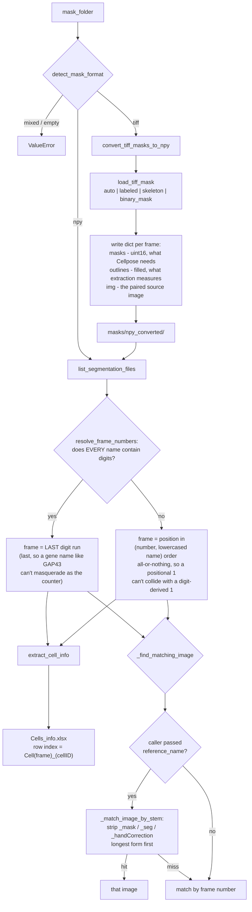

# Epi-Quant v2 — backend logic extraction

This is a prep step for rebuilding Epi-Quant's frontend on pywebview. The
modules here pull the pure quantitative-analysis logic out of `src/`'s
PyQt5 windows into plain, independently-debuggable Python functions with
explicit inputs/outputs — no `self.*` state, no `config.py` globals. `src/`
is untouched and keeps working exactly as before; nothing here is wired up
to a UI yet.

Run modules directly with `v2/` as the working directory (or on
`PYTHONPATH`), the same way `src/`'s `gui_*.py` files already expect sibling
imports to resolve — e.g.:

```bash
cd v2
python data_input.py --mask-folder /path/to/masks --output /path/to/out
```

## How `data_input.py` resolves a folder into frames

Two questions decide everything downstream: *which files are frames*, and
*which image belongs to each frame*. Both are answered here, once, so nothing
later can disagree.



Two rules are worth keeping in mind when adding a dataset:

- **Frame numbering is all-or-nothing.** Digits win only if *every* filename
  in the folder has them. Add one digit-less file to a numbered folder and the
  whole folder renumbers positionally — deliberate (it prevents silent
  collisions) but surprising if unexpected.
- **Frame 0 is a frame.** `list_segmentation_files` filtered to `frame >= 1`
  until Round 22, copied from `src/gui_main.py`, where it guarded a digit-less
  name falling back to `inf` — a case `resolve_frame_numbers` had long since
  taken over, and which `inf >= 1` passed anyway. The only thing the filter
  still did was drop frame 0, silently: `embryos_GBE_GAP43` numbers from
  `handCorrection0000`, so the movie read as **30 frames, 7,449 cells** when
  the folder holds **31 frames, 7,717 cells**. The function now asserts that
  it returns as many files as the directory holds `.npy`, and names the ones
  it lost if it ever does not — all four consumers call it, so they can only
  agree with each other; only the directory can disagree.
- **Name beats position for image pairing.** Sorted order can disagree between
  the mask and image folders, so the stem match runs first and position is
  only the fallback. `Demo_Seg_QC` is the case that proves it: its masks sort
  `Demo_OE_mask`, `Demo_WT_handCorrection_mask`, `Demo_WT_mask` while its
  images sort `Demo_OE`, `Demo_WT`, `Demo_WT_handCorrection`, so pure position
  hands frames 2 and 3 each other's image.

## Extraction performance: 12x, byte-identical (2026-08-18)

Groundwork for the convoluted-shape descriptors (below), but useful on its own
and independently verified. `extract_cell_info` got 12x faster overall with
**identical output**, via three changes. It also answers reviewer 2's point 5
about whether the pipeline scales to datasets of a few thousand cells: the two
worst offenders were both O(n_cells x frame_area), so cost grew with frame size
even when cell count did not.

Profiled on `AS_dorsal view_E-cad` before any change:

| per-cell work | share of extraction time |
| --- | --- |
| `np.where(outlines == cell_id)` over the **whole frame** | 55.8% |
| `cv2.distanceTransform` over the **whole frame** | 35.4% |
| everything else | 8.8% |

1. **Bounding boxes.** `ndimage.find_objects` gives each cell's bbox once per
   frame; the per-cell `np.where`, `fillPoly`, `findContours` and
   `distanceTransform` now run on that window instead of the full array. Area,
   arc length, vertex count and both radii are translation-invariant, so
   cropping cannot change them; the columns that *are* absolute (centroid,
   left/right boundary, the edge-cell test) get the window offset added back.
2. **`_BBOX_MARGIN = 8`.** `cv2.distanceTransform` measures distance to the
   nearest zero pixel, so a crop tight to the cell leaves its edge pixels with
   no zero to measure from. Measured: margin 0 corrupts the Inscribed Circle
   Radius of **260/2822** cells (saturated distance overflows the `int()` cast,
   max error 65532); margin 1 already reproduces the full-frame result exactly.
   8 is cheap headroom -- the cost scales with the bbox, not the frame. The
   margin is *not* about the 5x5 chamfer mask width, which was the initial
   (wrong) guess.
3. **Row accumulation.** The old loop built a one-row DataFrame per cell and
   `pd.concat`-ed it onto an accumulator -- quadratic, and after (1) it was
   ~60% of what remained (cProfile). Rows are now collected as lists and the
   DataFrame is built once.

| dataset | cells | before | after | speedup |
| --- | --- | --- | --- | --- |
| `AS_dorsal view_E-cad` | 2822 | 12.57s | 0.65s | **19.4x** |
| `AS_LE_lateral view_E-cad` | 9920 | 7.61s | 1.01s | 7.5x |
| `pupae_E-cad` | 1213 | 4.72s | 0.08s | **60.7x** |
| `embryos_GBE_GAP43` | 7474 | 5.29s | 0.81s | 6.5x |
| `Demo_Seg_QC` | 211 | 0.11s | 0.04s | 3.1x |
| `cp_dataset_puzzle-like_cells` | 2354 | 2.53s | 0.16s | 16.1x |
| **total** | 24k | **32.8s** | **2.74s** | **12.0x** |

**Verification.** Every value in all six tables is unchanged, and each written
`Cells_info.xlsx` round-trips identically. Full `track_cells` output on
`AS_dorsal view_E-cad` is identical including dtypes (captured via `git stash`
so the comparison is against genuinely unmodified code).

**One intentional difference:** `cells_info` now has `float64` columns where it
previously had `object`. The old dtype was an artifact of concatenating onto an
empty `pd.DataFrame(columns=...)`, and it forced Python-level arithmetic
everywhere downstream. Values are equal and the Excel file is unchanged --
confirmed by round-tripping both through `to_excel`/`read_excel` and comparing
*with* dtype checking, since Excel stores numbers either way.

### `tracking_only` extraction mode

`extract_cell_info(..., tracking_only=True)` computes only the four columns
`cell_tracking.build_cost_matrix` actually reads -- `Maximum Horizontal/Vertical
Length` (its displacement gate) and `Center X/Y Coordinate` (the only nonzero
entries in `DEFAULT_TRACKING_WEIGHTS`) -- leaving the other 14 `NaN`. The column
set and order are unchanged, because several modules map columns positionally.
A further 2.1-2.7x on top of the above, and the four columns are identical to a
full extract.

**This surfaced a real bug in `build_cost_matrix`.** It summed
`weights[k] * (info2[k] - info1[k]) ** 2` over every column, and `0 * np.nan`
is `np.nan` -- so a zero weight did **not** mean "ignore", and a single
unpopulated column turned every cost into `NaN`, after which
`linear_sum_assignment` rejected the whole matrix. Zero-weight columns are now
skipped up front. Results for a fully-populated table are unchanged (the
skipped terms contributed exactly 0, verified end-to-end above), and it also
removes 14 of 18 multiplications from an O(n^2) Python loop.

## Coordinate-outline input + the Vofely puzzle-cell benchmark (2026-08-18)

Reviewer 2 asked for descriptors suited to "more convolve and complex cell
shape (e.g. puzzle like cells)". `test_data/cp_dataset_puzzle-like_cells`
turned out to contain **no puzzle-like cells at all** -- rendering all 12 masks
and measuring gives a median solidity of 0.93-0.98 per image (real Arabidopsis
pavement cells sit at 0.55-0.85); it is the Cellpose generalist grab-bag
(spheroid nuclei, bacteria, PlantSeg ovules/root, CoNIC histology nuclei).

The benchmark is now **Vofely et al. 2019, *New Phytologist***, Dryad
`10.5061/dryad.g4q6pv3`, in `test_data/Vofeley_Dryad_dataset`: 11,346
hand-traced cell outlines across 278 taxa, **solidity 0.512-0.968**. Only
`CellCoordinates.zip` (19.6 MB) is needed; the 5.9 GB `CellImages.zip` is not,
so there are no images -- visual checks render the outlines themselves.

`load_outline_coordinates` + `convert_outline_coords_to_npy` import it. Four
things about that deposit are load-bearing and were established by surveying it
rather than by reading its README alone:

- **Two file formats.** 6,235 files have no header and space-separated floats;
  5,111 carry an `x\ty` header and tab-separated integers; one is a README.
- **Two layouts.** The numeric-named files are each centred on their own
  centroid and carry no spatial relationship; the `gp`/`JH` files are in shared
  image-pixel coordinates. `_coords_share_a_frame` distinguishes them by
  comparing centroid spread against typical cell size. Only the second kind
  could support neighbour/tissue analyses -- but see the overlap caveat below.
- **Leaf side must come from `SampleTable.csv`, never the filename.** The
  deposit's own README warns its numeric side field is inconsistent. Parsing it
  from filenames gave r = 0.9346 against the published table; the correct join
  gives 0.9999.
- **Traced outlines are not a segmentation and can overlap.** Nothing forced
  the tracer to keep them disjoint, and a label image cannot put one pixel in
  two cells, so painting them in sequence lets each cell silently erase parts
  of its predecessors. Measured overlap as a fraction of total cell area:
  `gp15-043` 0.0%, `gp15-046` 14.9%, the puzzle-like fern `gp17-003` **25.2%,
  stacking up to 5 deep**. The converter therefore measures overlap and falls
  back to grid tiling (with a logged warning) above
  `max_overlap_fraction=0.01`, so no cell is ever truncated.

**Rasterization scale.** `px_per_unit` must not go below 1.0: against solidity
computed directly from the float coordinates, 1.0 and 2.0 px/unit reproduce it
exactly (bias 0.0000, max error 0.0000, r = 1.00000 over 441 cells) while 0.5
px/unit biases by -0.0056 with errors to 0.031. No cell fragments at any tested
scale; rasterized area converges as expected (2.73% -> 0.34% over 1 -> 8
px/unit, the usual O(perimeter/area) boundary term).

**End-to-end external validation.** Raw `.txt` -> `.npy` -> `masks` ->
solidity, against the authors' published `Table S1` per-species means, over 12
samples spanning the full range: **r = 1.0000, bias +0.0001, max error
0.0004**. Over all 336 matched species x side using the float coordinates
directly: r = 0.9999, 99.7% within 0.02. This is external published ground
truth, which matters because neither reference implementation's code may be
copied (below).

### Why the existing geometry cannot be reused for these cells

`extract_cell_info` never reads `dat['masks']`. It takes
`np.where(outlines == id)` -- **scanline order** -- and passes it straight to
`cv2.fillPoly`, which bridges across every concavity. On near-convex cells this
is invisible; on lobed cells it is catastrophic. Measured on the converted
Vofely data:

| group | solidity | median area error | median perimeter error |
| --- | --- | --- | --- |
| `gp15-043` Tabernaemontana | 0.97 | **+0.04%** | -0.31% |
| `gp17-003` Adiantum fern | 0.53 | **+67%** (max +617%) | -9% |

Rendered side by side, the fern's interdigitating lobes collapse into a solid
slab. **So all new shape descriptors must derive their contour from
`dat['masks']`, not from the fillPoly reconstruction.**

This does **not** affect the manuscript: on `AS_dorsal view_E-cad` the median
area error is +0.05% (p95 +2.31%) and perimeter -0.38%, with
`AS_LE_lateral view_E-cad` and `pupae_E-cad` similar -- those cells sit at
solidity 0.91-0.93, where the bias vanishes. Nothing needs re-running.

### Licensing of the reference implementations

Neither may be copied, so the descriptors are implemented from the **published
method descriptions** (algorithms are citable; only their expression is
copyrighted) and no code from either project is used:

| tool | licence | consequence |
| --- | --- | --- |
| **PaCeQuant** (in MiToBo) | GPL-3.0 | copying would force Epi-Quant to GPL-3 |
| **LobeFinder** (`George-wu509/LobeFinder`) | **no licence file** (verified via the GitHub API; the repo is one `.m` file) | all rights reserved by default -- copying not permitted at all |

Correctness is therefore established by (i) synthetic shapes with analytically
known lobe counts, (ii) two independent estimators asserted to agree, and
(iii) the published-ground-truth comparison above, which is the one that
actually settles it and needs no third-party code.

## `shape_features.py` -- descriptors for convoluted cells (2026-08-18)

Reviewer 2's main request. Per-cell descriptors in three families, all
dimensionless or explicitly scale-normalized: convex hull (solidity, convexity,
shape index), hull deviation (lobe count, max concavity depth, mean neck
width), and elliptic Fourier (elongation, sin/cos 2psi, irregularity, plus
optional raw coefficients). Cost is 0.29-0.50 ms/cell -- roughly 10% of what
extraction itself costs even after the 12x speedup above.

Everything reads its contour from `dat['masks']`; nothing reuses
`extract_cell_info`'s fillPoly reconstruction, for the reason measured earlier
(median +67% area error on genuinely lobed cells).

**Validation** is against external published ground truth, not self-consistency
-- which matters, because neither reference implementation's code may be
copied (PaCeQuant is GPL-3.0, LobeFinder has no licence at all). Our per-species
mean solidity vs the Vofely `Table S1` values, 16 samples spanning 0.51-0.97:
**r = 1.00000, bias +0.0001, max error 0.00035**. Three further descriptors
track published solidity from completely independent mathematics: max concavity
depth r = -0.974, EFD irregularity r = -0.941, lobe count r = -0.888. Synthetic
k-lobed shapes recover k exactly for k in 4/5/6/8 at amplitudes 0.20 and 0.45,
and two independent estimators (hull deviation vs curvature sign runs) are
asserted to agree on every one.

### Three findings that changed the design

**1. Curvature-derived scalars are not shippable.** The first version also
emitted a curvature-based lobe count, concave fraction, bending energy and
curvature standard deviation. They are exact on synthetics, but recomputing on
`AS_dorsal view_E-cad` at smoothing sigma = 0.01/0.02/0.04/0.08 of the contour
moved them by **70-100%** -- the median cell reported 10, then 5, then 2, then 0
lobes -- while every hull- and Fourier-derived descriptor moved by **0.0%**.
Curvature is a second derivative, so it amplifies the pixel-scale waviness of a
segmented boundary; sweeping a curvature-magnitude cutoff from 0.0 to 0.5 left
the instability untouched while the synthetics stayed exact, so no threshold
rescues it. Feeding features like that into PCA is precisely the failure this
work exists to fix, so they are not emitted. `Lobe Count` is the hull-deviation
count instead -- which is also what LobeFinder's published method actually uses.
The curvature code is kept, used by the self-test as an independent cross-check.

**2. Perimeter needs a better estimator than `cv2.arcLength`, and the obvious
correction is wrong.** Summing a pixel chain overestimates arc length. Measured
against exact perimeters on rasterized circles (r=30..200), axis-aligned
squares, those squares rotated 30 degrees, and 6/8-lobed cells:

| estimator | mean \|err\| | max \|err\| |
| --- | --- | --- |
| raw `cv2.arcLength` | 4.42% | 7.29% |
| Kulpa x0.9481 | 1.64% | 5.19% |
| Vossepoel-Smeulders | 0.74% | 2.15% |
| resample @2px | 0.80% | 1.63% |
| **resample @3px (chosen)** | **0.31%** | **0.70%** |

Kulpa's constant is tempting because `arcLength` is a near-uniform +5.5% on
curved boundaries -- but an axis-aligned square has no staircase and is already
exact, so the correction makes it 5.2% *too short*. Resampling at a fixed
arc-length spacing has no such blind spot. This is not cosmetic: the shape index
is compared against the rigidity threshold p* ~ 3.81 of Bi et al., and the raw
estimator reports a perfect circle as 3.743 instead of 3.545 -- enough to move
solid-like tissue across that threshold. Note this makes `Shape Index` here
*more accurate than*, and so not directly comparable with, the existing
`Circularity` column in `Cells_info.xlsx`, which still uses raw `arcLength`.

**3. `cv2.convexityDefects` fails on real cells.** It requires the hull's vertex
indices to be monotonic along the contour and raises otherwise. A cell with a
one-pixel neck is traced out-and-back, so the same coordinate appears twice at
non-adjacent positions and the ordering becomes ambiguous -- it happened on 4 of
2822 cells in `AS_dorsal view_E-cad`, and deduplicating points does not fix it
because the repeats are not adjacent. Replaced with `hull_deviation`, a
vectorized point-to-segment distance from each contour point to the hull, which
needs no ordering and so cannot fail that way. It also yields depth and count
from one computation, and is closer to LobeFinder's stated convex-hull concept.
Zero NaNs remain in the hull-derived columns on all test datasets.

**Output goes to a separate `Cells_shape.xlsx`** (sheet `Shape`), joined to
`Cells_info.xlsx` on `Cell Index` -- verified to join 1:1 on every dataset --
rather than as extra columns, because `common.save_modified_rows` maps DataFrame
column position to Excel column position and would write into the wrong columns
of an existing file if the schema grew. EFD coefficient columns are named
`efd_{h}_{c}`, the exact convention
`figures/Epiquant_ShapeAnalysis_allMutants.ipynb` uses, so that notebook can
read our output unmodified as a second implementation to check against.

Failures are `NaN`, never `-1`: `segmentation_qc.measurement_failures` scans
named columns for `-1` and `extract_cell_info`'s own check is column-blind, so
reusing `-1` would make an unmeasurable cell indistinguishable from a real
measurement failure. The only NaNs observed are cells whose contour is shorter
than `2*order+1` points, which genuinely cannot support an order-10 transform.

## `tissue_features.py` -- local tissue texture (2026-08-18)

The second half of reviewer 2's point 4 ("Could they also implement local
tissue texture parameters?"). Per cell, over its 1-ring: neighbour count, local
hexagonal fraction, local nematic order `S = |<exp(2i psi)>|`, local mean shape
index and solidity, local density, plus a per-frame neighbour-count entropy.
Joins to `Cells_info.xlsx` and `Cells_shape.xlsx` on `Cell Index` -- verified
1:1 on all four datasets. Cost 0.06-0.77 ms/cell. Fills the
the packing/neighbour-count analyses the manuscript's Fig. 5G / 6B need.

Three decisions that measurement forced:

**1. Adjacency is edge-based, not dilation-based.**
`adjacency.build_neighbor_graph` dilates each cell and sees what it reaches,
which cannot distinguish "shares a wall" from "meets at a corner". On a
synthetic square lattice it reports **8** neighbours per cell instead of 4,
because the four diagonal cells touch at the vertex. That is not academic here:
square packing is exactly what Tamada & Zallen (2015) describe in the Drosophila
presumptive pharynx, and detecting such arrangements is the point of these
descriptors. `build_interface_graph` counts shared border pixels via
`segmentation_qc._interface_pixels` and gets both lattices right -- hex 6,
square 4.

Gaps must be closed first: `pupae_E-cad` has **0** raw interfaces (no two of its
826 cells touch), and `_bridge_gaps` recovers 2341. Bridging was checked not to
create corner adjacencies -- both lattices stay correct with it applied at every
threshold from 1 to 8 px. The minimum interface is **2 px**, deliberately *not*
`segmentation_qc.suggest_min_interface_px`: that returns 14-40 px here because
it is tuned for scoring individual junctions in the QC overlay, and applying it
to topology discards real walls, driving the median neighbour count from 6 to 4
on all three datasets tested.

**2. "Border cell" has to mean the tissue's edge, not just the image's.**
`segmentation_qc.neighbor_count_deviation` excludes only frame-edge cells, which
is right for its purpose and useless here: `AS_dorsal view_E-cad` is 70.7%
background and `pupae_E-cad` 67.6%, and **not one cell in either touches the
frame**, so that rule excluded nothing while 119 of 145 AS cells sat on the
tissue rim. The symptom was a mean neighbour count of 5.24 where Euler's theorem
puts a 2D packing at ~6. Background adjacency must also be measured *after*
gap-closing, or it catches everything -- before bridging, all 826 `pupae` cells
are within a few pixels of "background" because the inter-cell gaps are
background too.

With both rules, interior mean neighbour count is 5.98 / 5.92 / 5.69 / 5.94 on
`AS_dorsal` / `pupae` / `embryos_GBE_GAP43` / `Demo_Seg_QC`, **median exactly 6
on all four** -- which is the check that the topology is right.

**3. Neighbour-count entropy is per frame, not per cell.** A 1-ring holds 6-7
cells and the entropy of a 6-sample categorical distribution is mostly sampling
noise; as a per-cell column it would enter PCA looking like a tissue-order
readout while carrying almost none. It is computed over all non-border cells of
a frame and broadcast, named `Frame Neighbor Entropy` so it cannot be mistaken
for a per-cell quantity.

Orientation `psi` comes from `shape_features`' `Sin2Theta`/`Cos2Theta`, never
from `Cells_info.xlsx`'s `Fitted Ellipse Angle` -- that column is stored folded,
so cells drawn 40 degrees apart can share a value (70 and 110 degrees both store
20.0), and averaging directions from it would be meaningless. `S` itself is
invariant to any global rotation or sign convention, so it does not depend on
how the imaging frame was oriented; the per-cell sin/cos pair does, which is why
the convention is fixed and tested.

Self-test covers: hex lattice -> 6 neighbours, square -> 4, perfect lattice more
ordered than a jittered one, aligned field `S`=1 vs isotropic `S`<0.15, the
director convention (`psi` and `psi+pi` identical), rotation invariance, and an
inset tissue that never touches the frame (the case that exposed finding 2).

## `pca_kmeans.py` -- feature presets and feature-space repair (2026-08-18)

`compute_pca` gains `standardize_mode`, `prune_correlation` and
`sign_convention`; the module gains `FEATURE_PRESETS`, `efd_preset`,
`standardize`, `prune_correlated` and `plot_shape_modes`. **Every new argument
defaults to v1's behaviour**, verified: `Cells_info_PCA.xlsx` and the K-means
labels are identical on `AS_dorsal view_E-cad`, `embryos_GBE_GAP43` and
`cp_dataset_puzzle-like_cells`.

Feature selection lives in the additive `FEATURE_FAMILIES` (see "New features"
above). Two named lists sit outside that scheme and are not families:
`legacy_13` (**since retired** -- see the column-deletion section below), which reproduced v1's exact PCA input and was asserted identical to
`data_input.ML_FEATURE_COLUMNS`, and `tracking_only`, the four columns
`cell_tracking.build_cost_matrix` reads. No family or list contains `P-Value` -- it is
`4*pi/circularity**2`, a monotone function of `Circularity`, which is itself a
monotone function of `Shape Index`: the same quantity three times. (The column
stays in the schema for now; removing it shifts every later column's position
and `common.save_modified_rows` writes Excel by position.)

### What worked, and what did not

The plan proposed correlation pruning **and** per-frame standardization as fixes
for the size-dominated PC1. Measured on `cp_dataset_puzzle-like_cells`, they fix
**different problems**, and only one of them addresses size at all.

**Correlation pruning barely dents size dominance.** The 8 size proxies
correlate at r = 0.88-0.94, so a 0.95 threshold mostly keeps them:

| threshold | features kept | PC1 size share |
| --- | --- | --- |
| (none) | 13 | 85.5% |
| r > 0.99 | 12 | 83.6% |
| r > 0.95 | 10 | 77.9% |
| r > 0.90 | 8 | 66.7% |
| r > 0.85 | 6 | 36.7% |

It only bites at 0.85, by which point it has discarded 7 of 13 features. Pruning
is still worth having for genuine duplicates, but it is the wrong instrument
here.

**Per-frame standardization does not touch size dominance either** -- but it
does exactly what it was actually for, which is the *between-image* confound.
Measured as the share of PC1's variance explained by image identity:

| feature set | global | per-frame |
| --- | --- | --- |
| v1's 13 features | 0.601 | **0.000** |
| a ratio-only set | 0.180 | **0.000** |

**The direct fix for size dominance is dimensionless features.** PC1's size
share: v1's 13 features 85.5%, the same 13 with pruning at 0.95 77.9%, a
ratio-only set **0.0%** (top loadings Shape Index 16%, Solidity 13%,
Elongation 13%), a lobing-only set **0.0%** (Solidity 21%, Max Concavity
Depth 19%, EFD Irregularity 15%). Every column in today's `hull` and `lobe`
families is dimensionless by construction, so both land in that regime.

So the three controls are not substitutes: **dimensionless features** for size
dominance, **per-frame standardization** for the image confound, **pruning** for
literal duplicates.

### `plot_shape_modes`

Writes `PCA_Shape_Modes.png`: the reconstructed cell outline at the 10th/30th/
50th/70th/90th percentile along each of the first components of EFD shape
space, against the mean shape. A port of `plot_modes`/`contour_of` from
`figures/Epiquant_ShapeAnalysis_allMutants.ipynb`, and the reason the EFD route
is worth having -- a component becomes a visible shape change rather than a
percentage. On `AS_dorsal view_E-cad`: PC1 63.7% is elongation, PC2 10.0% a
dorsoventral taper, PC3 8.9% a pear-shaped asymmetry.

It fits PCA **without standardizing**, per `standardize`'s `"none"` mode and the
collaborator's documented reason. `sign_convention` is on there because PCA
signs are otherwise arbitrary and the panels would flip between runs.

### The manuscript's shape parameter `p`

`shape_features`' `Shape Index` **is** the manuscript's Fig. 5D/E/F shape
parameter `p = P/sqrt(A)`. There is no separate module for it any more --
`gap_analysis/shape_parameter.py` was deleted, since a second implementation of
one division is a liability rather than an asset. Note `p` is read against Bi et
al.'s rigidity threshold p* ~ 3.81, so the perimeter estimator matters: the old
raw-`arcLength` route reported a perfect circle as 3.743 instead of 3.545.

## API wiring for the new descriptors (2026-08-18)

`webview/api.py` gains `start_shape_extraction` / `_run_shape_extraction`
(threaded, `onShapeExtractDone` / `onShapeExtractError`, progress stage
`"shape"`), `get_shape_feature_summary`, `load_existing_shape_features`,
`get_feature_options`, `has_efd_coefficients`, and `feature_families` /
`selected_features` / `prune_correlation` / `dataset_mode` on
`run_classification`. `get_existing_results` reports `shape` and `tissue`.
Shape extraction is **opt-in**: a user who only tracks never needs it.

**Families are additive, and the selection dictates the scaler in Python.**
`pca_kmeans.FEATURE_FAMILIES` holds each family and `family_columns()` unions
them on top of the always-on `basic` base; `_feature_frame` returns the matrix
and its standardize mode together, so the `efd` family cannot be run through
`StandardScaler` no matter what the frontend sends, and it refuses to combine
with any other family. The JS mock mirrors both rules, but the backend is the
authority -- a UI that *can* get this wrong eventually will.

**`ready` must mean "every column present", not "any".** A first version marked
a family ready when its filtered column list was non-empty. That reported a
mixed family as ready on a project with no shape table, because some of its
columns come from `Cells_info.xlsx` -- so the UI would enable it and the run
would then fail. Now verified both ways: every family reported ready runs
successfully, and every family reported not-ready names exactly what it is
missing.

Missing columns raise a readable `ValueError` naming them and pointing at the
shape step, rather than surfacing as a bare pandas `KeyError`; `load_cells_info`
reads whatever Excel exists, so a legacy project hitting a shape-dependent
preset was the realistic path to that.

**`dataset_mode`** answers the pooling question. `"time_series"` (default, v1's
behaviour) pools every frame -- correct for a movie of one specimen and required
if the result will be tracked. `"independent_samples"` runs PCA and K-means per
frame, for folders of unrelated images where pooling makes the leading component
partly "which image is this" (measured: image identity explains 0.601 of PC1's
variance on `cp_dataset_puzzle-like_cells`). Cluster labels are then per-frame,
so `cluster_1` in one image is unrelated to `cluster_1` in another -- documented
on the method, because the colour legend cannot express that.

**Verified** via the headless harness, which now takes `--shape`:

```
python3 v2/webview/api.py --mask-folder "test_data/AS_dorsal view_E-cad/masks" \
  --image-folder "test_data/AS_dorsal view_E-cad/images" \
  --output-dir /tmp/epiq_smoke --classify --shape --n-clusters 2
```

On `AS_dorsal view_E-cad` every family combination runs — `basic` 8 features /
global, `basic+hull` 11, `basic+lobe` 12, `basic+tissue` 13 (1780 of 2824 cells;
border cells have no neighbour count by construction), `basic+hull+lobe` 15,
`basic+hull+lobe+tissue` 20, and `efd` 40 / **none** — EFD refuses to combine
with another family, `independent_samples` runs, an unknown family is rejected
by name, and leading edge, tracking and every overlay still run afterwards.

`NaN`/`inf` are converted to `null` before crossing the bridge: `json.dumps`
emits bare `NaN`, which `JSON.parse` rejects, and the tissue table legitimately
contains NaN for border cells.

## ⚠️ FIXED: degenerate ellipse fits made extraction non-deterministic (2026-08-18)

**This changes numbers on manuscript datasets** -- see the impact table below.
Fixed with the user's explicit approval.

Surfaced while regression-testing the work above, and **pre-existing** --
confirmed by `git stash`-ing every change and reproducing it on the original
code.

**Symptom.** `extract_cell_info` was not reproducible. Four consecutive runs
over `cp_dataset_puzzle-like_cells` in one process gave different tables,
always differing on `Cell1564_255`, a **6-pixel** cell whose major axis came
back 7.48 on one run and 15.11 on the next. `cv2.fitEllipse` on a point set
that small is numerically degenerate.

**The real damage was to the feature, not the reproducibility.** When the minor
axis was *exactly* 0 the old `!= 0` guard caught it and wrote the `-1`
sentinel; a tiny nonzero axis slipped straight through and made
`Ellipse Major/Minor Axis Ratio` enormous -- 5443 on `AS_LE_lateral view_E-cad`
against a median of 3.15, 13421 on the puzzle set. One such value inflated that
column's standard deviation to 54.65, so after `StandardScaler` **99% of cells
were compressed into z = [-0.055, 0.134]** while the artifact sat at z = 99.5.
Real elongation variation (median 3.15, p99 10.14) was squeezed into a fifth of
a standard deviation, leaving PCA almost nothing from an axis that carries 93%
of PC3's loading -- all because of a handful of 1-6 pixel objects.

**Fix.** `_MIN_ELLIPSE_AXIS_PX = 2.0`: a fit whose smaller semi-axis is below
that falls through to the same `-1` sentinel a failed fit already used. The
threshold was chosen by sweeping it against determinism over all six datasets,
five interleaved runs each -- 1.0 px left `AS_LE_lateral` still flaky (its
`Cell71_124`, a 5-px 2-vertex line of pixels, measured 1.00 on one run and 1.01
on the next, straddling the cut), 1.5 px was already enough, 2.0 px buys margin
for four more cells out of 23,994. The 1st percentile of genuine minor axes is
7-12 px, so nothing real is near it.

**Impact** (all six datasets now identical across 8 interleaved runs):

| dataset | cells changed | ratio max | ratio SD | elongation z-range (99%) | cluster changes |
| --- | --- | --- | --- | --- | --- |
| `AS_dorsal view_E-cad` | 2 / 2822 (0.07%) | 9.95 → 9.95 | 1.08 → 1.08 | 7.60 → 7.58 | 7 (0.25%) |
| `AS_LE_lateral view_E-cad` | 4 / 9920 (0.04%) | **5443 → 19.79** | **54.65 → 1.85** | **0.19 → 5.54** | 10 (0.10%) |
| `pupae_E-cad` | 1 / 1213 (0.08%) | 6.27 → 6.27 | 0.64 → 0.64 | — | — |
| `embryos_GBE_GAP43` | 0 | 5.29 → 5.29 | unchanged | — | — |
| `Demo_Seg_QC` | 0 | 8.63 → 8.63 | unchanged | — | — |
| `cp_dataset_puzzle-like_cells` | 3 / 2354 (0.13%) | **13421 → 9.73** | **276.59 → 0.85** | **0.02 → 6.53** | 14 (0.59%) |

Every changed cell has an area of 5-26 px. The elongation feature's usable
z-range recovers 29x on `AS_LE_lateral` and 326x on the puzzle set; PC3 rises
from 7.8% to 11.1% on the latter as that axis stops being an artifact.
`AS_dorsal` barely moves because it had no tiny-nonzero fits -- which is the
check that the fix is targeted rather than broad.

**For the manuscript:** classification changes by 0.10-0.25% of cells on the two
dorsal-closure datasets. That is unlikely to disturb the reported ~100%
AS/LE accuracy, but anything quoting exact per-cluster counts should be re-run.
This is independent of, and additional to, the `_merge_tracking_pairs`
cell-loss re-benchmark already outstanding in `CLAUDE.local.md`.

## Frontend for the new descriptors (2026-08-18)

Two additions, no new pipeline step -- shape extraction belongs to Extract and
feature selection to Classify.

**Extract** gains a `#shape-descriptors` sub-panel, hidden until extraction
finishes: checkboxes for local tissue texture and raw EFD coefficients, an
`<details>` for EFD order / contour points / smoothing, a Compute button, and a
median summary table per descriptor. It is opt-in and says so -- a user going
straight to tracking never needs it.

**Classify** gains a feature-mode `<select>`, a checkbox group for the chosen
preset, a dataset-mode radio pair, an "Advanced" `<details>` for correlation
pruning, and a line under the status reporting what actually went in
(`"7 features (convolution, global), 2822 cells, all frames pooled."`).

Three behaviours worth knowing:

- **Modes the project cannot run are disabled in the dropdown**, labelled
  "— run shape descriptors first", and the select falls back to `geometric`.
  This is the same all-columns-present rule the backend uses, so anything
  selectable will actually run.
- **Selecting EFD replaces the checkbox group** with an explanation rather than
  offering coefficients individually, and the note reads "no standardization".
  The backend enforces both regardless of what the frontend sends.
- **`populateFeatureOptions()` runs on every entry to Classify**, from
  `goToStep`, not once. A user can run shape extraction *after* first visiting
  Classify, and a cached list would leave the new modes greyed out;
  `onShapeExtractDone` also refreshes it.

**Verified by driving the dev-mode mock in a real browser** (`python3 -m
http.server` in `frontend/`, then scripted clicks):

| checked | result |
| --- | --- |
| before shape extraction | `geometric` enabled, the other four **disabled**, auto-selected `geometric`, checkboxes populated |
| after shape extraction | all five enabled; summary tables rendered (2 tables, 5 rows) |
| switch to EFD | checkbox group replaced by the explanation, note = "no standardization" |
| switch back to convolution | checkboxes repopulate |
| dataset-mode radio | note switches to the per-image warning |
| run classification | status + `"2 features (convolution, global), 500 cells, each image clustered on its own — cluster_1 in one image is unrelated to cluster_1 in another."` |

The mock in `frontend/api.js` mirrors the backend contract, including the
mode-dictates-the-scaler rule, so this path exercises the real wiring rather
than a stub that always succeeds.

**Not yet click-tested in the real pywebview window** -- the dev browser cannot
run the actual pipeline. That is the one remaining gap for this work.

## New features: method, dependency, improvement, flaw (2026-08-18)

One row per shipped descriptor. "Flaw" is what it genuinely cannot do -- read it
before choosing a feature set.

| feature | how it is computed | needs | improved over v1 | known flaw |
| --- | --- | --- | --- | --- |
| `Cell Area` | pixel count of `dat['masks']` | cv2 | no longer re-fills the outline; **+46% error on lobed cells removed** | none material |
| `Cell Perimeter` | boundary resampled at 3 px, then summed | cv2/numpy | staircase bias removed (raw `arcLength` is +5.5%); **−32% error on lobed cells removed** | ~0.3% residual; `int()`-rounded for schema compatibility |
| `Approximate Polygon Vertex Count` | `approxPolyDP(contour, epsilon=2px)` on the mask contour | cv2 | measured on the real outline, not the bridged one (**was 0.41x on lobed cells**) | **fixed 2 px epsilon is resolution-dependent** — the same cell imaged at 2x gives a different count |
| `Circumscribed Circle Radius` | `minEnclosingCircle` on the mask contour | cv2 | now from the mask (it was already the one fillPoly barely affected, -0.2%) | `int()`-truncated |
| `Inscribed Circle Radius` | `distanceTransform` on the true mask raster | cv2 | **+104% error on lobed cells removed** | `int()`-truncated |
| `Solidity` | `A / A_hull`, both via `contourArea` | cv2 | new | none — the cleanest lobing measure |
| `Convexity` | `P_hull / P` | cv2 | new | hull perimeter is exact, cell perimeter estimated → slight upward bias |
| `Shape Index` | `P / sqrt(A)` (Bi et al.) | cv2 | new; replaces the deleted `gap_analysis` stub | **compactness, not anisotropy** — rises with both elongation and lobing |
| `Lobe Count` | runs of contour ≥5% of R_eq inside the hull | cv2/numpy | new | counts concavities; a lobe merged with its neighbour reads as one |
| `Max Concavity Depth` | max hull deviation / R_eq | cv2/numpy | new | one deep notch dominates |
| `Mean Neck Width` | chord across each concavity / R_eq | cv2/numpy | new | undefined for a convex cell (reported 0) |
| `EFD Irregularity` | ‖harmonics ≥2‖ after size normalization | **pyefd** | new | **not purely lobing** — 0.119 for a smooth 8:1 ellipse vs 0.268 for a 6-lobed round cell |
| `Elongation`, `Sin2Theta`, `Cos2Theta` | SVD of EFD harmonic 1 | **pyefd** | replaces the folded `Fitted Ellipse Angle` | elongation compressed (true 4.0 reads 3.08) and Spearman 0.9913 with the ellipse ratio; sin/cos are absolute orientation. **In no PCA family** |
| `Neighbor Count`, `Local Hexagonal Fraction` | shared-border pixels after gap-bridging | scipy/numpy | new; separates edge-sharing from corner-touching (hex 6, square 4) | border cells are NaN by construction, so they drop out of a run |
| `Local Nematic Order` | `|<exp(2i psi)>|` over the 1-ring | numpy | new | a 1-ring is ~7 cells, so it cannot reach 0 even for random orientations |
| `Local Mean Shape Index / Solidity` | 1-ring means | numpy | new | inherits each underlying flaw |
| `efd_{h}_{c}` (40) | Kuhl & Giardina elliptic Fourier | **pyefd** | start-point invariant to 6e-16 (pyefd's own `normalize=True` is not) | order 10 truncates fine detail; **must not be standardized** |

**Dependencies:** only **`pyefd`** was added (MIT, numpy-only) — everything else
uses cv2 / numpy / scipy / sklearn, already present. scikit-image is *not*
required.

**Dropped from every feature family, with the measured reason:**
`Fitted Ellipse Angle` (stored folded — 70° and 110° both become 20.0),
`Circularity` and `P-Value` (monotone functions of `Shape Index`),
`Frame Neighbor Entropy` (within-frame variance exactly 0 — pooled it encodes
only "which frame"), `Local Density` (px⁻², not comparable across
magnifications), `Elongation` / `Sin2Theta` / `Cos2Theta` (see the table). All
are still written to the xlsx files; they are simply not offered as PCA inputs.

**The Extract summary panel lists only what Classify can select.** It is built
from `pca_kmeans.FEATURE_FAMILIES`, the same source the family checkboxes use,
so it cannot drift from them. An earlier version listed the `SCALE_INVARIANT_*`
columns instead, which conflated "is dimensionless" (a property of the maths)
with "is offered as a feature" (a design decision) -- so it kept advertising
`Elongation`, `Sin2Theta`, `Cos2Theta` and `Frame Neighbor Entropy` after they
had been retired from every family. Those columns are still computed and still
written to the xlsx (`Sin2Theta`/`Cos2Theta` feed `Local Nematic Order`, and
`Frame Neighbor Entropy` is a real per-frame statistic), so the panel names them
under "Also written to the xlsx, not offered as features" rather than hiding
them.

**Feature families are additive.** `Basic geometrics` is the always-on base and
`Convex hull`, `Convolution/lobe` and `Local tissue texture` stack on top of it.
`Elliptic Fourier` is exclusive and unstandardized. Within `Basic geometrics`,
`Maximum Horizontal/Vertical Length` and their ratio are offered but **unchecked
by default**: they measure the cell's orientation relative to the image axes, so
rotating one real fern cell from 0° to 90° swings the ratio from 2.458 to 0.407
while solidity and shape index do not move. Tick them only for a deliberately
aligned specimen, as in the manuscript's AP/DV convention.

## ⚠️ Geometry now measured on `dat['masks']` (2026-08-18)

**Changes manuscript numbers — approved by the user.** `extract_cell_info` used
to re-fill the scanline-ordered outline with `cv2.fillPoly`, which bridges every
concavity. All five affected columns now read `dat['masks']` directly.

**Only `Cell Perimeter` additionally uses the 3 px resampling**, and that is not
an oversight: resampling exists to stop a *sum along the boundary* accumulating
staircase error, and perimeter is the only one of the five that sums along the
boundary. `Cell Area` is a pixel count (exact, and resampling would make it
worse -- a polygon through pixel centres under-counts by roughly P/2);
`Inscribed Circle Radius` comes from a raster distance transform; and both
`Circumscribed Circle Radius` and `Approximate Polygon Vertex Count` come from
extremal/simplified points on the contour, where no error accumulates. Their
remaining flaws are different ones -- `int()` truncation on the two radii, and a
resolution-dependent fixed epsilon on the vertex count.

On real puzzle cells (Adiantum fern, solidity 0.51) the errors this removes:

| column | before | after |
| --- | --- | --- |
| `Cell Area` | +46.4% | **0.00%** |
| `Cell Perimeter` | −31.8% | **−0.01%** |
| `Circularity` | +236% | **+1.01%** |
| `Inscribed Circle Radius` | +104% | **−1.55%** |
| `Approximate Polygon Vertex Count` | 0.41× | exact |

On the near-convex project datasets, with the data held constant and only the
code varying: `Cell Area` ±0.06%, `Cell Perimeter` **−4.0 to −5.0%** (the
staircase correction), `Circularity` **+8.0 to +11.3%** (which follows exactly:
`C = 4πA/P²`, so a ×0.9504 perimeter predicts ×1.1072 and ×1.1045 was observed),
and `Inscribed R` / `Vertex Count` / `Circumscribed R` unchanged. Classification
moves 0.00% (`embryos_GBE_GAP43`) to 1.59% (`AS_dorsal view_E-cad`) of cells.

**The safety gate held: the four columns `cell_tracking.build_cost_matrix` reads
— `Maximum Horizontal/Vertical Length` and `Center X/Y Coordinate` — are
byte-identical on all six datasets, and so is full `track_cells` output.** They
are not derived from the reconstruction, which is why the fix could be made
without touching tracking at all.

**Deliberately not changed:** `Center X/Y` is the mean of the *boundary* pixels,
not the area centroid — 6.6% of R_eq off on lobed cells (max 18.4%). It is a
tracking input, so moving it would change tracking; that is a separate decision.
The four `Fitted Ellipse *` columns also still fit the outline ring, so they keep
their exact values.

> **Note on baselines:** `test_data/AS_dorsal view_E-cad` and
> `AS_LE_lateral view_E-cad` masks were hand-corrected on 2026-08-20 (four and
> several frames respectively). Any regression baseline captured before that date
> will show spurious differences. Re-capture before comparing.

## Shortened feature labels in Classify (2026-08-18)

Display only. `pca_kmeans.FEATURE_DISPLAY_NAMES` maps a real column name to a
shorter label; the checkbox `value`, the DataFrame, the xlsx and every lookup
keep the full name, and the UI carries it as a tooltip. The principle is to drop
words that carry no information in a per-cell table: **"Cell"** (everything here
is a cell), **"Fitted"/"Approximate"** (how it was measured, not what it is) and
**"Circle"** (implied by "Radius").

| shown | real column |
| --- | --- |
| Area | `Cell Area` |
| Perimeter | `Cell Perimeter` |
| Ellipse Major Axis | `Fitted Ellipse Major Axis` |
| Ellipse Minor Axis | `Fitted Ellipse Minor Axis` |
| Ellipse Axis Ratio | `Ellipse Major/Minor Axis Ratio` |
| Vertex Count | `Approximate Polygon Vertex Count` |
| Circumscribed Radius | `Circumscribed Circle Radius` |
| Inscribed Radius | `Inscribed Circle Radius` |
| Max Horizontal Length | `Maximum Horizontal Length` |
| Max Vertical Length | `Maximum Vertical Length` |
| H/V Length Ratio | `Horizontal/Vertical Length Ratio` |

The `base` tag was dropped from the family picker at the same time -- Basic
geometrics being locked-on already says it.

**Guarded by the self-test:** every key must be a real column, and **no short
label may collide with a real column name** -- if one did, a lookup could
silently resolve the label instead of the column it stands for. Unmapped columns
(the hull/lobe/tissue families, whose names are already short) fall through
unchanged.

## Three columns deleted from `Cells_info.xlsx` (2026-08-18)

> **Partly reversed in Round 24 (2026-09-11):** `Fitted Ellipse Angle` and
> `Circularity` are back (17 columns), as default-off Basic features; `P-Value`
> stays deleted. See the Round 24 section.

**Changes the output schema, 18 columns -> 15 -- approved by the user.** They
appeared in every exported table while being offered in no feature family, which
was actively confusing.

| removed | why it was safe |
| --- | --- |
| `Fitted Ellipse Angle` | stored **folded** (`180 - a if a > 90`), a mirror reflection rather than a modulo, so orientations 40 degrees apart shared a value (70 and 110 both stored 20.0). Not invertible, therefore unusable as a direction. Orientation now comes from `shape_features`' `Sin2Theta`/`Cos2Theta`, recomputed from the elliptic-Fourier harmonic-1 SVD. |
| `Circularity` | exactly recoverable as `4*pi*A/P^2` from two columns that remain. Verified against the stored column to within its own 2-decimal rounding (max diff 0.005), with all 2824 sentinel rows reproduced. |
| `P-Value` | `4*pi/circularity**2` -- a monotone function of a monotone function of `Shape Index`. The same quantity a third time. |

**Two consumers had to be rewired, both verified:**

- `segmentation_qc.morphology_outlier` read the `Circularity` column; it now
  derives it from `Cell Area` and `Cell Perimeter`. Per-cell scores move by a
  median of **0.0000** (p95 0.024, max 0.094) and 0.89% of cells shift by more
  than 0.05 -- that difference is the *old* column's 2-decimal rounding being
  removed, so the new value is the more accurate one. The set of worst-scoring
  cells the overlay highlights overlaps 93.4% on average, and no frame falls
  below 50%.
- `segmentation_qc.measurement_failures` scanned all three for `-1`. Removing
  them loses **no** detection: the same 12 failures across all 24 frames of
  `AS_dorsal view_E-cad`, because each was `-1` exactly when a surviving column
  already was.

**`legacy_13` is retired.** It named two of the deleted columns, so it can no
longer be assembled -- and it would not have reproduced v1's numbers anyway
once geometry moved to the mask (perimeter ~-5%, circularity ~+10%). `src/`
stays frozen and is the reference for exact v1 reproduction.
`data_input.ML_FEATURE_COLUMNS` is now the 11-column `basic` family, and the
self-test asserts the two stay the same set.

### The positional coupling this exposed

`cell_tracking` indexed `CELLS_INFO_COLUMNS` **positionally** in two places:
`DEFAULT_TRACKING_WEIGHTS` was the literal `[0]*12 + [1, 1] + [0]*4`, and the
displacement gate read `info1[1]`, `info1[2]`, `info2[12]`, `info2[13]`.
Deleting `Fitted Ellipse Angle` (index 9) moved `Center X/Y` from 12/13 to
**11/12**, so both would have silently started reading
`Inscribed Circle Radius` and `Center X` -- no error, just wrong tracks.

Both now resolve **by name** (`DEFAULT_TRACKING_WEIGHTS` is built from a
membership test; the gate uses `_gate_indices`, which raises if a needed column
is absent), so the schema can change again without this trap.

**Gate result: full `track_cells` output on `AS_dorsal view_E-cad` is
byte-identical across the change.**

**Backward compatible.** A legacy 18-column `Cells_info.xlsx` still loads,
classifies (the extra columns are simply not selected) and passes QC --
verified end to end.

## Input format flexibility (reviewer-requested extension)

A peer reviewer asked for the pipeline to accept segmentation input beyond
Cellpose's `.npy` format, since other commonly-used epithelial segmentation
tools (e.g. EpySeg) export masks or boundary *skeletons* as `.tif`/`.tiff`
images instead. `data_input.py` now supports this via a small composable
pre-processing layer that sits in front of the (unchanged) `extract_cell_info`:

- `detect_mask_format(folder)` — `'npy'` / `'tiff'` / `'mixed'` / `'empty'`.
- `load_tiff_mask(path, mask_type='auto')` — converts one TIFF into a
  Cellpose-`'outlines'`-compatible labeled array. `mask_type` is `'auto'`
  (default), `'labeled'` (already an instance mask), `'skeleton'` (boundary
  lines to discard, splitting the rest into cells), or `'binary_mask'`
  (foreground pixels already *are* the cell bodies, no boundary to remove).
  `'auto'` treats any 2-valued TIFF as `'skeleton'`, since that's the more
  common convention for non-Cellpose tools and what motivated this request —
  pass an explicit `mask_type` if a given tool's binary output means the
  opposite.
- `convert_tiff_masks_to_npy(...)` / `prepare_segmentation_folder(...)` —
  batch conversion; the latter is the one-call "just get me an npy folder"
  entry point (no-ops if the folder is already `.npy`).

**Distinguishing a skeleton from a filled mask isn't just a pixel-value
question.** For a 2-valued TIFF, `_resolve_skeleton_classes` labels each of
the two classes under both 4- and 8-connectivity and picks the class that
fragments heavily going from 8- to 4-connectivity as the boundary/skeleton
(a thin 1px-wide line network falls apart at diagonal-only junctions under
4-connectivity; solid cell-body blobs don't) — this is more robust than
assuming "the minority-pixel-count class is the boundary," since that isn't
true for every tool/dataset.

**Unsegmented background can look like one giant "cell."** Labeling the
complement of a skeleton only works if the skeleton fully encloses the
imaged tissue; any region outside the segmented area (or between the tissue
edge and the image border) merges into one connected blob that can dwarf
every real cell by 1-2 orders of magnitude. `background_area_ratio` (default
10× the median component area, `None` to disable) discards such oversized
components after labeling — real epithelial cells packed into one field of
view have comparable cross-sectional areas, so this cleanly separates
genuine cells from background artifacts without needing to know the image's
layout. This only applies to labels this module derives itself
(`'skeleton'`/`'binary_mask'`/2-valued-`'auto'`); an already-labeled mask
(`mask_type='labeled'`) is trusted as-is.

**Tested against `test_data/embryos_GBE_GAP43`** (a real hand-corrected EpySeg-
style dataset: `masks/****_handCorrection.tif`, an 8-bit RGB
boundary-skeleton TIFF, black interior / white boundary lines): auto-detected
as `'tiff'`, converted via the skeleton path to 267 raw connected components,
one of which (28,698px, ~85× the 336px median) was correctly identified and
dropped as unsegmented background by the default `background_area_ratio=10`,
leaving 266 real cells with a sane area distribution (167–610px, mean ~343)
carried all the way through `extract_cell_info` → `compute_pca` →
`cluster_cells_kmeans`. The pre-existing `.npy`-based `test_data/pupae_E-cad`
dataset was re-verified unaffected (still 1213 cells / 2 frames, identical to
before this change).

## N-cluster classification (generalized from binary AS/LE)

v1's biology (Drosophila dorsal closure) only ever had two cell populations,
so `pca_kmeans.cluster_cells_kmeans` hardcoded `n_clusters=2` and baked a
binary majority/minority relabeling directly into the classification step,
and `manual_correction_classification.compute_leading_edge` hardcoded
`cluster_label==1`/`==0` as fixed "large"/"small" sides of the AS/LE
boundary. Many other tissues naturally split into more than two
morphologically distinct cell populations (confirmed by viewing
`test_data/cp_dataset_puzzle-like_cells`'s sample image: a thin elongated cell-file
region alongside several rounded rosette-shaped cell clusters in the same
frame) — this generalizes classification to arbitrary N while leaving the
actual K-means computation and `src/`'s frozen v1 methodology untouched.

**What changed:**

- `cluster_cells_kmeans(cells_info_pca, output_dir=None, n_clusters=2, k_range=(2, 9), random_state=None)`:
  `n_clusters` accepts any int, or the literal string `"auto"` to pick k via
  a new `_select_k_by_silhouette` helper (tries each k in `k_range`, clamped
  to `min(k_range[1], n_samples - 1)`, scores with
  `sklearn.metrics.silhouette_score`, picks the max — returns the full
  per-k score dict, not just the winner). Clusters are ranked by population
  size descending and labeled generically: `Cluster_Label=0`/`Cell_Type='cluster_1'`
  is always the largest cluster, ..., `'cluster_N'` the smallest. **For the
  classic N=2 case this produces the exact same `Cluster_Label` integers v1
  did** (majority still 0, minority still 1) — verified by diffing a
  before/after run on `test_data/pupae_E-cad`, `Cluster_Label` columns were
  byte-for-byte identical; only the `Cell_Type` string changed
  (`'epi cell'`/`'mes cell'` → `'cluster_1'`/`'cluster_2'`). The
  `cells_PCA_2D.png` decision-boundary contour (fit via `LogisticRegression`,
  a binary-classifier concept) is only drawn when the final cluster count is
  exactly 2; for N>2 it's a plain `tab10` multi-color scatter with no
  boundary line.
- `compute_leading_edge(..., cluster_pair: tuple[int, int] | None = None)`:
  **Important correction made while implementing this** — v1's "large cell"
  sentinel (`cluster_label==1` → -1) was NOT tied to population majority.
  Running real data confirmed the opposite: for the classic AS/LE case,
  `Cluster_Label=1` ("mes cell") is the population MINORITY (29 cells vs.
  1184 for `Cluster_Label=0`/"epi cell") — "large cell" referred to
  physically large individual cells (amnioserosa), which happen to be few
  in number, not "the more populous cluster". Those are two different
  things that only correlated in that one dataset. So `cluster_pair` is a
  purely positional convention (`cluster_pair[0]` → -1, `cluster_pair[1]` →
  +1), decided by the caller, NOT a runtime "whichever cluster has more
  cells" computation. `cluster_pair=None` auto-resolves only when exactly 2
  `Cluster_Label` values are present: if they're exactly `{0, 1}` (the
  normal 2-cluster `cluster_cells_kmeans` output), resolves to `(1, 0)`
  specifically to reproduce v1's exact numeric behavior; any other 2-value
  pair (e.g. after manual relabeling) resolves to ascending order, since no
  legacy convention applies there. More than 2 `Cluster_Label` values present
  with `cluster_pair=None` raises `ValueError`. An explicit `cluster_pair`
  referencing an absent label also raises `ValueError`. Cells in any
  third/non-compared cluster are skipped entirely (generalizes v1's
  `not in [0, 1]` guard to `not in cluster_pair`).
- `update_clustering_data(clustering_data, cell_index, classification_result)`:
  drops the old 0/1-only restriction (which silently did nothing — not even
  raising — for any other value, while still marking the row `modified=True`,
  a latent no-op bug). Now accepts any int and sets
  `Cell_Type=f"cluster_{classification_result + 1}"` — no more
  `'mes Cell'`/`'epi Cell'` strings anywhere in `v2/`.

**What was verified unaffected:** `cell_tracking.py` needed zero changes —
confirmed via exhaustive grep that `split_by_leading_edge`/`track_cells`
only ever read the numeric `leading_edge` column and its sign (`<= 0` /
`> 0`), never `Cluster_Label` or any `mes`/`epi` string. `common.py`,
`data_input.py`, `trajectory_visualization.py`, and all of `gap_analysis/*.py`
have zero references to any of this terminology. `src/` (v1, including
`src/gui_comparison.py`'s hardcoded 2-item mes/epi manual-correction
dropdown) is completely untouched.

**Test results:**

- `test_data/pupae_E-cad` (N=2 regression): `Cluster_Label` integers
  identical before/after (diffed directly); `Cell_Type` correctly renamed to
  `cluster_1`(1184 cells)/`cluster_2`(29 cells); `cells_PCA_2D.png` still
  renders the `LogisticRegression` boundary; `compute_leading_edge` with no
  `cluster_pair` (auto-resolves to `(1, 0)`) reproduced the exact
  pre-refactor summary (n=826, min=0.0, max=282.85155117128136, count(+1)=1,
  count(-1)=0, computed-distance count=825).
- `test_data/cp_dataset_puzzle-like_cells` (N-cluster / auto-k, 3 independent images
  clustered separately, not pooled, since they're unrelated samples): the
  `Root_YX_019` image (65 cells) selected k=8 (silhouette 0.4440, vs. 0.4199
  at k=2 — the two smallest resulting clusters were 4 and 1 cells, so treat
  this particular winner with some caution on such a small sample; silhouette
  scores across k=6..9 were all within ~0.006 of each other, not a sharp
  separation). The other two images (`N_294_final_crop_ds2_YX_001`, 300
  cells; `N_435_final_crop_ds2_YX_009`, 183 cells) both cleanly selected
  k=2 with scores decreasing monotonically for larger k. `Cluster_Label`
  ordering was verified correctly size-ranked in all three cases (e.g. the
  k=8 run: 16, 13, 8, 8, 8, 5, 4, 1). The k=8 output's plot was confirmed to
  have no boundary line (plain `tab10` scatter, visually inspected).
  `compute_leading_edge(cluster_pair=None)` on the k=8 output correctly
  raised `ValueError` naming all 8 present labels; an explicit
  `cluster_pair=(0, 1)` succeeded and, spot-checked directly, produced a
  real `leading_edge` value for exactly the 29 cells in clusters 0/1 (16+13)
  while leaving all 34 cells in clusters 2-7 untouched (`None`); a
  `cluster_pair=(0, 99)` (99 absent) correctly raised `ValueError`.
- `update_clustering_data` unit check: `classification_result=3` produced
  `Cluster_Label=3`, `Cell_Type="cluster_4"`, `modified=True`, as expected.

## Module map

| File                                    | Covers (v1 source)                                                                                                                                                                   |
| --------------------------------------- | ------------------------------------------------------------------------------------------------------------------------------------------------------------------------------------ |
| `common.py`                           | Path setup, shared`save_modified_rows` helper                                                                                                                                      |
| `data_input.py`                       | Module 1 — Cellpose`.npy` loading + 18-feature extraction (`gui_main.bio_extract_cell_info`)                                                                                    |
| `pca_kmeans.py`                       | Module 2 — PCA + K-means classification (`gui_main.bio_compute_cell_pca` / `bio_clustering_k_mean`)                                                                             |
| `manual_correction_classification.py` | Module 4a — classification correction +`leading_edge` computation (`gui_comparison.py`)                                                                                         |
| `cell_tracking.py`                    | Module 3 — Hungarian-algorithm tracking (`gui_main.run_cell_tracking` + tracking orchestration)                                                                                   |
| `manual_correction_tracking.py`       | Module 4b — tracking correction (`gui_cell_track.py`), plus swap-safe correction / suggest-match / smart-stop propagate (new, see below)                                          |
| `trajectory_visualization.py`         | Module 5 — trajectory replay + displacement field (`gui_plot_track.py`, `gui_cell_direction.py`) + lifetime-map scaffold                                                        |
| `rendering.py`                        | Overlay compositing for the webview UI (see below) — cluster/tracking/trajectory tinting, click-to-cell pixel lookup, PNG encoding                                                  |
| `adjacency.py`                        | Same-frame cell-adjacency graph via mask-dilation overlap — gap-tolerant, used by the tracking-correction termination check. Cannot separate edge-sharing from corner-touching; `tissue_features.build_interface_graph` does that |
| `segmentation_qc.py`                  | No-reference segmentation QC scores for the Extract overlay — per-junction / per-cell contrast, morphology, neighbour count, measurement failures (new, see "Round 5" and its follow-ups)  |
| `tracking_benchmark.py`               | Tracking evaluation harness: the judges and their biases, the diagnostics, CTC ground-truth ingest (new, see "Round 10" -- **read its module docstring before quoting any tracking number**) |
| `topology.py`                         | T1 transitions / neighbour exchanges with nematic orientation, ported from TissueMiner (new, see "Round 7"), plus `annotate_persistence` for flicker (Round 9)                            |
| `lineage.py`                          | Division + delamination **candidates** and the per-track lineage sheet; reuses `topology.py` for rearrangement (new, see "Round 8")                                                      |
| `webview/`                            | The pywebview desktop UI itself (see "pywebview UI" section below)                                                                                                                   |
| `gap_analysis/`                       | Stub modules for manuscript analyses with no v1 implementation (see below)                                                                                                           |

Build/dependency order: `common` → `data_input` → `pca_kmeans` →
`manual_correction_classification` (parity-check gate here, see below) →
`cell_tracking` → `manual_correction_tracking` → `trajectory_visualization`.
`gap_analysis/` has no real dependencies on the above,
which imports `adjacency.py`. `rendering.py` depends on `data_input.py` only;
`webview/` depends on everything.

## Track-correction improvements: swap safety, match suggestions, smart-stop propagate

Follow-up to the "Propagate to later frames" feature above: cells mismatched
from the very start of a run can churn through a chain of different wrong
track IDs frame after frame (e.g. 69 → 63 → 64 …), and a single
propagate-forward fix only reunites one hand-off point. Four additions to
`manual_correction_tracking.py` (plus `adjacency.py`, new) address this,
compared against EPySeg/Tissue Analyzer's tracking-correction code
(`/Users/a72670/EPySeg`) for design precedent.

**`swap_tracks_at_frame(tracking_data, frame_number, id_a, id_b)`** — fixes a
real data-loss bug in `update_tracking_data`: for a genuine two-cell ID swap,
calling it twice silently destroys one side (it overwrites `new_id`'s current
frame-value with `old_id`'s value, with no read/preservation of what
`new_id` held before). `swap_tracks_at_frame` reads both tracks' LIVE values
(not the frozen `original_tracking_data`) and atomically exchanges them;
raises `ValueError` if either side is unmatched at that frame (a one-sided
case is a relabel, not a swap — kept as an explicit, separate operation
rather than folded into `update_tracking_data`, mirroring EPySeg's
`track_correction.py` presence-based swap/relabel dispatch). Wired to a new
"Swap two tracks" panel in the webview UI, separate from the existing
reassign dialog.

**`suggest_match_candidates(cells_info, tracking_data, frame_number, selected_cell_index, top_k=3)`** — ranks frame `frame_number + 1`'s currently
unmatched cells by centroid distance from the selected cell, as a suggestion
only (a human still clicks "Use this" to apply via `add_tracking_id`). Note:
**not** a revival of the "local re-track" feature removed earlier (see the
changelog above) — that re-ran Hungarian matching on spatial proximity,
which just reproduces whatever wrong answer Hungarian already gave; this
function never decides anything on its own, it only narrows the candidate
pool a human picks from.

**`adjacency.build_neighbor_graph(fill_labels, dilation_px=2)`** (new
module) — the first same-population cell-adjacency graph in this codebase
(`manual_correction_classification.get_adjacent_cells` is cross-cluster-only).
Dilates each cell's own bounding-box-restricted mask and checks which other
labels fall inside; `tissue_features.build_interface_graph`
delegates to it, incidentally filling that manuscript-analysis stub
(Fig.5G/6B) as a byproduct — `compute_neighbor_count_distribution`/
`compute_area_vs_neighbor_count` remain unimplemented.

**`find_propagation_stop_frame(...)`** + `merge_tracks_from_frame`'s new
optional `end_frame` parameter — a "smart-stop propagate" advanced workflow,
kept separate from the existing "Propagate to later frames" checkbox (which
keeps its unconditional to-the-end behavior). Given a correction at
`frame_number`, walks forward using `adjacency`'s neighbor graph to find how
far the corrected cell's local neighborhood stays unsettled (some neighbor
unmatched), stopping when it settles (neighbor becomes matched) or
disappears (heuristic: no plausible nearby continuation within a
displacement gate, or an ambiguous large jump onto territory that's already
one of the corrected cell's own neighbors — flagged in code as a judgment
call with no labeled extrusion ground truth; the computed stop frame and its
diagnostic trail are always shown to the user before `merge_tracks_from_frame`
is actually called with that bound). Verified against real data
(`test_data/pupae_E-cad`, `test_data/AS_dorsal view_E-cad`): the neighbor
graph builds in well under a second even on ~2800-cell/24-frame real
segmentation, and the walk correctly resolves both a genuine "matched" and a
forced "unsettled" scenario.

### Round 2: correction-workflow UX + collision-safety redesign (2026-08-09)

Follow-up after using round 1's features in practice surfaced three UX
frictions and two real defects.

**Collision guard (new default, no opt-in flag)**: `update_tracking_data`,
`add_tracking_id`, and `merge_tracks_from_frame` now return
`(tracking_data, displaced)` instead of a bare `DataFrame` — before any of
them would overwrite a target track's slot that already holds a *different*,
live claim, a new `_evict_future_if_colliding` helper first relocates that
claim's entire future (from the collision point onward) onto a
freshly-minted track ID (`max(existing Index) + 1`), rather than silently
destroying it. This is the fix for a real cascading-mismatch bug: fixing one
track's identity could previously corrupt a third, unrelated track when
their target IDs collided (confirmed via a real 3-cell trace — `Cell_i`,
`Cell_j`, `Cell_k` — and reproduced as a smoke test). Checked external prior
art (napari's MMV_H4Tracks "Separate" function, CVAT's ID-correction guide,
EPySeg's own presence-based refuse-or-swap dispatch) — auto-bump-to-a-fresh-ID
is the standard pattern; EPySeg's alternative (refuse and demand manual
resolution) is strictly more restrictive. `merge_tracks_from_frame` also
gained a same-track guard (`old_id == new_id` now raises `ValueError`) after
this work surfaced that merging a track into itself would silently null out
its own data — relevant to the new "Check how far this holds" diagnostic
below, which deliberately calls it with `old_id == new_id` for a read-only
neighbor-settlement check.

**`swap_tracks_from_frame`** — swap with propagate, mirroring
`merge_tracks_from_frame`'s "Propagate to later frames" checkbox but for a
mutual swap: loops `swap_tracks_at_frame` per frame across a range, skipping
(and reporting) any frame where only one side has a claim rather than
aborting the whole range. Since a swap only ever exchanges values between
the same two rows, it needs none of the eviction logic above.

**`suggest_match_candidates` reversed direction** — now searches *backward*:
given a selected cell at frame `f` (typically unmatched, but works for a
wrongly-matched one too), it ranks "orphaned" tracks — ones with a claim at
`f-1` but none at `f` — by centroid distance, matching how a user actually
notices a problem (they see the broken cell at the *later* frame). Also
gained a mask-fallback (`_centroid_and_radius_from_mask`) for cells missing
from `Cells_info.xlsx` — root-caused to the Extract step's `exclude_edge_cells`
option, which drops edge-touching cells from `Cells_info.xlsx` while leaving
them fully intact in the segmentation mask, so they were clickable and
addable via `add_tracking_id` (which never needed `cells_info`) but crashed
`suggest_match_candidates` with a `KeyError`. `find_propagation_stop_frame`
got the same fallback for its neighbor lookups. After a suggestion is
applied, a new manual "Check how far this holds →" button reuses
`compute_propagation_stop_frame` purely diagnostically (see the `old_id == new_id` guard above).

**Correct Classification UX** — reversed to target-cluster-first: pick a
cluster from the (existing) picker buttons, which now toggle an "active"
highlight and persist across clicks/frame navigation, then click cells to
reassign them immediately (mirrors the Correct Tracking swap-mode
convention: pick a mode, then clicks act immediately, no separate apply
step).

**Correct Tracking panel consolidation** — the Smart-stop trigger moved into
the same row as the reassign panel's Apply button (shortened label:
"Smart-stop propagate"), and the track-# input got a dedicated
`.track-id-input` CSS class instead of the shared `.small-input`. Note:
`!important` was required on its properties — `.small-input` and
`.track-id-input` both lose to the generic `input[type="number"]` rule's
`min-width: 120px` on plain specificity, a pre-existing bug affecting every
`.small-input` field (FPS/zoom/swap inputs all silently render at 120px
instead of 70px) that was flagged separately rather than fixed here (fixed
in a follow-up session, same `!important` treatment).

### Round 3: UI polish + position-based identity propagation (2026-08-09)

Testing round 2 in the real (dev-mode) app surfaced three small UI issues,
fixed directly: `.track-id-input` widened 45px → 60px (45 proved too
narrow in practice); both "Propagate to later frames" checkboxes shortened
to "Propagate to later" (the reassign row was getting crowded after round
2's Smart-stop consolidation); and a real bug where Suggest-match's "Use
this" never refreshed the on-image cell-ID labels (traced to its click
handler being the one place that didn't call an equivalent of
`showCorrectTrackFrame`'s image re-fetch — fixed by extracting a
`refreshCorrectTrackImage()` helper shared by both). Also added an
adjustable label-size control (`ImageFont.load_default(size=N)`, supported
since Pillow 10.1 — no bundled font file needed; verified in this
environment's Pillow 12.3.0).

**The more substantial finding**: "Check how far this holds" (round 2's
Suggest-match follow-up) turned out to be diagnostic-only — it called
`compute_propagation_stop_frame(frame, trackId, trackId, 20)`, which checks
*neighbor*-topology settlement, not whether the corrected cell's own track
number stays correct going forward. It couldn't handle the actual reported
scenario: a physical cell manually attached to a track at frame f, whose
identity then churns through **several different wrong tracks** across
subsequent frames (e.g. attached to track 18 at f, then found under track
12 at f+1, track 14 at f+2, track 16 at f+3) — `find_propagation_stop_frame`
trusts the track's own row as ground truth for future frames, which is
right for the existing single-`old_id` Smart-stop-propagate use case but
wrong here, since there's no single consistently-wrong `old_id`.

New functions in `manual_correction_tracking.py`:

- **`find_confirmed_identity_moves`** — walks forward from a human-confirmed
  anchor cell by centroid position (nearest cell within
  `drift_gate_multiplier * radius`, reusing the same displacement-gate
  convention as `find_propagation_stop_frame`'s neighbor walk and
  `build_cost_matrix`), and at each frame checks which track (if any)
  currently claims the position-matched cell — recording a move whenever
  it's unclaimed or claimed by a *different* track. Explicitly not a
  revival of the removed "local re-track" feature: it never re-runs
  Hungarian or proposes an initial match on its own, it only extends an
  already-confirmed anchor one small gated step at a time. Returns a plan,
  applies nothing.
- **`apply_confirmed_identity_moves`** — applies that plan in one batch
  (confirmed with the user: all-at-once, not per-move confirmation),
  reusing the same `_evict_future_if_colliding` collision guard as every
  other write path.

Verified against real data (`test_data/AS_dorsal view_E-cad`): simulated a
3-track churn by nulling a real track's claims across three frames and
reassigning those same physical cells to three unrelated tracks — the walk
correctly identified and named all three, and applying the plan correctly
reunited them onto the original track with the churned tracks' claims
cleared. Kept entirely separate from the existing neighbor-based
"Smart-stop propagate" (per the user's confirmed scope decision) — that
feature and its backing functions are untouched.

**Restricted pairing (follow-up fix).** Real-data testing on
`test_data/AS_dorsal view_E-cad` exposed a drift bug in the walk above: a
plain nearest-centroid pick can land on a neighbouring cell that another
track legitimately owns just because it happens to be a few pixels closer,
and since the anchor position then updates to that wrong cell, every later
frame follows the wrong track too. Measured instance — reconstructing the
reported case (track 18 anchored at frame 2, its frames 3-8 claims
cleared), at frame 4 three cells sat inside the 49.5px gate: 25.0px (owned
by track 5), 28.4px (owned by track 11), and 30.7px — the genuine
continuation and the only unclaimed one. The walk took the 25.0px cell and
then followed track 5's cells for frames 5-8: **5 of 6 moves wrong**.

`find_confirmed_identity_moves` now takes `restrict_to_unmatched=True`
(default), limiting candidates to cells no track claims. On that same
reconstruction it produces **6 of 6 moves correct**. The restriction is
principled rather than a tie-break: a cell some track already claims is
*accounted for* — that track asserts continuity through it — whereas an
unclaimed cell is by definition one Hungarian failed to account for, which
is exactly what an anchor needing repair is looking for. When no unclaimed
cell is in the gate the walk stops with `reason="no_unmatched_continuation"`
rather than stealing, and the UI says so and points at the checkbox.

Passing `restrict_to_unmatched=False` restores the old behaviour, which is
what the multiple-different-wrong-tracks churn case needs (there the
genuine continuation IS claimed, by a different wrong track each frame) —
exposed as a "Pair with unmatched cells only" checkbox next to "Check how
far this holds". Each move now also carries its centroid `distance`, shown
in the moves list so a reviewer can judge a borderline pick. Both modes are
covered by smoke tests, including a fixture mirroring the measured
2.0px-owned vs 3.0px-unclaimed competition.

### Round 4: TA environment score, track-lifecycle view, trajectory click-to-jump (2026-08-10)

Correct Tracking's first two visualizations (matched/unmatched, cell
identity) only help *inspect* a cell you already suspect. Two new color modes
port Tissue Analyzer's error-*spotting* workflow (Aigouy & Prud'homme,
"Segmentation and Quantitative Analysis of Epithelial Tissues", Ch. 20 —
in the gitignored `bibliography/`; its Fig. 3 is the reference for both).

**Environment score** (`adjacency.environment_scores` + `track_color_mode="environment"`)
— Dice/Sorensen overlap of a cell's neighbor set between the current frame
and the previous *or* next one (TA's Fig. 3g/h; the metric is EPySeg's
`pairwise_score`). Dark = the neighborhood changed a lot, usually worth
inspecting; bright = preserved. Selectable LUT: viridis (TA's own default),
Fire, Gem, PuOr, BrBG.

Three deliberate departures from the reference implementation, each for a
concrete reason:

1. **Neighbor sets are compared in track-ID space.** EPySeg computes
   neighbors directly on identity-colored tracked images, so this is free
   there; here they come from per-frame `fill_labels`, whose raw ids are
   reassigned every frame, so they must be translated through `tracking_data`
   first. Verified on real data: raw-label neighbor sets genuinely differ
   between frames while the translated track-ID sets match.
2. **Fixed [0,1] normalization.** EPySeg calls `apply_lut` with
   `min=None, max=None`, which autoscales each frame to its own min/max — so
   the same color means different things on different frames. Pinned here so
   a movie is readable as a time series.
3. **A real unscoreable state.** EPySeg scores cells absent from the compared
   frame as `0`, conflating "brand-new cell" with "environment completely
   changed" (its own author notes vertex-less cells land there too). Here
   unscoreable cells — untracked, track absent in the compared frame, or no
   comparable neighbors — are omitted from the result and left **untinted**.
   Untracked *neighbors* are likewise dropped from both sets rather than
   guessed at, a case EPySeg never has.

Validated on `test_data/AS_dorsal view_E-cad`: all 171 cells at frame 5 score
1.0 against frame 4 (that region's tracking is topologically clean), and
injecting a swap between two neighboring tracks flags **exactly those two
cells at 0.5** — TA's own "inspect" threshold — with no false positives.
TA's Note 16 caveat (a division or delamination lowers the score
legitimately) is surfaced in the UI hint.

**Track lifecycle** (`manual_correction_tracking.classify_track_lifecycle` +
`track_color_mode="lifecycle"`) — colors cells whose track *ends* at this
frame ("lost"), *starts* at it ("new"), or both, i.e. a single-frame track.
That third state gets its own color because it is TA's Fig. 3 oversegmentation
example ("a newly appeared cell that does not exist in the previous or next
time frame") and the most actionable of the three. Other cells are untinted
unless "Tint other cells" is on. At the first frame nothing can be judged
"new" and at the last nothing "lost", so edge frames only report the side
that exists rather than lighting up entirely.

**Caching design worth preserving.** The neighbor graph is cached per frame
(`api._neighbor_graph_cache`) but — unlike `_border_cell_cache` — needs **no
invalidation on tracking edits**, because it depends only on the frame's
`fill_labels` geometry, which never changes. The tracking-dependent half
(label→track translation and the Dice score) is cheap set math recomputed on
every render, so both new views are automatically correct straight after a
correction. Verified: a `swap_tracks` edit changed the scores immediately
while the cache stayed populated. Measured cost on a 171-cell frame: 35ms to
build, ~0ms cached. Note the graph must always be built from `fill_labels`
even when `render_mode="outline"` — the boundary array yields near-empty
neighbor sets.

**Trajectory click-to-jump** — clicking any cell jumps to its track, reusing
`get_tracking_cell_at_pixel` unchanged (no backend work: it hit-tests
`fill_labels` regardless of render mode, and `imagePixelFromClick` is already
zoom/pan-correct since zoom is an inline pixel width, not a CSS transform).
`loadTrack` gained a `preserveFrame` option so a click keeps the frame you
are looking at, falling back to the track's first frame only if the clicked
track doesn't exist there; the number input and Prev/Next Track buttons keep
their original jump-to-start behavior. Clicking an unmatched cell reports it
instead of jumping. Also fixed a latent bug found here: during a track "gap"
the previous frame's image stayed on screen while `state.trajectoryFrame` had
already advanced, so a click would have hit-tested a frame that wasn't being
displayed — the image is now cleared in that state.

Fire is an ImageJ built-in (it is *not* one of Fiji's ~500 `.lut` files),
defined from its canonical 32 control points, which is exactly how ImageJ
builds it. Gem is embedded verbatim as base64 from Fiji's `Gem.lut` (an
800-byte NIH-Image file: 32-byte `ICOL` header + raw RGB), so there is no
runtime dependency on a Fiji install; control-point subsampling was measured
and still cost ~3/255 error even at 65 anchors, hence the exact copy.

### Round 5: segmentation QC view + local re-track (2026-08-10)

**Segmentation QC (`v2/segmentation_qc.py`, new).** Extract had no quality
signal at all: the `-1`/`0` sentinels `extract_cell_info` writes for failed
ellipse fits, zero perimeters and zero contours went only to `logger.debug`,
then straight into PCA/K-means as if they were measurements. Four
individually-selectable metrics now render as heatmaps in the Extract step,
reusing round 4's `continuous_lut_colors` and LUT set unchanged:

- `boundary_contrast` — does the outline sit on the bright membrane signal?
  `(ring − interior) / (ring + interior)` per cell. **The one that uses the
  image**, and the one worth trusting most on junction-marker data.
- `morphology` — robust (median/MAD) z-score over area, circularity and
  inscribed/circumscribed ratio, from columns already stored.
- `neighbor_count` — |neighbours − 6|, reusing `adjacency.build_neighbor_graph`
  and its cache. Border cells are excluded (their count is truncated by the
  field of view, not by segmentation quality).
- `measurement_failures` — surfaces those wasted sentinels. Note the
  zero-contour branch writes **`0`**, not `-1`, for vertex count and both
  radii, so an `== -1` scan alone misses it.

Metrics are kept separate rather than PCA-combined into one score. The
best-known no-reference work (Chen & Murphy, MBoC 2022) does combine 14
metrics, but assumes multichannel images with several cell types differing in
expression — not single-channel Ecad-GFP — so its weighting would not
transfer, and a combined number would hide *why* a cell was flagged.

**Cellpose's own `cellprob` is deliberately unused** even though it's present
(`flows[4][2]`): the `flows` layout differs between Cellpose versions *within
this project* (`AS_dorsal` stores `flows[0]` as ndarray, `pupae` as a list),
and it records Cellpose's original guess, so it's stale for exactly the
hand-corrected cells that matter — `ismanual` shows 8–43 corrected cells per
frame in `AS_dorsal view_E-cad`. Everything is computed from the raw image
plus the final mask instead.

**Two calibration facts, both measured rather than assumed.** `boundary_contrast`
validates against a weak ground truth: on `AS_dorsal view_E-cad` frame 10,
hand-corrected cells average **0.247 vs 0.461** for automatic ones — it
independently picks out the same hard regions a human chose to fix. And the
metrics do *not* share a scale: contrast medians ~0.44 on real data, so a
shared 0–1 LUT and a shared 0.5 threshold flagged ~85% of cells.
`QC_METRIC_DISPLAY` gives each metric its own LUT window and triage
threshold, bringing flag rates to 0.7–12%. The window is fixed, not a
per-frame autoscale, so round 4's cross-frame comparability still holds.
The raw intensity array is read via `data_input._find_matching_image`, never
`rendering.load_base_image`, which max-normalises per frame to uint8 and
would both break cross-frame comparison and discard 8 bits of the 16-bit
`pupae_E-cad` data. Both bit depths are verified.

**Local re-track (`cell_tracking.retrack_frame_range`).** Re-solves tracking
for `[start, end]` only, after segmentation hand-correction makes those links
stale. Identity survives both seams: `start-1` is untouched, so the re-solved
`(start-1, start)` match says which existing track each cell continues and it
is written into that same row; at `end+1` the re-solved `(end, end+1)` match
says which cell genuinely continues the chain, and where a different track
claims it, that track's future is spliced on via the existing
`merge_tracks_from_frame` and reported. Mid-range arrivals get
`max(Index) + 1`, the same collision-free scheme the correction path uses.

**This is not the "local re-track" removed in an earlier round.** That one
re-ran Hungarian in a *spatial* neighbourhood around a *tracking* correction
— re-running the algorithm that produced the bad link. Here the *segmentation
input changed*, so recomputing is the only correct response.

**How EPySeg/TA solves this: it doesn't** (verified in source). Tracking is
whole-list only; index 0 is unconditionally re-minted with fresh random
colours by `track_first_frame` with no existence guard; there is no seam
handling, no staleness detection, and no ID-collision protection
(`assigned_ids` starts as `[0, 0xFFFFFF]`, is never seeded from existing
files, and isn't even passed into the per-frame matcher). Its de-facto answer
is re-tracking the whole movie, which **destroys every manual track
correction** — the author flagged this and never fixed it. The one
transferable idea is that `match_by_max_overlap` propagates the previous
frame's identities off disk; that is what the leading-seam anchor above does,
minus the re-mint that makes partial re-tracking impossible there.

`api.get_stale_frames()` compares mask `.npy` mtimes against the tracking
output and reports each frame's `ismanual` count, pre-filling the range and
warning that tracking is out of date — the check EPySeg lacks entirely.
(`ismanual` can't date a correction, so mtime decides staleness and
`ismanual` is context.)

Verified on real data: re-tracking `[8,12]` on `AS_dorsal view_E-cad` left
all 18 frame columns outside `[7,13]` byte-identical, preserved every
pre-existing track id, and kept the count at 185; re-tracking unmodified data
is correctly a no-op. Then, breaking 30 `Frame10` claims deliberately (20
nulled, 10 swapped) and re-tracking `[9,11]` **repaired all 30 exactly**,
with zero residual difference from the original table.

> **A rule this project keeps re-deriving, stated once.** *A filter whose
> removals cannot be seen cannot be judged too aggressive.* Every filter here
> reports what it removed, beside what it kept: the T1 event filter
> (`T1s drawn 2 of 3, 1 hidden by "persistent"`), the junction-length minimum,
> and Round 19's minimum cell area (`3 cell(s) below 19 px removed — frame 19: 1,
> frame 24: 1, frame 29: 1`). Three applications, one rule; it is not re-argued
> in each round section.

### Round 28: a cache that outlived the masks it was built from (2026-10-15)

**The bug was a sentence in a comment.** `_neighbor_graph_cache` carried
*"this needs NO invalidation: the graph is a function of the frame's
`fill_labels` geometry alone, which never changes once a project is loaded"*,
and it was cleared in exactly two places — changing project, and changing the
T1 thresholds. Neither is a path on which the masks change. A segmentation
correction followed by a re-track leaves the graph keyed to labels the masks no
longer use, while `label_to_track` is rebuilt from the new table, so the
environment score compares a stale neighbour set against a fresh one.
`CLAUDE.md` rule 6: an invariant stated in a comment and enforced by nothing.

**Confirmed by measurement, in the way the plan asked for.** Per movie: extract
+ track, *warm* the caches on the frames about to be edited (which is what
looking at those frames does), merge two adjacent labels in each of three
frames, re-track that range through the product path, then measure on the same
object (caches hot) and on a fresh one reading the same outputs (a restart).
Inputs generated by the run; `test_data` hashed before and after and unchanged;
masks unregistered; **no reference, so none of these is an accuracy**.

| movie | frame | hot: perfect 1.0 | restart | scored / unscoreable (same both) |
|---|---:|---:|---:|---|
| `AS_dorsal` | 9 | 115 | **119** | 146 / 0 |
| `embryos_GBE_GAP43` | 13 | 85 | **88** | 255 / 5 |
| `embryos_GBE_GAP43` | 14 | 120 | **122** | 250 / 6 |
| `embryos_GBE_OE_GAP43` | 32 | 156 | **154** | 209 / 3 |

Forward–backward inconsistency and assignment margin were **identical** in both
states on all three movies: they re-read the masks each time and hold no cache.
After the fix, every one of the three metrics is identical hot-vs-restart on
all three movies.

**Two corrections to the plan's own reasoning, both from the data.** §C2
predicted the stale graph biases scores *upward* systematically (smaller
neighbour sets, and Dice saturates). The mechanism is confirmed, **the
direction is not**: two movies went down, one went up. And the magnitude is
small — 2–4 cells per frame for a correction of two labels per frame. If the
maintainer saw a large upward shift, this explains why a shift happens and not
why it was large, so **something else is also in play**. The first version of
this experiment also measured nothing and said so: its "restart" arm called
`load_existing_extraction`, which on a TIFF project reconverts
`npy_converted/` from the untouched TIFFs, so both arms read pre-edit masks.

**One invalidation entry point, five callers.** `_invalidate_frame_caches
(frames=None, reason=...)` is the only place a mask change is announced;
`set_project`, `_run_extraction`, `_reextract_frames` (the re-track path),
`load_existing_extraction` and `set_min_cell_area` call it. Per-frame caches
can be dropped per frame; the ones that pool across frames (the hysteresis
chain, the QC display windows, the registration decision, the two `cells_info`
lookups) go entirely. The full audit of all nine per-frame caches — what each
derives from, what clears it, whether a mask change invalidates it — is
`v2/docs/cache-invalidation.md`.

**The score now reports what it is not about.** Dice saturates on small sets:
two cells each keeping one comparable neighbour, the same one, score 1.0 — so a
healthy median is exactly what a degraded input produces, and the worst cells
(no comparable neighbour either side) are dropped from the result rather than
scored 0, so they cannot pull it down. `environment_scores(...,
with_unscoreable=True)` now returns them, and the overlay prints *"40 cell(s)
scored — 22 of them a perfect 1.0 (55%), 4 below the dead band … 3 cell(s)
could not be scored at all"*. Same class of defect as Round 26 §C: two
different kinds of nothing drawn identically.

**The inspection pass that would not play.** The maintainer's explanation — the
dataset is missing track #1 — does not hold: `AS_dorsal`'s table has 162 tracks
numbered 1–162 with no gap, and measured on the backend after a correction +
re-track, every quantity the pass needs is healthy (162 tracks, 24 frame
numbers 1–24, first track's range 1–21, 21 frames in range). So the failure is
on the **frontend** side, where two of the five quantities come from a cache:
`state.trackNumbers` and `state.frameNumbers`. Both failure modes are now
neutralised and demonstrated in the browser:

- a stale/empty `state.trackNumbers` used to make `loadTrack` veto a track the
  backend had just supplied — silently. The pass now adopts the backend's list
  at the start and loads tracks on a `trusted` path that skips the membership
  check (the check stays for the number box, where a typo is the thing it
  catches). Forced empty, the pass recovers and runs.
- an empty `state.frameNumbers` left the pass with no frames and a frozen
  picture while its clock kept running. It now stops and says which track and
  why: *"this project has no frame list loaded — re-run Extract, or reload the
  project"*, and Finish still writes what was marked.

**Keys.** `↑`/`↓` change track (`<` `>` `,` `.` remain aliases). `←`/`→` are now
**consumed by the inspection** and step one frame inside the current track,
pausing the loop — unconsumed they fell through to the player, which is visible
on the Trajectory step, so the loop and the player were animating the same
`` from two places. That was the conflict, not the choice of keys.
`playerKeyDown` still knows nothing about the inspection, the census or the
magnifier; priority order in `KEY_OWNERS` remains the only statement of it.

### Round 27: one player instead of five, two new census sets, and a re-track fixture (2026-10-15)

**The player was five hand-copied blocks; it is one template.** `index.html`
carried the same frame-nav + zoom-controls markup five times (`extract`,
`classify`, `correct-class`, `correct-track`, `trajectory`) while the JS was
already shared by prefix. Hand-copied markup drifts, and this round found the
drift in the same file: the matched/unmatched legend was in no panel list, so
nothing ever hid it and it explained matched/unmatched colours under
Environment score. Each page now holds `<div class="player" data-player="...">`
and `playerMarkup()` fills all five at startup. **Demonstrated rather than
asserted:** changing the one word "First frame" to "JUMP TO START" in the
template changed all five players' tooltips on the next reload, and reverting
changed all five back.

Measured on the Correct Tracking page at 1100 px: **three rows, 166 px, eight
worded buttons** (`|← First`, `← Prev`, `▶ Play`, `Next →`, `Last →|`, `−`,
`+`, `Reset`) became **one row, 30 px, glyphs** (`⏮ ⏪ ▶ ⏩ ⏭`) with the
position as `12 / 86`, `fps` as a suffix, and the zoom percentage itself as the
reset control. Two worded controls remain, `fps` and `%`. The step glyphs are
the double triangles: a single right triangle beside Play renders as the same
shape, which the browser check caught.

**Keyboard: a fourth owner, and no second guard.** `KEY_OWNERS` already existed
(Round 19); the player joins it rather than adding a listener. Order is
`stepper > census > inspection > player`, and the player's handler contains no
mention of either of the others — priority order is the rule, stated once. Four
states verified in the browser:

| state | ←/→ go to |
|---|---|
| nothing open | the movie (1/5 → 2/5) |
| magnifier open | the magnifier (2/5 → 3/5), movie unmoved |
| census **and** magnifier | the magnifier (3/5 → 4/5), movie unmoved |
| census, no magnifier | **nobody** — the census swallows them; `J` still advances the queue |

The last row is a decision the maintainer took this round: an unconsumed arrow
would page the movie behind the census panel. The census consumes it in its own
handler — the census deciding what it owns — not as a check inside the player.
`stepperVisible()` was also wrong in a way that only mattered once the player
existed: it tested `hidden` alone, so a magnifier left open on another step
still claimed the arrows. It now also requires the panel to occupy a box
(`getClientRects()`, since a `fixed` element has no `offsetParent`).

**The magnifier is a floating window.** It was `position: absolute` inside
`.image-click-wrap` — docked on top of the picture it exists to help read. Now
`fixed`, draggable by its head, resizable, with its place and size remembered
for the session only (a view preference, like "Enable inset view"). A remembered
corner is clamped into the viewport on every open and on every window resize:
asked to open at (5000, 4000) in a 1440×900 window it lands at (1072, 592),
fully visible — without that, a magnifier remembered from a larger window would
open off-screen with no way to get it back.

**Two new census sets, from the existing implementations.** `forward_backward`
(the reverse solve disagrees) and `low_margin` (the solver's own confidence,
smallest first) both call `tracking_benchmark._solve_pairs` — the same function
behind `forward_backward_consistency` and `assignment_margin`, so the published
1.98 / 1.05 / 0.22% and 11.40 / 21.65 / 31.96 px still describe these queues.
`_solve_pairs(want_margins=True)` now returns `{frame: {label: margin}}` instead
of a bare list, because the queue needs to know which link each margin belongs
to; `assignment_margin` takes the median over the values and is unchanged. Built
on real data (this run's own extract + track, unregistered): **GBE 163 and 200
(capped); `AS_LE_lateral` 32 and 200**. Both blind spots are in the UI's `?` and
in `docs/census.md` §2a — above all that `forward_backward` and
`environment_flagged` **share** a blind spot and are not two independent lines.
`frame_pair` left the dropdown but not the codebase: it is the only unbiased
sample, so it stays callable from a script.

**Visual inspection of every track.** Each track loops over its own frames at
the player's fps; `>` / `<` walk the list, `Space` pauses, and **`K` marks the
cell on screen** — `(track, frame, cell)`, resolved in the backend from the
tracking table, so a mark says *where* a track goes wrong rather than only that
it does. Marks land in `GT_.../track_inspection.csv` with a provenance naming
the tracking run, the masks, the conventions **and the tracks not reached**. It
is a separate file from the census's verdicts on purpose: "I watched this track"
and "I judged this link" are not the same evidence, and separate files make
pooling them impossible rather than merely refused.

**Track #501 could not be opened, and the backend was innocent.** `state.track
Numbers` was refreshed in two places and the `<datalist>` in one: `onTrackDone`
did both, `onRetrackDone` only the array, and the correction handlers neither.
So a track created by hand was missing from the frontend's list and `loadTrack`
answered "Track 501 not found." for a track `get_track_numbers` returns
correctly. One `refreshTrackNumbers()` now does both, called from eight places —
tracking, re-track, and every correction that can create or retire a track.

**A fixture that makes "re-track is not good" testable.** There was no right
answer to compare against, so one was constructed: copy `AS_LE_lateral`'s masks
to a temp dir, run the pipeline (6,478 cells, 147 tracks, **6,303 links** — the
constructed truth), then inject four known errors into frames 10–14 — a merge
(two frames), a split, a deleted cell, and a 3 px vertex pocket.

*The first attempt measured nothing and said so:* it used GBE, a TIFF dataset,
so `prepare_segmentation_folder` rebuilt `npy_converted/` from the untouched
TIFFs on every run and silently overwrote every injection — clean and "broken"
came out identical. That is exactly the case step 2 exists to catch, and it is
why the damage must be reproduced before anything is repaired.

On a `.npy` dataset the injection lands: label counts per frame move as
designed, cells 6,478 → 6,477, **tracks 147 → 150**, links 6,303 → 6,298 (8
lost, 3 gained). Restoring the masks and re-tracking **only frames 10–14**
through the product path returns the link set to **exactly** the clean one:
6,303 links, 0 missing, 0 extra, identical both inside and outside the
re-tracked range. The cost matrices of the local re-track and of a full re-run
are **identical for all six frame pairs** (same shape, same index and columns,
max absolute difference 0.0) — so the invariant that broke twice before is now
an assertion over matrices, not a sentence in a docstring. `test_data`'s hash is
unchanged across the whole run.

**So the fixture does not reproduce the complaint.** On this constructed
scenario re-track is exact. That does not make the report wrong — it means the
failure is somewhere this fixture does not reach, and the next step is to find
the case that does, not to change re-track.

### Round 26: the border exclusion stopped deleting rows (2026-10-14)

**One predicate, applied at the wrong layer.** `is_edge_cell` is a per-frame,
bounding-box, 3 px test, and until this round it decided whether a cell got a
`Cells_info` row at all. A cell 3 px from the border in one frame and 4 px in
the next therefore flipped between "excluded" and "kept" -- **136 times over 85
frame pairs on `AS_LE_lateral view_E-cad`** -- and each flip minted an orphan
cell and a new track. The exclusion itself is right; its own docstring says why
it exists, *"a deliberate, scientifically-meaningful exclusion for morphometric
statistics"*. Morphometrics is exactly what a truncated cell corrupts, and
tracking is exactly what it does not: the cost function reads the centroid and
the mask, both intact. Full diagnosis in `docs/edge-flicker-diagnosis.md`.

So extraction now writes **every** cell plus an `Edge Distance` column, and the
filter moved to the consumers:

| consumer | filters on `Edge Distance` |
|---|---|
| tracking (`track_cells` / `build_cost_matrix`) | **no** |
| morphometrics / `shape_features` | yes (unchanged) |
| PCA / K-means / Classify | yes, in `_feature_frame` |

A **distance, not a flag**, so the threshold is not baked into the data -- a
different margin, or a Schmitt trigger over it, needs no re-extraction. It is
appended **last** (both row builders and `common.save_modified_rows` are
positional) and is in no feature set: it locates a cell, it does not describe
one, exactly like Center X/Y. `is_edge_cell(p, h, w, margin)` is now *defined*
as `edge_distance(p, h, w) <= margin`, asserted over a grid of boxes and
margins so the column and the ported predicate cannot drift.

**Measured on `AS_LE_lateral view_E-cad`** (`overlap_weight=1`,
`centroid_weight=1`, `motion_compensation=False`, `max_frame_gap=1`,
`drift_mode='mask'`). One extraction feeds both arms: the old behaviour is
reproduced exactly by dropping the rows with `Edge Distance <= 3` before
tracking, since every column is a function of that cell's own pixels.

| | rows | cells/frame | tracks | **median track length** | <=4 frames | tracked cell-frames |
|---|---:|---:|---:|---:|---:|---:|
| current | 6,111 | 68 | 124 | **49** | 18 | 6,081 |
| **plan A** | **6,478** | **72** | **122** | **66** | **7** | **6,449** |

**The track count is not the result** (124 -> 122); the fragmentation is:
median track length +35%, and the <=4-frame fragments fall 18 -> 7. The two
diagnosed cases close completely: `Cell1_64` used to be in no track while its
successor opened one at frame 2, and is now the head of a frames 1-78 track;
`Cell15_62` / `Cell18_61` / `Cell20_60` used to be two fragments (12-15, 20-70)
plus a cell in no track at all, and are now one 72-frame track spanning 11-82.

Border cells have truncated `Maximum Horizontal/Vertical Length`, which is
`build_cost_matrix`'s displacement gate, so the link displacements are the risk
this change had to be checked against. They do not move:

| | links | median | p95 | p99 | >30 px |
|---|---:|---:|---:|---:|---:|
| current | 5,937 | 4.13 | 9.05 | 12.77 | 9 (0.15%) |
| **plan A** | **6,300** | **4.11** | **9.05** | **13.03** | **13 (0.21%)** |

**The UI stopped calling two different things "unmatched".** A cell with a row
that the LAP did not link is a tracking outcome a correction can fix; a cell
with no row was filtered out at Extract and no correction can reach it. They
shared one colour, which is what sent the maintainer looking for a LAP bug in
`Cell1_64`. The second now renders magenta, with the legend saying which is
which; omitting `extracted_labels` reproduces the old rendering byte for byte,
so a caller that cannot tell them apart does not start claiming it can.

**`exclude_edge_cells` keeps the checkbox and changes meaning**, so it is now
persisted in `extract_settings.json` and stamped into tracking provenance
(along with `edge_margin_px`): a table produced under the old semantics has
fewer cells per frame than one produced under the new, and nothing else
recorded which was which. The value lives in `data_input` as module state, like
the minimum cell area, so consumers and provenance writers read one answer.

**`margin=3` is deliberately untouched.** With the exclusion off the tracking
path, whether that number is right -- and whether it wants the hysteresis the
junction-length minimum has -- is a separate question for the numbers above to
inform.

**⚠️ The ground truth could not be used as a judge, and the reason is not the
one the plan expected.** `GT_cell_track_output` and `cell_track_output` carry
**identical** `ground_truth_links.csv.provenance.json` files (session
`5ec19dd17d0d`, 2026-09-17, recording 145 tracks) while the merged table in the
directory has 124 -- so that provenance does not describe the table beside it.
The plan reasoned that 145 > 124 looked like the GT had been produced *without*
the border exclusion, which would have made it evidence for plan A. **It was
not.** `GT_cell_classification_output/Cells_info.xlsx` is byte-identical to the
working `cell_classification_output/Cells_info.xlsx`: 6,110 rows, the pre-Round-26
18-column schema, frame 1 holding 61 rows with labels 44, 58 and 64 absent --
the three the border test removes. Both were extracted **with** the exclusion
dropping rows, and both `extract_settings.json` say `min_cell_area_px: 20`
(which is the whole of the 6,110-vs-6,111 difference: `Cell11_66`, 5 px, 24 px
clear of every border). So the 145-vs-124 gap has some other cause, not
identified this round, and no agreement percentage against that GT is reported.

### Round 25: a brute-force candidate set beside the ranked one, one shared window, and the datasets written down (2026-09-13)

**The maintainer asked for a version that makes no choices, kept beside the old
one so the click-test can decide.** `CANDIDATE_MODE = "radius"`, switchable per
session from a **Candidates** select in the census row: every f+1 cell whose
centroid lies within `R = k x median cell radius` (k = 3, adjustable) of the
anchor's centroid carried by the pair's **measured** drift, nearest first, with
nothing excluded — including the tracker's own answer, which is flagged rather
than hidden so the user sees its rank. The Round 20–23 `ranked` merge is
untouched. Every verdict now records `candidate_mode`. Picking the tracker's own
answer is recorded as `correct`, and `queue_census_edit` refuses it as a no-op —
the harness's correction blocks had assumed `candidates[0]` was an alternative,
which radius mode breaks whenever the tracker's answer ranks first.

**One window for the blink and every tile, centred on the registered anchor.**
Round 23 gave each tile its own window centred on the candidate, and the
click-test showed the cost: green anchor and red candidate never sat in the same
place, so every comparison needed a mental re-alignment. The window is now square
with side `max(2R + 2*pad, what holds the anchor, the tracker's answer and every
candidate)` — asserted, because a cell offered for lying within R must not be
cropped out of its own tile — clamped at the image edge. **Enable anchor view**
(default on, session-only, modelled on Enable inset view) draws the anchor's
outline on each tile; switching it calls a render-only endpoint that re-uses the
cached label list and returns it, so the frontend checks the list did not change.

**Measured, this session's own extract + track** (`exclude_edge_cells`, motion
compensation, tracking `drift_mode=none`, k = 3). Lengths, ranks and distances
only — there is no reference:

| | WT | OE (corrected 2026-09-13) |
|---|---|---|
| drift / radius / ratio | 6.87 / 13.0 px = 0.529 (register) | 2.79 / 23.0 px = **0.121 (no)** |
| R, shared window | 39 px, 135x135 | 69 px, 195–197 px |
| environment queue | 64 | **8** |
| radius list length | median 8.5 (5–13) | median 5.5 (2–11) |
| tracker's answer rank (radius) | 1:19, 2:15, 3:9, 4:5, 5:5, 6:3, 7:2, 9:2; outside R: 4 | rank 1 in 8 of 8 |
| ranked list length | median 12 | median 11.5 |
| ranked candidates lying outside R | 291, in 63 of 64 items | 54, in all 8 |

On WT the radius list is **shorter** than the ranked one, the opposite of what
was expected: the ranked merge hands unused quota to whichever source still has
entries and fills to 12 with cells beyond R. The maintainer's frame-34 screenshot
could not be re-found — frame 34 is not in corrected OE's queue under this
tracking — so all 214 tracked 34→35 links were probed instead: 1 has both top
ranked tiles below 0.01 overlap/coverage, none shows the screenshot's 36.6 px
`pointed` tile, and the tracker's answer is the nearest cell on all 214.
Consistent with the screenshot having been a segmentation problem, not proof of
it. **No clicks have been recorded against either version yet**, so there is no
`chosen_rank` distribution; the §D3 prediction stays an argument.

**A silent CSV defect, found while adding the column.** `append_verdict` appended
rows keyed by the current `FIELDS` beneath whatever header the file already had,
so a `ground_truth_links.csv` started before Round 23 received that round's four
new columns one heading off. A file whose header differs is now rewritten under
the current one first (old rows kept, new columns blank; an unknown column raises
rather than being dropped).

**Datasets.** `v2/docs/datasets.md` is the checked inventory. Corrected against
it: `AS_dorsal` has 24 frames, not 25; OE is hand-corrected (2026-09-13) and
holds 16,958 labels, not 16,981; the vertex-pocket issue is resolved on disk (no
label of 5 px or less in either GBE movie); `_registration()` now names four
movies with OE's ratio. And Round 23's reading of `AS_dorsal` cause 3 is
withdrawn — see the correction beside it below.

**Extract help.** The permanent min-area hint moved, word for word, into a `?`
popover after the `px` input.

### Round 24: two columns back, vertex pockets out, and the "12 measurement failures" were stale outlines (2026-09-11)

Plan: `rounds/Round 24.md`. Issue 3 (the Fiji pre-processing script) is a
separate session. Every number below comes from a pipeline run stored outside
`test_data/` (a scratch capture harness calling `extract_cell_info`,
`EpiQuantAPI.run_classification` and `track_all_populations` with the API's own
defaults, per-dataset min cell area pinned, sha256 of every mask file read).
Baselines were captured after each step and compared cell by cell, not by file
bytes (xlsx carries timestamps).

**A -1 sentinel no longer reaches PCA.** `_feature_frame` turned only NaN into a
dropped row, so a `-1` (failed ellipse fit, zero perimeter) entered
`StandardScaler` as a many-SD outlier. Now masked to NaN, **scoped to the
`Cells_info` columns** — `-1` is that table's convention only; a raw EFD
coefficient may legitimately be negative. Measured: `AS_dorsal` 2824 → 2812
cells into PCA (its 12 sentinel rows); `AS_LE_lateral` and GBE unchanged.
Regression test: `api.py --self-test` S (fails on the pre-fix code).

**`Fitted Ellipse Angle` and `Circularity` are back in Basic geometrics, both
default off** (user's decision). Schema 15 → 17 columns, in their v1 slots;
abbreviations θ / C; display name `Ellipse Angle`; the family note explains all
three default-off groups (text fixed by the plan). `legacy_13` stays retired
and `P-Value` stays deleted. Why back: the angle's single-feature AUC on
`AS_LE_lateral` is **0.9174** — re-measured on the restored product column,
reference `GT_cell_classification_output` (the maintainer's table, 6,112 of
6,480 cells; agreement with that table, not an accuracy). Why off: it is
image-frame orientation, folded, so it misleads on any non-aligned mount; and
Circularity is Shape Index again (Spearman −1.00), and pruning does not guard
the pair (off by default; Pearson |r| 0.966 survives any threshold ≥ 0.97).
*Verified*: default Classify output cell-for-cell identical on `AS_dorsal`,
`AS_LE_lateral` and GBE; tracks identical on `AS_dorsal`, GBE and OE; every
pre-existing column identical on all seven datasets; every restored `-1` falls
on a row QC already flags; Circularity = 4πA/P² within its 2-decimal rounding.

Two things adding columns would have broken, both fixed and tested:

- **Tracking required the whole schema.** `DEFAULT_TRACKING_FEATURES` was
  `CELLS_INFO_COLUMNS`; all but the centroid had weight 0 and were skipped, but
  `cells_frame[feature_columns]` still needed them to exist, so a project
  extracted before this round would have raised `KeyError` at Track. It is now
  the four columns the cost reads (gate extents + centroid), and the three
  positional `DEFAULT_TRACKING_WEIGHTS` defaults are `resolve_weights(...)` by
  name. The cost is bit-identical on a 17-column table with −1/NaN in the new
  columns, a 15-column table, and with the full schema passed explicitly
  (`cell_tracking.py --self-test` R24; the old default reproduces the
  `KeyError`). On real data: `AS_dorsal` tracked from a 15-column table gives
  the identical 180 tracks.
- **An old project lost its whole Basic family.** `get_feature_options` marked a
  family ready only if every column existed. Default-off columns no longer block
  readiness; absent ones come back as `unavailable` and render disabled with a
  "re-run Extract" tooltip ("Select all" skips them); asking for one names
  Extract, not the shape step (`api.py --self-test` O; dev mock follows the
  real shape and plays a pre-R24 project after "load existing extraction").
  The `Cells_info.xlsx` round trip (write → load existing → leading-edge
  write-back) is tested on the 17-column sheet (`data_input.py --self-test`).

**Stale Cellpose outlines (the bbox bug, and more).** Extraction cropped each
cell to its *outline's* bounding box and measured the mask through that crop.
On `AS_dorsal` 12 cells have a stored outline of 1–10 px against a 99–240 px
mask boundary — every file carries `manual_changes`; Cellpose's GUI did not
re-derive the ring after an edit — so `Cell6_156` was measured as the **13 px**
of its **1,826 px** mask inside that box, and its centroid, H/V extent, ellipse
and boundaries all described one pixel. **These are exactly the "12 measurement
failures" `segmentation_qc` has reported on that dataset since Round 13; there
were never any others.** Fix: the crop is the union of the outline and mask
boxes, and a cell whose stored ring has fewer than half the pixels of its
mask's external contour (image-border pixels not counted) is measured from that
contour — Cellpose's own convention, pixel-identical to the stored ring on all
3,761 healthy cells checked. Border pixels are excluded because
`thin_label_outlines` (TIFF input) has none there: counting them wrongly
rebuilt `Demo_Seg_QC`'s corner cells (ratios 0.42–0.48), caught by the
baseline diff, fixed, and now pinned by a test. Measured ratio over all seven
datasets (43,983 cells): the 12 at 0.00–0.08, the next-lowest 0.97. Each
rebuilt cell is logged per frame. *Deltas*: `AS_dorsal` QC failures 12 → 0;
PCA 2812 → 2824 cells, k = 2, the 2,812 common cells ARI 0.983 with the previous
partition (12 changed); tracks 181 → 180, 15 links replaced by 18, all in frame
pairs adjacent to a rebuilt cell; puzzle `Cell1564_255` area 11 → 12 (its stray
mask pixel is now inside the crop). Nothing else moved.

**Tissue Analyzer's vertex pockets are returned to the skeleton.** A background
sliver enclosed by skeleton lines at a vertex became its own component and so a
"cell": 201 on `embryos_GBE_OE_GAP43` (189 × 2 px, 12 × 3 px). At the dataset's
`min_cell_area_px = 3` the twelve 3 px ones reached `Cells_info`, and one took a
real link (`Cell25_17 → Cell26_43`, 21 px, cost 73.3). `_vertex_pockets` flags a
label with **no interior pixel** (no 3×3 block of itself) — a shape test, so no
pixel count to guess — and `_label_binary_mask` hands those pixels to the
skeleton before gap-closing, which gives them to the adjacent cells. After the
oversize drop (which is median-relative), labels zeroed not renumbered. On the
three TIFF datasets it flags exactly those 201 labels and nothing else; the
smallest real label is 64 px. *OE deltas*: 16,993 → 16,981 rows, exactly the
plan's twelve, per-frame counts drop only there; 398 neighbours gain 1–3 px
(centroid shift ≤ 0.39 px); **of 16,524 links exactly one changed** — the bogus
one; `Cell25_17` is now unmatched, correctly (every frame-26 cell within 31 px
is claimed by its own predecessor). OE now gives 16,981 cells at any min area
0–114 (was 17,182 at 0). WT GBE, `AS_dorsal`, `AS_LE_lateral`, pupae, puzzle and
`Demo_Seg_QC` unchanged. Tests: a synthetic enclosed L-pocket gives 9 cells not
10 (10 without the fix); a 3×3 block is kept, a 2-px strip is not.

**Min cell area copy.** Behaviour unchanged (`count < N` is dropped); the hint
and input tooltip now say "keep ≥ N px — a label of exactly N px is kept", the
comment at `SUGGESTED_MIN_CELL_AREA_PX` says so, and a self-test pins it.

**Manuscript impact.** WT GBE and `AS_LE_lateral` are unchanged in extraction,
classification and tracking. `AS_dorsal` changes (12 cells now measured) and OE
changes (one link). Both belong on the list of pending re-measurements for the
cell-loss benchmark if either dataset is part of it.

**Also noted, not fixed:** `extract_cell_info` still computes a `p_value` it
never writes (dead since the 2026-08-18 deletion).

### Round 23: widening the candidate depth did not widen the depth (2026-09-08)

**Round 22 reported the wrong number.** It raised each ranking's own cut from
`[:4]` to `[:12]` and the merge walk from `range(4)` to `range(12)`, measured
that the offered list went from 4-5 entries to 12, and called that a widened
search. The merge is depth-first with a hard `limit` exit: rank 0 from every
source, then rank 1, and so on. Three non-empty sources and `limit=12` means it
stops after rank 3, so **every source still contributed exactly its first four**
— the same four as before. The list grew only because those four stopped
duplicating each other. A unit test now pins it (`api.py --self-test` A1): three
sources of twelve unique labels each, and the pre-quota merge reports
`{overlap: 4, nearest: 4, pointed: 4}`. It was written first and it failed
first.

**On this data the cap does not bind, which cuts the other way.** Measured on
both movies with this session's own extraction and tracking
(`exclude_edge_cells=True`, `motion_compensation=True`): `reference` is empty by
construction, `overlap` yields 1-5 entries (9 of GBE's 64 items yield exactly
one), so the loop soon has only `nearest` and `pointed` left and reaches **rank
11-12 in both, already, before this round**. Reached rank per source, median
over the items where that source contributed anything:

| | GBE before | GBE after | AS before | AS after |
|---|---:|---:|---:|---:|
| overlap | 2 (61 of 64 items) | 1 (61) | 2 (25 of 56) | 2 (28) |
| coverage | — | 3 (45) | — | 3 (11) |
| nearest | 11 (64) | 11 (64) | 11 (55) | 11 (55) |
| pointed | 10 (64) | 11 (64) | 10.5 (50) | 11 (55) |

`CANDIDATE_QUOTAS` (reference 2, overlap 4, coverage 4, nearest 3, pointed 2,
leftovers redistributed) now decides the split, spending depth where it can
help: the 12th-nearest cell sits a median **49.8 px** from the anchor on GBE,
about 3.8 cell radii, and a normally-moving cell's successor is not out there.
But the quotas only bind when the other sources have entries, and mostly they do
not — of GBE's 12 slots per item, `nearest` takes 338 and `pointed` 300 against
`overlap`'s 75 and `coverage`'s 45. **That is not a mis-set quota; there is
simply not more to propose.**

**Why the true cell is missing is therefore not depth.** The three causes §A3
listed, each counted rather than argued (GBE, 64 items):

- *The search starts from the wrong place.* Confirmed, and it is a **convention
  mismatch**: the census derives `register` from `drift_mode`, which was `none`,
  so the candidate search ran at zero drift while the tracking it is questioning
  ran with motion compensation. All 64 items.
- *The true cell is the tracker's own answer, which is excluded.* `shown` is the
  **nearest** cell to the anchor for **25 of 64** items and within the top three
  for **49 of 64**. On those the list opens at the second-best cell and no tile
  can be right. Left excluded by decision — `J` (`correct`) already says "this
  link is fine" — and recorded here so the next round has the count.
- *The true cell is not at f+1 at all.* Nil on GBE; **large on `AS_dorsal`**,
  where 22 of 56 anchors have **zero** overlap with any f+1 cell — their whole
  footprint is background in the next frame. Those anchors have a median area of
  455 px against a median cell of 3,218 px: the AS environment queue is
  sampling fragments at the edge of the segmented region, not typical cells.

  > ⚠️ **Corrected Round 25 (§E3): that reading is wrong.** 3,218 px is the
  > median of **frame 1**; `AS_dorsal` is a movie whose cell count falls
  > monotonically from 176 to **2** (dorsal closure internalises the
  > amnioserosa), with median area 3,227 px at frame 1, 774 px at frame 20, 572
  > px at frame 22 and 258 px at frame 24. A 455 px anchor is a **normal late-
  > frame cell**, not a fragment, and "no successor" is not a defect — the cell
  > really is gone. More generally, **any movie-wide statistic on `AS_dorsal`
  > mixes two states**: either restrict a benchmark to the frames holding >= 100
  > labels (1–14) and record that range in provenance, or report by segment.
  > See `v2/docs/datasets.md`.
- *Edge exclusion desynchronising the label sets* — the fourth member of the
  Round 21 §A family — **is real but tiny**: `exclude_edge_cells` drops rows
  from `Cells_info` and nothing from the mask the candidates are drawn from, so
  5 labels across the whole GBE movie exist as candidates without a row. None
  reached any item's top twelve, and the nearest cell was never one of them.

**A coverage source, on corrected reasoning.** `|A n B| / |A|`, hardcoded, never
the raw intersection — the raw intersection just favours the biggest candidate.
Round 21 §C2 justified it as "more forgiving of a dividing cell" and **that is
wrong**: for a division IoU separates the daughter from a neighbour 4.5x against
coverage's 2.5x. Coverage wins where the true successor is much *larger* than
the anchor (2.5x against IoU's 1.3x). They fail in opposite directions, which is
an argument for offering both and not for replacing either. Four numbers, pinned
by `cell_tracking.py --self-test`. **They are algebra, not a measurement** —
Round 20's motion model also had a clean argument and measured worse.

**So the measurement is a click.** `census.FIELDS` gains `chosen_reason` and
`chosen_rank` — which source first proposed the cell a human picked, and where
it sat — looked up in the backend from the list it offered, not sent back by the
frontend. They are reference-free: the input is a person's choice, not a
tracking table. Whether `coverage` earns its slot, and whether `pointed`
amplifies a wrong link or finds an adjacent swap fastest, are both settled by
reading them after a few dozen items. `register` and `environment_threshold`
join them, so a verdict file can say afterwards what it was collected under.

**Each candidate tile gets its own crop, at the anchor's scale.** The shared
window grown to hold every candidate was tolerable at 4-5 and is not at 12:
measured, it opens to a median **1.73x** the anchor window's area on GBE (max
2.41x) and **2.42x** on `AS_dorsal` (max 4.46x), so the anchor rendered tight
and the candidates rendered as shrunken tissue thumbnails. `_window_like` gives
each candidate a window of the anchor's exact pixel size, centred on it — equal
pixel dimensions is what makes two CSS-sized crops render at one scale. The tile
caption also splits in two, the evidence on its own line in muted 11 px, and
that evidence now names a **place**: `IoU 0.42 with the anchor at frame 20`,
`44.6 px from the tracker's answer`. "the cell" and "the link" were not
locations, which is what the maintainer asked about.

### Round 22: frame 0 enters the pipeline (2026-09-08)

**One line, and everything it exposed.** `list_segmentation_files` filtered to
`frame >= 1`, so `embryos_GBE_GAP43`'s `handCorrection0000.tif` had never been
extracted, tracked, classified or counted. The maintainer diagnosed it from a
status line before it was reported (click-test guide `:383`).

| | frames | cells (threshold 0) |
|---|---:|---:|
| before | 30 | 7,449 |
| **after** | **31** | **7,717** |

Counted from the directory, and from an Extract this round ran; frame 0 alone
holds 268 labels. The other five `test_data/` datasets are unaffected — GBE is
the only 0-numbered one.

**The assertion is against the directory, not against the consumers.** Round 19
added a cross-consumer check and it could never have caught this: all four
consumers call `list_segmentation_files`, so a frame it drops is missing from
all four identically. `list_segmentation_files` now raises if it returns fewer
files than the folder holds `.npy`, and the message names them.

**What frame 0 broke.** `suggest_match_candidates` returned `[]` for
`frame_number <= 1` — "nothing precedes it". On a 0-numbered movie frame 1 does
have a predecessor, so every orphaned track at frame 1 came back as "no
candidates", silently, on the frame where a track most often first goes missing.
It now asks `tracking_data` whether a `Frame{n-1}` column exists; `<= 0` would
only have moved the same assumption down one frame. Four other patterns were
searched (frame-number truthiness in Python and JS, 1-based indexing, frontend
minimums, `Cell{frame}_{id}` parsing) and are listed in the round's report; the
only code change beyond the above is three `min="1"` frame inputs in
`index.html` relaxed to `min="0"`.

**A third copy of Round 21's bug, in the branch next door.** `extract_cell_info`
carried the comment *"Through the shared loader"* and called
`apply_min_cell_area(dat.get("masks"))` directly. On an older `.npy` whose only
key is a *filled* array under `outlines`, `masks` is None, so extraction
filtered nothing and said nothing, while `cell_tracking` filtered the same file.
`get_min_area_removals` was the third site: it skipped such a frame entirely, so
the UI's removal count read low. All three now go through
`data_input.load_label_array`, whose `looks_filled` test (moved out of
`cell_tracking`, where it was the only copy) makes its own docstring true: a
genuine boundary ring returns `None`, not a label array to filter down to
nothing. Extraction and the UI now say when a frame could not be judged rather
than reporting zero removals for it.

**Census candidates: `limit=12` was a dead parameter.** Two independent 4s —
`ranked[:4]` in each of the two ranking helpers, and `for depth in range(4)` in
the merge — capped the list below `limit` on every call ever made. For an
`environment_flagged` item source 1 is empty by construction and the other three
overlap heavily, so the offered list was 3–6 long. Widened to 12; no new source,
no re-ordering. Measured **length only — this round has no reference, so it
reports no hit-rate** (inputs extracted and tracked by the measurement itself
into a scratch directory; tracking and judge both unregistered):

| | queue | median before | before | median after | after |
|---|---:|---:|---|---:|---|
| GBE (31 frames / 7,717 cells / 422 tracks) | 109 | 4 | 3:29, 4:53, 5:25, 6:2 | **12** | 11:13, 12:96 |
| `AS_dorsal` (24 frames / 2,824 cells / 181 tracks) | 55 | 4 | 0:1, 3:15, 4:24, 5:12, 6:2, 8:1 | **12** | 0:1, 11:22, 12:32 |

The one zero-length `AS_dorsal` item is zero before and after: nothing at f+1 to
propose, which depth cannot fix.

**Round 21 §C4's table is marked not-citable** (see the ⚠️ beside it below). It
conflicts with the maintainer's manual classification of the same set, and
calling it "reference-free" was wrong — it judges the anchor's own link with the
**overlap reference**, whose answer depends on a registration convention the
table does not record, produced by a script that is not in the repository. The
**fourth verdict is suspended**, with both reasons written into
`v2/docs/census.md` §8.7 so it is not re-proposed as a new idea.

### Round 21: the min-area filter never reached the row, and three rounds of "ground truth" that was not (2026-09-07)

#### The correction that reframes Rounds 18–20

The maintainer's answer this round: **the corrected tracking tables were never
ground truth — no visual inspection was ever done on them** — and anything of
that kind should be regenerated from the masks by the pipeline.

Rounds 18, 19 and 20 all treated `corrected_tracking.xlsx` and the `GT_*`
folders as a reference, and `CLAUDE.local.md` called a hand-corrected table *"the
most valuable artefact in this repository"*. That sentence is now corrected in
place. The consequence for the record: Round 19's 62.9% → 75.3% and Round 20's
89.5% / 77.9% are **agreement with an unvalidated tracking table**, not accuracy
and not a measure of candidate quality. Round 20's *relative* conclusion survives
— merge helps, per-cell prediction does not — because that compared three
variants against one fixed reference, and the reference's own correctness does
not affect the ordering. The absolute numbers should not be quoted.
`census.md` §8.4 carries the same caveat beside its table.

Those files, and `v2/baseline_data/` entirely, were gone by the start of this
round. Given the above, nothing irreplaceable was lost; the baselines were
regenerated from the masks.

#### §A — the filter was applied to the wrong array

**Reproduced before fixing, as the plan required.** At a 200 px threshold on
GBE: Extract reported 123 removals but produced 7,449 cells (7,452 − 3), and
**all 123 removed labels appeared in the tracking table** — in the same process,
with the global still set. So it was none of the three causes the plan listed.

The cause was a fourth, and mine from Round 19: the filter was applied to the
filled `masks` array, but **the per-cell loop enumerates `outlines`**, which was
never filtered. Extraction kept emitting a row for every removed label, and
tracking — which is driven by `Cells_info` — linked them all. Round 19's
assertion missed it because it compared the four consumers that read `masks` and
never checked extraction's own row set.

The decision is now made once, on the filled array, and applied to both arrays.
Filtering `outlines` by *its own* pixel counts would be wrong in the other
direction: it is a ~2–5%-of-pixels boundary ring, so a 200 px area threshold took
all 262 labels in the first attempt. Extraction now gives 7,326 = 7,452 − 123.

The three gaps §A2 named are closed too: the threshold **persists with the
project** (`extract_settings.json`, restored by `set_project`), is **recorded in
the tracking provenance** with `baselines.check()` refusing across differing
thresholds, and `_FrameLabelLoader` **reports** the threshold it applied. Round
trip asserted end to end: set 200, Extract, discard the API object, Track — 123
removed labels, **0** reaching the table.

#### §B — the census candidate block

It was a `.field-row`, so the question, the tiles and the buttons were flex
siblings on one line: the question floated level with the tiles and tile 3
wrapped to its own row. Now a column — question, tiles, buttons — all
left-aligned. At 1440×900 the panel is 606 px against a 900 px viewport; the
candidate block went from wrapping to 175 px (hint 15 + tiles 114 + actions 34).

#### §C — instrumented, not theorised

**§C3** is done: every tile now states its basis in the same words — *"the
overlap reference's pick"*, *"IoU 0.31 with the cell"*, *"12.4 px from the
cell"*, *"18.1 px from the link"*. They previously read `13.4 px`, `16.5 px from
the link`, `26.1 px` — two origins, one of them unstated.

**§C1's probe is built and self-tested** (`v2/candidate_probe.py`): per-source
rank of the expected cell, whether any source generated it before the merge, its
distance and IoU against the anchor, whether it is already claimed, and the
anchor's area and centroid-containment. **The measurement is deferred**: §C1
requires a reference collected on the current segmentation, and there is none.
The probe runs the moment there is one. **§C2 is not attempted** — the plan
requires measuring a new source against C1's table before shipping it, and that
table does not exist yet.

**§C4 has a reference-free answer, and it is the strongest result of the round.**
An `environment_flagged` item means the anchor's *neighbourhood* changed, which
need not mean the anchor's own link is wrong. Classifying each item by what the
overlap reference says about that link:

| | anchor link disagrees | agrees | unjudgeable |
|---|---|---|---|
| GBE (118 items) | **9 (7.6%)** | 43 (36.4%) | 66 (55.9%) |
| `AS_dorsal` (61 items) | **10 (16.4%)** | 15 (24.6%) | 36 (59.0%) |

So for **92% of GBE items and 84% of `AS_dorsal`'s**, the UI asks *"which cell is
it really?"* about a link nothing has flagged. That explains the short candidate
lists and the frequent absence of a convincing tile far better than any ranking
hypothesis — and it means the two removed mechanisms were being blamed for a
question that was malformed for this set.

> ⚠️ **Do not cite any number in this table** (added Round 22 §G1).
>
> It conflicts with the maintainer's own manual classification of the GBE
> `environment_flagged` set (2026-09-07, click-test guide `:444`): of 18 items
> reviewed by eye, **7 links were fine — 39%**, against this table's 92%. The
> conflict sits in the 55.9% "unjudgeable" bucket: a person *can* judge those,
> and judged them "the link is wrong".
>
> Calling this answer **"reference-free" above is wrong**, and that is the
> likelier error of the two. It is not reference-free: it uses the **overlap
> reference** to judge the anchor's own link, and an overlap reference's answer
> depends on the registration convention of the masks it is computed on —
> exactly the switch that produced the 255 / 518 / 955 / 25 two-by-two. **This
> table does not record which convention it used, and no script in the
> repository generates it.** Until both exist, it is not evidence.

§C4's proposed fix is a **fourth verdict** — *"this link is fine, the
neighbourhood changed for another reason"*. The plan gates it on C1, so it is
**not built**: it changes what gets recorded, and the case for it is now on the
record with numbers. **Round 22 §G2 suspends it outright**, for two reasons
recorded in `v2/docs/census.md` §8.6: the verdict `correct` already says "this
link is fine", and by the manual count the larger group is not that one.

### Round 20: the candidate-ranking diagnosis did not survive measurement (2026-09-07)

Four items from the click-test. §C was the substantial one, and measuring it
overturned its own premise.

#### §A/§B — two small UI fixes

The Extract hint described a GBE measurement rather than the controls; it now
describes **Exclude edge cells** and **Minimum cell area** and names no dataset.
The GBE justification (2/3/3 px against a next-smallest 119 px) stays in this
file, where the threshold is argued. The drift `?` moved onto the checkbox row
beside **Register masks (drift)**, matching the *Match cells by* button so the
two read as one affordance.

#### §C1 — the candidate list was a truncation, and that part was real

`_census_candidates` accumulated four sources and then took `[:3]`. Sources 3
and 4 were therefore **unreachable** unless source 2 ran short — and for an
`environment_flagged` item source 1 is empty by construction, so the offered
list was *always exactly the IoU ranking's top three*. When that ranking was
wrong there was no second opinion, though two more had been computed.

Now a round-robin merge: a failure in any one ranking costs at most one slot.
Asserted by a unit test — an IoU ranking returning three wrong labels no longer
crowds the centroid-nearest candidate out of the first page.

#### §C2 — pagination, and the reason it earns its place

`4` cycles through `ceil(n/3)` pages and wraps; `0` is on every page; digits mean
the tile in that position, so page 2's tiles are labelled 1–2. Pages are computed
on the **actual** list length — five candidates is two pages, not a padded three
— and the pool is capped at 12. Each tile now says why it was offered
(`reference`, `IoU 0.31`, `12 px`), and the hint reports the list length as a
signal: short means the rankings agree, long means they disagree.

#### §C3 — the measurement, and what it overturned

**§C's premise does not survive contact with the data.** It held that AS_dorsal
usually has the true cell in the top three and GBE often does not, because a
single global translation is the wrong motion model for germband extension.
Measured on both queue kinds, against the maintainer's corrected tables, over
only the items where the tracker's own pick disagrees:

| queue | dataset | before | interleaved (**shipped**) | + per-cell prediction |
|---|---|---|---|---|
| `environment_flagged` | GBE | 89.5% / 89.5% | 89.5% / **89.5%** | 88.2% / 89.5% |
| | `AS_dorsal` | 94.1% / 94.1% | 94.1% / **97.1%** | 94.1% / 97.1% |
| `geometry_flagged` | GBE | 77.9% / 77.9% | 77.9% / **81.4%** | 75.7% / 81.4% |
| | `AS_dorsal` | 100% / 100% | 100% / **100%** | 95.2% / 100% |

*(@3 / @all. Agreement with a human-corrected tracking table, not an accuracy;
unregistered tracking, unregistered judge; inputs generated by the run from
`v2/baseline_data/`. Median list length 3 → 4–5.)*

Three findings, none of them the expected one:

**1. The GBE/AS_dorsal split is an artefact of a stale reference.** GBE's
comparison table was collected on the 7,457-label segmentation and the masks have
been hand-corrected twice since, renumbering raw labels. Before filtering,
**every one of the 27 misses had its GT-named successor a median 130 px from the
anchor — five cell diameters, up to 373 px.** No motion model puts a cell there
at 7 px/frame. Excluding links whose reference is not spatially plausible (19 and
46 of them) leaves GBE at 89.5% / 77.9% against AS_dorsal's 94.1% / 100% — a
modest gap, not the split the premise described. `AS_dorsal` excluded **zero**,
because only GBE's masks were re-segmented. The misses seen in the click-test
were most likely these.

**2. The merge helps, and its help lands exactly on the pagination.** GBE's
`geometry_flagged` @all rises 77.9% → 81.4% — five more items — while @3 is
unchanged. Those five answers are on page 2 or later, which is what `4` reaches.
So §C1 and §C2 justify each other, and neither needed the motion argument.

**3. The per-cell prediction was built, measured, and removed.** It was worse at
rank 3 in **every** measurement (77.9→75.7, 89.5→88.2, 100→95.2) and gained
nothing at full depth: it displaced good candidates off the first page.
Consistent across two datasets and two queue kinds is not noise. The physical
reasoning in §C may still be right about GBE's motion; it is not supported *for
this use*. `v2/docs/census.md` §8.4 keeps the table so a later round does not
rebuild it blind.

#### §D — `census.md` §8

Covers the sources in order and that source 1 is empty by construction for
`environment_flagged`; that the list is a merge and why the truncation made two
sources unreachable; the motion models and the drift/radius ratios; the measured
hit-rates with their reference and convention named; and that IoU proposes
rather than scores.

### Round 19: what the first real click-test found (2026-09-07)

The native-window pass finally happened, three rounds after it was first owed,
and did what the rounds kept predicting: it found things the dev mock
structurally cannot see, plus two backend defects that only surface when a
person works through a queue. Everything below came from that session.

#### §A1 — the preflight failure was the flag, not the test

`cell_tracking.py --self-test` errored with *"unrecognized arguments"*. The
self-test was fine; **7 of 20 modules accepted `--self-test` and 13 ran it by
omitting an argument instead**, so a preflight checklist could not use one
invocation shape. Every module accepts the flag now — a no-op where the
self-test already runs by default.

A second, larger cause hid behind it. `tracking_benchmark`'s pinned block
checked the *extraction* fingerprint but not the *masks*, so the maintainer's
hand-corrected segmentation surfaced as a 15.81% cost regression. Round 18 added
that check to `baselines`; it is now in both. Re-extracted (**7,452 cells, 419
tracks**) and re-pinned, with all four superseded values kept beside their
replacements.

#### §A2 — the guide was wrong, the mechanism was right

The maintainer marked the `baselines --check` step ✗: *"我持否定意见，因为我刚
manual correct 一些 segmentation 错误"*. They were right. Having just corrected
segmentation, a refusal **is** the pass condition, and the guide asked them to
expect `OK`. Rewritten as a two-row table where both outcomes are ☑ and the
absence of a refusal is the ✗.

Their transcript also showed the refusal blaming the *tracking table* (*"no
longer matches its provenance hash"*) when the masks were what changed. It now
says **SEGMENTATION changed** and names the label counts.

#### §A3/§A4 — a recipe, and a rule

The drift-warning note now carries the exact three steps that trigger it (track
with Register masks on → uncheck it → start a census), plus why it exists.

`CLAUDE.local.md`'s ownership table gains the maintainer's rule as a rule:
**do not rely on any output folder without a `GT_` prefix; generate what a
measurement needs as part of the measurement.** It earned itself again this
round — GBE's `GT_All_cell_tracking/` was destroyed by an app run between
sessions. Round 18's decision to **copy rather than move** the hand corrections
into it is what saved them; the `baseline_data/` copies were intact and are what
§C2 was measured against.

#### §B — three UI fixes

**B1**: the census preamble is one line plus `?`; the two-modes rule is in the
popover, one click rather than one scroll away.

**B2a**: inset outlines default off, red picker retained.

**B2b**: the arrow keys died after a census. Cause: two independent global
`keydown` listeners with no ownership rule, the stepper's defending itself with
`if (censusState.active) return` — and that flag stays true when a queue is
*abandoned* rather than finished, so the arrows were dead for the rest of the
session. Replaced with **one dispatcher**: owners are tried in priority order,
each returns whether it consumed the key, and an unconsumed key falls through.
The census owns J/K/L/space/digits; the arrows reach the stepper underneath it.
Verified before, during and after a census, with the census still owning J.

**B3**: the drift hint led with `ratio` and `threshold`, internals of
`registration_decision`. It now leads with the decision and keeps the arithmetic
behind a `?`, along with the fact worth surfacing — the same movie gives 25 or
938 flagged links on that switch alone. *One deviation from the plan's example
text:* it suggested "more than half a cell width" for ratio 0.537, but 0.537 is
half a **radius**; 6.97 px against a 13 px radius is about a quarter of a cell
width, and the code says the physically correct thing.

#### §C1 — a correction session now ends at the button that commits it

`#census-apply-btn` lives inside `#census-panel`, which was hidden when the
queue finished: the work was done and there was no way to commit it. The panel
has a completed state instead — *"4 of 4 reviewed — 4 pending correction(s)"*,
per-item buttons hidden, Apply present and enabled. Asserted, not eyeballed.

#### §C2 — candidates were seeded from the tracker's answer

`_census_candidates` built its list from `reference_label`, `true_label`, then
the three cells nearest `shown_label`. For an `environment_flagged` item there
is no overlap reference, so the whole list collapsed to *"the three cells
nearest where the tracker put the link"* — and when the link is wrong, the true
cell is near where the cell was at frame **f**, not near where a wrong link
points at **f+1**.

Now seeded from the anchor: the reference's pick, then highest IoU against the
anchor's own frame-f mask (drift-corrected), then nearest to the anchor's
centroid, with nearest-to-`shown_label` only as a last resort. The shared crop
window is widened to contain every candidate, so none renders as a near-empty
tile.

**Measured hit rate, on the items that matter** — those where the tracker's pick
disagrees with the reference, since a correct pick is answered with J and never
opens the candidate list: **62.9% → 75.3% (56 → 67 of 89).** Reference: the
maintainer's corrected GBE tracking table, of which only 21 links are tied to a
logged edit — the rest is a tracker's output, so this is agreement with a
human-corrected run, not an accuracy. Unregistered tracking, unregistered judge.
Inputs: `v2/baseline_data/embryos_GBE_GAP43/`.

*Using IoU to propose candidates is not the circularity the standing constraint
forbids* — nothing is scored, no number comes out of it, and the human decides.
That is stated in the docstring so a later round does not "fix" it back.

#### §C3 — re-track re-extracts the range it re-tracks

Round 13 made re-track *refuse* when `Cells_info` was stale. That stops the
corruption and leaves the user to fix it by hand. Now re-tracking a range
re-extracts that range first — including the seam frames the cost reads — so the
geometry the tracker sees is by construction the geometry of the masks on disk.

`extract_cell_info`, `extract_shape_features` and `extract_tissue_features` all
gained a `frames` filter. All three are per-cell, so a range is exact rather
than an approximation. **Which families to recompute is decided by which sidecar
files exist**, not by inspecting columns. Asserted both ways: with the sidecars
absent only `Cells_info.xlsx` is touched and nothing is created; with them
present all three are updated for exactly the re-extracted rows and byte-
identical elsewhere.

**§C3a**: `Cells_info_PCA.xlsx` and `cells_clustering_results.xlsx` are
dataset-fitted, not per-cell — the PCA basis is fit over every cell and k-means
over that basis. There is no correct local recomputation, so they are left
untouched and reported out of date, with refitting left to the user because its
blast radius is the whole movie.

#### §D — one shared loader, then the filter

**There was no single mask-loading step to hang this on.** Six modules
independently indexed `dat["masks"]`; `_close_label_gaps` gets away with running
at TIFF→npy *conversion*, which `.npy` datasets never pass through. All six now
go through `data_input.load_label_array`, with the minimum area as module state
— six parameters would be six chances to diverge, which is the failure this
whole round is about.

**The threshold came from the data and the data was unambiguous.** GBE's three
smallest labels are **2, 3 and 3 px**; the next smallest is **119 px** — a 116 px
gap with nothing in it. `AS_dorsal`'s smallest is 139 px and it has none. The
suggested 19 px is the geometric midpoint of that gap (√(3×119) = 18.9): an
order of magnitude above the artefacts, six times below the smallest real cell.

Removal is on the **mask**, to background. `exclude_edge_cells` drops the row and
leaves the label, which is harmless for an edge cell; for a vertex artefact it is
not, because a 1 px label where four cells meet becomes a fifth neighbour in the
adjacency graph and can stop those four being recorded as neighbours of one
another — corrupting T1 detection exactly where T1s happen. Donating the pixel to
a neighbour would move that cell's measured area, so background is correct.

Verified: with the filter **off**, extraction is unchanged on both movies and
`apply_min_cell_area` returns the same array object. With it **on**, the label
sets resolved by extraction, tracking, the benchmark and rendering are
**identical** (GBE 262/262/262/262, `AS_dorsal` 177 ×4). It removes **3 cells on
GBE** (frames 19, 24, 29) and **0 on `AS_dorsal`**. `_close_label_gaps` does not
refill a removed pixel. **Ships off**, and is recorded in `CLAUDE.local.md` as a
fifth thing that must be settled before the cell-loss benchmark is final.

#### Verification

Items 1–11 done. Item 12 (the guide) is updated with a §8 covering everything
this round changed, so the next native pass has it. The native pass itself is,
as always, the maintainer's.

### Round 18: the census as a working tool, and a segmentation swap that hid itself (2026-09-06)

#### The finding that reordered the round

Half-way through §D the GBE numbers made no sense: `iou_agreement` read **22.61%**
where the self-test had asserted 4.83% an hour earlier, and `environment_dice`
0.7236 where it had been 0.9018. HEAD and the working tree gave byte-identical
results, so it was not the code.

**The masks had been replaced.** GBE's segmentation TIFFs were hand-corrected on
2026-09-06 at 17:13 and `npy_converted/` rebuilt, while the pinned extraction
stayed at 09-05. So the tracker linked cells from the *old* segmentation while
every judge measured overlap on the *new* masks — they disagreed on **12 of 30
frames** (7,456 extracted cells against 7,457 mask labels).

Every existing check passed while this happened: the parameters were right, the
resolved paths were right, the extraction fingerprint matched. **`CLAUDE.md` rule
7 case 3 exactly** — *record a fingerprint of what was actually read*. `baselines`
now hashes the mask **arrays** (not the files, so a re-conversion that produces
identical arrays is correctly not a change), and `check()` refuses with *"that is
a segmentation change, not a tracking regression"*.

Extract was re-run against the corrected masks: **7,457 cells, 422 tracks** at
the shipped defaults. The pinned constants were re-pinned for the third round
running, and for the third time the cause was the inputs, never the code —
verified each time by running HEAD against the same inputs. Every superseded
value is kept in the comment beside its replacement (4.89 → 4.83 → 4.64), so the
sequence stays legible.

#### §A — `baseline_data/` ignored, hand corrections moved to safety first

`v2/baseline_data/` is in `.gitignore`. The hand-corrected tables, their coverage
logs and their `ground_truth_links.csv` were **copied** into §E's
`GT_All_cell_tracking/` with provenance **before** anything else — and copied,
not moved, so the only copy of unreproducible hand work was never in flight.
Step 3 (emptying the regenerable half) is deliberately not done: keeping it local
and ignored is the lower-risk option the plan itself prefers.

#### §B — naming, and a red inset outline

Section renamed to **Census: Correction / Ground-truth Collection**. The inset's
outline gained a colour picker defaulting to **red**: the membrane signal is
grey-white and the highlight fills are green, so green outlines separate least.
**§B3 was already built** in Round 16 — verified, not rebuilt: the toggle
defaults on, closes the panel without dropping the selection, stays closed across
re-selections, and reopens when re-enabled.

#### §C — the correction write path, asserted end to end

Not "the batch API returned success". On both movies: the frame column changed to
the chosen cell; the saved `.xlsx` matches the in-memory table exactly; one undo
restores byte-identically.

**The assertion caught a false claim in the return value.** `apply_census_edits`
reported `frames_written` as the frames it *edited*. But `_evict_future_if_colliding`
relocates a colliding track's entire future, so on GBE **one link correction
rewrote 27 of 30 frames**. `frames_written` is now measured from the before/after
tables rather than asserted from the edit list, `frames_asked` records what was
requested, and `beyond_asked` names the difference. `add_tracking_id`'s dedup also
removed another track's claim with nothing reporting it; that is now
`claims_removed`.

A correction tool whose reach is under-reported is not usable for real work, and
this is the shape that under-reporting took.

#### §D — the queue size is a property of the run, and the status line could lie

The completed 2×2, measured in-repo on matching inputs and added to
`judge-calibration.md`:

| tracking | judge | GBE | `AS_dorsal` |
|---|---|---|---|
| unregistered | unregistered | **255 / 7,233 (3.53%)** | 62 / 2,816 (2.20%) |
| unregistered | registered | 938 (12.97%) | 70 (2.49%) |
| registered | unregistered | 518 (7.16%) | 71 (2.52%) |
| registered | registered | **25 / 7,231 (0.35%)** | 66 (2.34%) |

Matching the convention is necessary but not sufficient: both diagonals match and
on GBE they are **10× apart**. And it is a property of the drift, not a law — on
`AS_dorsal` all four cells sit within 2.2–2.5% and the diagonal buys nothing.
Quoting GBE's ratio as a general fact about registration would be quoting one
movie's stage drift.

**The reported 523 was a convention mismatch, and the status line said the
opposite.** `start_census` read `self.drift_mode` — a live UI setting the user can
change *after* tracking — and claimed "matching this tracking". 523 is the
registered-tracking / unregistered-judge cell (measured 518); the
unregistered/unregistered cell is 255. The run's own convention is now recorded
when tracking completes, the queue follows it, and a setting changed since the run
raises a visible warning. No cap, no top-N, no severity filter: 3.5% disagreement
is the tracking telling the user something.

§D2 confirmed rather than rebuilt: `geometry_flagged` and the Link-agreement
overlay are one function with two callers, so the overlay paints what the queue
enqueues.

**§D3** adds `environment_flagged` at the repair tier (0.5, not the look tier's
0.75). Every verdict now carries `source`, and **pooling across sources raises**
rather than being discouraged in a footnote — `environment_dice` is invariant
under a coherent identity permutation, so it rewards exactly the systematic
mislabelling a drift-compensated cost can introduce. Only `frame_pair` reports
`unbiased: True`.

#### §E — ground truth as a CTC-style sibling

`cell_track_output/GT_All_cell_tracking/` beside `All_cell_tracking/`, holding the
xlsx, `provenance.json` and the per-judgment CSV. The xlsx is the readable
artefact; the CSV is the evidence, because the xlsx schema cannot hold `verdict`,
`ms_elapsed`, `is_decoy`, `is_repeat` or `source` — and the decoy pass-rate and
intra-rater agreement are what make the labels quotable.

The provenance hashes the tracking table it was collected against, and a
correction applied afterwards flips `matches_current_tracking` to False rather
than passing silently. Asserted that no pipeline path picks it up: both `listdir`
calls are on the per-population subfolder and filter by a prefixed regex, so
neither a `GT_` sibling nor a `GT_`-prefixed file inside the result folder is
visible to them.

**This sits inside a directory the app writes to, which looks like the pattern
rule 7 forbids. It is not.** Rule 7 governs test fixtures — things a normal day's
work must not be able to overwrite. This is the user's own data and belongs with
their outputs. The distinction is who owns the file, not which directory it is in.

#### §F, §G — the two documents

`v2/人机协同点击测试指南.md` rewritten for what is actually owed: Round 17's three
unverified rendering fixes, this round's UI, the correction write path as a
close-the-app-and-reopen check, and the census timing run Round 15 §C6(3) asked
for and forbade estimating. Every item names a dataset, a click and an expected
result, with a "known limitations, don't report these" section.

`v2/docs/census.md` covers what one item is, each set's rule and measured size,
the completed 2×2, the two modes and why they are exclusive, what decoys/repeats/
timing each measure, and that only `frame_pair` gives an unbiased rate.

#### Also noted, not fixed

`track_all_populations` writes the merged table to `all_cell_tracking/` while
`track_cells` writes its per-population folder as `All_cell_tracking/`. On macOS
these resolve to one directory; on a case-sensitive filesystem they would be two.
The app's own read and write paths are consistently lowercase, so nothing is
broken here — flagged rather than changed, since changing it moves output paths.

#### Verification

Items 1–8 done. **Item 9 — the native-window pass — is not done and is now the
guide's entire purpose**; §F exists so that it stops being an unactionable line
item and becomes a half-hour with a checklist.

### Round 17: close Round 16, undo the shared-directory damage, fix what the native window showed (2026-09-06)

#### §A -- the native pass happened, and it earned its place

Round 16's verification item 7 is **done, by the user**. The standing "Still not
verified" gap had been open since 2026-08-17.

It found three real defects, and the pattern is the argument for keeping the
native pass a hard item rather than a nice-to-have: **every one of the three is
invisible to the dev mock.** Two are pure rendering (a CSS collision, a fill
that ignored its filter) and the third is a label-source mismatch that only
shows when two panels are on screen together. That is the third time the mock
has hidden something.

#### §B1 -- baselines moved out of the dataset directory

`baseline_path()` used to return a path *inside* `test_data/<dataset>/`, which
is where the app writes on every Extract / Classify / Track run. Four of the six
occurrences in `v2/docs/shared-directory-cost.md` trace to that one fact.

They now live in `v2/baseline_data/<slug>/`:

```
tracking.xlsx      the pipeline-produced table
Cells_info.xlsx    the PINNED extraction it was produced from
provenance.json    commit, params, RESOLVED input paths, both content hashes
```

Pinning the extraction is the part that matters. Round 16's trigger was a
re-extraction moving a constant from 4.89% to 4.83% with nothing in the tracker
changed, surfacing as a tracking regression; `check()` now hashes the input as
well and reports a mismatch as *"an extraction change, not a tracking
regression"*. Regression runs read masks from `test_data/` and write every
output to a temp directory that is deleted on the way out.

Three things are asserted rather than intended: no baseline path resolves inside
an app output directory, a path that would is **refused**, and adopt +
regenerate + a regression run leave the dataset directory byte-identical.
`tracking_benchmark`'s pinned block now reads the pinned extraction too.

#### §B2 -- `__bool__` means "found arrays", not "path exists"

It was `isdir(npy_folder)`. A TIFF dataset's own `masks/` holds only `.tif` --
the arrays are in `masks/npy_converted/` beneath it -- so the check passed, the
loader found nothing, and the mask-overlap term at weight 1.0 contributed
nothing while the run reported success. It cost twice (Round 15 §A1, Round 16's
centroid-only baseline).

Now false when no arrays resolve, and `track_cells` / `retrack_frame_range` warn
naming the folder and what could not be computed -- but only when something is
actually lost, so `overlap_weight=0` stays quiet. The self-test covers the TIFF
shape specifically.

#### §B3 -- the withdrawn numbers, re-measured

From provenance-stamped baselines with the arrays reachable and the resolved
paths recorded. **The old values stay withdrawn; these do not replace them in
the historical record, they succeed them.**

| dataset | `none` (shipped default) | `centroid` | `mask` |
|---|---|---|---|
| `embryos_GBE_GAP43` | **418** | 475 (+57) | 487 (+69) |
| `AS_dorsal view_E-cad` | **181** | 183 (+2) | 183 (+2) |
| `AS_LE_lateral view_E-cad` | **151** | 151 (+0) | 151 (+0) |

Withdrawn for comparison, **not** to be quoted: 414 -> 473 / 488. The anchor was
four tracks low because that run's overlap term was silently inert, so the old
deltas (+59 / +74) conflated turning registration on with turning the overlap
term on. The corrected deltas are +57 / +69.

Worth noting beyond the fix: registration does essentially nothing on
`AS_LE_lateral` and almost nothing on `AS_dorsal`. GBE is the dataset that
drifts (6.98 px/frame against a 13.0 px median radius), and it is the only one
where the choice matters.

The 370 -> 414 endpoint is not in this table: 370 belongs to a code state before
Round 7's `_close_label_gaps` bound and cannot be reproduced without reverting
it.

#### §B4 -- diffed before regenerating, and the corrections were kept

Both replaced tables were compared against fresh pipeline runs before anything
was written. The pipeline is deterministic (two runs share 100% of links), so
the comparison is meaningful.

| stored table | closest setting | links shared | residual |
|---|---|---|---|
| GBE (written 09-06 00:10) | `drift=mask` | 6,851 / 6,935 (98.8%) | 84 stored-only |
| `AS_dorsal` (09-05 17:26) | `drift=none` | 2,499 / 2,632 (94.9%) | 133 stored-only |

No setting swept (drift x motion x gap x overlap_weight) reproduces either
table. **The coverage log settles what the residual is**: 11 of GBE's 14 logged
`cell_changed` cells appear in a stored-only link, and 2 of `AS_dorsal`'s 3. The
tables carry human corrections, and the log shipped in Round 15 is what made
that answerable rather than a guess.

So they were **not overwritten**. Preserved under `v2/baseline_data/<slug>/`:
`corrected_tracking.xlsx`, the session's `coverage_log.csv`, and
`ground_truth_links.csv` holding the 21 (GBE) and 5 (`AS_dorsal`) links that
touch a cell the log records as edited -- narrow on purpose. An edit is evidence
about the cell it changed, not about the other 98% of links the tracker produced
and nobody looked at. `corrections.provenance.json` records the run, the
extraction, the closest setting and that caveat.

*A method note:* the first comparison was per-track and reported 99 of 181
`AS_dorsal` tracks differing, which looked alarming. It was an artefact of the
metric -- one differing link splits two tracks, and the Index columns were not
even aligned. At link level the same tables agree on 94.9%. The granularity of
a diff is part of the claim.

#### §C1 -- the legend collision, fixed at its cause

`.control-group-label` carried `margin-right: -8px`, which cancelled
`.field-row`'s 8px gap **exactly**, so the lead-in butted against the first
control: *"Disagrees with overlapAgrees [swatch]"*. Every row using the class
had it.

Fixed in the CSS, not in one row's markup, so all four colour-legend rows are
covered. Reproduced and verified by measurement rather than by eye: re-applying
the old rule in the live page gives a **0 px** gap, the fix gives **10 px** plus
a 1 px separator rule. The agreement row's lead-in also read as a sentence
fragment and is now *"vs overlap reference"*, which reads as the row heading it is.

#### §C2 -- one label resolver, and an inset toggle

**(a)** "Show cell labels" drew **track** ids, falling back to the raw label
only for unmatched cells. Renamed to *"Show track labels"*, and the fallback is
now marked -- prefixed `#` and drawn in orange -- because a number that is a
track id for most cells and a raw label for a few, with no way to tell which, is
worse than either alone.

**(b)** The inset labelled with raw ids, so the same three cells read 284 / 281 /
282 in the main view and 65 / 72 / 76 in the inset. Cellpose renumbers raw labels
every frame, so stepping the inset changed every number even where tracking was
perfect -- the opposite of what the panel is for. Both now go through
`rendering.build_matched_lookup` + `rendering.cell_label_text`. The defect *was*
the duplication, so the fix is one function rather than a second copy, and a
self-test asserts one cell reads `7` at frames 1, 2 and 3 while its raw id is
65 / 11 / 5.

**(c)** An *"Enable inset view"* checkbox, default on, closes the panel without
deselecting the cell and keeps it closed across re-selections until re-enabled.

#### §C3 -- the filter was an axis filter calling itself a T1 filter

`Show: settled only` reported *"Axes drawn 3 of 13"* and still painted ten faded
olive cells, because the filter and the fill were two code paths and only the
axis path had heard of it (`rendering.py:466` gated the axis; `:413` dimmed the
fill from `confirmed`, which nothing connected to the filter).

The filter now runs in `_dynamics_states`, so every consumer gets one answer, and
an excluded T1 is **not drawn at all** rather than dimmed -- the user's judgement
was that the faded rendering only adds visual load. Renamed `t1_axis_filter` ->
`t1_event_filter` throughout: the old name was accurate when it only gated axes
and stopped being accurate the moment it gated the fill. The readout now says
*"T1s drawn 2 of 3 (1 hidden by 'persistent') -- cell and axis together"*, and the
**raw counts still render** beside it.

Asserted by counting painted pixels, not by eye, on both movies. GBE frame 16:
161 T1 cells (148 settled / 13 transient), `all` fills 13 of 13 transient,
`settled only` fills **0 of 13**. `AS_dorsal`: 5 of 5 -> 0 of 5. Two transient
cells on GBE still show a few changed pixels under `settled only` (8 of 441 and
32 of 446) -- that is a settled neighbour's axis line crossing them, not a fill,
which is why the assertion is on the fill fraction and not on any change at all.

**Divisions and delaminations are deliberately left alone.** They share the same
`confirmed -> dim` rendering path, but the decision is not the same one: an
unconfirmed division candidate has to stay visible or it can never be confirmed,
whereas an unsettled T1 is noise the user asked to stop seeing.

#### Verification

Items 1-8 are done: all module self-tests, the real-data harness on
`AS_dorsal view_E-cad` and GBE, and a dev-mode click-through of C1-C3 (legend
gap measured before and after, the inset toggle's four states, the renamed
filter, both readouts).

**Item 9 -- a second native-window pass on C1-C3 -- is NOT done.** It needs the
real window, and all three are rendering defects, which is precisely the class
the mock cannot see. It is the one outstanding item of this round.

### Round 16: retire one tool, verify before applying, and reuse the census view (2026-09-05)

All five items came from the user running the app on real data. The coverage
log shipped in Round 15 recorded that session, and it is the first real
evidence this project has of how the correction view is actually used: **578
events, 8.8 minutes over all 30 GBE frames, 28 cells clicked, 14 corrections
applied**, with the overlay on `agreement` for 275 of 536 frame views and
`environment` for 226. That is a tool being used for judging, not for browsing.

#### §A -- Smart-stop propagate is retired from the UI

Hidden, not deleted. `compute_propagation_stop_frame`,
`score_propagation_stop_frames` and `apply_smart_stop_merge` and their tests
stay as the record of what was tried, the same way the four unthreaded LAP cost
parameters do. The three elements stay in the DOM inside
`#smart-stop-retired[hidden]` so the handlers keep working rather than being
half-removed.

The evidence had been against it for three rounds: its line search never
discriminated (all three candidates scored 2.155% on the tested merge), and its
stop rule overshoots by one frame *by construction* -- a neighbour unclaimed at
`frame_number` has `previous_owner` `None`, so the frame at which tracking picks
it up can never satisfy the test. "Check how far this holds" covers the harder
case, which Smart-stop's "trust `old_id`'s own row" assumption cannot represent
at all.

#### §B -- the plan is verified before Apply, and the plan's judge had to be replaced

`v2/docs/check-how-far.md` is the write-up; this is what it identified as
missing, now built.

**The judge §B3 named does not work, and this was measured before building on
it.** `tracking_benchmark.forward_backward_consistency` re-solves both
directions from `cells_info` and the masks and **never reads `tracking_data`**:
on `AS_dorsal view_E-cad` a *fully scrambled* tracking table scores identically
(48 / 2,634, 1.822% both ways). Its delta would therefore be exactly zero for
every plan -- endorsing a destructive plan as readily as a good one. A judge
that cannot fail is worse than no judge.

The replacement, `tracking_benchmark.table_link_consistency`, keeps the
plan's intent -- transposition, same cost function -- but scores the links the
**table** asserts: for each pair, does the backward solve confirm `b -> a`?
Measured on the same scrambled table: **2.55% -> 99.60%** where
`forward_backward_consistency` reads 2.55% -> 2.55%. The two are now asserted
apart in the self-test so this cannot be re-discovered.

It remains a **consistency delta, never an accuracy**. Same cost function, so it
says whether the result is self-consistent under transposition, not whether it
is right; its degenerate case (a coherent identity permutation scores 0) is
shared with `environment_dice` and with forward--backward, so it is not a second
independent line on either; and both sides are measured under one registration
convention, reported in the answer.

Also shipped: the three structural checks
(`manual_correction_tracking.verify_moves_plan`, answered by running the plan
through the **real writer** on a deep copy rather than modelling what the writer
would do -- this module has shipped three data-destroying write paths, and a
checker that modelled them would have agreed with every one), each step's
`distance` against the gate that admitted it, and every
`from_track_id is not None` step marked red as the only destructive action a
plan contains.

Measured on `AS_dorsal` track #2 through the harness: 20 moves, all 20 taking a
cell from another track, 2 tracks truncated, one step at **0.809 of its gate**,
consistency delta +1 of 2,616. On GBE track #2: 20 moves, delta +0 of 5,250.
The live table is asserted byte-identical after verification -- the safety
property of an accept-and-revert loop, and not optional.

#### §C1 -- how census items are chosen

Two queue kinds, both raster-ordered within a frame pair so consecutive items
are adjacent cells and the crop moves a little rather than across the image:

- **`geometry_flagged`** -- every link where `classify_links` returns
  `"disagrees"`: the tracker's pick is not the overlap reference's best-IoU
  successor. On registered GBE **24 of 7,219 (0.33%)**; on `AS_dorsal`, 66 of
  2,818 (2.34%).
- **`frame_pair`** -- every link in one chosen pair; the unbiased design,
  ~240 items.

`register` defaults True and is recorded in the provenance, because an overlap
reference computed on unregistered masks scores a registered tracker by a
convention it does not share -- that switch alone moved GBE's flagged count from
955 to 24.

#### §C2 -- correction mode, kept strictly apart from census mode

> Ground truth collected against a tracking run is not valid for a run it
> corrected. A session writes verdicts **or** edits, never both.

The two modes share the blink, the keystrokes and the auto-advance, and refuse
each other in the **backend**, not in the UI: `submit_census_verdict` refuses a
correction session and `queue_census_edit` / `apply_census_edits` refuse a
census one. Correction mode forces decoys and repeats off -- accepting a decoy
would inject a deliberate error into the tracking table -- and applies the whole
batch as **one snapshot, one atomic write, one undo**, with §B1's structural
checks run over the batch first and Apply refused if it fails one.

Asserted on both movies in the harness: a census session leaves the table
byte-identical and a correction session leaves `ground_truth_links.csv`
byte-identical, and undo restores the snapshot exactly.

#### §D -- transient T1 axes are off by default

Default changed from `all` to `persistent`, on the user's report that the faded
transient axes interfere with reading the frame -- 21% of raw events on GBE
reverse within one frame, and at ~1,500 gains per movie that is a lot of flicker
drawn over the tissue. **Rendering only**; no count changes and nothing is
dropped from the data. `all` stays one click away, and `get_t1_events` now
returns `axis_counts` so the readout says `Axes drawn 2 of 3 (1 hidden by
"persistent", 0 can't judge)` -- a filter whose removals cannot be seen cannot
be judged too aggressive.

#### §E -- a docked frame stepper

Opens on selecting a matched cell, steps with the arrow keys, closes with `Esc`,
and **never touches the main view or the selection** -- the reported bug. A
filmstrip marks which frames the track actually holds a cell in.

The window rule is explicit and the panel says which one is in force:

- **within one frame of the anchor**: one shared window, so the immediate
  before/after is a true blink -- the cell moves, the background does not;
- **beyond that**: re-centred, because under GBE's ~6.5 px/frame drift a fixed
  window loses the cell within a few steps.

*The first implementation got this wrong and measuring caught it.* Unioning the
anchor with **whichever frame was asked for** gives a different window per
frame: 147x85, 130x77, 164x100 for three supposedly shared frames of `AS_dorsal`
track 1. The window is now unioned over the anchor and *both* its neighbours, so
all three are identical -- asserted in the harness (`AS_dorsal` 151x114 x3,
GBE 89x97 x3, and the +3 step re-centred and flagged).

`_census_crop` / `_census_window` were factored into one cropper used by both
the census queue and the stepper, rather than a second one written; the
shared-window property is the subtle part and two croppers would diverge on
exactly it.

#### Two findings from the day's real use, neither of them a regression

**1. The GBE pinned numbers moved because the INPUTS changed.** The user
re-ran Extract on GBE (7,456 cells), which replaced
`cell_classification_output/Cells_info.xlsx` -- the file
`tracking_benchmark`'s pinned constants were measured against. The first symptom
was an assertion failing at 4.83% where 4.89% was pinned, which reads exactly
like a cost regression. It is not: **HEAD and the working tree give
byte-identical scores on today's extraction** (4.8296% / 94.9153% / 5,487
judged / 7,221 total / 418 tracks, both). The constants are re-pinned to the
current extraction with the previous values kept in the comment, and the block
now fingerprints `cells_info` so the next occurrence says *which* of the two it
is instead of failing like a regression.

**2. `baselines.regenerate` pointed at the wrong folder for a TIFF dataset.**
`masks/` on GBE holds only `.tif`; the arrays live in `masks/npy_converted/`.
`_FrameLabelLoader.__bool__` passes on the former (the folder exists) and then
finds nothing, so the mask-overlap term -- weight 1.0 by default -- silently did
nothing. **The GBE baseline written in Round 15 is therefore centroid-only:
414 tracks, where the same defaults with the arrays reachable give 418.**
Provenance could not catch it, because every parameter it recorded was correct;
only the inputs were wrong. Fixed, and the resolved path is now recorded in the
provenance rather than just whether one was supplied.

**Both stored baselines for `AS_dorsal` and GBE were replaced by the user's own
app runs** (17:26 and 17:04), which recreated the output folder and removed the
provenance files. `baselines.py --check` reports both as *"has no provenance, so
it is not a baseline for any settings"* -- the B1 mechanism doing its job on its
first live occurrence. They are **not** regenerated here: those folders may hold
manual corrections, and overwriting them is the user's call.
`AS_LE_lateral view_E-cad` is untouched and still verifies (151 tracks).

#### Not verified in the native window

Everything above was verified through module self-tests, the real-data harness
on `AS_dorsal view_E-cad` and `embryos_GBE_GAP43`, and a dev-mode click-through
of every item (Smart-stop absent, plan checks and red marking, both session
modes refusing each other, batch apply/undo and the blocked path, the axis-count
readout, and the stepper preserving the main frame and the selection).
**Verification item 7 -- a native-window pass -- is not done**; it needs the
real window. The last full native pass remains 2026-08-17.

One useful thing learned in the dev-mode pass: `window.EpiQuantAPI` is frozen,
so a click-through cannot monkey-patch a mock method to force a branch. Reach
branches through `mockState` instead.

### Round 15: close the leftovers, build the mechanisms, collect the first ground truth (2026-09-03)

Full item-by-item ledger at the end of this section -- §B2 makes accounting for
**every** numbered item mandatory, so it is written out rather than summarised.

#### §A1 -- four validations, plus a fifth found while testing them

`drift_mode` typos, `no_link_ratio <= 1.0` and `overlap_power <= 0` now raise;
`track_all_populations` concatenates with `ignore_index=True` so the merged
index is unique; and requesting drift without masks warns instead of silently
running unregistered. Each has a test asserting the bad value raises.

The fifth was not in the plan. `_FrameLabelLoader.__bool__` is true for any
folder that **exists**, so a folder holding no `.npy` at all passed the new
warning and still fell back to centroids with no sign that it had. That shape
is not hypothetical: `embryos_GBE_GAP43` ships TIFF masks, and its own
`masks/` folder looks exactly like a valid `npy_folder` from outside -- the
arrays live in the extractor's `npy_converted/` subfolder beneath it. It now
warns, naming that subfolder.

*Recorded because it nearly became a false finding:* measuring through
`track_all_populations(npy_folder="…/masks")` on GBE produced no overlap term
and no registration, and the obvious reading was "the overlap term has never
been active on GBE". It was wrong. The product path calls extraction first,
which sets `npy_folder` to `npy_converted/`, and the term works. The tell was
that `overlap_weight` 0 vs 20 still changed the table (414 -> 408 tracks). This
is `CLAUDE.md` rule 6 form 3 from the inside: **the fixture was broken, not the
product**, and from outside the two look identical.

#### §A2 -- `retrack_frame_range`'s three divergences, all closed

- **Gap-closing scope.** `close_track_gaps` was handed the whole table, so a
  re-track bounded to `[1,2]` merged a track spanning frames 8-9 into one
  spanning 5-6 -- frames the caller excluded, and exactly the manual
  corrections the function exists to preserve. **Reproduced in a fixture
  first**, then fixed: it still solves over the whole table (a segment's best
  partner may sit outside the range) but applies only joins whose bridged hole
  lies inside `[start_frame, end_frame]`, chains all-or-nothing. The fixture
  now asserts frames 5-9 are untouched, with 1 out-of-range join rejected.
- **`leading_edge`.** `track_cells` raises on a mixed-sign column; the re-track
  built one cost matrix over both populations and returned silently. It now
  raises the same way -- the divergence was on the quiet side, which is the
  worse one.
- **Index normalisation.** `.map(str)` was applied in `track_cells` and not
  here. Confirmed by deleting the new line: a mixed-dtype index raises
  `ValueError: Cannot mask with non-boolean array` without it.

#### §A3, §A4 -- dead references and paths that reported success

`reassign_track` does exist -- as `EpiQuantAPI.reassign_track`, a webview
method, not a function in `manual_correction_tracking`. Both docstrings now
name what a caller can actually reach (`update_tracking_data`, or
`merge_tracks_from_frame` to carry the fix forward) and say where the API
wrapper lives. `add_tracking_id` gained `update_tracking_data`'s dedup, so one
cell string can no longer be claimed by two tracks at one frame with
`_claim_owners_at_frame` silently keeping the last.

Three failure paths stopped reporting success:

- `settled_by_topology` returned `score is None or score >= threshold` -- i.e.
  **"settled" when it failed to look**. Now three states (`settled` /
  `unsettled` / `unknown`), and it refuses to pick a default for `unknown`:
  treating it as settled is the old bug, treating it as unsettled runs
  propagation past any evidence.
- A mask that fails to load in `find_propagation_stop_frame` now reports
  `mask_unavailable`, not `track_ended`. A track ending is a fact about the
  data; a mask not loading is a fact about the filesystem.
- `_FrameLabelLoader` no longer hands back 1-px `outlines` when `masks` is
  absent. **But not by deleting the fallback**: `_load_frame`'s docstring
  records an older `convert_tiff_masks_to_npy` that wrote a *filled* array
  under the same key, and that array is a perfectly good label image. The
  fallback now checks which it is -- a filled cell fills most of its bounding
  box, a boundary ring fills a thin fraction -- and accepts the first while
  refusing the second. Two boundary rings essentially never intersect, so the
  refused case gave IoU ~0 for every pair and turned the overlap term into a
  near-constant penalty that ranked exactly like centroids alone.

#### §A5 -- three wrong numbers rather than crashes

**Gap-join chains close whole.** `if tail in absorbed or head in absorbed:
continue` applied only the first link of an A->B->C chain. Measured on the
pre-change code: three segments one gap apart came back as **two tracks**
under all three row orders tried. *The plan called the survivor "row-order
dependent"; it is not* -- `tail_ids`/`head_ids` are sorted by track id, so the
survivor is deterministic. It is the **lowest-id link that wins, not the best
one**, which is arbitrary rather than unstable. Real-data effect is small and
is reported as measured: `max_frame_gap=2` on GBE joins **one** more segment
(396 -> 395 tracks); every other combination tried on GBE and `AS_dorsal` at
gap 1 and 2 is unchanged.

**Track ids are now scoped to the run.** `start_index` auto-detection read the
sibling population's Excel file off disk, which on a re-run is the *previous
run's*. Measured before/after on a two-population fixture: three consecutive
calls into one directory gave `[1,2,3,4]`, `[5,6,7,8]`, `[9,10,11,12]`; they
now give `[1,2,3,4]` every time. Any manual correction keyed by `Index` used to
misalign after a re-run. First runs into a clean directory are unaffected, so
no stored baseline moves.

**The mutation contract was backwards and is now stated correctly.** Verified
empirically: appending a new track's row is done *in place* and returns the
same object; the calls that rebind are `merge_tracks_from_frame` and the
gap-join application. The docstring said the opposite. Use
`result["tracking_data"]`.

**The "matched" stop settles later than the docstring said.** The code requires
the neighbour's owner to be *unchanged* between frames; the docstring said
merely "already claimed". The code's rule is the deliberate one -- an owner
that changes is precisely an unsettled neighbourhood -- so the docstring was
corrected, the fixture labelled "settled (via match)" was renamed to what it
actually tests (`track_ended`), and a second fixture was added that reaches the
real `matched` branch.

#### §B1 -- the stale baseline, mechanised (`v2/baselines.py`)

Three wrong conclusions came from one GBE table produced with drift on (473
tracks) while the pipeline at defaults produces 414. `CLAUDE.md` already said a
baseline must be pipeline-produced; nothing enforced it. Now:

- **A baseline is written only by running the pipeline.** `regenerate()` calls
  `track_all_populations` and writes the table and its
  `<baseline>.provenance.json` together. There is no path that stamps
  provenance onto a hand-produced file -- that is the failure being prevented.
- **Every comparison checks provenance first**, and a mismatch fails with
  *"this is not a baseline for these settings"* naming the differing
  parameters, explicitly **not** as a regression. Asserted in the self-test.
- The parameter list is read from `track_all_populations`'s signature, so
  changing a default cannot leave the list describing the old one.
- The provenance carries a hash of the table, so an out-of-band edit stops it
  being a baseline the moment it is touched.

All three stored baselines were regenerated through it: `AS_dorsal` 181,
`embryos_GBE_GAP43` 414, `AS_LE_lateral` 151 tracks. Content was verified
identical to the pre-change code's output on the same inputs -- the A/B that
matters, per the rule that comparing against a stored artefact tests the
artefact.

#### §C4 -- the coverage log (`v2/coverage_log.py`)

Corrections are labelled errors. Nothing recorded the other half, so a cell
displayed, clicked and deliberately left alone was indistinguishable from a
cell nobody saw -- which is why no ground truth has ever come out of the
correction tool. The Correct Tracking view now logs `frame_shown` (with dwell,
zoom and overlay mode), `cell_inspected` and `cell_changed`, and
`summarise()` reports four disjoint sets per frame: `changed`,
`inspected_unchanged` (a weak positive), `displayed_only`, `never_displayed`.

A frame shown for under `min_dwell_ms` (default 1500) is `glimpsed` and yields
**no** weak positives: paging past a frame is not inspection, and counting it
as such is how a coverage log turns into a fabricated ground truth.

Asserted on both real movies through the harness. GBE: frame 1 displayed
9,000 ms with 1 corrected, 1 inspected-and-left, 260 displayed-but-not-clicked;
frame 30 never displayed (210 cells), a distinct state. `AS_dorsal` likewise
(175 not clicked at frame 1; frame 24 never displayed).

#### §C1/§C2/§C6 -- the census UI (`v2/census.py`)

Built and verified end to end in dev mode: blink on hold-space (the two srcs
differ and revert), `J`/`K`/`L`, `1`-`3`/`0` candidate picking, auto-advance,
completion, and a summary carrying all four qualifying numbers together. Crops
verified on real GBE data: every crop in an item shares **one** window exactly
(64x87, 73x91, ...), so the blink is a true toggle rather than two differently
framed images -- checked by measuring the encoded PNGs, and by rendering four
real items and looking at them.

**The decoy quota is exact, not a per-item coin flip.** At census sizes a 15%
Bernoulli rate returns zero decoys about 2% of the time and seed 0 was one of
those -- a 24-item GBE census came back with no rubber-stamping check at all.
A quota with a floor of 1 removes that variance.

**The set size depends entirely on matching the registration convention**, and
this is worth reading before quoting any of it. On GBE, all four combinations:

| tracking | judge | flagged |
|---|---|---|
| unregistered | unregistered | 265 / 7,221 (3.67%) |
| unregistered | **registered** | 955 / 7,221 (13.23%) |
| registered | unregistered | 517 / 7,219 (7.16%) |
| registered | registered | **24 / 7,219 (0.33%)** |

Only the diagonal is a comparison of like with like; the off-diagonal cells are
the preprocessing mismatch of `CLAUDE.md` rule 5 case 5, differing by 40x on
nothing but that switch. The census therefore runs registered-vs-registered and
the API records which convention it used. `AS_dorsal` matched-convention:
66 / 2,818 (2.34%), queue 73 items. GBE queue: 26 items.

Ground truth gets the same `.provenance.json` treatment as the baselines --
which movie, which frame pairs, which tracking run, and whether the judge was
registered. **Ground truth collected against one tracking run is not
automatically valid for another**: the link set itself changes.

#### Ledger (§B2): every numbered item

| item | outcome |
|---|---|
| A1 (4 validations) | **done**, each with a test; a 5th gap found and fixed |
| A2a `leading_edge` | **done** -- re-track now raises as `track_cells` does |
| A2b gap scope | **done** -- reproduced, then bounded to the re-tracked range |
| A2c index normalisation | **done** -- confirmed by deleting the fix |
| A3 `reassign_track` refs | **done** -- it exists at the API layer; both docstrings corrected |
| A3 `add_tracking_id` dedup | **done**, with a fixture |
| A4 `settled_by_topology` | **done** -- three states |
| A4 `mask_unavailable` | **done**, with a fixture |
| A4 `outlines` fallback | **done**, refined: filled-vs-boundary check, not deletion |
| A5 chain gap-closing | **done**; "row-order dependent" **corrected to** lowest-id-wins |
| A5 `start_index` scoping | **done**, measured before and after |
| A5 mutation contract | **done** -- docstring was backwards, verified empirically |
| A5 `matched` stop frame | **done** -- docstring corrected, second fixture added |
| B1 baseline provenance | **done** -- `v2/baselines.py`, all three baselines stamped |
| B2 full accounting | **done** -- this table |
| B3 `CLAUDE.md` rule 6 | **done** -- third form added, with its reviewing-side mirror |
| C4 coverage log | **done**, asserted on both movies |
| C5 storage + provenance | **done** -- census CSV extended, `.provenance.json` written |
| C6(1) coverage log first | **done** |
| C6(2) flagged census | **BUILT, NOT LABELLED** -- 26 items on GBE, 73 on `AS_dorsal`, both queued and ready; §A3 stays open until a human labels them |
| C6(3) measured seconds/judgment | **NOT DONE** -- it is measured *from* C6(2), which needs the user |
| D3 smart-stop topology | **out of scope this round**, as the plan states |

**Not verified in the native window.** Everything above was checked through
module self-tests, the real-data harness, and a dev-mode click-through in a
browser. The Browser pane's screenshot capture would not follow page scroll, so
the census panel's *appearance* was confirmed from DOM geometry and page text
plus a rendered image of the real crops -- not from a screenshot of the panel
itself.

### Round 14: the D2 confirmer was measuring noise, and three paths destroyed data (2026-09-02)

Every finding was **re-verified in-repo before being fixed**, as the plan asked.
All reproduced except one, which reproduced once the fixture was built correctly
-- recorded below, because "my first reproduction was wrong" is a different
statement from "the finding is wrong".

#### A. The topology confirmer shipped last round was wired to the wrong frames

**A1 -- the verdict was noise.** `swap_verdict` took `(current, rival, anchor)`
and compared `anchor` against each of the other two. But `anchor` and `current`
are both **frame-N** labels while `neighbour_dice` resolves its first argument in
`graph_prev` and its second in `graph_now`, so the anchor was looked up in the
**previous** frame's graph -- hitting whatever unrelated cell happened to carry
that number -- and the rival in the next frame's. Raw labels are renumbered every
frame, so the score was noise. **It could not be fixed by reordering arguments:
the call shape was wrong.** The parameters are now named for the frame they live
in (`candidate_prev_label`, `current_now_label`, `anchor_now_label`) and both
comparisons run the same frame pair.

**A2 -- the never-veto invariant was violated in the primary use case.** The
topology term sat between `swap_gain` and `distance`. `swap_gain` is `None` for
*every* candidate when the selected cell is held by no track -- which is exactly
why a user clicks it -- so topology became the **first discriminating key**.
Reproduced: two candidates at 1 px and 500 px, both `swap_gain=None`; geometry
gives `[1, 2]`, adding a `keep` on the near one and a `swap` on the far one gives
`[2, 1]`. **A 1 px candidate demoted below a 500 px one.** The README, the
function's own comment and `topology_score`'s docstring all claimed the opposite.

**The old self-test could not see it**: its `tied` fixture gave every candidate
`distance: 10.0`, and its `decided` fixture varied `swap_gain`. The one case that
breaks the invariant -- *equal `swap_gain`, different `distance`* -- was in
neither. It is now the test.

**A3 -- and the ranking should not have existed.** Reproduced on both movies,
fully registered, splitting the geometry-flagged disagreements:

| | GBE | AS_dorsal |
|---|---:|---:|
| flagged, n | 78 of 6,808 | 78 of 2,136 |
| rival **already claimed** by another track | **100.0%** | 98.1% |
| nearest rival IS the best-IoU cell | 100.0% | 98.1% |
| forms a true 2-cycle (an actual swap) | **2.6%** | **0.0%** |
| chain displacement / other | 97.4% | 100.0% |

Every flagged disagreement is a cell whose nearest neighbour was **already taken
by another track** -- a global solver making a trade-off -- and the greedy
per-cell reference then names that same taken cell. **Both signals restate one
fact.** Almost none are 2-cycles, the signature of an identity swap. So the flag
detects **crowding, not swaps**, and its high measured precision against that
reference is not evidence of error detection.

**Resolution: mark, do not rank.** Topology is now a badge; the ordering is
purely geometric. That also makes the never-veto property true by construction --
"never demote" and "promote on agreement" cannot both hold in one sort key unless
promotion is confined to exact geometric ties, which essentially never occur.

#### B. Three correction paths destroyed data, all through one unbounded eviction

`_evict_future_if_colliding` relocates a track's **entire** future and has no
inverse. All three callers invoked it on data that was not in collision.

| | reproduced | fix |
|---|---|---|
| **B1** | a plan covering frames 2-4 tore track 18's **frame-5 continuation** -- the one the walk had *settled* on -- onto a junk track | bound the eviction to the plan's last frame |
| **B2** | `merge_tracks_from_frame(..., end_frame=3)` relocated the target's frames **4-5**, outside the merge range and colliding with nothing. This is the smart-stop workflow, i.e. exactly where the bound exists to protect data | bound it to the merge's own range |
| **B3** | a **no-op** edit truncated an unrelated healthy track and scattered its future: `original_cell_id_str` was never NaN-checked, and `current_value != NaN` is always True | return unchanged when the source holds no cell at that frame |

*Reproduction note:* B3 did not fire on my first fixture -- I had put the NaN on
the wrong side. The finding is real; my first attempt at it was not. Worth
recording, because "does not reproduce" and "I reproduced it wrongly" are easy to
confuse and only one of them is a result.

`_evict_future_if_colliding` now takes `to_frame`, and all three call sites pass
a bound. Each has a regression test that fails without the fix.

#### C. `_merge_tracking_pairs` lost data two more ways

- **C1** -- a frame *count* was used as a frame *span*
  (`range(start, start + len(matching_frames))`). Reproduced on frames
  1,2,5,6,9,10: the pair file `9_10` was written correctly and **never opened**,
  so frames 8-10 vanished from the merged table with no error and no log line.
  Frame holes are normal. Now iterates the frame numbers that exist.
- **C2** -- the merge listed the output directory, so a **previous run's** pair
  files were stitched into a new result. Reproduced: a 5-frame movie re-tracked
  as 2 frames into the same directory produced a phantom track describing cells
  that no longer exist. **That is the hand-correction -> re-track workflow this
  module is built around.** `track_cells` now records which pairs it produced and
  the merge honours only those.

#### D. `weights` was indexed positionally against `feature_columns`

The module docstring promised both the gate and the weights were "resolved by
NAME ... so adding or removing a column cannot quietly repoint them at the wrong
data". **That was true of `_gate_indices` only.** Reproduced: calling
`track_cells(..., feature_columns=[the four columns tracking actually needs])`
left every resolved weight at zero, so the distance term was identically 0, the
whole cost matrix was zeros, and `linear_sum_assignment` returned an **arbitrary
permutation** -- no exception, no warning, because the both-terms-disabled guard
does not fire while `centroid_weight` is 1.0.

`resolve_weights` now resolves by name, an all-zero resolution raises, and a
length mismatch raises. The docstring has been corrected to describe what the
code does.

#### The k-means baseline is seeded, after measuring that seeding hides nothing

Round 13's addendum found `pupae`'s regenerated classification did not match its
documented baseline. Cause: `KMeans(random_state=None)`. Before seeding, the
plan required checking that auto-`k` does not flip -- if it did, seeding would
be papering over an unstable model.

Measured on `pupae_E-cad` (n=1213), 20 seeds: **`_select_k_by_silhouette` chose
k=2 in 20/20**, and all 20 seeds produced an identical (1186, 27) split, while
unseeded runs wandered between (1183, 30), (1184, 29) and (1186, 27). So any
fixed seed converges to the same optimum and the unseeded variation was landing
in worse local ones.

`DEFAULT_RANDOM_STATE = 0`. The regenerated baseline is **(1186, 27)** against
the previously documented **(1184, 29)** -- a one-time diff, recorded here with
the **measured spread (1183-1186)** so the seed does not create false confidence.
The N-cluster generalisation itself is unaffected: only 2-3 of 1,213 cells move
and the majority/minority structure is stable.

#### Documentation

- **`v2/docs/topology-geometry.md` is marked WITHDRAWN**, not deleted -- the
  withdrawal is the finding. It carried unregistered-judge numbers while
  `CLAUDE.local.md` declared `v2/docs/` authoritative, so the project vouched for
  a stale document for two rounds. Its 30.5% was cited in two code comments;
  both now say what is actually true.
- The Round 13 §D claim that topology "never demotes one when it disagrees" is
  corrected where it stands.
- `CLAUDE.local.md`'s tracking paragraph is now explicitly *the manuscript's*
  method, noting the three specifics `v2/` has since changed -- including that
  `linear_sum_assignment` is **Jonker-Volgenant** (Crouse 2016), not Hungarian,
  a naming error repeated in several docstrings.

### Round 13 addendum: the separate-image audit, and a premise that inverted twice (2026-09-02)

#### The datasets are not all movies, and four rounds of smoke tests knew it for QC but not for tracking

| dataset | kind |
|---|---|
| `AS_dorsal view_E-cad`, `AS_LE_lateral view_E-cad`, `embryos_GBE_GAP43`, `CTC` | movies |
| `cp_dataset_puzzle-like_cells` (12), `Demo_Seg_QC` (3), `pupae_E-cad` (2), `Vofeley_Dryad_dataset` | **separate images** |

**`Demo_Seg_QC` is dropped from every TRACKING verification line.** Its three
masks are two unrelated specimens plus a hand-corrected copy of one:
pair 1->2 has mismatched dimensions (209x209 vs 210x210) and cannot be compared
at all, and pair 2->3 has a **median best IoU of 1.000** with 97.5% of cells
above 0.9 -- a near-identity map. **Any tracking number computed on it is ~100%
by construction**, so a completely broken tracker would still pass. It stays as
the QC and extraction dataset it has always been; nothing about
`junction_contrast`, gap closing, LUT windows or the false-junction case is
affected.

Severity, stated plainly: grepping this README for a *tracking* figure
attributed to `Demo_Seg_QC` returns **none** -- every number quoted from it is
extraction or QC. **A weakened safety net, not a wrong number.** The tracking
regressions that mattered always ran on GBE and `AS_dorsal`, both real movies.
**A dataset that scores perfectly is a warning, not a pass.**

`data_input.warn_if_not_a_movie` now warns -- never refuses -- when consecutive
frames have different shapes, or when filename stems are not a shared prefix
plus a counter. Only the user can tell a two-frame movie from a two-specimen
folder, so it informs. Known limit, recorded in its self-test: `pupae_E-cad`'s
`_P1`/`_P2` share a long prefix and differ by one digit, so the filename
heuristic cannot see them.

#### The §D premise inverted twice, and the second inversion was my own measurement error

See the corrected tables in the Round 13 §D section above. In short: the
original document measured with the unregistered judge; the correction then
scored a **registered judge against an unregistered geometry flag**. Registering
both sides restores the original framing -- geometry is the recall engine
(93.1% / 66.2% precision on the two movies), topology is a weak confirmer
(8.3% / 5.3%, near baselines of 1.16% / 3.28%), and the conjunction is the most
precise (100% / 76.9%, recall 62.0% / 14.3%).

**D2 was wired here and is CORRECTED in Round 14** -- the never-demote claim
this paragraph originally made was false in the function's primary use case, and
the flag it modulated turns out to detect crowding rather than swaps. Topology
now **marks and does not rank**. See the Round 14 section for the measurement
and the fix. D3's OR was never implemented, which turned out to be right.

#### `pupae`'s regenerated baseline does not match, and the reason is worth more than the file

Regenerating `pupae_E-cad`'s classification via the pipeline gives
**1,186 / 27** where README records **1,184 / 29** (total 1,213 matches
exactly). Investigating rather than shrugging: **`pca_kmeans` runs
`KMeans(..., random_state=None)`**, so the split is not deterministic. Repeating
the pipeline's own k-means on one fixed PCA output gives (1183, 30) and
(1184, 29) across eight trials, and the pipeline run gave (1186, 27).

So the README's claim that `Cluster_Label` was *"byte-for-byte identical"*
before and after the N-cluster generalisation describes **one draw from an
unseeded estimator**, not a reproducible property. The generalisation itself is
almost certainly fine -- the majority/minority structure is stable and only 2-3
of 1,213 cells move -- but the *baseline* is not reproducible as documented.
`random_state` is already an exposed parameter; **seeding it by default would
change classification output, so it is left as a flagged decision rather than
changed here.**

#### Two closures that are less closed than they looked

**The LapTrack localisation is now excluded too.** Round 12 attributed the
8.91% disagreement to "the no-link / alternative-cost structure". The block
matrix **is** that structure, and `four_quadrant=True` changes 0.00% of links in
both regimes. So the structural explanation is excluded as well, and the
residual difference is **unattributed** -- carried forward openly, like G2.

**A3's blast radius is smaller than the plan implied.** No dataset in
`test_data/` has a `leading_edge` column, so the population-split defect is
structural but **unreachable with stored data**; it fires only once a user runs
`compute_leading_edge` themselves. The synthetic test is the right coverage. Not
a defect that was affecting real runs.

#### Still open, deliberately

- **G2**: the ~0.04 data-property gap (0.377 -> 0.709 measured against the
  plan's 0.417 -> 0.752). Both candidate explanations were disproved in Round 12
  and it remains **unexplained**, not settled.
- `registration_decision`'s `radius_fraction` threshold has never been exercised
  near 0.2 -- observed ratios are 0.50 / 0.099 / 0.092 -- so it is an untested
  free parameter.
- **§11**, the ground-truth capture UI, still deferred by decision.

### Round 13: the re-track path solved a different problem (2026-09-02)

#### A. The re-track path is now equivalent to the full run

`retrack_frame_range`'s own comment states the invariant -- *"The cost has to be
the one `track_cells` uses"* -- and that invariant had been broken **twice more**
since it was written, because nothing tested it. Verified before fixing:

| comparison | links differing |
|---|---|
| full run `mask` vs re-track | **15.96%** (audit: 16.01%) |
| full run `centroid` vs re-track | 14.32% (audit: 14.15%) |

`retrack_frame_range` had no `drift_mode` parameter at all -- not "the caller
forgot", the function did not accept one -- so re-track was permanently
`drift_mode="none"`. A user who turned registration on (the setting that scores
best under every judge) and then re-tracked a range got **40% of that range
solved by a different algorithm**, while the feature's entire promise is that
identities outside the range do not move.

Fixed: `drift_mode`, `drift_by_frame` and `max_frame_gap` threaded through
(A1, A4); `_run_local_retrack` now passes everything the full run uses (A2);
the mes/epi population split reuses `split_by_leading_edge` so there is one copy
of that logic (A3).

**A6, the test that would have caught all of it**, now asserts that re-tracking
a range whose masks have not changed produces links **identical** to the full
run's for that range:

| dataset | drift_mode x max_frame_gap | result |
|---|---|---|
| `embryos_GBE_GAP43` | none / centroid / mask x 0 / 1 | **6 of 6 identical** |
| `AS_dorsal view_E-cad` | none x 0 / 1 | identical |

*A correction to the plan:* it says to run this on `AS_dorsal` "which has the
population split". **No dataset in `test_data/` has a `leading_edge` column** --
it is added by the Classify + leading-edge step, which none of the stored
projects ran. A3 is therefore covered by a synthetic test in
`cell_tracking.py`'s self-test, which builds two populations laid out so the
only plausible partner for a mes cell is an epi cell, and asserts each
population re-tracks as its own problem.

#### A5. Stale `cells_info` -- and a false positive I nearly shipped

Re-track advertises "after hand-correcting segmentation", which is exactly the
state in which `Cells_info` (centroids, radii, and the labels `overlaps` is
keyed by) no longer describes the masks on disk. `get_stale_frames` compared
mask mtimes only against the **tracking** output, never against **Extract**, so
the recommended UI path walked straight into it. `_run_local_retrack` now
refuses, naming the frames and telling the user to re-run Extract.

**The first version of that check flagged all 30 frames.** It compared against
`npy_converted`, which is a *derived* folder this code regenerates on demand --
measured mtimes: converted npy 22:46, `Cells_info` 18:29, source TIFFs 14:22.
It now reads the source masks a human actually edits, and matches `.tif`/`.tiff`
as well as `.npy`, because `list_segmentation_files` lists only `.npy` and
returned nothing at all for a TIFF project. Verified in both directions: exactly
the touched frame is flagged, a range clear of it proceeds, a range containing
it refuses. **A check that always fires is worse than no check.**

#### B. "Built in the harness, unreachable from the product" is now a test failure

This had shipped three times: Round 10's LAP parameters, Round 11's
registration, and registration again in `retrack_frame_range`. A
signature-reachability test now asserts that every keyword of
`build_cost_matrix`, `_no_match_sentinel` and `match_frames` reaches **both**
`track_cells` and `retrack_frame_range`, and that every keyword of
`track_cells` reaches `track_all_populations` -- or is listed in
`UNTHREADED_PARAMETERS` with a one-line reason.

**It failed on its first run**, catching `feature_columns` and `weights` as
unreachable from `track_all_populations`. Both are now threaded. That is the
test working as intended: a gap found at commit time instead of a round later.

#### C. The LAP cost parameters -- retired, with the reason on the record

Reproduced independently (exact values: `overlap_weight=1.0`,
`centroid_weight=1.0`, `max_centroid_distance=31.0`, gate on):

| variant | unregistered | mask-registered |
|---|---|---|
| `cost_form=multiplicative` | 7.55% | 0.36% |
| `overlap_power=2.0` | 1.34% | 0.09% |
| `overlap_power=0.5` | 1.07% | 0.09% |
| `no_link_ratio=1.05` | 0.20% | 0.00% |
| `no_link_ratio=1.5` | 5.18% | 0.51% |
| **`four_quadrant=True`** | **0.00%** | **0.00%** |

**Registration subsumes them.** Unregistered, the IoU term is small and noisy
(median best IoU 0.377), so reshaping it absorbs drift and moves 1-8% of links.
Registered (0.709), the correct link is unambiguous and no reshaping changes it.
They stay in the cost primitives as the record of what was ruled out, and are
listed in `UNTHREADED_PARAMETERS` with the reason.

**The C-follow-on question is answered:** the four-quadrant block matrix --
the structural form LapTrack and TrackMate use -- changes **0.00%** of links in
*both* regimes, so it is not the residual difference either.

**Reconciliation with Round 12's "byte-identical" claim.** There is no
contradiction: Round 12 tested `four_quadrant`, the alternative-cost form and
the per-cell extent gate, all at **`overlap_weight=0.0`** (centroid-only, to
match LapTrack's Euclidean metric). It never tested `cost_form` or
`overlap_power`, which are the two that move under this round's table. Both
statements are true, about different parameters. Today's run confirms
`four_quadrant` at 0.00%, which was the overlapping claim.

#### D. Topology as a confirmer -- and the doc's numbers do not survive the judge

`v2/topology_score.py` (new) is the one shared scoring function: `neighbour_dice`
(unweighted set Dice in track space, TA's `pairwise_score` equivalent),
`swap_verdict`, `settled_by_topology` at the 0.5 **repair** tier, and
`mean_neighbour_dice` for the accept-and-revert loop.

**Verification item 5 asked for the 2x2 under both judges, and that was the
right thing to ask.** Every number in `topology-geometry.md` was measured with
the unregistered judge, which Round 11 showed is the corrupted one:

**Corrected, and the correction matters twice.** The first version of this
table scored a registered judge against an **unregistered geometry flag** --
the flag and the judge using different conventions, which is `CLAUDE.md`
pattern 5 committed inside the section that introduced it. Registering both
sides, with precision AND recall, on the two real movies:

`embryos_GBE_GAP43` (6,808 scored links, 79 disagreements, baseline 1.16%):

| flagged group | n | precision | recall |
|---|---:|---:|---:|
| geometry only | 29 | **93.1%** | 34.2% |
| topology only | 12 | 8.3% | 1.3% |
| **both** | **49** | **100.0%** | **62.0%** |
| neither | 6,718 | 0.03% | 2.5% |

`AS_dorsal view_E-cad` (2,136 scored links, 70 disagreements, baseline 3.28%):

| flagged group | n | precision | recall |
|---|---:|---:|---:|
| geometry only | 65 | **66.2%** | 61.4% |
| topology only | 19 | 5.3% | 1.4% |
| **both** | **13** | **76.9%** | 14.3% |
| neither | 2,039 | 0.78% | 22.9% |

**The original framing was right after all: geometry is the recall engine,
topology is the confirmer.** Geometry alone is 93.1% / 66.2%; topology alone is
8.3% / 5.3%, barely above baselines of 1.16% / 3.28%; the conjunction is the
most precise on both (100% / 76.9%). Together they flag 90 of 6,808 links on
GBE and catch **97.5%** of the disagreements.

Two intermediate conclusions are therefore withdrawn: *"geometry's apparent
strength is an artefact"* (it was the mismatched convention that was the
artefact) and *"neither signal is informative alone"* (geometry is). The
topology-only figure of 44% (n=25) also does not survive -- it falls to 8.3%
once the flag is registered, and does not replicate on the second movie.

**The drift-proxy control, WITHDRAWN.** This section previously used
`pupae_E-cad` as the control. That is invalid: `pupae_E-cad` is **two separate
specimens** (`_P1`, `_P2`), not a movie, so there is no correspondence between
its two images and every "link" over that pair is arbitrary. "Registered
identical to unregistered" there is trivially true because the measured offset
is 0.06 px; it demonstrates nothing about topology. Withdrawn rather than
softened -- it is the same error class as the stale-baseline pattern in
`CLAUDE.md`, committed while writing about that error class.

The valid control is a second real movie, and it is stronger. See the corrected
table below.

#### F1. T1 provenance

Every T1 count now carries `(enter_px, exit_px, dilation_px, persist_frames,
axis_filter)` via `api.t1_parameters()`, and `adjacency.DEFAULT_DILATION_PX` is
named rather than repeated as a literal. Grepping the repo for `pixel_size`,
`um_per_px`, `micron`, `scale_um` still returns **zero hits**: `25 / 15` is a
statement about one objective and one binning, and until now nothing recorded
which. **No T1 count produced before this round is reproducible outside the
session that produced it.**

#### Not done, and why

- **§D2 / §D3 / §D4** -- `topology_score` is built, self-tested and measured,
  but is not yet wired into `suggest_match_candidates`, `find_propagation_stop_frame`
  or the accept-and-revert score. The measurement above is a reason to wire it
  differently from the plan's design: the plan's "topology is a good confirmer,
  geometry is the recall engine" rests on numbers that do not survive the
  registered judge.
- **§E1** (TA's `match_by_max_overlap` as a third solver) and **§E2** (per-move
  accept/revert) -- untouched, not half-built.
- **§F2** (calibrate the trigger from the disappearance-rate curve) -- not built;
  F1's provenance stamp is the prerequisite and is done.
- **§11** remains deferred by decision.

### Round 12: close Round 11, fix what shipping revealed (2026-09-01)

#### A. Registration now reaches the tracker

Round 11's headline result was **unreachable from the product**: `drift_mode`
existed only on the benchmark's `track_in_memory`, not on `track_cells`, so the
setting that scores best could not be produced by the pipeline users run. Now
threaded through `track_cells`, `track_all_populations`, `retrack_frame_range`,
`webview/api.py` and the Track tab, **default `"none"`**.

Verified from the product path, not the harness:

| `drift_mode` | iou unreg | iou reg | fwd-bwd | margin | tracks |
|---|---|---|---|---|---|
| `none` (default) | 4.89% | 14.01% | 1.98% | 11.38 | 414 |
| `centroid` | 8.08% | 1.76% | 1.12% | 21.63 | 473 |
| `mask` (TA-style) | 9.43% | **0.35%** | **0.20%** | **31.93** | 488 |

`none` is byte-identical to the stored tables on `AS_dorsal` and GBE, and
`mask` reproduces 0.35 / 0.20 / 31.93 exactly. **The decision is left separate**
-- this is the table, not a default change.

*Incidental:* `centroid` produces **473** tracks, which is exactly the count of
the stale GBE table that caused Round 11's false regression. That out-of-band
run had drift compensation on.

#### B. Two silent failures found by shipping

**B1 -- the link-agreement overlay drew nothing and said nothing.** Three paths
returned `{}` with no explanation (last frame, no npy folder, unreadable mask),
and the render branch draws `{}` as *nothing*, which looks exactly like the mode
being off. Every empty return now carries a `reason` and a message, rendered in
the counts line. **Fixing the silence first was the right order**: whether
anything further was broken became a glance instead of a hunt, and nothing
further was.

**B2 -- "Check how far this holds" vanished after applying a suggestion.**
`showCorrectTrackFrame` cleared the panel *after* `await refreshCorrectTrackImage()`,
so a frame change resolving mid-flight landed its reset on top of the
freshly-shown panel. Fixed by clearing all panel state **synchronously, before
the await**, which removes the await from between any reset and any later show
-- not by reordering the two statements at the call site, which would not stop
the next async caller. Same shape as the `_qc_scores`/`_qc_display` clobber:
two paths writing one piece of state, ordering decided by timing. A smoke test
now reproduces the exact race and asserts the panel survives.

#### C. §8 closed -- and it is none of the three suspects

All five variants -- shipped, `four_quadrant`, alternative-cost-as-cutoff, the
per-cell extent gate removed, and all three together -- produce **byte-identical
links**. So the LapTrack disagreement is not any of them.

Over the 2,059 cells both tools linked on eight frame pairs, scored by our own
cost: ours totals **1.98% less**, cheaper on **63** of the 69 differing cells,
LapTrack cheaper on 5, with no exact ties. LapTrack also makes 9 links we do
not. **It localises to the no-link / alternative-cost structure**: the two are
solving slightly different problems, not the same problem differently, which is
why neither dominates.

**The † figures, re-measured, marks removed:** sentinel 32.0 on GBE and 85.0 on
`AS_dorsal` at `overlap_weight=0` (constant across frame pairs, as claimed), so
the additive `+1.0` is **+3.1%** there and **+1.2%** here -- the scale-freeness
argument holds. At weight 1 the sentinel becomes per-frame-pair, 64.8-93.2. The
two unmatched paths are both real and unequal: **142 sentinel-filtered against
29 columns never emitted** (the plan said 139/82; the split depends on per-frame
cell counts, which the regenerated extraction changed).

#### D. T1: the adjacency, not the criterion

**D1** -- `build_neighbor_graph(..., return_weights=True)` returns
`{cell: {neighbour: contact_strength}}`. Identical topology, symmetric
strengths, isolated cells kept; asserted in the self-test.

**D2 -- a Schmitt trigger, not a threshold.** `contacts_in_track_space` gains
`enter_px`/`exit_px`: present above `enter_px`, absent below `exit_px`, and the
previous frame's verdict held in between. Measured, with a hard-threshold
control:

| setting | gained | lost | 1-frame reversal |
|---|---|---|---|
| **hysteresis off (current)** | **1,505** | **1,545** | 21.0% |
| hysteresis 25 / 15 | 1,229 | 978 | **14.8%** |
| hysteresis 20 / 10 | 1,189 | 1,123 | 14.4% |
| hysteresis 40 / 20 | 356 | 148 | 13.1% |
| **HARD threshold at 20 (control)** | 1,827 | 1,902 | **31.7%** |
| HARD threshold at 25 (control) | 1,895 | 1,787 | 33.4% |

Off reproduces 1,505 / 1,545 exactly. **The control is the point**: a hard
cutoff of similar magnitude *raises* reversal to 31.7%, reproducing Round 9's
1,832 / 31.6% from a different code path, while hysteresis lowers it to 14.8%.
The two thresholds are doing the work, not the threshold. Default off.

*On the reversal denominator:* 21.0% here is gains+losses pooled; Round 9's
"27%" was gains only, `(1505-1102)/1505 = 26.8%`. Both correct, different
denominators -- stated because this project has lost a number to exactly that
before.

**D3** -- `topology.validate_rosette_quartet`, napariCellFlow's four-cell check
(`edge_analysis.py:183`), added as a **named alternative** beside the ported
TissueMiner criterion, which is untouched. It annotates `rosette: True/False`
and drops nothing. Its `min_edge_length` / `min_overlap_pixels` filters are
deliberately NOT adopted -- those are the hard cutoffs D2 exists to avoid.

#### E. Accept-and-revert (E1 only)

`score_propagation_stop_frames` runs TA's `optimize_score` loop as a **line
search** over candidate stop frames. Two constraints, both places this project
has been burned:

- **The score is not the quantity that produced the candidate.** Smart-stop
  decides by neighbour settlement, so it is scored by `iou_agreement` on
  registered masks instead -- self-confirming otherwise, like the IoU
  circularity and the residual selection bias.
- **Reverting is snapshot-and-restore, not an inverse.**
  `merge_tracks_from_frame` can trigger `_evict_future_if_colliding`, which has
  no clean inverse. Every trial runs on a deep copy. **Asserted: the live table
  is byte-identical after scoring** -- that is the whole safety property.

Verified on GBE. Honest caveat: on the arbitrary merge tested, all three
candidates scored identically (2.155%), so the line search ran correctly but
found a flat region. It has not yet been shown to discriminate on a real swap.

#### F. Transient T1 axes -- three-way, defaulting to all

`all` / `settled + can't judge` / `settled only`, because
`annotate_persistence` produces three states and a checkbox would silently fold
`unjudgeable` into one of the other two. **Defaults to showing everything**: a
filter whose removals cannot be seen cannot be judged too aggressive.

#### G. Reconciliations

**G1 -- resolved, and it exposes a number I got wrong.** With the correct
population (both prev and next present, which is what TA's rule needs), the
figures reproduce the plan **exactly**: n = 6,593, 64.8% below 1.0, 22.5% below
0.75, 42.2% in [0.75, 1.0). Round 11 reported 5.4% below 0.75 -- that was
measured against the **stale drift-compensated table**, whose coherently
shifted identities score better on neighbour Dice by construction. The stale
baseline produced a second wrong number, not just a false regression.

| definition | n | < 1.0 | < 0.75 | [0.75, 1.0) |
|---|---|---|---|---|
| **both directions present (TA's rule)** | **6,593** | **64.8%** | **22.5%** | **42.2%** |
| any direction available | 7,421 | 62.4% | 21.2% | 41.2% |

**G2 -- both candidate explanations disproved, gap unexplained. Still open as of
Round 13, and carried forward deliberately -- do not read it as settled.** The drift
estimate's provenance is not it: mask-derived and `Cells_info`-derived drifts
differ by 0.089 px median and give 0.709 vs 0.711. Integer rounding is not it
either: a half-pixel change in the applied shift moves median best IoU by
0.007, not 0.04. **The measured value stays 0.377 -> 0.709 and the plan's
0.417 -> 0.752 remains unaccounted for** -- recorded rather than reconciled by
assumption, the same treatment 0.9094 got.

**G3 -- the stale baseline is gone and the lesson is recorded.** GBE's derived
outputs were deleted out-of-band; they have been **regenerated by the pipeline**
(extraction 7,439 cells over 30 frames, matching the previous extraction
exactly; tracking 414 tracks). **A baseline must be pipeline-produced. A
hand-rerun table is not a baseline** -- it cost a false regression in Round 11
and a wrong dead-band number in the same round.

#### Not done

- **§E2**, per-move acceptance for `find_confirmed_identity_moves`. E1 was the
  designated starting point and is complete; E2 is untouched rather than
  half-built.
- **§11** (ground-truth capture UI) remains deferred by decision. The API
  methods exist; the frontend still has zero references, deliberately.

### Round 11: the reference was wrong, and the metrics that can prove it (2026-09-01)

Round 10 built the judge. Reading Tissue Analyzer's source then showed **the
judge itself was corrupted by tissue drift**. Everything below was verified
in-repo before executing, and `v2/tracking_benchmark.py`'s self-test now
asserts it.

**Two reference documents in `v2/docs/` are authoritative** --
`judge-calibration.md` and `unsupervised-metrics.md`. When a number here
changes, change it there in the same commit. They exist because the 0.9094
figure lost its provenance once and cost a round to recover.

#### Tissue Analyzer registers before matching

`match_by_max_overlap(..., pre_register=True)` -- default True -- calls
`_pre_reg` then `apply_translation` on the PREVIOUS frame's whole label image
before any overlap matching, in every branch
(`EPySeg/epyseg/ta/tracking/last_tracking_based_on_matching_or_on_translation_from_mermaid_warp.py:44`).
Read from source and confirmed. Its matching loop is then greedy
maximum-overlap propagation over regions sorted by area -- no global
assignment, no centroid at all.

#### What registration does to the correspondence problem -- no tracker involved

| property of the data | unregistered | registered |
|---|---|---|
| median best IoU | **0.377** | **0.709** |
| median top-second margin | 0.224 | 0.661 |
| cells with best IoU > 0.5 | 18.2% | 81.7% |
| judgeable at IoU > 0.3 | 5,483 | 6,818 |

**The unregistered reference has a median self-overlap of 0.377 against its own
0.3 judgeability threshold.** It is operating at the edge of its validity, and
it names a different successor for a substantial minority of cells once
registered. No tracker appears anywhere in that table, which is what makes it
the load-bearing measurement.

#### Scoring the same three settings reverses the ranking

| tracking setting | iou, unregistered | iou, registered | fwd-bwd ↓ | margin ↑ |
|---|---|---|---|---|
| no compensation (shipped default) | **4.89%** | **14.01%** | 1.98% | 11.38 |
| centroid shift only (Round 10) | 8.08% | 1.76% | 1.12% | 21.63 |
| TA-style: whole mask registered | 9.43% | **0.35%** | **0.20%** | **31.93** |

Forward-backward consistency and the assignment margin have **no registration
convention of their own**, so they cannot be biased toward either side. Four
independent lines favour registration; the one that disagrees is the one shown
above to be at its own validity limit.

**The same tracking scores 4.89% or 14.01% on nothing but the convention of the
reference.** `iou_agreement` therefore always reports which convention it used,
and the UI names it in the readout.

**None of this is an accuracy.** What is established is narrower and sufficient:
the reference must be computed on registered masks, and **the Round 9/10
conclusion that motion compensation makes tracking worse is not supported by
any measurement that can test it.** It remains default-off and *undecided*.

#### The 2x2 -- and a prediction that did not hold

| cost | unregistered | registered |
|---|---|---|
| hybrid | 4.89% | 0.35% |
| IoU only | 5.02% | 0.37% |
| centroid only | 5.53% | 0.38% |

Round 9's unregistered ordering reproduces exactly (4.90 / 5.03 / 5.54 then).
Registration collapses the spread from 0.64 pp to **0.03 pp** -- once
registered, the choice of cost form barely matters. But the plan's specific
hypothesis, that IoU is *disproportionately* handicapped because overlap
saturates while centroid distance degrades continuously, is **not supported**:
all three costs improve by the same factor (13.6-14.6x). What the reference-free
metrics do show is that IoU-only is the least self-consistent cost either way
(forward-backward 5.14% unregistered against centroid-only's 0.46%).

#### `registration_decision` -- measured, not a default

Registers when the median global drift exceeds a configurable fraction
(default 0.2) of the median cell radius. On GBE that is 6.97 / 13.00 = **0.54
-> register**; on a tissue with no bulk motion the ratio falls below threshold
and registration would be an identity operation anyway. The Track tab shows the
measured drift and the resulting decision, so the basis is visible rather than
the behaviour changing silently.

**Corrected: this previously claimed the rule "answers `AS_dorsal`, `pupae` and
`cp_dataset`".** Two of those three are separate-image collections, not movies
-- `pupae_E-cad` is two specimens and `cp_dataset` is twelve unrelated images,
10 of whose 11 consecutive pairs have different dimensions. Re-validated on the
three real movies, using each dataset's own median `Circumscribed Circle
Radius`:

| dataset | frames | median drift | median radius | ratio | decision |
|---|---:|---:|---:|---:|---|
| `embryos_GBE_GAP43` | 32 | 6.50 px | 13.00 px | **0.50** | register |
| `AS_dorsal view_E-cad` | 24 | 3.45 px | 35.00 px | **0.099** | no |
| `AS_LE_lateral view_E-cad` | 86 | 3.05 px | 33.00 px | **0.092** | no |

**A documentation defect, not a wrong rule.** It discriminates across a 5x
spread on real movies, and the two AS movies clear the threshold for two
independent reasons (half the drift, 2.7x the radius). But note the threshold
has **never been exercised near 0.2** -- the observed ratios are 0.50 / 0.099 /
0.092 -- so `radius_fraction` remains an untested free parameter rather than a
calibrated one.

#### Two reference-free judges (§2)

`forward_backward_consistency` solves each pair, then re-solves it transposed
with the drift negated, and counts links where forward says a->b but backward
does not say b->a. Not trivially satisfied: the displacement gate and the
overlap term's `max(H,V)` bridge both come from the ROW cell, so transposing
genuinely re-solves the problem.

`assignment_margin` is the median (second-best - best) finite cost per assigned
row. **Only comparable within a fixed cost scale** -- meaningless across
`cost_form` settings, since the multiplicative form squares the distance.

**Both share `environment_dice`'s blind spot**: a systematically wrong but
self-consistent assignment satisfies them, exactly as a coherent identity
permutation satisfies Dice. They are documented as such, because two metrics
with the same blind spot are one metric.

#### Vectorised `build_cost_matrix` (§7) -- the blocker removed

It did one pandas `.loc` per candidate pair, ~62,500 for a 250x250 frame pair.
That is why two Round 10 measurements ran past 40 minutes and were killed.
Broadcasting gives the identical matrix:

| dataset | identical? | vectorised | original loop |
|---|---|---|---|
| `AS_dorsal view_E-cad` | yes | 3.0 s | 39.6 s (13x) |
| `embryos_GBE_GAP43` | yes | 8.4 s | 178.8 s (21x) |
| `pupae_E-cad` | yes | 1.6 s | 32.0 s (20x) |

`_build_cost_matrix_reference` keeps the original loop so the two can be
asserted equal rather than believed equal. **Not bit-identical, and the
self-test says why**: numpy's vectorised `sqrt` differs from scalar `sqrt` by
up to one ULP (worst relative difference 2.6e-16). What is asserted instead is
the NaN pattern exactly, the values to 1e-12, and -- the binding one -- that
the resulting *assignment* is identical. Full-pipeline output is byte-identical
on all three datasets.

*A trap worth recording:* the first regression run compared against the stored
GBE table and reported a failure. The stored table had been regenerated
out-of-band (473 tracks, not the 414 the pipeline produces) so it was no longer
a baseline. **Comparing against a stored artefact tests the artefact; comparing
old code against new code on the same inputs tests the change.** The A/B above
is the latter.

#### `environment_dice`: Tissue Analyzer's dead band (§4)

TA's `take_decision(sensitivity=0.75)` ignores a cell when BOTH directions
score >= 0.75 -- worst-of-two, same combination rule as ours -- with the
comment that such a cell "has most likely changed one or two neighbors, no
reason to worry". 0.75 is exactly where losing a single neighbour never flags
(0.750 / 0.800 / 0.833 / 0.857 / 0.875 for 4-8 neighbours). `optimize_score`
then uses a **second, lower** threshold of 0.5 for repair, skipping perfect
cells outright.

Measured here (n = 6,455 cell-frames with both directions available):

| rendering rule | darkened |
|---|---|
| continuous LUT, anything < 1.0 (previous) | 49.5% |
| TA's rule, `min(prev, next) < 0.75` | 5.4% |
| **cells sitting in [0.75, 1.0)** | **44.0%** |

The band figure reproduces the plan's 42.2%; the absolute rates do not (the
plan has 64.8% / 22.5%), so **our over-sensitivity is less severe than stated
but has the same cause and the same fix**. Both tiers are now configurable in
Correct Tracking, defaulting to 0.75 / 0.5.

#### `iou_agreement`: margin and mutual tests (§5)

`margin` requires the reference to beat its own runner-up by that much IoU;
`mutual` requires the backward best to agree. Cells failing either become
**unjudgeable, not correct** -- a tie the reference cannot resolve is not
evidence the tracker was right. The overlay now shows **both** IoUs on click:
`reference 0.301 vs this tracking's pick 0.231` reads as the near-tie it is,
where a red cell alone does not.

#### Also landed

- **§6**: `cost_form`, `overlap_power`, `no_link_ratio` and `four_quadrant`
  now reach `track_cells`, `track_all_populations`, `retrack_frame_range` and
  `track_in_memory`. They existed but were unreachable, which made Round 10's
  own "report its effect under both judges" unsatisfiable.
- **§11**: `save_ground_truth_links` / `load_ground_truth_links` on the API.
  The export seeds the CSV from the current tracking so a human corrects rather
  than types. Ground truth is still the only judge that reports an accuracy.

### Round 10: build the judge before touching the algorithm (2026-08-28)

Round 9 concluded "nothing here fixes the swaps". That conclusion was reached
with a judge that penalises the entire class of fix being tested, and with a
diagnostic that was a filter artefact. **Both are corrected here, and the
correction is the main deliverable** -- `v2/tracking_benchmark.py`, which is
the first thing in this repo that reproduces any of these numbers. Everything
before it came from throwaway scripts.

#### Two corrections to Round 9

**1. "The motion is jitter, not coherent" was wrong, and the evidence was an
artefact of how it was measured.** Round 9 took each cell's best-IoU partner
directly at each frame gap and found a flat 7.56 / 7.52 / 7.31 px. That
selects against fast cells: a cell that moved far may not overlap its true
successor at all, so its "best" partner becomes a slower neighbour sitting
where it used to be, and the measured displacement is capped by construction.
Measured by CHAINING mutual-best-IoU links instead, unfiltered, with centroids
taken from the masks (independent of both `Cells_info` and the tracking table):

| frame gap | measured | if fully coherent | if pure jitter |
|---|---|---|---|
| 1 | 7.56 px | 7.56 | 7.56 |
| 2 | **14.10 px** | 15.12 | 10.69 |
| 3 | **20.82 px** | 22.69 | 13.10 |

The motion is coherent, and it is mostly one rigid translation: lag-1
displacement autocorrelation +0.457 (x) / +0.314 (y), 88.5% of consecutive
steps point the same way, and removing a whole-field drift of (0.36, 6.66)
px/frame takes the median step from 7.57 px to **2.69 px**. The diagnostic
takes its positions from the masks, so `Cells_info` cannot be a confound
either way.†

**2. The judge was not neutral about motion compensation.** Over 42,828 in-gate
candidate pairs, Spearman(cost, IoU) is **-0.850** without prediction and
**-0.709** with drift compensation. A judge built on best-IoU therefore
penalises motion-predicting costs by construction, and cannot distinguish
"moved links away from the truth" from "moved links away from the
biggest-overlap cell".

**The end-to-end result stands; what changes is what it means.** Motion
compensation still doubles the wrong-link rate under that judge. Its status is
now **undecided, not bad** -- which is why the code and its UI surface stay,
default off, as the test case the harness exists to adjudicate once ground
truth lands. See also §11 below on *why* a hard prediction can actively hurt.

#### `v2/tracking_benchmark.py` -- the harness

Three judges, and **each states its own bias in its own docstring, or it does
not get added**:

- `iou_agreement` -- agreement with each cell's best-IoU successor. Reproduces
  **94.84% correct / 4.89% wrong / 0.27% broken at n=5,483 judged of 7,215**
  cell-frames, i.e. **24.0% unjudgeable**, asserted in the self-test. Its bias
  is the Spearman result above; its secondary bias is that the `IoU > 0.3`
  filter selects slow cells, which is finding 1.
- `environment_dice` -- mean neighbour-set Dice in track-ID space. Its bias is
  severe and opposite: it is **invariant under a coherent permutation of
  identities**, so shifting every identity one step the same way scores 1.0
  while every link is wrong. It rewards exactly the systematic error drift
  compensation can introduce. Never a sole judge, never an optimisation
  objective.
- `ground_truth` -- the only one that measures accuracy.

**Use the reference judges as a pair.** Their failure modes are opposite, so
only a change that loses on neither is credible.

*Discrepancy recorded rather than tuned away:* the plan specified
`environment_dice` = 0.9094 on GBE. Every definition tried gives **0.9015**
(per-frame mean 0.8992, keeping untracked neighbours 0.8999, `dilation_px` 1
and 3 give 0.9007 and 0.9025). The self-test asserts the measured 0.9015. A
number whose definition cannot be recovered is not a number to fit code to --
that is the whole subject of this round.

The harness also ships the diagnostics that produced the findings, as
first-class functions rather than scripts: `gap_growth` (chained, with both
reference curves), `displacement_statistics` (autocorrelation and drift
decomposition), `cost_judge_correlation` (**run this BEFORE trusting an
`iou_agreement` comparison, not after**), and `track_in_memory`, which skips
the per-pair Excel writes that dominate runtime.

#### Ground truth (§2)

`load_ctc_ground_truth` reads Cell Tracking Challenge `TRA` annotations
(`man_track.txt` + `man_trackTTT.tif`). Validated on
`test_data/CTC/DIC-C2DH-HeLa/01_GT` (84 frames, 1,082 links):

- a tracking built from the ground truth itself scores **100.00%** -- if it did
  not, the judge would be broken;
- rotating one frame column drops it to 98.15%, so it detects corruption;
- **our shipped cost scores 93.90% -- with 1,016 correct, 0 wrong and 66
  missing.** On sparse well-separated cells our cost makes no wrong links at
  all; every failure is a break.

`environment_dice` returns `nan` there, correctly: CTC cells do not touch, so
there are no neighbour sets. That is the judge declining to answer rather than
inventing a score.

**This validates the harness. It says nothing about GBE.** CTC has no
membrane-labelled dense epithelial sheet and no coherent tissue flow -- exactly
the conditions that make the GBE swaps hard. Never quote a CTC score as
evidence about GBE. `load_link_csv`/`save_link_csv` take hand-labelled GBE
links in the smallest possible format (`frame, cell_index_f, cell_index_f1`);
deliberately no annotator, since the webview's two-frame view and
click-to-select already produce them.

#### The two judges rank drift compensation oppositely -- reproduced

Run through the shipped code path (`predicted_centroids` = every centroid
shifted by the measured global drift):

| cost | `iou_agreement` wrong | `environment_dice` | tracks |
|---|---|---|---|
| centroid + overlap (shipped default) | **4.89%** | 0.9015 | 414 |
| centroid only | 5.53% | 0.8969 | 414 |
| global drift compensation | 8.16% | **0.9428** | 470 |

**Drift compensation is worst under one judge and best under the other.** That
is the structural opposition, not noise: `environment_dice` is invariant under
a coherent permutation of identities, and a global drift shift is very close to
exactly that permutation, so the judge rewards it for the property that makes
it dangerous. `iou_agreement` penalises it for the property that might make it
right. **Neither settles it. That is the whole argument for ground truth**, and
for shipping nothing here as a default.

*(A note on running this yourself: an early version of this comparison silently
fell back to `centroid_weight=1.0` for the IoU-only row via a `cw or 1.0`, so
it reported IoU-only as identical to the default. The measured IoU-only wrong
rate is 5.03%. `0 or 1.0` is `1.0` in Python, and a weight of zero is a
legitimate setting here.)*

#### Gap closing (§3), as a second-stage LAP

`close_track_gaps` joins a track that ends at frame `f` to one that begins at
`f + 1 + g`. It is a **second assignment problem over track segments**, not a
special case inside the frame-to-frame one -- the structure u-track (Jaqaman
2008), TrackMate and LapTrack all share, and the same
`linear_sum_assignment` with no ILP and no flow network. The overlap term is
deliberately unused: the two cells are in non-adjacent frames, so their masks
need not overlap and an IoU of 0 carries no information.

`max_frame_gap=0` everywhere by default, so the merged table stays
byte-identical -- verified against the stored tables on both `AS_dorsal`
(181 x 26) and `embryos_GBE_GAP43` (414 x 32).

Turned on at `max_frame_gap=1` on GBE:

| | tracks | `iou_agreement` wrong | `environment_dice` |
|---|---|---|---|
| off | 414 | 4.89% | 0.9015 |
| on (10 joins) | **404** | 4.89% | 0.9015 |

**Neither judge moves at all, and that is a fact about the judges, not about
gap closing.** Both score frame-to-frame links; gap closing adds no
frame-to-frame link, it only joins two segment ends across a frame that has
none. So the correct reading is "**both judges are structurally blind to this
change**", not "the change is neutral". What it does move is the track count,
by -2.4% here -- which is exactly the quantity the manuscript's cell-loss
benchmark is built on. Judging gap closing needs `ground_truth`, which is
another reason it ships off.

#### `annotate_persistence` -- a real bug, exactly diagnosed (§4)

`horizon = min(int(persist_frames), len(contacts_after))` silently degraded the
requirement to whatever lookahead existed. At the end of the movie
`contacts_after` is empty, the horizon becomes 0, `held >= 0` is always true,
and **every event in those frame pairs was marked persistent
unconditionally**. That was the entire discrepancy between Round 9's planned
and delivered figures:

| `persist_frames` | delivered | from frames with too little lookahead | excluding those |
|---|---|---|---|
| 1 | 1,102 / 1,264 | 55 / 39 | **1,047 / 1,225** |
| 2 | 906 / 1,160 | 100 / 86 | **806 / 1,074** |

The bias is not neutral: the unjudgeable frames all sit at the end of the
movie, where germband extension is most active. It is now a **three-state**
annotation -- `persistent` / `transient` / `unjudgeable` -- counted separately
in `get_t1_events` and shown as all three in the dynamics readout. An observed
reversal still decides even on a short lookahead; only "ran out of movie"
yields `unjudgeable`.

#### T1 criterion: what napariCellFlow does differently (§5)

Read from source. napariCellFlow defines a contact by dilating masks and
skeletonising the shared boundary, has a `min_edge_length` filter, has **no**
persistence or flicker filter, and works on the adjacency graph with geometry
used only for secondary validation -- so far, much like ours. The difference
that matters is its **validation**: a T1 must involve **exactly four unique
cells**, and the four connecting "ring" edges must exist in **both** frames.

We count half-events per cell (TissueMiner's convention) and never check that a
gain has a matching loss forming a canonical quartet. Measured on
`embryos_GBE_GAP43`:

| criterion | gains |
|---|---|
| ours (TissueMiner half-events) | 1,505 |
| **satisfying napariCellFlow's quartet + intact ring** | **650 (43.2%)** |
| rejected as not a canonical T1 | 855 (56.8%) |

At frame 4, 6 of 10 gains pass. For comparison, the persistence filter removes
27% of gains; the quartet condition removes 57%, and it does so **at detection
time** rather than post hoc.

**Recommendation: add it as a named alternative criterion, not a replacement,
and do not enable it by default.** Two reasons for caution. It is stricter
than the physics requires -- a real T1 where one of the four cells is untracked
or where segmentation breaks the ring is rejected, so 56.8% is an upper bound
on what is false, not an estimate of it. And it is a *different definition* of
the event, not a filter on ours: `detect_t1_transitions` is the ported
TissueMiner criterion and the module docstring draws a line around what is
ported, so a geometric or quartet criterion belongs beside it with its own
provenance note. The geometric definition in Phys. Rev. Research 6, 033176
(2024) and Phys. Rev. E "Geometry of T1 transitions in epithelia" -- a bond
shrinking to zero with a new bond opening perpendicular to it -- is the natural
form for that alternative, and is complementary to the set difference because
it can separate a real T1 from threshold noise at detection time.

#### UI restructure (§6)

**Cell dynamics moved from step 6 (Correct Tracking) to step 7 (Trajectory)**
-- it is a result to look at, not a correction tool, and step 7 already has the
playback and zoom that reading it needs.

**Step 6 gained a link-agreement overlay** driven by
`tracking_benchmark.classify_links`, with four states rendered distinctly:
agrees / disagrees / **can't judge** / broken. The wording is a hard
constraint, not a preference: it says *disagrees with an overlap reference*,
never "error", the `?` popover carries the reference's measured bias, and the
unjudgeable state is always visible because it is about a quarter of cells.
An overlay that hid it would re-introduce precisely the agreement-vs-accuracy
confusion this round exists to remove.

#### LAP cost-structure alternatives (§7) -- all default-off

- **`no_link_ratio`** on `_no_match_sentinel`: TrackMate's multiplicative
  `C_alt = ratio * max(C)` (it uses 1.05) instead of our additive `max + 1`.
  The additive constant is not scale-free -- the same `+1.0` is a much larger
  relative nudge on a dataset whose costs are small than on one whose costs are
  large, so one line of code means a different drop propensity per dataset.†
  `None` reproduces today exactly.
- **`cost_form="multiplicative"`**: TrackMate's `P = 1 + w*(1-IoU)^p`,
  `cost = (d*P)^2`. Dimensionless, so it removes the `max(H, V)` bridge that
  converts IoU into pixels -- which is why our additive form lets the total
  exceed the displacement ceiling, and turns the sentinel from a movie-wide
  constant at `overlap_weight=0` into a per-frame-pair quantity once the
  overlap term is on.†
- **`overlap_power`**: ultrack raises overlap weights to a power to favour
  fewer, better-overlapping matches. Default 1 is linear, i.e. unchanged.
- **`four_quadrant`** in `match_frames`: TrackMate's `(n+m) x (n+m)` block
  matrix. Our rectangular form produces **two different unmatched paths** that
  are not treated alike: a row matched to a sentinel column (filtered
  afterwards, and it leaves a record) and, when `m > n`, a column never emitted
  at all -- no cost, no record.† Only one of the two is visible. Asserted to
  reproduce the rectangular links exactly when off.


#### Cross-check against LapTrack (§9)

LapTrack 0.17.0, installed in a throwaway venv rather than the project
environment. Compared **link for link** on the centroid-only cost, which is the
one cost both tools express identically, so a disagreement localises a bug in
our implementation rather than a difference of method.

| | links | identical to ours |
|---|---|---|
| ours (centroid only) | 7,007 | -- |
| LapTrack, `euclidean`, cutoff = our ceiling | 7,067 | **6,383 (91.09%)** |

**The most useful line: `cells only we linked = 0`.** Every link we make,
LapTrack also makes; it makes 60 more. So our solver is not dropping links a
reference implementation keeps -- it is more conservative, which is the
sentinel acting as a ceiling (see `_no_match_sentinel`). The remaining 624
cells (8.91%) are linked by both but to a different target.

*A methodological note worth keeping.* The first run of this comparison
reported only 83.37% agreement, because it used LapTrack's `sqeuclidean`
metric against our plain Euclidean distance. **Minimising the sum of `d^2` is
not the same assignment problem as minimising the sum of `d`** -- the squared
form penalises one long link more than several medium ones, so the optimum
genuinely differs. That is a real 8-point difference produced entirely by a
metric mismatch in the harness, not by either implementation, and it is the
same class of error as everything else in this round: the comparison was not
measuring what it claimed to.

*Not completed:* a follow-up run intended to localise the remaining 8.91% to a
single design choice (four-quadrant matrix / alternative-cost form / the
per-cell extent gate) was abandoned after ~40 minutes -- neutralising the
per-cell gate makes almost every in-ceiling pair finite, which blows up both
the Python cost loop and the assignment. Redo it on a few frame pairs rather
than the whole movie. The three candidate causes are all now switchable
(`four_quadrant`, `no_link_ratio`, and the gate), so it is a short job.

LapTrack's own paper demonstrates **drift-compensated tracking** as a worked
example. That matters here: it means our measured failure of drift
compensation on GBE is a question about our data or our judge, not evidence
that the technique does not work.

#### Design notes (no code this round)

**Two-step LAP, and why it replaces the min-cost-flow plan (§8).** u-track
(Jaqaman 2008), TrackMate and LapTrack all use the same two-stage structure:
step 1 is the frame-to-frame LAP we already have, producing tracklets; step 2
runs a SECOND LAP over track *segments* to close gaps and to split and merge.
It is the same `linear_sum_assignment` -- no ILP, no flow network -- which
makes it a much cheaper route to multi-frame consistency than the sliding-window
min-cost flow scoped earlier, and it is the field standard. `close_track_gaps`
is step 2's gap-closing channel; its splitting channel is the natural interface
to `lineage.py`'s division detection. Implement the rest after ground truth
exists, not before: step 2 has cutoffs that cannot be tuned without it.

**Why a swap-gain penalty cannot be added to the cost.** Within a frame pair
the linear assignment already minimises total cost, so
`c(i,j) + c(i',j') - c(i,j') - c(i',j)` is information the objective already
has. Making it explicit turns the problem into a quadratic assignment problem,
which is NP-hard, and `linear_sum_assignment` no longer applies.
`suggest_match_candidates`' `swap_gain` is useful *only* because it reads frame
`f-1` -- information from outside the pair. The linear way to use `f-1` is
motion compensation; the non-degenerate way is multi-frame optimisation.

**Multi-frame option, scoped not built.** Sliding-window min-cost flow:
trajectory cost is additive over edges, so it stays polynomial and exact, and
it expresses gap closing, appearance and disappearance natively. A second-order
expansion (node = one link, edge = two consecutive links) expresses velocity
smoothness and remains a flow problem. Graph size on GBE is around 7,400 nodes
and 43,000 edges first-order (this round measured 42,828 in-gate candidate
pairs, which is the same quantity), and roughly an order of magnitude more
second-order -- seconds to solve either way. **Compute is not the constraint;
ground truth is.** It is also MORE
prone to the coherent-mislabelling failure that neither current judge can
catch, which is a reason to have the judge first. Reference implementation:
ultrack (global ILP over segmentation hypotheses and links).

**Temporal-consistency segmentation: hypothesis selection, not propagation
(§10).** An earlier suggestion in this project was seeded/propagated
segmentation, where the previous frame constrains the current one. ultrack
shows the better form: keep a HIERARCHY of segmentation hypotheses per frame
and let the tracker select among them under flow-conservation constraints,
rather than committing to one segmentation propagated forward. Propagation
locks errors in along the time axis and is direction-dependent; hypothesis
selection is neither. Recorded, not implemented -- the hierarchy machinery
(ultrametric contour maps, watershed-by-area dendrograms) is out of proportion
to this project.

**Prediction with uncertainty -- the principled form of motion compensation
(§11).** btrack initiates a probabilistic model per tracklet and predicts
future states *and the error in those states*, then assembles tracklets by
multiple-hypothesis testing under integer programming. This is the mechanistic
explanation of why our motion compensation hurt: **a linear assignment treats
the prediction as CERTAIN**, so prediction error becomes a hard displacement of
the search centre. A wrong prediction does not merely fail to help -- it
actively moves the search toward the wrong neighbour. A prediction carrying a
covariance degrades gracefully to no-prediction when it is unreliable, which is
exactly the behaviour our version lacks. Not implemented this round: a Kalman
filter has parameters that cannot be tuned without ground truth.

**How the field does it, and what was deliberately not borrowed.** Tissue
Analyzer / EPySeg `match_by_max_overlap` (greedy overlap propagation of the
previous frame's identities, whole-list re-tracking only -- worse than our
`retrack_frame_range`); TissueMiner (no tracking of its own; aggregates so
flicker cancels); napariCellFlow (overlap ratio + max displacement + gap
closing, plus the T1 quartet condition above); EmbedTrack / Trackastra (learned
motion field / multi-frame attention); ultrack (global ILP).

#### Corrections to earlier rounds

**Round 7 mis-attributed the perimeter line.** It said the closed line around
the whole image perimeter on `embryos_GBE_GAP43` came from the user's
hand-corrections. The user states this dataset was never hand-corrected, and
1,468 = 2 x (300 + 434) is exactly the image perimeter. Checked across the
project's datasets, first frame of each:

| dataset | input format | image border drawn |
|---|---|---|
| `embryos_GBE_GAP43` | TIFF | **100%** (1,468 px = 2(H+W)) |
| `Demo_Seg_QC` | TIFF | **100%** (836 px = 2(H+W)) |
| `AS_dorsal view_E-cad` | Cellpose `.npy` | 0% |
| `pupae_E-cad` | Cellpose `.npy` | 0% |
| `cp_dataset_puzzle-like_cells` | Cellpose `.npy` | 0% |

**The border tracks the input format, not the curation.** Both TIFF-mask
datasets have a complete perimeter line; none of the three native-Cellpose
datasets has one. It is a property of how a skeleton/outline TIFF is written --
the image edge is drawn as part of the boundary network -- so it arrives with
the file and is not evidence that anyone edited anything. `_handCorrection` in
those filenames is a naming convention from the exporting tool, not a record of
curation. The `_close_label_gaps` 3 px bound stays: it was a real bug either
way, and it is what stopped those border pixels being teleported inward.

**Round 9's "median displacement does not grow with frame gap ... signature of
non-persistent motion" is withdrawn.** See finding 1 above. The flat curve was
a filter artefact. The end-to-end measurement it was used to explain still
stands; the explanation does not.

#### † Figures carried from the Round 10 plan, not re-measured here

The claims marked † above come from the review that prompted this round and
were **not independently re-measured**, because the run that would have done it
is slow enough to be its own task: `build_cost_matrix` does one pandas `.loc`
lookup per candidate pair, so a single 250 x 250 frame pair costs ~62,500 of
them, and re-deriving the sentinel magnitudes and the two unmatched-path counts
across the movie ran past 40 minutes without finishing.

They are stated qualitatively above rather than numerically, and nothing in the
code depends on them: `no_link_ratio` and `four_quadrant` both default to
today's behaviour and are asserted inert. Re-measure on a handful of frame
pairs before quoting any of them as a number -- the same rule this round exists
to enforce applies to the plan's numbers too.

*(That `.loc`-per-pair cost is also why `track_in_memory` exists and why the
LapTrack localisation was abandoned. It is a real optimisation target, but
touching the cost loop is not a change to make while its output is the
regression baseline.)*

#### Standing constraint

**No accuracy figure for swaps, T1 or cell loss may be quoted from any judge
other than `ground_truth`.** Everywhere else, say "agreement", name the
reference, and state its bias. The generalised version of this is now rule 5 in
`CLAUDE.md`.


### Round 9: tracking cost function + stabilized T1 (2026-08-26)

Two reports from real use on `embryos_GBE_GAP43`: cell IDs swap often, and T1
detection misfires often. The user asked for a mask-IoU-only cost function and
a user-definable cost, and whether TissueMiner has a stabilized-T1 optimization.

**Measurement came first, and it moved the design twice.**

#### The swaps are real; IoU is not the fix

Of cells with an unambiguous successor (best mask IoU > 0.3, n = 5,483):
**94.8% continue correctly, 4.89% are linked to the wrong cell, 0.27% break**.
So this is mis-assignment, not ID churn. At 4.9% per step over 29 steps, ~77%
of tracks hit at least one swap.

Three suspects were tested and **ruled out**:

- *The displacement gate* kills **0%** of correct pairs (median displacement
  7.9 px, cell extent 23 px, ceiling 31 px).
- *Too little overlap weight* -- sweeping 0 -> 50 barely moves held-out area
  continuity (links with a >50% area jump: 5.4% -> 4.9%). Area is a weak
  arbiter for swaps between neighbours, which have similar areas, so this was
  suggestive rather than decisive on its own.
- *A longer baseline favouring the mask* -- **the opposite**. Over a 2-frame
  gap, recovering the chained 1-frame consensus gives centroid-only 32.1% and
  IoU-only 30.9%; chaining two 1-frame best-IoU steps disagrees with a direct
  2-frame best-IoU match 67% of the time. IoU degrades at least as fast as the
  centroid here, so the premise behind the IoU-only request does not hold on
  this data.

#### ⚠️ Motion compensation was built, measured, and DEFAULTS OFF -- it makes this worse

A residual analysis said the cost's real flaw was assuming cells do not move:
predicting each cell from its own previous displacement dropped the median
residual from 7.9 px to 2.3 px (frame-wide median: 4.0 px), against a 26 px
neighbour spacing. It was built on that basis. **Measured end to end against
agreement with each cell's best-IoU successor, it roughly doubles the swap
rate:**

| setting | swap rate | track breaks | tracks |
|---|---|---|---|
| **hybrid, no prediction (shipped default)** | **4.89%** | 0.27% | 414 |
| motion compensation on | 9.52% | 0.53% | 482 |
| constant velocity, damped 0.5 | 7.38% | -- | -- |
| prediction in the cost only, gate on the actual position | 9.68% | -- | -- |
| IoU-only + motion compensation | 6.01% | -- | -- |

It is monotonic in how much prediction is applied, and moving the gate with
the prediction is *not* the cause (that variant is marginally the worst).

> **Superseded by Round 10.** The reasoning in this subsection about jitter
> versus coherent motion is WRONG -- the flat gap curve it rests on is a filter
> artefact, and the motion on this dataset is coherent. The end-to-end
> measurement (motion compensation doubles the wrong-link rate under
> `iou_agreement`) still stands, but that judge is now known to be biased
> against exactly this change. Read Round 10 before acting on any of it.

**Why the residual analysis was wrong, because this is the reusable lesson.**
Those residuals were measured only over cells that were *already tracked
correctly across three frames* -- the subset where prediction was not needed.
Cells whose motion was large or irregular are exactly the ones that got
swapped, so they either broke the chain or contributed a wrongly-small
displacement. The evidence against the idea was already in hand and was
misread: **the median displacement does not grow with frame gap** (7.9 / 8.2 /
8.0 px at gaps 1, 2, 3) while the tissue drifts only 2.63 px/frame. A constant
median across gaps is the signature of *non-persistent* motion -- jitter around
a slowly-moving mean -- and extrapolating the last step in that regime adds
noise (variance 6*sigma^2 against 2*sigma^2) rather than removing it. Growing
displacement would have meant coherent motion; it doesn't.

*(Round 10: that last paragraph is exactly backwards. Measured by chaining
mutual-best-IoU links instead of re-matching at each gap, displacement grows
7.56 / 14.10 / 20.82 px -- 93% of fully coherent. The flat curve came from the
`IoU > 0.3` selection keeping only slow cells at large gaps. The correct
mechanistic explanation for why the prediction hurt is in Round 10 §11: a
linear assignment treats the prediction as certain, so its error displaces the
search centre instead of degrading gracefully.)*

The code is kept because it is the correct model for a movie with genuine
coherent drift (a translating tissue, stage drift), which this one is not.
`predict_centroids` supplies `build_cost_matrix`'s `predicted_centroids`, which
**replaces** each frame-1 cell's centroid rather than adjusting each comparison,
so the plausibility gates move with the prediction too. Default **off** in
`track_cells` *and* in the webview. If a future session wants it gone, nothing
depends on it.

#### So what does fix the swaps? Nothing here does

Every cost the new controls can express, scored the same way:

| cost function | swap rate |
|---|---|
| **centroid + mask overlap (shipped default)** | **4.90%** |
| hybrid, overlap weight 10 | 4.92% |
| mask overlap (IoU) only | 5.03% |
| centroid only | 5.54% |
| IoU-only + motion compensation | 6.01% |
| hybrid + motion compensation | 9.57% |

**The shipped default already wins.** Note the metric is agreement with each
cell's best-IoU successor, which is *biased in IoU-only's favour* -- and
IoU-only still loses to the hybrid. That makes the conclusion stronger, not
weaker. What the ordering does show is that the mask carries real information:
centroid-only is the worst of the three non-predictive costs, so the overlap
term added in Round 6 is earning its place. It is just already being used.

The swaps are not caused by the cost function's *form*. They come from ~8 px of
per-frame centroid jitter against a 26 px neighbour spacing -- an ambiguity no
reweighting of these terms resolves. Anything that genuinely helps will have to
add information these terms do not carry: more of the movie at once
(multi-frame or global assignment), or a better-conditioned centroid. Worth
saying plainly rather than shipping a knob and implying it is a fix.

*(These come from an in-memory harness that skips the per-pair Excel writes;
it reproduces the full `track_cells` run's baseline to within 0.01 pp --
4.90% against 4.89% -- and is ~40x faster, which is what made a six-way
comparison affordable.)*

`centroid_weight` was added alongside `overlap_weight` as requested;
`centroid_weight=0` IS the IoU-only mode, with no separate code path. **Neither gate is scaled by it**
-- they are a plausibility filter, not part of the cost (the separation
`_no_match_sentinel` already describes), which is what stops a distant cell
winning on a sliver of overlap. Both weights zero is rejected rather than
silently returning an all-zero matrix.

**Also fixed: `retrack_frame_range` was solving a different cost.** It called
`build_cost_matrix(cells_a, cells_b, feature_columns, weights)` with no
overlap term and no displacement ceiling, so a local re-track could "repair" a
link into something the full run would never have chosen. It now takes the same
`npy_folder`/weights/motion settings, threaded from the same API state.

#### TissueMiner has no stabilized T1 -- and does not need one

Read from `/Users/a72670/tissue_miner`: `topology/CountT1.R` is a raw
time-shifted set difference whose only filters are the margin cell
(`cell_id != 10000`), presence in both frames, and the division relabel.
`triangles/CategorizeTriangles.R`'s "filter by connectivity" is a validity
check for that relabel, not stabilization. Nothing in the C++ parser either --
no minimum bond length, no four-fold-vertex handling, no cooldown.

**Why they get away with it:** their outputs are ROI *rates* and *nematic
averages* (`mqf_cg_roi_rate_T1`, `mqf_fg_unit_nematics_T1`), in which a gain
and its immediate reversal cancel. Epi-Quant draws individual events on
individual frames, which is exactly where a flicker stops cancelling and starts
looking like a finding. Structurally the same situation as Round 8's
delamination: a term TissueMiner does not need because of how it reports.

`topology.annotate_persistence` marks each event `persistent` /
`persisted_frames` and **never drops one**. Measured through the API on
`embryos_GBE_GAP43` (1,505 raw gains / 1,545 raw losses):

| `T1 must hold` | settled gains | settled losses |
|---|---|---|
| 0 (TissueMiner's own behaviour) | 1,505 | 1,545 |
| 1 further frame | 1,102 | 1,264 |
| 2 further frames | 906 | 1,160 |

So **27% of gains and 18% of losses reverse within one frame**. At frame 4, 19
of 35 T1 cells are transient. A horizon that runs past the end of the movie is
*shortened*, not failed -- the end of a movie is not evidence that an exchange
reversed. (An earlier standalone script instead skipped those frames entirely,
which is why it reported 1,047/1,225; the API's convention is the deliberate
one.)

**The adjacency definition is NOT the cause.** Six variants tested --
`adjacency.build_neighbor_graph` at `dilation_px` 1 and 2, and
`tissue_features.build_interface_graph` at `min_interface_px` 2/5/10/20.
Gains stay in the 1,468-1,505 band and the reversion rate in 21-24%. A *large*
interface threshold makes it **worse** (20 px -> 1,832 gains, 31.6%
reversion), because a hard length cutoff turns a smoothly shrinking bond into
threshold-crossing flicker. Do not try to fix this by thresholding interface
length.

**The two issues are coupled.** A swap between adjacent cells rewrites both
neighbour sets at once: cells with >= 3 simultaneous neighbour changes carry a
13-16% swap rate against a 3.7% baseline (~4x enrichment), and 29% of changed
cells are in that bucket.

#### Rendering and UI

Unsettled T1 cells are dimmed toward the base image and their nematic axis is
drawn **thin and dashed** instead of solid -- the axis-level counterpart of
Round 8's faded-candidate treatment, reusing the same `confirmed` flag through
`_dynamics_states`. The Track tab gained a cost-mode radio group, a weight cap
raised 5 -> 50, and a `Motion compensation` checkbox; the dynamics panel gained
`T1 must hold [N] frame(s)` and a readout showing **both** totals, so the
filter's effect is always visible rather than silently applied.

`motion_compensation` defaults **off** in `cell_tracking.track_cells` and **on**
in the webview. That divergence is deliberate: the function default keeps the
published baseline reachable and lets the self-tests pin it, while the app
default is the setting that tracks better.

#### Regression

With default parameters the new `build_cost_matrix` is **bit-identical** to the
pre-change formula (max |new - old| = 0 over four frame pairs on both
`AS_dorsal` and `embryos_GBE_GAP43`), and `track_cells` reproduces the stored
merged tables byte-for-byte on both.

*Worth knowing for anyone writing a harness against this:* the first attempt
reported `AS_dorsal` as differing, purely because it passed
`masks/npy_converted` -- a folder that only exists for TIFF-derived projects.
`_FrameLabelLoader` is falsy for a missing folder, so the overlap term switched
off **silently** and the run was centroid-only. Native-Cellpose projects keep
their `.npy` files directly in `masks/`. A silent fallback is the right runtime
behaviour but a trap in a benchmark; check `bool(_FrameLabelLoader(folder))`
before trusting a comparison.

**On the manuscript's cell-loss benchmark:** because motion compensation now
defaults off everywhere and the cost is bit-identical at defaults, this round
does **not** add a fourth invalidation -- the three from
`_merge_tracking_pairs`, Round 6's overlap term and Round 7's
`_close_label_gaps` bound still stand and are still outstanding. Switching
motion compensation on, or changing cost mode, would add one.

No accuracy figure for swaps or T1 should be quoted from this round -- there is
no ground truth for either here. The swap rates above are agreement with a
best-IoU successor, which is a *comparison between settings*, not an accuracy.

### Round 8: cell dynamics + lineage sheet (2026-08-26)

Driven by a reviewer point: Epi-Quant claims broad applicability but was never
demonstrated on tissues with **dividing** or **intercalating** cells, with the
reviewer offering germband extension as an example and the alternative of
acknowledging the limitation. `test_data/embryos_GBE_GAP43` *is* germband
extension, so the demonstration was available.

**`v2/lineage.py` (new)** — division and delamination detection plus the
per-track lineage sheet. Rearrangement reuses `topology.py` unchanged.
Everything produces **candidates with their evidence, never verdicts**, and the
lineage sheet is built only from events a human confirms. Two findings forced
that framing:

*Division has no reference implementation to port.* TissueMiner does not infer
divisions — Tissue Analyzer paints daughters into `dividing_cells.tif` and
`DeformingTissue.cpp:228` merely tests `pv == Pixel::DividingCellValue`.
Without TA it reports **zero** divisions, every `lineage_group` becomes a
singleton and every `generation` 0. Only the mother→daughter *pairing*
(nearest-centroid within a cluster) is inference, and that is what is ported.

*Delamination cannot be told from a tracking break by overlap.* TissueMiner's
`Apoptosis` is a residual bucket — whatever survives "stayed" and "moved out of
mask" (`DeformingTissue.cpp:516-522`). Both a delaminating cell and a broken
track end with the cell's territory absorbed by neighbours. **The measurements
that settled the design:**

| rule | candidates on `embryos_GBE_GAP43` |
|---|---|
| TissueMiner's bare residual bucket (interior + unexplained) | **208** |
| + area must have been shrinking | 100 |
| + cell must also END small (< 50% of median area) | **1** |

The middle row is why the second term exists. Those 100 had a median final area
of **400 px against a population median of 380** — 99% ended at more than half
the typical cell size, i.e. they vanished at full size. That is a broken track,
not a cell leaving the epithelium. Margin cells are excluded *before* any of
this, matching TissueMiner's ordering, since that ordering decides what gets
called a delamination at all.

**What the GBE dataset actually shows: 0 divisions, 1 delamination candidate,
and abundant intercalation** (10 gained / 8 lost contacts and 35 cells involved
at frame 4). That is the biologically expected answer — germband extension
extends by intercalation, not division — and it is also why the earlier signals
were misleading: cell count falls 21.6% while median area *rises* 11%, which is
tissue leaving the field of view, and 308 of 414 tracks end in the interior,
overwhelmingly from tracking breaks rather than biology.

**The lineage sheet** (`cell_track_output/cell_lineage.xlsx`) uses TissueMiner's
`cell_histories` shape (`CreateDbFromParser.R:513-532`): `track_id`,
`first_frame`, `last_frame`, `mother_track_id`, `left`/`right_daughter_track_id`,
`appears_by`, `disappears_by`, `lineage_group`, `generation`. Vocabulary mirrors
their `gainDict`/`lossDict`, with one **deliberate divergence**: their loss code
5 maps to the literal `"SegErrAppearance"` — the same string as gain code 4 — so
appearance and disappearance errors are indistinguishable in their output. That
is a bug; we use `SegErrDisappearance`. `lineage_group` is weakly-connected
components over the mother→daughter edges and `generation` the depth from the
root, as in `RevealLineage.R` — implemented with union-find, since the edge set
is a forest and no graph library is needed.

`last_frame` reads the last **non-NaN** claim, not the last column:
`_merge_tracking_pairs` emits `range(start, start + count + 1)`, so 30 frames of
pairs yield a `Frame31` that can never hold anything.

**Visualisation** — a new `"dynamics"` colour mode in Correct Tracking, with
division / delamination / T1 in separate colours and the T1 orientation axes
drawn on top (blue = bond gained, orange = lost). **Confirmed events render
solid; unconfirmed candidates are blended toward the base image**, so the two
can never be mistaken — the whole point of a curation workflow is that the
detector proposes and a human decides. This also finally gives `topology.py`'s
T1 backend a UI; it had none.

Note `get_tracking_overlay` is called **positionally** from `app.js`, so the new
`show_nematic_axes` parameter is appended last and the JS call updated in step.

**No accuracy is claimed and none should be quoted.** There is no ground truth
for these events in this project, which is exactly why the curation framing
exists. Everything above is a count of candidates.

### Round 7: the perimeter-line cascade, propagation depth, T1 transitions (2026-08-25)

**1. The "unmatched ring" was never a tracking failure.** Those cells were
never *extracted*. The cascade, traced end to end on `embryos_GBE_GAP43`:

the hand-corrections draw a closed line around the **entire image perimeter**
(exactly `2*(H+W) = 1,468` px) → `_drop_oversized_components` correctly deletes
the unsegmented band inside it → `_close_label_gaps` then handed **every**
skeleton pixel to its nearest surviving label, teleporting those 1,468
perimeter pixels a **median 17 px inward** → 1,303 cells acquired a second,
disconnected fragment on row 0 → `is_edge_cell` is bounding-box based, so one
such pixel condemned the whole cell → `exclude_edge_cells` dropped **1,304 of
7,444 labels (17.5%)** → and `render_tracking_overlay` iterates the *mask*, so
a never-extracted cell was painted in `unmatched_color`, identical to a real
tracking failure.

That last step is why it stayed hidden: the overlay could not distinguish
"never extracted" from "failed to match".

`_close_label_gaps` was violating its own documented precondition
(`data_input.py`: "*`fillable` should be only the pixels known to be a
separator*"). It now bounds the fill to `_MAX_GAP_FILL_PX = 3` — a drawn
boundary is 1-3 px wide, so its pixels are always within a couple of pixels of
the cell they belong to, while an orphaned perimeter line 17 px away is left
alone. Measured after the fix, frame 1: **edge cells 44 → 0**,
**multi-component cells 44 → 0**; `Cells_info` with `exclude_edge_cells` on:
**6,140 → 7,439**; the blue ring in the tracking overlay: **gone**, one
genuinely unmatched cell left (0.4%). `Demo_Seg_QC` is unaffected —
background still closes to 0.00% and frame 2 still isolates exactly its one
known false junction.

**2. Junction-contrast rendering — two defects.**

*(a) Per-frame state was clobbered.* `_qc_scores` stashed the frame's
free-edge ids on `self`, then `_qc_display` scored *other* sample frames to fit
its colour window and overwrote them. Junction ids are per-frame sequential,
so the render classified junctions with a different frame's id set: **28 of
427 misclassified on `AS_dorsal`**, 11 of 653 on `embryos`. Only bit on a cold
cache, hence the intermittency. `_free_edge_ids(frame)` is now a pure
per-frame lookup — mismatches **0**.

*(b) The dark ring was the free-edge rim.* Free edges median +0.161 vs +0.213
for cell-cell — comparable — but **18% score ≤ 0** and render at the bottom of
the LUT, and since the rim is one thin continuous line it reads as a solid
dark band. They are ROI boundaries, not errors. `show_free_edges` now defaults
**off**, with a toggle; when off they are dropped before the window fit too,
so they cannot drag the cell-cell scale.

**3. Propagation stopped after one frame — and it was not `max_frames_ahead`**
(that is 20 at every layer). Both features only ever considered **unclaimed**
cells, and on a dense movie everything is claimed:

- `find_confirmed_identity_moves` returned `no_unmatched_continuation` on
  iteration 1. `restrict_to_unmatched` now defaults **False**; `from_track_id`
  already records who loses each cell and `apply_confirmed_identity_moves`
  already evicts their future, so displacement is reported, never silent.
- `find_propagation_stop_frame` skipped claimed neighbours *before the loop*,
  so it returned `stop_frame == frame_number` — a literally one-frame merge.
  Claimed neighbours are now tracked, and a neighbour is dropped only once it
  is claimed by the **same** track as before (`_claim_owners_at_frame`), i.e.
  when it has genuinely settled rather than merely being claimed.

Measured on `embryos` with a deliberately swapped track: **20 moves spanning
frames 4-23, every displacement named**, against **0 moves /
`no_unmatched_continuation`** on the old default.

**The dev mock had been hiding this**: it hardcoded `stop_frame: frame+2` and
always "settled", so dev-mode click-through structurally could not reproduce
the bug.

**4. T1 transitions / neighbour exchanges — `v2/topology.py` (new).**

Ported from TissueMiner (`topology/CountT1.R`, nematic in
`commons/BaseQueryFunctions.R:414-420`), **BSD-3-Clause**, © 2015 Scientific
Computing Facility @ MPI-CBG — permissive, no copyleft. The notice is carried
in the module docstring and in `third_party/tissue_miner_LICENSE` as the
licence requires. Etournay et al. 2016 (eLife 5:e14334) is cited as the
authors request.

What is ported is the *criterion*, not the plumbing: TissueMiner derives its
neighbour list from a half-edge table in a SQLite database built by its own
C++ parser, whereas `adjacency.build_neighbor_graph` plus the tracking table
already give us neighbour sets with persistent ids. A contact present at `t`
but not `t+1` is a loss; the reverse is a gain; **both cells must be present in
both frames**, TissueMiner's own filter for appearance/disappearance
artefacts.

**The sign flip on gains is the load-bearing part of the orientation.** The
nematic is built from the two centroids (`Qxx = (dx²−dy²)/2`, `Qxy = dx·dy`,
normalised) and then negated for a gain, rotating its axis 90° so it lies
along the newly formed bond. Without it the two halves of one T1 point across
each other and cancel when averaged; with it they reinforce, which is what
makes a regional mean meaningful — and that mean is the measurement that
matters for convergent extension. The self-test asserts exactly this: the
gain and loss nematics of a synthetic four-cell T1 have a dot product of
**+1.00**.

Not ported: TissueMiner collapses a division by relabelling both daughters
with the mother's id, which needs a lineage table Epi-Quant does not produce.
Documented consequence — a division whose daughters both persist can still
register as a T1. Like TissueMiner, this counts **half-events per cell**, not
four-cell quartets.

On `AS_dorsal` frames 1→2: 7 gained, 8 lost, 17 cells involved, nematic order
0.363.

**⚠️ Tracking numbers change again for `embryos_GBE_GAP43`** now that 17.5%
more cells are extracted (tracks went 370 → 414 in testing). Any benchmark on
that dataset predating this needs re-running.

*Also noted, not fixed:* **Epi-Quant has no licence file at all** — no
`LICENSE`, no statement anywhere. By default that means all rights reserved.
It does not block the BSD import (BSD imposes nothing on the receiving
project), but it is worth settling separately.

### Round 6 follow-up: frame-edge junctions, swap-aware suggest-match, exposed overlap weight (2026-08-23)

**1. Fabricated junctions along the image frame.** On `embryos_GBE_GAP43` the
junction overlay drew straight lines hugging the image border. They were real
cell–cell junctions in the data — but fabricated by `_bridge_gaps`. Cells
clipped by the field of view were each grown up to 3 px into the exterior
strip left behind after the background component was removed, met in the
middle of it, and produced interfaces no membrane corresponds to.

A distance test alone can't catch this, because the outer rim is thin too — it
just has cells on one side. **Whole-component thickness separates them
cleanly:** real inter-cell gaps are background components 1–4 px across
(median 1 px on `pupae_E-cad` and `AS_dorsal`), while the tissue exterior is a
single component 21–477 px thick. `_bridge_gaps` now bridges only components
whose every pixel is within `max_gap_px` of a cell. Frame-hugging junctions:
`pupae` and `AS_dorsal` go to **0**; on `embryos` bridging is now correctly
disabled entirely (0 of 1 components qualify) and only genuinely-clipped
adjacent cells remain. `pupae` still gets its 1,870 junctions, so bridging
still does its job where it should.

**2. `suggest_match` generalised to swaps.** It ranked only *orphaned* tracks
— ones that lost their claim at this frame. That assumes the error is a
missing link, which is wrong for a densely tracked movie: in germband
extension nearly every cell stays matched and the dominant failure is two
neighbouring tracks **exchanging identities**. Both are matched, so neither is
orphaned, and the search returned nothing for the one error that actually
happens there.

Candidates now include matched tracks and each reports `status`,
`current_cell`, and `swap_gain`:

```
keep = d(s, S_prev) + d(c, C_prev)
swap = d(s, C_prev) + d(c, S_prev)
swap_gain = keep - swap
```

Positive means each cell sits nearer the OTHER track's previous position, i.e.
they look exchanged. Likely swaps outrank mere proximity in the list and are
flagged in the UI. `include_matched=False` keeps the old orphan-only
behaviour. This is exactly the error TA calls out — "cell swapping errors
where two adjacent cells exchange their identities… this cell swap generates a
(darkening) strong environmental change".

**3. `overlap_weight` is no longer hardcoded.** Exposed as a Track-step
control with a `?` popover explaining the cost formula and that 0 reproduces
the centroid-only baseline. The popover wiring was refactored into a reusable
`wirePopover()` rather than duplicated.

**Environment score vs EPySeg/TA — checked, and they agree.** Our
`adjacency.environment_scores` uses the same Dice/Sørensen formula as
EPySeg's `pairwise_score` (`tracking_error_detector_and_fixer.py:632`):
`2·|A∩B| / (|A|+|B|)`. The only differences are the documented handling of
genuinely untracked cells, which EPySeg does not have (it mints an identity
for every cell). What TA does better is *presentation*: it prints the
comparison against the previous frame AND the next frame as two panels
(Fig. 3g/h) and tells the reader to scrutinise any cell dark in either. We had
both directions but only one at a time, so a new **"vs both (worst)"** option
takes the per-cell minimum — the same reading rule in a single view. The
individual directions stay, since they are what tells you *which* side the
change happened on.

**T1 detection — nothing to port, contrary to the premise.** Searched for it
and it does not exist: zero matches for `T1`, `transition` or `rearrang` in
the whole `epyseg/ta/` tree, and zero in the TA monograph. "Neighbor
exchanges" appears once in the monograph's abstract, as biology, not as a
tool feature. TA's answer to neighbour change *is* the environment score. A T1
detector would therefore be new work rather than a port — feasible, since
`build_neighbor_graph` plus the track-id translation already give the neighbour
sets it needs, but it should be scoped as its own feature.

### Round 6: background artefact, free-edge junctions, overlap-aware tracking (2026-08-22)

Three reported issues; investigation found **the third was largely caused by
the second**.

**1. The background became a giant "cell" — and it was poisoning tracking.**
The GBE skeletons don't enclose the tissue, so everything outside it formed
one connected component and took label 1: present in **31/31 frames** of
`embryos_GBE_GAP43`, covering 22.5–29.6% of the image, always 78–101× the
median cell area. Both guards failed:

- `_drop_oversized_components` tested `areas > ratio * MAX_area`. The giant
  *is* the max, so for any ratio ≥ 1 the test is unsatisfiable — **0 pixels
  changed in all 31 frames** at the default 10.0. `load_tiff_mask`'s docstring
  said "median", which the code never implemented. Now median-based, as
  documented.
- `exclude_edge_cells` evaluated `is_edge_cell` on `outlines`, but
  `thin_label_outlines` cannot place a ring pixel in row/column 0, so the
  giant's ring sat 4–19 px inside the frame and failed `margin=3` in **21 of
  31 frames**. The test now runs on the filled mask.

The consequences reached far past the spreadsheet. The giant's 426 px extent
made its displacement gate vacuous, so it competed for every cell, and its
circumscribed radius set the global matching sentinel to 262 px instead of 21.

| | correct | **wrong** | missing |
|---|---|---|---|
| before | 75.9% | **23.6%** | 0.5% |
| after (no algorithm change) | 96.4% | **1.6%** | 2.0% |

Largest component per frame is now 0.6% of the image, max/median 2.0.
The frontend's `parseFloat(...) || 10.0` also turned a typed `0` into `10`, so
the filter could never be disabled from the UI; blank/0 now means disabled.

**2. Free edges — the tissue's outer rim.** `_interface_pixels` required both
sides of an adjacency to be a real label, so a cell-vs-background edge never
became a pair and rendered as bare image, indistinguishable from "no edge
here". On `AS_dorsal view_E-cad` that was 60% of cells losing a median 18.6%
of their perimeter, with 2 of 145 cells entirely blank. Free edges are now
emitted keyed `(0, label)` and scored against that one cell's own interior.

**They are kept on a separate scale, and never flagged.** Measured, they score
a median 0.036 against 0.523 for cell–cell junctions, with 16 of 44 at or
below 0. Looking at them settled why: on that dataset the rim traces *where
Cellpose stopped*, mid-epithelium — the tissue visibly continues past it, and
the worst free edges sit on dark cytoplasm. The metric is right, but that is
an ROI boundary, not a mistake, and nothing in the mask can distinguish the
two. So `split_junction_scores` separates the classes, each gets its own
fitted colour window, and free edges are counted but excluded from the flag
count — otherwise 919 non-errors would have buried the 7 real ones on
`AS_dorsal`. (A first attempt at a symmetric two-sided band made this *worse*,
16/44 vs 9/30: the band geometry was never the cause.)

**3. Tracking.** The cost was confirmed **purely centroid** — every weight
except Center X/Y is 0 and zero-weight columns are skipped. But centroid was
not the problem: nearest-centroid agrees with mask-overlap ground truth
**97.8%** of the time, and displacement is only 0.46× the inter-cell spacing.
After the background fix, three changes:

- **Centroids are no longer `int()`-truncated.** That quantised the very
  signal being compared, against a median tie-margin of 5.4 px with ~20% of
  cells having a runner-up within 2 px. Only Center X/Y move, by <1 px.
- **The displacement ceiling is now explicit.** The old sentinel was doing two
  jobs: fill value *and*, because the solver prefers a dummy over anything
  dearer, a maximum-acceptable-cost ceiling. That ceiling turned out to be
  load-bearing — making the sentinel merely "larger than everything", which
  looked like the obvious fix, took wrong links from 3.7% to **20.0%**. It is
  now `max_centroid_distance`, applied to the centroid term alone.
- **An optional mask-overlap term**, `mask_overlap_fractions` + a new
  `overlaps` argument:
  `cost = centroid distance + overlap_weight * (1 - IoU) * max(H, W)`.
  Kept in pixel units so the gate and sentinel keep their meaning; a perfect
  overlap adds nothing, no overlap adds one cell diameter. Separating the
  ceiling from the sentinel is what makes this possible at all — with the
  penalty subject to a displacement ceiling, 19.4% of genuine links were lost
  to dummy assignments.

Measured on `embryos_GBE_GAP43`, wrong links 3.7% → **2.7%**.
`overlap_weight=0` reproduces the centroid-only cost exactly, so the
previously-published baseline stays reproducible for comparison.

**⚠️ Benchmark integrity.** The 97.8% / 96.4% / 3.7% figures use *mask
overlap* as ground truth, which is legitimate while the cost is centroid-only.
**Once IoU is in the cost that comparison is circular** and the 2.7% must not
be reported as validation. A new baseline needs ground truth from
hand-corrected tracks. This is why the overlap weight was not tuned against
this number.

*Known and deliberately not changed:* `list_segmentation_files` filters
`frame_number >= 1`, so `...mCh0000_handCorrection.npy` is dropped and this
dataset extracts 30 of its 31 frames. Changing the filter risks renumbering
other datasets.

### Round 5 follow-up 4: QC help popover, clipboard export, tunable junction length (2026-08-14)

**Minimum junction length is now derived, not hardcoded.** `MIN_INTERFACE_PX
= 20` assumed a fixed pixel scale; junction length actually tracks image
resolution. `segmentation_qc.suggest_min_interface_px` takes the 25th
percentile of the frame's own junction band-lengths, and
`junction_contrast`/`worst_junction_per_cell`/`junction_label_array` accept
`min_interface_px=None` to mean "derive it". Derived values across this
project: **14 px** (`pupae_E-cad`), **17** (`embryos_GBE_GAP43`), **21**
(`Demo_Seg_QC`), **41** (`AS_dorsal view_E-cad`) — a 3x spread no constant
covers. `api.get_junction_min_px()` pools it over the same sampled frames as
the LUT window (`_qc_fit_frames`) so the threshold can't drift frame to frame
(measured per-frame spread is only 17-18 px on embryos, 20-22 on Demo);
`set_junction_min_px()` overrides it and clears the dependent LUT cache.

**The percentile is 25, not the 5th originally proposed** — chosen on
measurement, and the override makes the difference reproducible. At the
derived 21 px, `Demo_Seg_QC` frame 2 (which contains a real false junction)
flags exactly 1 junction and frame 3 (the hand-corrected control) flags 0.
Forcing the threshold to 9 px (the 5th percentile) takes frame 2 to 3 flags
and **frame 3 to 2 flags on a frame with nothing wrong** — the two short
vertex stubs return, one of which visibly traces a real but dim membrane. A
lower percentile buys only false positives here; clean datasets flag nothing
either way.

**QC help moved into a `?` popover.** `#extract-qc-hint` had grown to ten
lines of inline prose pushing the preview down the page. It is replaced by a
`?` button beside the "Boundary only" radio opening a popover with one entry
per metric, plus what `Min junction` does and why short edges are skipped.
Dismisses on outside click and `Escape`. This is the **first layered element
in the app** — the stylesheet previously contained no `z-index` and no
absolute/fixed positioning at all, and there was no modal, dialog, popover or
tooltip pattern to follow. Native `<dialog>` was avoided because the bundled
WKWebView's support for it is unverified; the popover uses the same
`style.display` toggle idiom as everything else.

**Send-to-clipboard button** in the step nav, beside "7. Trajectory". It
carries `nav-action-btn`, deliberately **not** `step-btn` — `init()` binds
`goToStep(btn.dataset.step)` to every `.step-btn`, which would throw on a
button with no `data-step`.

Steps 1 (Setup) and 5 (Track) have no preview image, so all six `.src`
writes now route through one `setPreviewImage()` helper that records
`state.lastViewDataUri`; the button copies the active step's own image when it
has one and that last view otherwise. Copies at **native resolution** — verified
that a 300x200 render displayed at 793x529 under zoom still copies as 300x200,
so zoom stays a viewing aid and pasted figures are reproducible.

The page is served from `http://127.0.0.1:<random-port>/` — pywebview
auto-starts its Bottle server because `create_window` receives a bare
filesystem path (`webview/util.py:75-84`, `webview/__init__.py:274`), even
though `http_server=True` is never passed. That is a potentially-trustworthy
origin, so `navigator.clipboard` is available and is the primary path (the
`.src` data URI needs no Python round-trip). `api.copy_image_to_clipboard`
is a fallback via `AppKit.NSPasteboard`, added because at the time the native
window had never been click-tested and the primary path was therefore
unproven; pyobjc is already a transitive pywebview dependency so this costs no
new requirement, and there is no PyInstaller spec for `v2/webview/` to update
(the `gui_main.spec` in the docs targets the legacy PyQt5 `src/` app). Verified
at the Python level by round-tripping a 40x25 PNG off the pasteboard at the
exact pixel value.

*(Updated 2026-08-17: the click-through since confirmed
`navigator.clipboard` works in the real WKWebView, so the primary path is
proven and the fallback is now belt-and-braces. The fallback itself has still
never executed — it only fires when the primary path throws.)*

### Round 5 follow-up 3: junction contrast — per-edge, not per-cell (2026-08-13)

The user pointed out that `Demo_Seg_QC`'s WT frame contains a real
segmentation error — a junction drawn straight across a cell, splitting it
into two spurious 4-vertex cells — that the QC view did not flag at all.

**Why it was missed.** `boundary_contrast` averages over a cell's *entire
perimeter*. A cell has ~6 edges, so one fabricated edge among five good ones
is diluted away: the two affected cells scored at the **25th and 57th
percentile** of their frame, i.e. entirely unremarkable. Measured per
interface instead, that same edge is the **dimmest of all 203 junctions** in
the frame (median intensity 1073 vs a frame median of 1472).

**`junction_contrast`** scores each cell-cell interface on its own:
`(median on the border − median of the two interiors) / sum`. Three details
that were each necessary, not incidental:

- **Median, not mean, along the border.** The vertices at each end of a
  junction are genuinely bright; a mean lets them mask a dark span between
  them. Switching to the median moved the real error from 3rd-worst to
  2nd-worst on its own.
- **A minimum interface size** (`MIN_INTERFACE_PX = 20` band px, ~10 px of
  junction). The two junctions that had been out-ranking the genuine error
  were 15- and 18-px stubs beside vertices — too few independent samples for
  a stable median. Excluding them made the real error **worst of 159**, with
  the next junction 0.065 away. Visual inspection confirmed one of those
  stubs traces a real (dim) membrane, i.e. it was a false positive.
- **Gap bridging** (`_bridge_gaps`, `MAX_GAP_PX = 3`). "Adjacent" is not a
  given even in Cellpose output: on `pupae_E-cad` **no two of the 826 cells
  touch anywhere** (0 4-adjacent pixel pairs), so a touching-only search
  returned zero junctions. Bounded so cells can't reach across the genuinely
  unsegmented background that is 67-71% of those frames.

**Contrast ≤ 0 is an absolute, physically meaningful threshold**: a real
membrane is brighter than the cytoplasm it separates, so an edge that is not
means there is no membrane there. Result on the three `Demo_Seg_QC` frames:

| frame | junctions | ≤ 0 |
|---|---|---|
| WT (has the error) | 159 | **1 — exactly the false junction** |
| WT hand-corrected | 159 | 0 |
| OE | 104 | 0 |

Across whole projects the flag rate is 0.12% (`AS_dorsal`, 8/6869) to 0.47%
(`Demo_Seg_QC`, 2/422), and 0.00% on `embryos_GBE_GAP43` (0/14567).

**Rendered as edges, not cells.** `junction_label_array` paints each scored
interface with its own id, so the existing `rendering.render_score_overlay`
consumes it unchanged and the bad *edge* is coloured in place rather than
tinting the two cells that share it. The false junction shows up as a black
line against otherwise yellow/orange junctions. Click-to-inspect lists the
clicked cell's own junctions worst-first with the neighbour named, so the
answer is "this edge, with that cell", not just "something here is wrong".

**On a user-adjustable colour range** (asked, and answered with measurement):
not needed, because the auto-fit already spans what a manual control would
be for. Median `junction_contrast` is 0.14 on `Demo_Seg_QC`, 0.45 on
`pupae_E-cad` and 0.52 on `AS_dorsal view_E-cad` — a 3.7x spread that no
single fixed window covers, which is why `fit_display_window` now refits
`vmax` for this metric too. `vmin` stays pinned at 0 and is deliberately
*not* fitted: fitting it would turn "≤ 0 means no membrane" from an absolute
statement into a relative one, and make the worst junction of a perfectly
clean frame look as alarming as a genuine error.

The window is now pooled over up to 3 frames spread across the project
(`api._QC_FIT_FRAMES`) rather than taken from frame 1 alone — `Demo_Seg_QC`
holds *unrelated samples* whose contrast levels differ ~2x, so fitting on
whichever happened to be first clipped the others to the top of the colormap.

### Round 5 follow-up 2: TIFF 1-px erosion + Filled/Outlines toggle (2026-08-13)

Both found by the user QC-ing `embryos_GBE_GAP43` (segmented in TA, read
through the TIFF→npy converter). **Both only affect TIFF input — the native
`.npy` path is untouched, so the manuscript's Cellpose-based AS/LE numbers do
not move** (verified: `AS_dorsal` and `pupae` extraction byte-identical
against the pre-change module; `cp_dataset` differs on one cell, which is the
pre-existing `cv2.fitEllipse` nondeterminism that also differs old-vs-old).

**1. Cells lost a 1-px rim.** `_label_binary_mask` resolved the source TIFF
into a cell class and a boundary class, labeled only the cell class, and
**discarded the boundary** — so every drawn 1-px line became permanent
background between two cells. Measured: background was 8.03% of the image,
*exactly* the 10,449 skeleton pixels, and **not one of the 269 cells was
4-adjacent to another** (native Cellpose has 16,107 adjacent pixel pairs).

New `_close_label_gaps` hands those pixels back to the nearest cell, via
`scipy.ndimage.distance_transform_edt(..., return_indices=True)` —
scikit-image's `expand_labels` would be the obvious tool but scikit-image is
**not installed and is referenced nowhere in this repo**. Restricted to the
resolved boundary class, never a blanket background fill, so a genuinely
unsegmented region can't be absorbed. Applied to `skeleton`/`auto` only;
`binary_mask`'s background may be real empty space.

Result on embryos: background 8.03% → 0.00%, adjacent pairs 0 → 14,128, cell
count unchanged (269 → 269, nothing lost or merged). **`boundary_contrast`
rose from 0.145 to 0.175 (+20%)** — the ring now samples the membrane instead
of sitting one pixel inside it, which is exactly what the QC metric needed.

**2. The Filled/Outlines toggle was a no-op on TIFF data.** The frontend
wiring was correct; the converter wrote the *same filled array* under both
`'masks'` and `'outlines'`, so `_load_frame`'s `boundary_labels` **was**
`fill_labels` (`np.array_equal → True`, both 91.9% nonzero) and "outlines"
painted a flooded cell. This affected all five render steps, not just the two
reported. The converter now writes a genuine ring via `thin_label_outlines`
(91.9% → 13.7% nonzero). Verified the encoded PNGs now differ between
`mask` and `outline` in both Extract and Correct Tracking, on both input paths.

`rendering.cell_boundary_mask` now delegates to `data_input.thin_label_outlines`
so the ring geometry has one implementation.

**Numbers this moves, TIFF datasets only:**

| | from gap fix | extra, from thin outlines |
|---|---|---|
| Cell Area | +9.1% | — |
| Cell Perimeter | +4.0% | — |
| Circularity | +1.2% | — |
| Fitted Ellipse Minor / Major Axis | — | +16.4% / +18.0% |
| Ellipse Major/Minor Ratio | — | +1.5% |

The ellipse shift is the point, not a side effect: `cv2.fitEllipse` is fed the
raw stored array, so a filled point cloud biased the fit small while a ring
fits the actual outline — which is what the Cellpose path always did. The two
input formats are now consistent. The axis *ratio* barely moves, so
aspect-ratio conclusions hold, but ellipse axes are 4 of the 13 PCA features,
so **any TIFF-derived classification should be re-run.**

**3. `binary_mask` picked the wrong class** (pre-existing, fixed here). It
selected whichever class covered *fewer* pixels, which is backwards whenever
cells outnumber the gaps — on skeleton-like input it labeled 4,668 line
fragments as "cells" instead of finding the 269 real ones. It now takes the
foreground (higher) value, matching this `mask_type`'s documented meaning and
the UI's own wording, "binary_mask (foreground = cell body)". Cell/boundary
disambiguation is the skeleton path's job (`_resolve_skeleton_classes`, what
`auto` uses); `binary_mask` is the explicit "trust me" escape hatch.

`python3 data_input.py` now runs a self-test covering all three (9-cell
skeleton grid closes with no background and touching cells; the ring is
smaller than the filled mask and preserves the label set; `binary_mask` labels
3 foreground blobs and keeps its background).

### Round 5 follow-up 1: digit-less filenames, Cellpose round-trip, adaptive QC window (2026-08-12)

Found by the user debugging the new QC view against `test_data/Demo_Seg_QC`
(two *unrelated samples*, `Demo_WT`/`Demo_OE`, as TIFF boundary masks — not a
time series). Three separate defects, all now fixed and verified.

**1. Digit-less filenames made every preview blank.** `_extract_frame_number`
returns `inf` for a name with no digits, and `extract_cell_info` had its own
private `str(idx + 1)` fallback — so extraction emitted `Cell1_*`/`Cell2_*`
rows while `_npy_path_for_frame` and `_find_matching_image` both looked for a
frame numbered `inf`, found nothing, and returned `None`. New
`data_input.resolve_frame_numbers` is now the single place that decision is
made, used by `list_segmentation_files`, `extract_cell_info`,
`_find_matching_image`, `convert_tiff_masks_to_npy` and api.py's three
lookups. Numbering is all-or-nothing (embedded digits if *every* name has
them, otherwise positional for *all*) so a positional 1 can't collide with a
digit-derived 1. Ordering is `(number, lowercased name)` — sorting digit-less
names by `inf` alone left them in `os.listdir` order, which is arbitrary, so
frames 1 and 2 could have swapped identity between runs on the same folder.
Verified byte-identical extraction output on `AS_dorsal view_E-cad` against
the pre-change code (2822 rows, every column equal).

**2. Converted `.npy` files couldn't be opened in Cellpose.**
`convert_tiff_masks_to_npy` wrote `{'outlines': ...}` only; Cellpose's
`io._load_seg` indexes `dat["masks"]` unconditionally (`KeyError: 'masks'`)
and then reports "no image file found and no image in npy" without `'img'`.
Both keys are now written — `'masks'` as uint16, matching what Cellpose
saves. `'outlines'` deliberately keeps holding the same *filled* array rather
than a thin boundary: `extract_cell_info` measures from `'outlines'` on this
path, so narrowing it would silently change every extracted geometry column,
and Cellpose is unaffected because `io._masks_to_gui` discards stored
outlines for 2D masks and recomputes them. Verified by replaying
`_load_seg`'s key path inside the user's own cellpose venv.
To hand-correct one, copy it beside its image as `<image-stem>_seg.npy`.

**3. The QC LUT window was hardcoded to Ecad-GFP's contrast range.**
`boundary_contrast` is a physical intensity ratio; the `vmax=0.6` in
`QC_METRIC_DISPLAY` was measured on dorsal-closure Ecad data. `Demo_Seg_QC`
tops out at 0.07, so every cell rendered in the bottom eighth of the colormap
and **100% tripped the flag threshold** — saying nothing about segmentation
quality. `segmentation_qc.fit_display_window` now refits the window from the
project's own scores (98th percentile, not max, so one bright junction can't
compress everything), cached per project in `api._qc_display_cache` and
applied to every frame, so frames stay mutually comparable — the property the
fixed-range LUT exists to protect. Only `boundary_contrast` is refit; the
other three span 0-1 by construction. Flag rates: `Demo_Seg_QC` 100% → 9.2%,
`AS_dorsal` unchanged at 5.8% (fitted window 0.555 vs the old hardcoded 0.6).

**Extract preview controls.** `api.get_extract_preview` now composites the
whole Extract preview in one call — raw frame, optional QC tint
(`metric=None` for none), optional segmentation outline (colour-pickable),
optional per-cell ID labels (size-adjustable). One method rather than the
frontend layering several, because each layer needs the same `_load_frame`
result and they must be drawn in a fixed order. `rendering.cell_boundary_mask`
derives the outline from the *filled* mask rather than a stored `'outlines'`
array, since that array is only a thin boundary on the native Cellpose path
and would flood every cell on the TIFF path. `rendering._label_centroids`
computes all centroids in one `bincount` pass instead of the per-cell
`np.where` scan `render_tracking_overlay` uses.

## pywebview UI (`v2/webview/`) — handoff notes

**Status (updated 2026-08-28). Rounds 6 through 10 are UNCOMMITTED.** The
last commit is `0dd0961` (shape/tissue descriptors). The working tree carries
ten modified files — `README.md`, `cell_tracking.py`, `data_input.py`,
`manual_correction_tracking.py`, `rendering.py`, `segmentation_qc.py`,
`webview/api.py` and all three `webview/frontend/` files — plus three new
paths: **`v2/lineage.py`**, **`v2/topology.py`** and **`third_party/`** (the
TissueMiner licence copy). Everything in the Round 6, 7 and 8 sections above
exists only in the working tree, as do Rounds 9 and 10 -- which add
**`v2/tracking_benchmark.py`** as a fourth new file. Commit before starting
anything new; note
`third_party/` is untracked and easy to miss, and dropping it would break a
licence obligation, not just a file reference.

Rounds 1–5 (tracking correction) were declared feature-complete by the user
and committed through `c3d231c`. Each round since reopened the file for a
different reason: **Rounds 6, 7 and 9 were bug reports from real use**, not
new features, **Round 8 answers a reviewer comment**, and **Round 10 came from
an outside review of Round 9's own reasoning** -- which found a biased judge
and a filter artefact, and was right about both. So "treat a further
tracking *feature* as a new request" still holds — but every round since that
declaration has been driven by something found while actually running the app,
which is the pattern to expect.

Read the round sections in this order — note they are **not** in one
consistent direction: "Extended session changelog" (the original round) is
oldest, then "Round 2" → "Round 5" ascend, and then **everything from Round 8
down runs newest-first**: Round 10 → Round 9 → Round 8 → Round 7 → Round 6 follow-up → Round 6 →
Round 5 follow-ups 4, 3, 2, 1. Two consequences: the Round 5 follow-ups are
where the segmentation-QC metrics took their current shape, so a reader who
stops at "Round 5" has an out-of-date picture of `segmentation_qc.py`; and
Round 7 sits *below* Round 8 despite being read first in most investigations,
because it holds the `data_input.py` cascade that changed extraction counts.

**The native-window click-through is DONE (2026-08-17) and was clean.** The
user ran `python v2/webview/app.py` against real `test_data/` and exercised
click-to-cell on full-size images, a full Extract/Track run with live
progress, the QC overlay (metric/LUT switching, the `?` popover, the
`Min junction` input) and the Send-to-clipboard button, reporting no
misbehaviour. This retires the gap that stood open across all five previous
rounds, in which everything had been verified only through backend Python
calls plus the dev-mode mock's 1x1 stand-in images in an 800x450 viewport.

Three specific consequences worth keeping:
- **`navigator.clipboard` works in the real WKWebView.** That was the one
  path that could not be tested from the dev browser, and it is the primary
  copy path.
- **The native folder pickers work** (`select_folder` →
  `webview.create_file_dialog`). This was never in doubt after the fact: all
  three path inputs are `readonly` (`index.html:37,42,47`), so `Browse…` is
  the only way to set a project at all.
- **The `?` popover stacks correctly at real window size.** It is the app's
  first layered element — the stylesheet had no `z-index` or absolute/fixed
  positioning before it.

If you're picking this up in a new conversation, read
`~/.claude/skills/epi-quant-webview-ui/SKILL.md` first — it has the file
layout, the `EpiQuantAPI` naming convention, the progress-wiring template,
and an "add a new pipeline step" checklist (still accurate, unchanged by
this round). This section is just the current status/outstanding-work
summary.

**What exists**: `rendering.py` (overlay compositing + click-to-cell lookup)
and `webview/api.py`+`app.py`+`frontend/` (vanilla HTML/CSS/JS, no build
step) implement the full pipeline: Setup (+ "Load Existing Results" to skip
recompute if a prior run's output is found) → Extract → Classify (skippable,
n_clusters manual or `"auto"`, per-cluster HEX colors + preset palettes,
per-cluster show/hide, "cluster borders" interface highlight) → Correct
Classification (click-to-reassign) → Track (single population, or
leading-edge-boundary split for exactly 2 clusters) → Correct Tracking
(click-to-reassign/add, "propagate to later frames" for a mismatch that
cascades forward) → Trajectory view (single-cell highlight per frame). Every
frame-preview panel (Extract/Classify/Correct Classification/Correct
Tracking/Trajectory) has: zoom (buttons/slider/drag-pan), mouse-wheel frame
scrubbing, First/Prev/Play(adjustable FPS)/Next/Last, and a filled-mask vs.
boundary-outline render toggle. Correct Tracking additionally has a
matched/unmatched vs. per-cell-identity (Golden Angle or a reused qualitative
LUT) color mode and a cell-label visibility toggle.

Added since that description was written (Round 5 and its four follow-ups):
**Extract** gained a segmentation-QC overlay (five selectable metrics, LUT
picker, per-project auto-fitted colour window, click-to-inspect with a
per-junction breakdown, a "Worst frames" triage button, a tunable
`Min junction` size, and a `?` metric-help popover) plus colour-pickable
outline and size-adjustable Cell-ID overlays. **Track** gained a bounded
local re-track (`[Start, End]` with automatic seam reconciliation) and
mtime-based stale-frame detection. The step nav gained a global
**Send-to-clipboard** button that copies the current view — or the last view,
on the two steps that have no preview — at native resolution.

**Verified**: the entire backend, via `api.py`'s own `if __name__ == "__main__"` smoke-test harness (`python v2/webview/api.py --mask-folder ... --image-folder ... --output-dir ... [--classify --n-clusters 2]`), re-run
repeatedly against all real datasets across this round's fixes, most
recently `test_data/pupae_E-cad`, `test_data/AS_dorsal view_E-cad`, and
`test_data/AS_LE_lateral view_E-cad` (86 frames, 226 tracks post-fix) —
all pass end to end including manual classification/tracking corrections.
The frontend is exercised at two levels. During development, via the
**dev-mode mock** (`api.js` falls back to fixture data when
`window.pywebview` is absent) served over a local `http.server` and driven
with the Browser tool for every new control — this proves the JS wiring,
layout and call parameters, but only against fake 1×1-pixel images. Keep
using it while building: it is fast and needs no dataset. It is not
sufficient on its own, which the 2026-08-17 click-through finally
complemented — run the real app before calling a UI change done.

**Verified in the real window (2026-08-17)**, closing what were items 1, 2,
3, 4, 6 and 9 of this list: click-to-cell on full-size images, a full
Extract/Track run with live progress, the QC overlay and its `?` popover and
`Min junction` control, the native folder pickers, and the primary
`navigator.clipboard` copy path. Reported clean.

**Still not verified — do this next:**

1. **Re-benchmark the manuscript's tracking cell-loss numbers.** See the
   "Tracking correctness" entry in the changelog below. Not a UI task, which
   is why the click-through did not touch it, and not optional busywork: the
   previously-reported ~10%/~60% comparison was measured against the buggy
   merge algorithm. **This has now been invalidated three separate times** —
   by the `_merge_tracking_pairs` fix, by Round 6's overlap term in the cost
   matrix, and by Round 7's `_close_label_gaps` bound (which raised extracted
   cells on `embryos_GBE_GAP43` by 17.5% and took tracks 370 → 414). Round 9
   does NOT add a fourth: its cost is bit-identical at defaults and motion
   compensation ships off. Anything quoting that percentage must be re-run against the
   current pipeline before submission.
2. **The local re-track panel against a genuinely hand-corrected project** —
   masks actually corrected in Cellpose/Fiji, reloaded, then re-tracked. The
   real-data verification used already-clean masks plus a Python-simulated
   "broken links" case (30 links broken, all 30 repaired exactly), and the
   click-through did not cover this specific workflow.
3. **The Python clipboard fallback** (`api.copy_image_to_clipboard`,
   `AppKit.NSPasteboard`) has still never executed. It only runs when
   `navigator.clipboard` throws, and in the real window the primary path
   worked — so its success confirms the primary path, not the fallback. It is
   verified at the Python level (a 40x25 PNG round-tripped off the pasteboard
   at the exact pixel value). If clipboard copy ever misbehaves on another
   machine or OS version, this is the first place to look.

4. **Nothing from Rounds 6, 7 or 8 has been through the native window.** The
   2026-08-17 click-through predates all three. Everything since was verified
   through backend Python calls plus the dev-mode mock. That matters most for
   Round 8's Correct-Tracking additions — the `dynamics` colour mode, the
   confirm/reject candidate controls, and `Save lineage sheet` — which are
   new UI surfaces, not adjustments to tested ones.
5. **Division detection has never seen a real division.** `embryos_GBE_GAP43`
   yields **zero** division candidates, which is biologically right for
   germband extension but means the mother→daughter pairing path is covered
   only by `lineage.py`'s synthetic self-test. A dataset with real divisions
   would be the first genuine exercise of it.
6. **The single delamination candidate has not been eyeballed against the raw
   movie.** It survived both evidence terms, which is the strongest statement
   available — but "survived the filter" is not "is a delamination", and with
   n=1 a human look is cheap.
7. **Round 7's propagation fix was measured on a deliberately swapped track**
   (20 moves spanning frames 4–23), not on a correction a user actually made
   in the window. The old behaviour it replaced — one-frame propagation — was
   reported from real use, so the fix deserves the same setting.

8. **The Round 9/10 UI has never run in the real window** — the cost-mode
   radios, the raised weight cap, the motion-compensation and gap-closing
   checkboxes, the relocated cell-dynamics controls in step 7, and the
   link-agreement overlay in step 6 were all exercised only through the dev
   mock and backend calls.
10. **No hand-labelled GBE ground truth exists yet.** `load_link_csv` accepts
   it and `ground_truth` will judge it, but until some exists the GBE swap
   question stays formally undecided — CTC validates the harness, not the
   biology (see Round 10 §2).
9. **The T1 persistence horizon has no principled default.** It ships at 1
   frame because that is where the measured flicker lives, not because 1 is
   correct for every movie — a slower tissue may need more, and a genuinely
   reversible T1 is indistinguishable from noise at any setting. Both totals
   are always shown for exactly this reason.

**A note on what counts as verification here.** Two separate rounds were
saved by the user reporting the same symptom *twice* after a claimed fix
(Round 7's junction rendering, "依然存在"), which is what forced generating and
actually looking at images rather than trusting a code path. And the dev mock
has now structurally hidden a bug twice — it hardcoded `stop_frame: frame + 2`
and an always-"settled" response, so dev-mode click-through *could not*
reproduce the propagation failure. Keep the mock honest to the real response
shape, and treat "the self-test passes" as necessary, not sufficient.

### Extended session changelog (2026-08-08) — found via real usage, not code review

Everything below was found by the user actually running the app against
real `test_data/` (mainly `pupae_E-cad`, `AS_dorsal view_E-cad`,
`AS_LE_lateral view_E-cad`, `cp_dataset_puzzle-like_cells`) and reporting
what broke, not by reading code — treat this list as the "what's actually
been battle-tested" record for the webview UI.

**Rendering/display bugs:**

- App **crashed on Classify**: `pca_kmeans.py` calls `plt.figure()` (to save
  PCA plots) from a background thread (pywebview's `js_api` calls don't run
  on the main thread); macOS requires `NSWindow` creation on the main
  thread, so this raised `NSInternalInconsistencyException` and killed the
  app. Every figure in that module is `savefig`'d and never `.show()`n, so
  forcing `matplotlib.use("Agg")` (a non-interactive backend, no window
  creation at all) is safe. Fixed.
- **Images didn't preview at all** in Classify/Correct Tracking:
  `rendering.encode_png_base64` returned a bare base64 string instead of a
  `data:image/png;base64,...` URI (its own docstring already said it should
  return the latter). Without the `data:` scheme, the browser treated the
  huge base64 blob as a relative URL and tried to GET it from the local
  server, overflowing the request line (`414 Request-URI Too Long` in the
  terminal log — that's what gave this away). The dev-mode mock's fixture
  already had the correct prefix, which is exactly why this only showed up
  against real data. Fixed at the single `encode_png_base64` boundary.
- **Clicking a cell almost always said "No cell at that position"**: native
  Cellpose `.npy` output's `'outlines'` key is the ~2–5%-of-pixels *boundary
  line*, not a filled mask (despite the name and despite `v1`/`data_input.py`
  consistently treating it as "the labeled mask" for feature extraction,
  which works there because that code explicitly re-fills the polygon via
  `cv2.fillPoly` from the boundary points — `rendering.py` does no such
  reconstruction). `'masks'` is the actual filled per-cell array (verified:
  same cell IDs, ~30% pixel coverage vs. `outlines`' ~2–5%, on every real
  dataset checked). `api.py`'s `_load_frame` now prefers `'masks'`, falling
  back to `'outlines'` only for `convert_tiff_masks_to_npy`'s synthetic
  dicts (which have no `'masks'` key because their `'outlines'` is already
  filled — that path was already correct). Both a **filled label array**
  (`fill_labels`, used for hit-testing and the default "mask" render mode)
  and the **boundary-only array** (`boundary_labels`, used for the
  "outline" render mode option and, critically, still passed unchanged into
  `manual_correction_classification.compute_leading_edge`, which was
  ported from v1 against the boundary-only convention — swapping that one
  input would have silently changed the `leading_edge` numbers) are now
  returned separately from `_load_frame`.
- **Frame Prev/Next silently did nothing past the first frame** for
  `cp_dataset_puzzle-like_cells` (three unrelated sample images, not a time
  series — real frame numbers `[1, 9, 19]`, not `1..3`). The frontend
  assumed frame `N`'s "next" is always `N+1`; a new `get_frame_numbers()`
  API method returns the actual (possibly sparse) sorted frame list, and
  all frame-nav (First/Prev/Next/Last/autoplay) now steps by index into
  that list.
- **Editing one cluster's color in the legend silently reset every other
  cluster's color to gray**: `set_cluster_colors` replaced the whole
  `cluster_color_map` instead of merging, but the per-swatch color picker
  only ever sends one `{cluster_label: color}` entry at a time. Fixed to
  `.update()`.
- **"Show cluster borders" didn't visibly do anything**, then (after a first
  fix attempt) highlighted an oddly large, not-boundary-shaped region: the
  `leading_edge` column is a continuous KDTree distance (or a ±1 fallback
  sentinel for frames with no detected interface), never a boolean, so an
  initial `== True` check was comparing floats to Python's `True` (~never
  true) — no highlight at all. A distance-percentile heuristic replaced that
  but wasn't right either (matches manuscript Fig. 2E: the actual physical
  interface is a thin, one-cell-wide line, not a broad region). The final
  fix reuses `get_adjacent_cells` — the exact pairwise-contour-proximity
  check `compute_leading_edge` already runs internally — via a new
  `find_boundary_cells`, which returns only cells that genuinely touch a
  cell of the other cluster. This is a new *visualization-only* helper;
  it doesn't touch the persisted `leading_edge` column or the tracking
  split logic. It's also expensive (~2s on a ~1000-cell frame, all-pairs
  KDTree scan) — cached per-frame, invalidated on any classification change.

**Tracking correctness (the big one — changes reported numbers, see below):**

- **Reassigning one track's ID sometimes silently changed a *different*
  track's displayed ID**, and **cells that first appear mid-movie (not
  present in frame 1) were never tracked at all** — both traced to the same
  root cause in `cell_tracking._merge_tracking_pairs`: its ported "seed a
  table from the first frame-pair, then look up later pairs by matching
  values" stitching algorithm silently dropped any cell whose first valid
  match was at frame *i > 1* (no row existed yet for it to attach to), and
  could leave two rows both claiming the same physical cell — which two
  *different* pieces of correction/display code then resolved inconsistently
  (`api.py`'s click lookup took the first match, `rendering.py`'s on-image
  label took the last, via a dict overwrite), so an edit nulling one
  duplicate could flip which "phantom" claim became visible elsewhere.
  Rewritten as an incremental "open tracks" stitch (walks pair files in
  frame order, extending or starting a track per cell, `Index` assigned
  once over the complete result) — mid-sequence starts are now included,
  and duplicate claims can't arise by construction. **Explicitly confirmed
  by the user to be worth the tradeoff of changing tracking output**: track
  counts increase (verified on `AS_dorsal view_E-cad`: 174 → 185 tracks;
  `AS_LE_lateral view_E-cad`: 226 tracks post-fix, previously untested at
  this scale) since previously-dropped cells now get tracks, and any
  dataset's cell-loss % will shift accordingly. **This means the
  manuscript's reported ~10%-cell-loss-vs.-~60%-nearest-neighbor benchmark
  (measured against the old buggy merge) should be re-run before being
  treated as final** — see `CLAUDE.local.md`'s working agreement.
- A **local re-track feature was built, tested, and then removed** after
  the user found it didn't actually fix mismatched pairs in practice — it
  re-ran Hungarian matching on a spatial+temporal neighborhood around a
  correction, which doesn't address the actual failure mode (a wrong track
  ID that then keeps extending itself frame after frame). Replaced with
  `manual_correction_tracking.merge_tracks_from_frame(tracking_data, frame_number, old_id, new_id)`: from `frame_number` onward, moves every
  cell `old_id` currently claims onto `new_id`, clearing `old_id`'s claim —
  i.e. splices the mis-tracked tail of one track onto the correct one,
  wired in as a "Propagate to later frames" checkbox next to the existing
  reassign-to-track UI. Verified against the user's own example (track 15
  correct through frame 5, track 11 wrongly picks up the same cell frames
  6–8): after propagating, track 15 correctly spans through frame 8, track
  11 is empty from frame 6 on, frame 5 is untouched.

**New features (additive, don't affect existing numbers):**

- "Load Existing Results" on the Setup step — if a prior run's
  `Cells_info.xlsx`/`cells_clustering_results.xlsx`/tracking `.xlsx` already
  exist in the chosen output folder, offers to load them instead of
  recomputing; legacy tracking files get `dedupe_tracking_data`-cleaned on
  load with a status notice if it found anything to clean.
  `EpiQuantAPI.get_existing_results`/`load_existing_extraction`/
  `load_existing_classification`/`load_existing_tracking`.
- Per-panel zoom (buttons + slider + click-drag pan) and mouse-wheel frame
  scrubbing (debounced to one frame per ~120ms so a fast trackpad flick
  doesn't skip several) on all five frame-preview panels.
- First/Last frame buttons and autoplay (Play/Pause, adjustable FPS) on all
  five panels, alongside the existing Prev/Next.
- Filled-mask vs. boundary-outline render-mode toggle for Classify/Correct
  Classification/Correct Tracking/Trajectory (reuses the same `fill_labels`/
  `boundary_labels` split from the click-to-cell fix above — hit-testing
  always uses `fill_labels` regardless of display mode).
- Per-cluster show/hide checkboxes in the Classify legend, and a "cluster
  borders" highlight toggle with an adjustable border color.
- Correct Tracking: matched/unmatched color pickers actually wired up (the
  UI hint text referenced them before they existed), a cell-label
  visibility toggle, and a "Cell identity" color mode (each track/cell its
  own color) with a LUT picker — the qualitative presets already used for
  cluster colors (tab10/Set2/Dark2/Paired/tab20, cycling past their size),
  plus a new Golden Angle generator (MorpholibJ's default label-image LUT:
  HSV hue advances ~137.508° per label, scales to any track count without
  visibly repeating) as the default. A first version used a continuous
  viridis colormap instead of LUTs; replaced per user feedback.

## Deferred (not touched this round)

The data-export module (`gui_main.generate_quantitative_analysis_data`,
which assembles and writes one `track_{n}_quantitative_analysis.xlsx` file
per tracked cell) is explicitly deferred — not extracted or stubbed here.

## `compute_leading_edge` parity check

`manual_correction_classification.compute_leading_edge` is a genuine new
extraction (not a mechanical hoist) assembled from two ~150-line Qt methods
in `gui_comparison.py`. Before relying on it: run v1's classification-
correction flow on a real multi-frame dataset, capture the `leading_edge`
column it writes to `Cells_info.xlsx`, run v2's `compute_leading_edge` on
the same `outlines`/`cells_info`/`clustering_data` inputs, and diff the two
`leading_edge` columns row-for-row — they must match exactly.

## Gap analysis: manuscript analyses with no v1 implementation

Confirmed missing from `src/` entirely (stub files created in
`gap_analysis/`, signatures + docstrings + `NotImplementedError` only):

1. **Cross-genotype (WT vs. `pyd`) statistical comparison** — Fig.5A-C,E,G,
   Fig.6A,B,D,E. `gui_comparison.py` ("Correct Cell Classification Results")
   is single-dataset correction UI only; no two-dataset comparison exists
   anywhere. → **stub deleted 2026-08-18**; a genotype comparison is a
   statistics/plotting job over two finished `Cells_*.xlsx` sets, not a
   pipeline module, so an empty placeholder was only misleading.
2. **Packing / neighbor-count analysis** — Fig.5G, Fig.6B. No cell-adjacency
   graph exists in v1 (vertex count via `cv2.approxPolyDP` describes a
   cell's own contour, not its neighbor count). → **implemented** in
   `tissue_features.py` (`Neighbor Count`, `Local Hexagonal Fraction`); stub
   deleted.
3. **Shape parameter `p = perimeter / sqrt(area)`** — Fig.5D/E/F. Distinct
   from the existing `Cells_info.xlsx` `'P-Value'` column
   (`4*pi/circularity**2`) — do not conflate the two. → **implemented** as
   `shape_features`' `Shape Index`, on a correctly-measured perimeter; stub
   deleted.
4. **Oscillation period/amplitude analysis** — Fig.4B, Fig.6D/E. Only an
   unrelated MSD power-law exponent (gamma) exists (duplicated in
   `gui_cell_shadow_plot.py` / `gui_quantitative_analysis.py`). →
   `gap_analysis/oscillation_analysis.py`
5. **PCA-subtractive + DTW trajectory comparison** — Fig.6F-I. No `dtw` code
   anywhere; would need a new dependency (`fastdtw`/`dtaidistance`). →
   `gap_analysis/pca_dtw_analysis.py`

## Bug Fix Changelog

Four bugs found during exploration were fixed here (v2 is a new location,
not a live-patch of v1, so this is safe). **None of these fixes alter the
headline published methodology** (PCA explained-variance percentages,
K-means classification results, or Hungarian-algorithm cell-tracking loss
rates) for any cell/frame that was already being processed correctly in v1
— they only correct edge-case or latent bugs.

1. **Path-setup duplication** (`common.py`). v1 had two divergent
   implementations: `config.set_paths` (`src/config.py:10-28`, dead code,
   never actually called) and `gui_main.MainWindow.update_paths_and_create_folders`
   (`src/gui_main.py:583-679`), which duplicated the same logic inline and
   additionally set an undeclared `config.output_path` attribute. Fixed:
   one canonical `common.setup_output_dirs()`. Pure bookkeeping — no
   numeric effect.
2. **PCA feature-abbreviation duplicate dict key** (`pca_kmeans.py`).
   `src/gui_main.py:1445-1446` had `'Cell Left Boundary'` as a dict key
   twice (the second was meant to be `'Cell Right Boundary'`); Python's
   duplicate-key overwrite silently gave Right Boundary no abbreviation at
   all (its full column name leaked onto the `PCA_Component_{i}_Contribution_Squared.png`
   chart's x-axis instead of a short code). Fixed: `'Cell Left Boundary': 'Lb'`, `'Cell Right Boundary': 'Rb'`. Cosmetic only — does not change PC
   scores or explained-variance percentages.
3. **`leading_edge == 0` silently dropped from tracking** (`cell_tracking.py`,
   `split_by_leading_edge`). `src/gui_main.py:796,800` split cells with
   strict `< 0` / `> 0`, inconsistent with `run_cell_tracking`'s own
   internal population-detection at `src/gui_main.py:1626,1641` (already
   `<= 0` / `> 0`) — any cell with `leading_edge == 0` fell into neither
   split and was never tracked. Fixed: `<= 0` (mes) / `> 0` (epi)
   consistently. Can only add previously-dropped edge-case cells; doesn't
   change Hungarian matching or cell-loss methodology for anything already
   tracked.
4. **Unconditional debug print** (`data_input.py`, `extract_cell_info`).
   `src/gui_main.py:1085` unconditionally `print()`ed every row containing a
   `-1` sentinel value (failed ellipse fit / zero-perimeter cell) on every
   call. Fixed: guarded `logging.debug()`, only when such rows exist. No
   change to the returned DataFrame or Excel output.

### Additional opportunistic fix (not one of the 4 above, flagged separately)

- **`data_input.extract_cell_info`**: v1's `bio_extract_cell_info`
  (`src/gui_main.py:1043-1046`) leaves `cell_arclength`/`circularity`/
  `p_value` completely unassigned in the (practically unreachable, since
  `cv2.findContours` on a just-rasterized single-cell mask should always
  return at least one contour) branch where `cv2.findContours` finds zero
  contours — referencing them later would raise `UnboundLocalError`. v2
  defensively assigns `-1` sentinels there instead (matching the existing
  `-1` convention already used for the zero-perimeter case), so a
  virtually-unreachable edge case degrades gracefully instead of crashing.
  Flagged here since it wasn't one of the 4 explicitly agreed fixes.
- **`data_input._extract_frame_number` / `extract_cell_info`'s `fig_id`**
  (found while building the webview UI and testing against
  `test_data/embryos_GBE_GAP43`, whose mask filenames look like
  `Ctrl_GAP43-mChCtrl_GAP43-mCh0000_handCorrection.tif`): the ported v1
  logic picked the FIRST digit run (`_extract_frame_number`) or the LARGEST
  digit run (`fig_id`) as the frame number. Both resolve to `43` (from the
  "GAP43" gene name) for every one of that dataset's 31 files, since `43` is
  both first and numerically larger than any of the actual `0000`..`0030`
  frame counters — silently collapsing all 31 frames into one ("frame 43"),
  which broke extraction and tracking entirely for that dataset (produced 1
  frame / 0 tracks instead of 30 frames / hundreds of tracks). Fixed: both
  now consistently use the LAST digit run, which is the real frame counter
  for every filename pattern in this project's `test_data/` (verified
  against all of them before making this the default — the only
  side-effect elsewhere is a cosmetic frame-label change for
  `test_data/cp_dataset_puzzle-like_cells`'s independent samples, e.g.
  `"Cell294_..."` → `"Cell1_..."`, since those aren't real sequential
  frames and the label value doesn't affect correctness).

### Known quirks reproduced bug-for-bug (deliberately NOT fixed)

- **`manual_correction_classification.compute_leading_edge`**: in the
  "has matching points" branch, v1 assigns the *unsigned* KDTree distance
  regardless of which of the two compared clusters (`cluster_pair`) a cell
  belongs to — no sign differentiation there, unlike the sentinel-fallback
  branch which is explicitly signed (`-1`/`+1`).
- ~~**`manual_correction_classification.update_clustering_data`**: writes
  `'mes Cell'`/`'epi Cell'` (capital C), while `pca_kmeans.cluster_cells_kmeans`
  writes `'mes cell'`/`'epi cell'` (lowercase c) for the same concept — a
  pre-existing v1 casing inconsistency, preserved verbatim.~~ **Superseded**
  by the N-cluster generalization above: `update_clustering_data` no longer
  writes any `mes`/`epi` string at all (generic `cluster_N` naming instead),
  so this casing inconsistency no longer exists anywhere in `v2/`. Kept here
  as a historical record, not deleted outright.
- **`trajectory_visualization.compute_displacement_vectors`**: frame-column
  resolution (`str(start_frame) in column_name`) is a substring match, not
  an exact one — fragile in principle (e.g. could match `'Frame10'` when
  looking for frame `1`), though harmless under the normal ascending
  `Frame1..FrameN` column order. Reproduced verbatim from
  `gui_cell_direction.py:90-91`.

### Frontend bugs found via dev-mode click-through (`v2/webview/frontend/`, both fixed)

- `onExtractDone` never called `enableStep("classify")`, so `goToStep`'s
  guard silently no-opped and clicking "Classify cells →" did nothing after
  extraction finished. Fixed by adding the missing `enableStep("classify")`
  call. (Audited every other `goToStep` call site for the same missing-gate
  pattern at the same time — this was the only instance.)
- The Trajectory step's frame label/overlay stayed blank on first entry
  (`get_track_frame_range`/`get_trajectory_overlay` were only ever called
  from the track-number `<select>`'s `change` handler, never on initial
  navigation into the step). Fixed by adding `enterTrajectoryStep()`, which
  auto-loads the first track only the first time the step is entered
  (doesn't clobber the user's position on re-entry).
